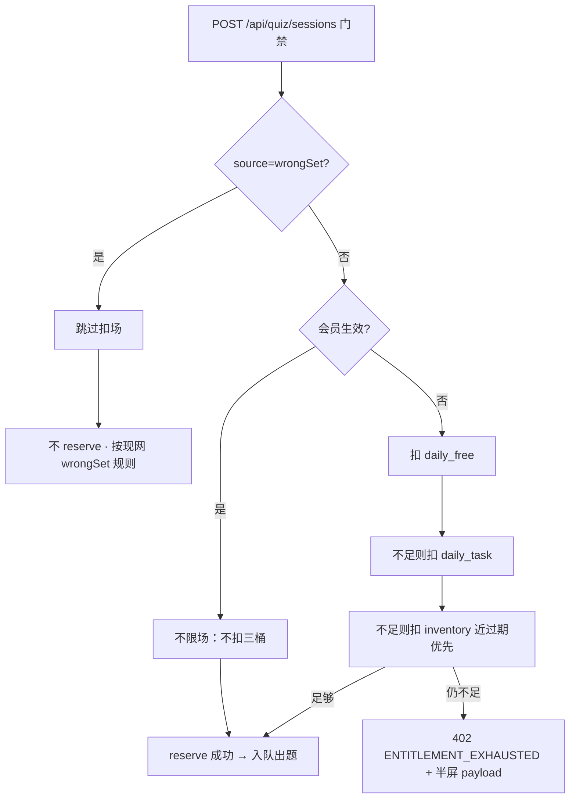
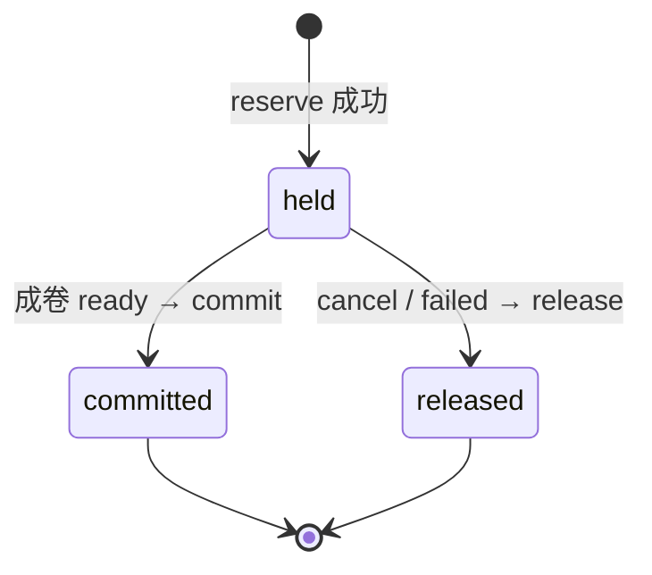

# 题刷刷 · TB-20 / C4 权益账本与出题门禁 · C 切片契约（v0.1.0-C）

| 项 | 值 |
| --- | --- |
| 性质 | **C 契约已放行**（辉本人当面确认进入完整交付） |
| 放行 | **2026-11-07 16:11**（Asia/Shanghai）· 产品经理PRD 决策卡 t170s767 |
| hui_quote | 「确认进入完整交付，Arch 出 TB-20 C4 契约」 |
| 架构版本旁注 | **v0.1.0-C**（TB-20 / 看板 C4；相对商业化架构 v0.2 + PRD v2.0.0 的本刀落地契约） |
| 依据 | 商业化架构 v0.2 · 商业化 PRD v2.0.0 · 看板规划 C4「不含支付 UI」· 议题清单（同日） |
| 已拍板并入 | **§0 硬拍板**（不可改；日免接 C5 UI 标注「可后改」） |
| 仓 | https://github.com/zh7551069/ai-tishuashua |
| 进仓约定 | 合码 PR 应落到 `docs/contracts/tb20-entitlement-C-contracts-v0.1.0-C.md`，并旁注修订 `docs/quiz.md`（门禁段）与 shared 错误码；**本任务未 push / 未合码 / 未写生产代码** |
| 本地 arch 副本 | `/Volumes/My PSSD/notion_files/题刷刷/arch/C 契约 · TB-20 权益账本与出题门禁（2026-11-07）.md` |
| 契约归属 | 架构师；**全栈不得私改路径 / 字段 / 错误码 / 四桶顺序 / 日切时区 / reserve 状态机 / 半屏 payload 而不申报** |
| 业务对接 | 题刷刷 · 业务组 |
| 合码 | **仅辉当面「合」授权** |
| 写码 | **等 Owner 点全栈**；本文件不授权开工写码、不点名 Cloud Agent |

> **放行范围**：本文件为正式 C。后端 / shared / Worker **可按本契约在 Owner 点名后开工**。**严禁**本刀引入支付 UI / 微信商户 / 统一下单 / 支付回调。不合码直至辉当面「合」。

---

## 0. 硬拍板（从架构已拍板收口 · 不可改）

| # | 拍板 | 备注 |
| --- | --- | --- |
| **H1** | **四桶**：`membership` / `daily_free` / `daily_task` / `inventory` | 无第五桶；**无 `member_quota`** |
| **H2** | **扣场顺序**：会员生效 → 不扣其余桶；否则 `daily_free` → `daily_task` → `inventory`（近过期优先） | 架构 §4.2 |
| **H3** | **1 场** = 成功「AI 开始出题」并**成卷**（会话 `status→ready`）；取消 / 失败不净扣 | 见 §4 |
| **H4** | `Session.source=wrongSet`（再练这 N 道）**不扣场** | 现网创建仍拒；门禁路径必须跳过 |
| **H5** | **懒日切**为主：业务日 = **Asia/Shanghai** 日历日；未用日免 / 当日任务奖次日 00:00 清零重计 | 先日切再扣场 |
| **H6** | **会员生效期内不限场**：不扣日免 / 任务奖 / 库存；不受后管日限影响 | 无 member_quota |
| **H7** | **ledger 只追加**；禁止直接改余额数字绕过分录 | 补发 / 作废亦走 ledger（后置切片） |
| **H8** | **inventory 近过期优先**（`expires_at` ASC NULLS LAST，其次 `created_at` ASC） | 架构拍板 #7 |
| **H9** | **日免默认 2**；本刀若已有配置键则读，否则常量 `2`；**C5 接后管 UI（可后改）** | Owner 钉死 2026-11-07 |
| **H10** | **grant**：本刀提供 service API + **测试 seed / 单测 mock**；**禁止**支付回调代码进本 PR | Owner 钉死 |
| **H11** | **Worker**：必须注册日切对账 job 钩子；可 **metrics-only / 空跑上报**（stub 可接受） | Owner 钉死 |
| **H12** | **半屏**：本刀定错误码 + **最小 JSON payload**；小程序半屏 UI 属 **C8** | Owner 钉死 |
| **H13** | **`membershipUntil` / 会员态** 与 TB-17 **`freeUserBankFirst` 正交** | Owner 钉死；见 §8 |



---

## 1. 范围与硬约束

### 1.1 做（本刀）

1. entitlement **四桶账户** + **Membership** 最小字段；migration 进仓。
2. **reserve → commit / release** 状态机；用户级锁；幂等键；挂现网 generation。
3. **懒日切**（Asia/Shanghai）+ Worker **可注册**日切对账 job（可 metrics-only）。
4. 出题前门禁：挂 `POST /api/quiz/sessions`；`wrongSet` 跳过。
5. 只读 API：`GET /api/me/entitlement`、`GET /api/me/entitlement/ledger`。
6. 用尽：`ENTITLEMENT_EXHAUSTED` + 半屏最小 payload（无小程序 UI）。
7. 账户字段 `refineLifetimeUsed`（终身累计）读写边界 + 校验钩子预留（上传提炼门禁可挂钩；**完整提炼 UI/联调不强制本刀**）。
8. 内部 service：`entitlement.reserve | commit | release | grant`；grant 仅 seed/单测可灌。
9. 接 TB-17：`isFreeUser()` 改为读真实会员态（`!isMemberActive`）；**不改**抽题算法 / 题库编排。

### 1.2 不做（本刀严禁）

| 禁项 | 归属切片 |
| --- | --- |
| 支付 UI / 微信商户 / 统一下单 / 支付回调 / `POST /orders` / `POST /pay/wx/notify` | **C7** |
| 后管 SKU / 全局配额配置页 / 用户补发·作废 UI | **C5 / C6** |
| 小程序用尽半屏 / 定价 / 加油 / Me 扩展页 / 场次明细页 / 分享·邀请页 | **C8–C13** |
| 短信登录、RAG、证书通关包、金币/广告、题库编辑器、C 端自选题库/AI | 总禁 |
| 会员降级、自动退款冲正、pending 自动发奖、`member_quota` | 架构禁 |
| 改 TB-17 抽题窗口 / `freeUserBankFirst` 默认 / 题库表结构 | TB-17 已合 |
| 开放 `wrongSet` 创建（仍 `400 VALIDATION_ERROR`「暂未开放」） | 另切片 |

### 1.3 相对现网 / TB-17 交叉引用

- 出题主路径仍是 **`POST /api/quiz/sessions`**（`docs/quiz.md`）；**禁止**臆造 `/api/generation` 新 URL。
- 会话 `QuizSessionSource` 枚举**不改**：`normal | retrain_similar | variant | wrongSet`。
- TB-17 组卷 `wrong→bank→AI` 与本刀场次账本**独立**（§8）。

---

## 2. 认证、Base、错误外壳

- Base：现网 API，前缀 `/api`。
- C 端：`Authorization: Bearer <微信用户 token>`（`docs/wechat-login.md`）。
- 错误体：现网 `{ "code": ApiErrorCode, "message": string }`；本刀用尽时**允许**附加 `details`（见 §2.2），旧客户端可忽略。
- 复用既有码：`VALIDATION_ERROR` / `UNAUTHORIZED` / `NOT_FOUND` / `PACK_UNAVAILABLE` / `LLM_*` / `QUIZ_GENERATION_FAILED` / `REDIS_UNAVAILABLE` / `DATABASE_UNAVAILABLE`。

### 2.1 新增错误码（shared `ApiErrorCode` 一次改齐）

| code | HTTP | 何时 |
| --- | --- | --- |
| **`ENTITLEMENT_EXHAUSTED`** | **402** | 非会员且三桶不足以 `reserve(1)` |
| **`ENTITLEMENT_CONFLICT`**（可选） | **409** | 同一幂等键并发冲突且无法安全合并（实现优先重试合并；仅极端路径抛） |

> HTTP **402** 钉死（Payment Required 语义对齐「需开通权益」）；若网关对 402 不友好，实现期须申报后方可改为 403，**不得静默改**。

### 2.2 半屏最小 payload（本刀定形 · UI 属 C8）

当 `code=ENTITLEMENT_EXHAUSTED` 时，响应体：

```json
{
  "code": "ENTITLEMENT_EXHAUSTED",
  "message": "今日免费场次已用完",
  "details": {
    "reason": "exhausted",
    "businessDate": "2026-11-07",
    "membershipActive": false,
    "balances": {
      "dailyFreeRemain": 0,
      "dailyTaskRemain": 0,
      "inventoryRemain": 0
    },
    "cta": [
      { "type": "member", "label": "开通会员" },
      { "type": "pack", "label": "购买加油包" },
      { "type": "task", "label": "做任务领场次" }
    ]
  }
}
```

| 字段 | 约束 |
| --- | --- |
| `details.cta[].type` | 仅 `member` \| `pack` \| `task`（本刀枚举钉死） |
| `details.cta` | 至少 1 项；推荐固定三件套顺序 member→pack→task |
| 深链 / 价格 / SKU | **本刀不带**；C8/C9 再扩 |

会员生效时**不得**返回本错误（应直接放行）。

---

## 3. 四桶模型与表（概念级 · 非正式 DDL）

> 实现可微调列类型；**不得**改对外语义、唯一性、只追加、近过期顺序。推荐迁移序号：下一可用号（如 `009_entitlement.sql`，以仓内实际为准）。

### 3.1 四桶

| 桶 | 来源（本刀） | 清零 / 过期 | 扣场优先级 |
| --- | --- | --- | --- |
| `membership` | grant seed / 未来支付 | `ends_at`；生效期不限场 | 最高：生效则不扣其余 |
| `daily_free` | 懒日切按配置发放 | 次日 00:00 Asia/Shanghai 清零重发 | 2 |
| `daily_task` | grant seed（本刀）；未来签到/分享 | 默认随日切清零 | 3 |
| `inventory` | grant seed（加油包/拉新）；Lot 分批 | 不清零；按 `expires_at`；近过期优先 | 4 |

### 3.2 `entitlement_accounts`（每用户一行）

| 字段 | 类型（概念） | 说明 |
| --- | --- | --- |
| `user_id` | uuid PK → users | |
| `business_date` | date | Asia/Shanghai 业务日锚点 |
| `daily_free_remain` | int ≥ 0 | |
| `daily_task_remain` | int ≥ 0 | |
| `refine_lifetime_used` | int ≥ 0 | 免费用户终身提炼计数；默认 0 |
| `updated_at` | timestamptz | |

- **不**在账户行存 inventory 总量（由 Lot `remain` 汇总）。
- **不**存 `membership_until` 冗余亦可；对外 API 以 Membership 表为准（账户可缓存镜像，须与 Membership 同事务一致）。

### 3.3 `entitlement_lots`（inventory 分批）

| 字段 | 类型（概念） | 说明 |
| --- | --- | --- |
| `id` | uuid PK | |
| `user_id` | uuid | |
| `bucket` | text | 本刀仅 `inventory`（预留扩展禁滥用） |
| `qty` | int | 入账总量 |
| `remain` | int ≥ 0 | 剩余 |
| `source` | text | 如 `seed` / `session_pack` / `invite` / `admin_grant` |
| `expires_at` | timestamptz NULL | 加油包默认 +365d；NULL=不过期 |
| `order_id` | text/uuid NULL | 本刀可空（无支付） |
| `created_at` | timestamptz | |

- 扣减排序：`ORDER BY expires_at ASC NULLS LAST, created_at ASC, id ASC`。
- `remain=0` 行保留（审计）；过期 Lot 不可扣（`expires_at <= now()` 跳过）。

### 3.4 `entitlement_ledger`（只追加）

| 字段 | 类型（概念） | 说明 |
| --- | --- | --- |
| `id` | uuid / bigserial PK | |
| `user_id` | uuid | |
| `delta` | int | 可负（扣）可正（发/退回） |
| `bucket` | text | `daily_free` \| `daily_task` \| `inventory` \| `membership`（会员事件 delta 可为 0 + reason） |
| `reason` | text | 见 §3.6 |
| `ref_type` | text | 如 `reservation` / `session` / `grant` / `day_roll` |
| `ref_id` | text | 幂等关联 |
| `biz_date` | date | 业务日 |
| `lot_id` | uuid NULL | inventory 分录指向 Lot |
| `created_at` | timestamptz | |

- **禁止 UPDATE/DELETE** 业务行（运维例外须审计外单）。
- 唯一建议：`(ref_type, ref_id, reason, bucket)` 或 reservation 维度唯一，防双扣。

### 3.5 `memberships`（本刀最小）

| 字段 | 类型（概念） | 说明 |
| --- | --- | --- |
| `user_id` | uuid PK | |
| `status` | text | `active` \| `expired` \| `none`（或无行=`none`） |
| `starts_at` | timestamptz NULL | |
| `ends_at` | timestamptz NULL | **`now() < ends_at` ⇒ 生效** |
| `sku_code` | text NULL | 本刀 seed 可写 `seed_member` |
| `last_order_id` | text NULL | 本刀可空 |
| `updated_at` | timestamptz | |

- `isMemberActive(user) ≡ memberships.ends_at != null && ends_at > now()`（时区：用 timestamptz 绝对时间）。
- 续费延长 / 升级补差：**本刀不实现支付路径**；grant seed 可直接写/延长 `ends_at` 供测。

### 3.6 `entitlement_reservations`（门禁挂账）

| 字段 | 类型（概念） | 说明 |
| --- | --- | --- |
| `id` | uuid PK | |
| `user_id` | uuid | |
| `session_id` | uuid UNIQUE | 与 `quiz_sessions.id` 1:1 |
| `idempotency_key` | text UNIQUE | 建议 `reserve:session:{sessionId}` |
| `status` | text | `held` \| `committed` \| `released` |
| `bucket_spent` | text NULL | 实际扣自哪一桶（会员放行则为 NULL） |
| `lot_id` | uuid NULL | inventory 时必填 |
| `qty` | int | 本刀恒 `1` |
| `created_at` / `updated_at` | timestamptz | |

### 3.7 reason 枚举（shared 一次定）

```ts
export const ENTITLEMENT_LEDGER_REASONS = [
  'daily_grant',      // 日切发放日免
  'daily_expire',     // 日切作废未用日免/任务奖
  'task_grant',       // 任务奖入账（本刀 seed）
  'inventory_grant',  // 库存入账（seed）
  'membership_grant', // 会员生效/延长（seed）
  'reserve_hold',     // 预扣（可选；若采用先改余额则记）
  'deduct',           // commit 确认扣场
  'release_restore',  // release 退回
] as const;
```

### 3.8 migration 要求

1. 建上表 + 必要索引（`ledger(user_id, created_at DESC)`、`lots(user_id, remain)`、`reservations(session_id)`）。
2. **不**回填历史用户强制日免行：首请求懒创建账户 + 日切发放。
3. shared 增：`ENTITLEMENT_EXHAUSTED`、时区常量 `BUSINESS_TZ = 'Asia/Shanghai'`、桶/reason 枚举。
4. **禁止**本迁移创建 payment / orders / wx 回调表。

---

## 4. reserve / commit / release 状态机

### 4.1 挂点（对照现网 `docs/quiz.md`）

| 时机 | 现网路径 | 本刀行为 |
| --- | --- | --- |
| 创建出题任务 | `POST /api/quiz/sessions` | 校验通过、写 session **之前或同事务**：若 `source≠wrongSet` → `reserve(1)`；不足 → **不建会话**、返 `ENTITLEMENT_EXHAUSTED` |
| 成卷成功 | Worker 将 session → `ready` | `commit(sessionId)`；ledger `deduct` |
| 取消 | `POST /api/quiz/sessions/:id/cancel` | `release(sessionId)` |
| 生成失败 | session → `failed` | `release(sessionId)` |
| 进入答题 | `POST /api/quiz/sessions/:id/start` | **不再**扣/退场次（已在 ready commit） |
| 交卷 | `POST .../submit` | **不扣场**；首刷交卷增长奖属 C13，本刀不接 |



### 4.2 规则钉死

1. **qty** 本刀仅 `1`。
2. **幂等**：`idempotency_key = reserve:session:{sessionId}`；重复 reserve 同 session → 返回已有 held/committed，不双扣。
3. **用户级锁**：`SELECT … FOR UPDATE` 账户行，或 Redis NX `entitlement:lock:{userId}`（TTL 短，建议 ≤10s）；**先日切，再 reserve**。
4. **会员生效**：reserve 成功、`bucket_spent=NULL`、**不改**三桶余额；reservation 仍建（status 可直接 `committed` 或 `held` 后 commit 空操作）——钉死：**仍建 reservation 行**便于审计；commit 为空操作写 ledger reason=`deduct` + bucket=`membership` + delta=`0`（或省略 ledger；二选一须在 PR 说明，推荐写 0 元分录便于明细「会员场」）。
5. **非会员扣减**：按 H2 顺序；inventory 拆 Lot；不足整场 → 整单失败，**不**部分预扣残留。
6. **wrongSet**：不调用 reserve；现网仍 `400 VALIDATION_ERROR`；单测锁定「若未来放开，门禁跳过」。
7. **`normal` / `retrain_similar` / `variant`**：一律走门禁（variant 1 题也计 1 场）。

### 4.3 余额可见性（held 期间）

- reserve 采用 **即时扣减余额 + held 标记**（推荐，避免超卖）：held 期间 `GET /me/entitlement` 已减；release 加回。
- 禁止「仅影子预留、余额仍显示未扣」导致并发超卖。

---

## 5. 懒日切与 Worker

### 5.1 懒日切步骤（每次进入 entitlement 写路径 / 余额读路径）

1. `today =` Asia/Shanghai 的 `YYYY-MM-DD`。
2. 若无账户行 → 创建：`business_date=today`，`daily_free_remain=dailyFreeQuota()`，`daily_task_remain=0`，ledger：`daily_grant`。
3. 若 `business_date < today` → 事务内：
   - ledger：`daily_expire`（未用日免 / 任务奖，delta=−remain）；
   - 置 `daily_free_remain=0`、`daily_task_remain=0`；
   - 再 `daily_free_remain=dailyFreeQuota()`，ledger：`daily_grant`；
   - `business_date=today`。
4. 并发：用户级锁；双请求幂等（同一用户同一 `today` 只滚一次）。
5. **inventory / membership 不参与清零**；过期 Lot 仅不可扣。

### 5.2 `dailyFreeQuota()`（§7）

见 §7。会员用户仍可滚日切（刷新日桶展示），但出题门禁会员直通。

### 5.3 Worker cron（**本刀必须有注册点**）

| 项 | 要求 |
| --- | --- |
| 模块 | `apps/worker` 下 `commerce-jobs`（或等价）可注册 |
| 建议名 | `entitlement.day-reconcile` |
| 调度 | 约 00:05 Asia/Shanghai（实现可用 cron 表达式 + 时区） |
| 本刀最小行为 | **metrics-only / 空跑上报**：打日志或指标「job ran / scanned=0 / ok」；**可不**全表改写（懒日切已覆盖正确性） |
| 禁止 | 本刀做微信账单对账、支付对账 |

---

## 6. API 与内部 service

### 6.1 `GET /api/me/entitlement`

- 认证：微信用户。
- 副作用：允许触发懒日切（读路径滚日）。
- 响应示例：

```json
{
  "businessDate": "2026-11-07",
  "timezone": "Asia/Shanghai",
  "membership": {
    "active": false,
    "startsAt": null,
    "endsAt": null,
    "skuCode": null
  },
  "balances": {
    "dailyFreeRemain": 2,
    "dailyTaskRemain": 0,
    "inventoryRemain": 0
  },
  "refine": {
    "lifetimeUsed": 0,
    "lifetimeLimitFree": 1,
    "unlimited": false
  }
}
```

- `refine.unlimited = membership.active`；免费用户 `lifetimeLimitFree=1` 钉死（架构拍板）。
- `inventoryRemain = SUM(lots.remain)` 且未过期。

### 6.2 `GET /api/me/entitlement/ledger`

- Query：`limit`（默认 20，最大 50）、`cursor`（可选，基于 `created_at+id`）。
- 响应：`{ items: LedgerItem[], nextCursor: string | null }`。
- `LedgerItem`：`id, delta, bucket, reason, refType, refId, bizDate, createdAt`。
- **只读**；不含支付订单详情。

### 6.3 generation 门禁（现网路径）

- **`POST /api/quiz/sessions`**：见 §4.1。
- 成功：201，行为与现网一致（`paper=null`，入队）。
- 用尽：402 + §2.2；**不**写 `quiz_sessions` 行。
- 取消 / 失败 release：见 §4.1。

### 6.4 内部 service（apps/api 模块，非公开 HTTP）

```ts
entitlement.ensureDay(userId): Promise<AccountView>      // 懒日切
entitlement.reserve(userId, { sessionId, qty: 1 }): Promise<Reservation>
entitlement.commit(sessionId): Promise<void>
entitlement.release(sessionId): Promise<void>
entitlement.grant(userId, GrantCommand): Promise<void>   // 本刀
entitlement.isMemberActive(userId): Promise<boolean>
entitlement.getBalances(userId): Promise<Balances>
```

#### `GrantCommand`（本刀允许的 shape）

```ts
type GrantCommand =
  | { type: 'daily_task'; qty: number; refId: string }           // 测种子
  | { type: 'inventory'; qty: number; expiresAt?: string; source: string; refId: string }
  | { type: 'membership'; endsAt: string; skuCode?: string; refId: string };
```

- **幂等**：同 `refId`+`type` 不重复加额度。
- **禁止**：HTTP 暴露 grant 给 C 端；禁止微信回调调用（C7）。
- **测试**：`NODE_ENV=test` / 专用 seed 脚本 / 单测直接调 service；可加 **仅本地** `POST /api/dev/entitlement/grant`（`WECHAT_LOGIN_MOCK` 或显式 `ENTITLEMENT_SEED=1` 门闩），**生产构建必须编译排除或 404**。

---

## 7. 日免默认（折中钉死）

| 项 | 本刀 |
| --- | --- |
| 默认值 | **`2`** |
| 读取顺序 | ① 若 `system_settings`（或未来 `commerce_config`）存在键 **`dailyFreeSessions`** 且值为正整数 → 用该值；② 否则常量 `2` |
| 本刀写配置 UI | **不做**（C5） |
| 本刀是否强制插种子行 | **不强制**；无行即常量 2 |
| 可后改 | **仅** C5 接后管配置 UI / 写 API；默认值与键名保持兼容 |

> 现网 `system_settings` 仅有 `freeUserBankFirst`（TB-17）。本刀**不**要求迁移插入 `dailyFreeSessions`；全栈可只实现常量路径 + 可选读键分支。

> **TB-21 旁注（2026-11-07）**：日免写键已由 C5 落地。值形钉死 `{ "sessions": number }`（1…99）。`dailyFreeQuota()` / `ensureDay` 读该键；缺省或非法仍回退常量 2。改配不回溯当日 `daily_free_remain`。正整数裸值和 `{ "value": n }` 仍兼容。后管路径见 TB-21 契约，不另起键名。

---

## 8. 与 TB-17 正交

| 维度 | TB-17 | TB-20（本刀） |
| --- | --- | --- |
| 关心点 | 免费用户**抽题编排**是否题库优先 | **能否出题**（场次账本） |
| 开关 | `freeUserBankFirst` | 无此开关 |
| 会员 | `isFreeUser()` 旁路抽库 | `isMemberActive` → 不限场 |
| 耦合 | 本刀将 `isFreeUser()` **接到真实会员态** | 不修改 `drawFromBank` / 避复窗口 / 入库 |

钉死：

1. `freeUserBankFirst && isFreeUser` 才抽库；会员 `isFreeUser=false` → 不抽库（与 TB-17 T5 一致）。
2. 会员不限场**只**看 Membership，**不**看 `freeUserBankFirst`。
3. 免费用户有场次但开关关 → 仍 AI 出题（TB-17）；与扣场无关。
4. 二者故障隔离：题库不足不得误报 `ENTITLEMENT_EXHAUSTED`；用尽不得改走「强制抽库」。

---

## 9. 可测验收（恰好 8 条）

1. **日免扣场**：非会员、`daily_free≥1`：`POST /api/quiz/sessions` 成功；成卷 `ready` 后 `daily_free_remain−1`；ledger 有 `deduct`（bucket=`daily_free`）。
2. **取消/失败退回**：reserve 后 `cancel` 或 `failed` → `release`；余额恢复至扣前；无净扣；ledger 有 `release_restore`（或等价可审计痕迹）。
3. **wrongSet 不扣**：门禁对 `source=wrongSet` **不调用** reserve；账户余额不变（单测可直接调门禁分支；创建 API 仍可按现网 400）。
4. **三桶耗尽**：非会员三桶均为 0 → `402 ENTITLEMENT_EXHAUSTED` + §2.2 payload；**无** `quiz_sessions` 行。
5. **会员不限场**：`ends_at>now()` → reserve 放行且三桶余额不变。
6. **跨日懒日切**：将账户 `business_date` 置为昨日且日免残留 >0；下一次 entitlement 写/读 → 日免重置为配额（默认 2）；旧残留不作可用；ledger 含 expire+grant。
7. **inventory 近过期优先**：两笔 Lot（较早 `expires_at` 与较晚）；扣 1 场只减较早 Lot（单测可证）。
8. **范围锁回归**：本 PR diff **无** 微信支付回调 / 统一下单 / `pay/wx` 路由 / 商户密钥配置代码；grant 仅 service + seed/单测（或受门闩保护的 dev 入口）。

---

## 10. 开放问题

> Owner 2026-11-07 已钉死议题清单开放项；**本刀无阻塞开放问题**。残留工程细化不阻塞开工：

| # | 项 | 状态 |
| --- | --- | --- |
| O1 | 日免配置源 | **已拍**：默认 2；可读键；C5 UI（可后改） |
| O2 | grant 灌数 | **已拍**：测试 seed / 单测；禁支付回调 |
| O3 | Worker cron | **已拍**：必有注册点；可 metrics-only |
| O4 | 半屏 payload | **已拍**：错误码 + 最小 JSON；UI→C8 |
| O5 | 与 TB-17 | **已拍**：正交；§8 |
| E1 | 会员场 ledger 是否写 delta=0 | 推荐写；PR 说明即可 |
| E2 | ready 后长期不 start 的 reservation | 已钉 commit@ready；无持有泄漏 |
| E3 | `ENTITLEMENT_CONFLICT` 是否落地 | 可选；优先锁内重试 |

---

## 11. 非目标 / 后续切片指针

| 切片 | 内容 |
| --- | --- |
| C5 | 后管全局配额 / SKU / 增长配置（含日免 UI） |
| C6 | 后管用户权益与补发/作废+审计 |
| C7 | 微信支付与订单回写 → 正式 `grant` |
| C8 | 小程序用尽半屏 UI（消费 §2.2） |
| C9–C10 | 会员定价 / 加油包页 |
| C11 | Me 会员态与用量展示 |
| C12 | 场次明细页（消费 ledger API） |
| C13 | 每日分享 + 邀请有礼 |

---

## 12. shared / 文档同步清单（合码 PR 用）

1. `packages/shared`：`ApiErrorCode.ENTITLEMENT_EXHAUSTED`（+ 可选 CONFLICT）、桶/reason/cta type、`BUSINESS_TZ`。
2. `docs/contracts/tb20-entitlement-C-contracts-v0.1.0-C.md`（本文进仓）。
3. `docs/quiz.md`：增「出题门禁」短节（挂 reserve/commit/release；链到本文）。
4. TB-17 `isFreeUser` 注释改为读 Membership。

---

*完 · 题刷刷 · TB-20 / C4 权益账本与出题门禁 · C 契约 v0.1.0-C · 2026-11-07（Asia/Shanghai）· 对齐商业化架构 v0.2 / PRD v2.0.0 · 写码不开 · 合码仅辉当面「合」*
