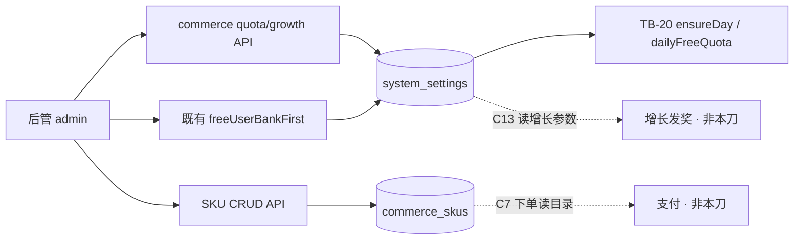

# 题刷刷 · TB-21 / C5 后管全局配额 / SKU / 增长配置 · C 切片契约（v0.1.0-C）

| 项 | 值 |
| --- | --- |
| 性质 | **C 契约已放行**（辉 t94u「开始实施商业化 v2.0.0…先规划看板再逐个实施」+ Owner 点名 TB-21 handoff） |
| 放行 | **2026-11-07**（Asia/Shanghai） |
| hui_quote | t94u「开始实施商业化 v2.0.0（含免费用户题库优先）；先规划看板任务再逐个实施」 |
| 架构版本旁注 | **v0.1.0-C**（TB-21 / 看板 C5；相对商业化架构 v0.2 + PRD v2.0.0 + TB-20 C 契约） |
| 依据 | 商业化 PRD v2.0.0 §5/§6/§8 · 商业化架构 v0.2 §9–§10 · 看板规划 C5 · TB-20 §7 日免读键 · 后管 design 包帧 `13:86`/`13:3`/`13:476`/`13:169` |
| 上游 | **TB-20 已合** `main@183865434be62296b8761e7c824107e083b68c5e` |
| 仓 | https://github.com/zh7551069/ai-tishuashua |
| 进仓约定 | 合码 PR 应落到 `docs/contracts/tb21-admin-quota-sku-growth-C-contracts-v0.1.0-C.md`；旁注修订 `docs/admin-system-settings.md`（或拆 `docs/admin-commerce-config.md`） |
| 本地 arch 副本 | `/Volumes/My PSSD/notion_files/题刷刷/arch/C 契约 · TB-21 后管全局配额SKU增长配置（2026-11-07）.md` |
| 契约归属 | 架构师；**全栈不得私改路径 / 键名 / 表字段语义 / 缓存键 / 生效时机 / SKU code 不可变性而不申报** |
| 业务对接 | 题刷刷 · 业务组 |
| 合码 | **仅辉当面「合」授权** |
| 写码 | **等 Owner 点全栈**；本文件不授权开工写码、不点名 Cloud Agent |
| UI 开工 | **须先过「UI 技术评审三行留痕」**；未过审禁前端开工 |

> **放行范围**：本文件为正式 C。后管 admin API + admin 页（配额 / SKU / 增长）可按本契约在 Owner 点名后开工。**严禁**本刀引入支付 UI / 微信商户 / 统一下单 / 支付回调 / C 端下单。不合码直至辉当面「合」。

---

## 0. 硬拍板（不可改）

| # | 拍板 | 备注 |
| --- | --- | --- |
| **H1** | **扩展现网 `system_settings` + 新建 `commerce_skus`**；不另起 `commerce_config` 表 | 标量/增长 JSON 走 settings；SKU 目录走独立表 |
| **H2** | 日免键名钉死 **`dailyFreeSessions`**（与 TB-20 §7 对齐） | 值形见 §3.1；`ensureDay`/`dailyFreeQuota()` 必须读此键 |
| **H3** | **改日免不回溯当日已发放余额**；仅影响下一次 `daily_grant`（跨日懒日切或新账户首滚） | 防运营改配瞬间改写全站 remain |
| **H4** | **无 `member_quota` / 会员日上限不可开**：设计稿「会员日上限开关」本刀 UI **永久关且禁用**；**无写 API 字段** | 对齐架构拍板「会员不限场」；勿实现开放态 |
| **H5** | **SKU `code` 创建后不可改**；改价不影响已支付订单（本刀无支付，仍写清语义） | 下单快照属 C7 |
| **H6** | **禁支付**：本 PR 无微信回调 / 统一下单 / 商户密钥 / `POST /orders` | 归 TB-23/C7 |
| **H7** | **不改 TB-20 四桶语义 / 扣场顺序 / reserve 状态机 / 时区** | 只提供配置读写与展示 |
| **H8** | **`freeUserBankFirst` 复用既有** `GET|PUT /api/admin/system-settings/freeUserBankFirst`；配额页可内嵌同一开关，**禁止**第二套键 | TB-17/TB-18 已合 |
| **H9** | 增长任务本刀只做 **配置持久化 + 后管 UI**；**不实现**签到/分享/拉新发奖 runtime（属 C13） | 配置须可被未来 growth 模块直接读取 |
| **H10** | 写操作记 **audit 行**（最小表）；审计列表 UI 仍归 TB-13/C6，本刀不做看板 | 设计稿「保存并记审计」 |
| **H11** | 样式权威：`design/后管（商业化v2.0.0）/`（或仓内 `design/bridge-export/admin-commerce-v2/` 拷贝）；**禁** `design/dev-cache` / `figma-dev-cache` / `get_design_context` | Bridge output 仅副源 |
| **H12** | 本刀 **含后管前端**；前端开工前必须有 Arch「UI 技术评审三行留痕」 | 见 §8 |



---

## 1. 范围与硬约束

### 1.1 做（本刀）

1. **全局配额**后管页（对稿 `13:86`）+ API：日免、提炼终身次数、只读时区/清零说明/扣场顺序；内嵌 `freeUserBankFirst`；会员日上限 UI 永久禁用。
2. **权益 SKU** 列表（`13:3`）+ 编辑抽屉/弹层（`13:476`）+ API：种 5 条试用价 SKU；改名/改价/有效天数/摘要/启用/推荐角标；停用；可选新建（code 唯一）。
3. **增长任务配置**页（`13:169`）+ API：签到 / 分享 / 拉新注册与首刷 / 日周封顶参数持久化。
4. `system_settings` 扩展键 + `commerce_skus` 表 migration；种子数据；短缓存失效。
5. 写路径最小 **admin_audit_logs**（或等价名）插入。
6. 导航：后管侧栏增「商业化」分组（权益 SKU / 全局配额 / 增长任务）；不拆坏既有「系统 / 免费用户题库优先」。
7. 文档：`docs/contracts/tb21-…` + admin 商业化配置说明。

### 1.2 不做（本刀严禁）

| 禁项 | 归属 |
| --- | --- |
| 支付 UI / 微信商户 / 统一下单 / 支付回调 / 订单表业务写入 | **C7 / TB-23** |
| 用户权益只读页 / 补发·作废 UI（`13:252` / `13:816`） | **C6** |
| 小程序定价 / 加油 / 用尽半屏 / Me / 分享·邀请页 | **C8–C13** |
| 增长 runtime（签到发奖、分享 token、邀请绑定、pending） | **C13** |
| 开启会员日上限 / `member_quota` | 架构禁 |
| 证书通关包 / 按证售卖 / sellable | 总禁 |
| 改四桶 / reserve / 日切时区 / wrongSet 规则 | TB-20 已合 |
| 题库编辑器、角色权限完整审计台 | 另切片 |
| 删除或破坏 TB-18 `/settings` 出题策略页（可并存；配额页可复用组件） | — |

---

## 2. 认证、Base、错误外壳

- Base：现网 `/api`。
- 鉴权：**后管 Bearer**（与 `docs/admin-login.md` / 既有 admin 路由一致）。微信用户 token → `401 UNAUTHORIZED`。
- 错误体：`{ "code": ApiErrorCode, "message": string }`。
- 复用：`VALIDATION_ERROR` / `UNAUTHORIZED` / `NOT_FOUND` / `REDIS_UNAVAILABLE` / `DATABASE_UNAVAILABLE`。
- 本刀**不**新增 C 端错误码；可选新增 admin 侧 `SKU_CODE_CONFLICT`（或统一 `VALIDATION_ERROR` + message）——推荐 **409** + 既有 `CONFLICT` 若 shared 已有，否则 `VALIDATION_ERROR`。

---

## 3. 数据模型

### 3.1 `system_settings` 扩展键（JSONB `value`）

> 表已存在（migration `008`）。本刀 **INSERT 种子** + 读写；**不**改表结构（除非缺列，则禁止）。

| key | value 形（钉死） | 默认 | 校验 |
| --- | --- | --- | --- |
| **`dailyFreeSessions`** | `{ "sessions": number }` | `{ "sessions": 2 }` | 整数 **1…99**（禁止 0：避免全站无法日免；若运营要 0 须另申报） |
| **`refineLifetimeLimitFree`** | `{ "limit": number }` | `{ "limit": 1 }` | 整数 **1…99**；本刀可改；TB-20 读侧若尚未接此键，本刀须提供 shared 读函数供后续挂接（本刀可不改提炼门禁 runtime） |
| **`growthConfig`** | 见 §3.2 | §3.2 默认 | 整包校验 |
| `freeUserBankFirst` | 既有 `{ "enabled": boolean }` | `false` | **不改**契约；配额页复用 |

**禁止**写入：`memberDailyCapEnabled` / `memberDailyCap`（无键；UI 只读示意）。

#### 读取兼容（TB-20）

```ts
// dailyFreeQuota() 读取顺序（与 TB-20 §7 兼容并钉死实现）
// 1) system_settings.key='dailyFreeSessions' 且 value.sessions 为正整数 → 用它
// 2) 否则常量 2
```

若 TB-20 合入时尚为「可选读键」，本刀 **必须** 落地读函数并让 `ensureDay` 走该函数（单测锁：改 sessions=3 后新账户日免=3）。

### 3.2 `growthConfig` 默认与字段

```json
{
  "checkin": { "enabled": true, "rewardSessions": 1 },
  "share": {
    "enabled": true,
    "rewardSessions": 1,
    "memberRefineBonus": 1
  },
  "invite": {
    "registerEnabled": true,
    "inviterRegisterSessions": 1,
    "inviteeWelcomeSessions": 1,
    "firstSubmitEnabled": true,
    "inviterFirstSubmitSessions": 3,
    "inviteeFirstSubmitSessions": 2,
    "dailyCapEnabled": true,
    "dailyCapSessions": 6,
    "weeklyCapEnabled": true,
    "weeklyCapSessions": 15
  }
}
```

| 字段 | 校验 |
| --- | --- |
| 所有 `*Sessions` / `*CapSessions` / `memberRefineBonus` | 整数 **0…99**（0=关奖但保留开关语义由 `enabled` 表达；推荐奖励用 ≥0） |
| `enabled` 类 | boolean |
| 未知字段 | PUT 拒绝（`VALIDATION_ERROR`） |
| 缺字段 | PUT 拒绝；GET 无行时返回默认（200） |

> 说明：`memberRefineBonus` 对应设计「会员改发提炼次」；会员提炼本已不限——配置仍存，C13 可决定仅展示或跳过；本刀不解释 runtime。

### 3.3 `commerce_skus`（新建）

| 字段 | 类型（概念） | 说明 |
| --- | --- | --- |
| `code` | text PK | 如 `member_week`；**创建后不可 UPDATE** |
| `type` | text | `member` \| `session_pack` |
| `name` | text | 展示名 |
| `price_fen` | int ≥ 0 | 试用价（分）；PRD 元×100 |
| `duration_days` | int NULL | 会员必填；加油包 NULL |
| `sessions` | int NULL | 仅 `session_pack`；会员 NULL |
| `summary` | text | C 端权益摘要 |
| `enabled` | boolean | 默认 true |
| `recommended` | boolean | 推荐角标；默认 false（月卡 true） |
| `sort_order` | int | 列表排序；种子给定 |
| `created_at` / `updated_at` | timestamptz | |
| `updated_by` | text NULL | 后管用户名 |

约束：

- `type=member` ⇒ `duration_days NOT NULL` AND `sessions IS NULL`
- `type=session_pack` ⇒ `sessions NOT NULL AND sessions≥1` AND `duration_days IS NULL`（有效期文案用默认购后 365 天，见 H 生效说明；可选列 `inventory_expire_days int DEFAULT 365`——**推荐加列**，默认 365，仅 pack 有意义）

**推荐列**：`inventory_expire_days int NULL`（pack 默认 365；member NULL）。

### 3.4 种子 SKU（migration 必须）

| code | type | name | price_fen | duration_days | sessions | summary（可微调文案） | recommended |
| --- | --- | --- | --- | --- | --- | --- | --- |
| `member_week` | member | 会员 · 周卡 | 1200 | 7 | — | 不限场 · 全上架证 | false |
| `member_month` | member | 会员 · 月卡（荐） | 2800 | 30 | — | 不限场 · 全上架证 | **true** |
| `member_quarter` | member | 会员 · 季卡 | 6800 | 90 | — | 不限场 · 全上架证 | false |
| `member_year` | member | 会员 · 年卡 | 19800 | 365 | — | 不限场 · 全上架证 | false |
| `session_pack_5` | session_pack | 场次加油包 ×5 | 600 | — | 5 | +5 场库存 · 跨日不清零 | false |

`ON CONFLICT (code) DO NOTHING`。

### 3.5 `admin_audit_logs`（最小 · 新建）

| 字段 | 说明 |
| --- | --- |
| `id` | uuid / bigserial |
| `actor` | 后管用户名 |
| `action` | 如 `commerce.quota.update` / `commerce.growth.update` / `commerce.sku.update` / `commerce.sku.create` / `commerce.sku.disable` |
| `target` | 如 `dailyFreeSessions` / `growthConfig` / `sku:member_month` |
| `before` / `after` | jsonb |
| `created_at` | timestamptz |

本刀**不**做审计列表 API/UI（可仅 INSERT）。

### 3.6 migration 要求

1. 下一可用号（如 `010_commerce_admin_config.sql`）。
2. 建 `commerce_skus` + 种子 5 行；建 `admin_audit_logs`。
3. `INSERT` settings 种子：`dailyFreeSessions`、`refineLifetimeLimitFree`、`growthConfig`（`ON CONFLICT DO NOTHING`）。
4. **禁止**创建 payment / orders / wx 表。

---

## 4. 后管 API

### 4.1 全局配额

#### `GET /api/admin/commerce/quota`

响应 200：

```json
{
  "dailyFreeSessions": 2,
  "timezone": "Asia/Shanghai",
  "timezoneReadonly": true,
  "refineLifetimeLimitFree": 1,
  "aiReviewSummary": "unlimited",
  "memberDailyCap": { "enabled": false, "sessions": null, "uiLocked": true },
  "clearingRuleText": "未使用日免 → 次日 00:00 Asia/Shanghai 清零并重发。当日签到/分享未用场次一并清零。拉新/加油包跨日库存不清零。",
  "deductOrderText": "1) 会员不限场生效 → 不扣其余桶\n2) 当日日免剩余\n3) 当日签到/分享奖励\n4) 拉新/加油包跨日库存（近过期优先）\n「再练这 N 道」不扣场；取消/失败不扣。",
  "updatedAt": "2026-11-07T08:00:00.000Z",
  "updatedBy": "admin"
}
```

- `timezone` / 文案字段服务端常量，**客户端不可改**。
- `memberDailyCap.uiLocked=true` 钉死；忽略客户端任何开启企图。

#### `PUT /api/admin/commerce/quota`

```json
{ "dailyFreeSessions": 3, "refineLifetimeLimitFree": 1 }
```

| 规则 | |
| --- | --- |
| 允许字段 | **仅** `dailyFreeSessions`、`refineLifetimeLimitFree` |
| 其它字段 | 出现 → `400 VALIDATION_ERROR` |
| 成功 | 200，响应同 GET；写 audit；删缓存 |
| 重置 | `POST /api/admin/commerce/quota/reset` → 恢复默认 2 / 1（可选；若做，须 audit）。设计有「重置为默认」——**本刀应实现** |

### 4.2 增长配置

#### `GET /api/admin/commerce/growth`

- 200：返回 §3.2 完整对象 + `updatedAt` / `updatedBy`。
- 无行 → 200 + 默认（不强制先 INSERT，或 migration 已种）。

#### `PUT /api/admin/commerce/growth`

- Body = §3.2 完整对象（全量替换，禁止局部 patch 半包——避免缺字段）。
- 校验见 §3.2；成功 200 + audit + 删缓存。
- `POST /api/admin/commerce/growth/reset` → 默认包（应实现）。

### 4.3 SKU

#### `GET /api/admin/commerce/skus`

| Query | |
| --- | --- |
| `type` | 可选 `member` \| `session_pack` |
| `status` | 可选 `enabled` \| `disabled`（或 `all` 默认） |
| 分页 | 本刀 SKU≤数十；**可不分页**；若分页：`limit` 默认 50 |

响应：`{ "items": Sku[] }`。

`Sku`：

```json
{
  "code": "member_month",
  "type": "member",
  "name": "会员 · 月卡（荐）",
  "priceFen": 2800,
  "priceYuan": 28,
  "durationDays": 30,
  "sessions": null,
  "inventoryExpireDays": null,
  "summary": "不限场 · 全上架证",
  "enabled": true,
  "recommended": true,
  "sortOrder": 20,
  "updatedAt": "...",
  "updatedBy": "admin"
}
```

> `priceYuan` 可为服务端派生（`priceFen/100`）方便对稿；写入以 **`priceFen`** 为准。

#### `GET /api/admin/commerce/skus/:code`

- 200 / `404 NOT_FOUND`。

#### `POST /api/admin/commerce/skus`

- Body：`code, type, name, priceFen, durationDays?, sessions?, inventoryExpireDays?, summary, enabled?, recommended?, sortOrder?`
- `code`：`^[a-z][a-z0-9_]{1,63}$`；冲突 → 409/VALIDATION
- 成功 201 + audit

#### `PUT /api/admin/commerce/skus/:code`

- **禁止** body 含 `code` 或改 code；含则 400。
- 可改：`name, priceFen, durationDays, sessions, inventoryExpireDays, summary, enabled, recommended, sortOrder`（类型不可改）。
- 成功 200 + audit。

#### `POST /api/admin/commerce/skus/:code/disable`（或 PUT `enabled:false`）

- 停用；已购权益不影响（本刀无订单，文档声明）。
- 启用：`POST .../enable` 或 PUT `enabled:true`。

### 4.4 既有出题策略（复用 · 不改路径）

- `GET|PUT /api/admin/system-settings/freeUserBankFirst` 保持 TB-18 契约。
- 配额页内嵌开关时 **只调此 API**，禁止平行键。

### 4.5 缓存与生效时机

| 配置 | 缓存键（建议） | TTL | PUT 后 | 对 TB-20 / 未来模块生效 |
| --- | --- | --- | --- | --- |
| `dailyFreeSessions` | `sysset:dailyFreeSessions` | 60s | **DEL 必须**（失败策略对齐 freeUserBankFirst：`503 REDIS_UNAVAILABLE`，DB 已写） | **热生效读路径**；但 **不改写** 用户当日 `daily_free_remain`；下一次 `daily_grant` 用新值 |
| `growthConfig` | `sysset:growthConfig` | 60s | DEL | 本刀无 runtime；C13 读时热生效 |
| `refineLifetimeLimitFree` | `sysset:refineLifetimeLimitFree` | 60s | DEL | 提炼门禁挂接后热读；本刀可不改 runtime |
| SKU 列表 | `commerce:skus:v1`（可选） | 60s | DEL | C7/C9 读目录；本刀 admin GET 可直读 DB |

无 `REDIS_URL`：与 TB-18 一样跳过缓存、直读 DB。

---

## 5. 与 TB-20 耦合点

| 点 | 要求 |
| --- | --- |
| `dailyFreeQuota()` | 必须读 `dailyFreeSessions.sessions`；默认 2 |
| 四桶 / 顺序 / 会员旁路 | **只读展示**于配额页；代码路径不改 |
| 日切时区 | 固定 `Asia/Shanghai`；UI 只读 |
| `refineLifetimeLimitFree` | TB-20 响应里 `lifetimeLimitFree` 今日为常量 1；本刀落配置后，**允许** follow-up 小 PR 把读改为配置（可同 PR 若改动面小）；**不得**改会员 `unlimited` 语义 |
| `freeUserBankFirst` | 正交；配额页展示但不改 TB-17 抽题 |
| grant / reserve | 本刀不调用扣场；SKU/增长配置不直接 grant |

**回归锁**：改日免为 3 后：

1. 老用户当日 remain 不变；
2. 将 `business_date` 置昨日再 `ensureDay` → 新日免=3；
3. 新用户首滚=3。

---

## 6. UI 技术约束（含前端）

### 6.1 对稿帧（必须覆盖）

| 帧 | 内容 | 路由建议 |
| --- | --- | --- |
| **`13:86`** | 全局配额 | `/commerce/quota` |
| **`13:3`** | 权益 SKU 列表 | `/commerce/skus` |
| **`13:476`** | SKU 编辑弹层/抽屉 | 同上页内 |
| **`13:169`** | 增长任务配置 | `/commerce/growth` |

### 6.2 样式源

1. 权威：`/Volumes/My PSSD/notion_files/题刷刷/design/后管（商业化v2.0.0）/`（`index.html` + `styles.css` + `svgs/`）。
2. 开工包：拷入仓 `design/bridge-export/admin-commerce-v2-20261107/`（或等价日期目录）。
3. **禁** `design/dev-cache`、`figma-dev-cache`、`get_design_context`。
4. Bridge `Figma-Bridge-main/output/` 仅副源；冲突以 design 包为准。

### 6.3 交互钉死

| 页 | 交互 |
| --- | --- |
| 配额 / 增长 | **表单 +「保存并记审计」**（非即时逐字段 PUT）；「重置为默认」二次确认 |
| SKU | 筛选 Tab：全部 / 会员 / 加油包 / 已停用；行内编辑 / 停用；新建 |
| 出题策略卡 | 可即时 GET/PUT（复用 TB-18 组件行为） |
| 会员日上限 | 开关关 + disabled；字段「—」 |
| 时区 / 清零 / 扣场顺序 | 只读说明，无输入 |

### 6.4 导航

侧栏新增分组 **「商业化」**（文案可对稿「权益 · v2.0.0」）：

- 权益 SKU → `/commerce/skus`
- 全局配额 → `/commerce/quota`
- 增长任务 → `/commerce/growth`

**本刀不做**：用户权益 / 补发作废入口可灰置或省略（C6）。

现网「系统 / 免费用户题库优先」**保留**。

### 6.5 UI 技术评审（开工门禁）

前端写码前，Arch 须出 **三行留痕**（结论 / 必改 / 建议），对照四帧 + 本契约 §6；**未过审禁前端开工**。后端 API/migration 可在 Owner 点全栈后与评审并行，但 **合码前** UI 评审须通过或声明「本 PR 仅 API」。

---

## 7. 可测验收（恰好 8 条）

1. **日免读写联动**：`PUT /api/admin/commerce/quota` `{dailyFreeSessions:3}` → GET=3；新用户 `ensureDay` 后 `daily_free_remain=3`；audit 有行。
2. **日免不回溯**：用户当日已有 remain=2；改配额为 5 后同一 `business_date` 再读余额仍为 2；将 `business_date` 置昨日再滚日 → 日免变为 5。
3. **SKU 种子与改价**：列表含 5 个种子 code；`PUT .../member_month` 改 `priceFen` 成功且 `code` 不可变；GET 反映新价。
4. **SKU 停用**：disable 后 `enabled=false`；列表 `status=disabled` 可筛出。
5. **增长配置**：`PUT growth` 改 `checkin.rewardSessions=2` → GET=2；reset 回 1；非法字段 400。
6. **freeUserBankFirst 复用**：配额页（或同 PR 集成测试）PUT 既有 settings 路径仍绿；**无**第二键写入。
7. **鉴权**：无后管 Bearer 或微信 token 调 commerce admin API → `401 UNAUTHORIZED`。
8. **范围锁**：PR diff **无** 微信支付回调 / 统一下单 / `pay/wx` / 商户密钥；无 C 端支付页；无补发/作废业务 API。

---

## 8. 开放问题

> **阻塞开放问题：0**。

| # | 项 | 状态 |
| --- | --- | --- |
| O1 | 会员日上限 | **已拍**：UI 永久锁定关；无 API |
| O2 | 日免改配是否改当日余额 | **已拍**：不回溯（H3） |
| O3 | 增长 runtime | **已拍**：本刀只配置；C13 实施 |
| O4 | 提炼 limit 是否本刀挂 TB-20 读路径 | **非阻塞**：推荐同 PR 小改 shared 读函数；不做也可，E1 |
| E1 | `refine.lifetimeLimitFree` 读配置 | 工程细化 |
| E2 | SKU `priceYuan` 派生 vs 只返回分 | 派生可选 |
| E3 | 审计列表 API | C6/TB-13 |
| E4 | C 端公开 SKU 目录 API | C7/C9；本刀仅 admin |

---

## 9. 非目标 / 后续指针

| 切片 | 内容 |
| --- | --- |
| C6 | 用户权益 + 补发/作废 + 审计台 |
| C7 | 微信支付与订单回写（读 SKU 快照） |
| C8–C12 | 小程序商业化页 |
| C13 | 增长 runtime 读本刀 `growthConfig` |

---

## 10. shared / 文档同步清单（合码 PR）

1. shared：`dailyFreeSessions` / `growthConfig` / SKU 类型与校验；**勿**把 Node SQL 经 browser barrel 导出（对齐 PR#52 教训）。
2. `docs/contracts/tb21-admin-quota-sku-growth-C-contracts-v0.1.0-C.md`。
3. `docs/admin-commerce-config.md`（新建）或扩写 `docs/admin-system-settings.md` 交叉链接。
4. TB-20 契约旁注：日免 UI/写键已由 C5 落地。

---

*完 · 题刷刷 · TB-21 / C5 后管全局配额·SKU·增长配置 · C 契约 v0.1.0-C · 2026-11-07（Asia/Shanghai）· 对齐商业化架构 v0.2 / PRD v2.0.0 / TB-20 · 写码不开 · 合码仅辉当面「合」*
