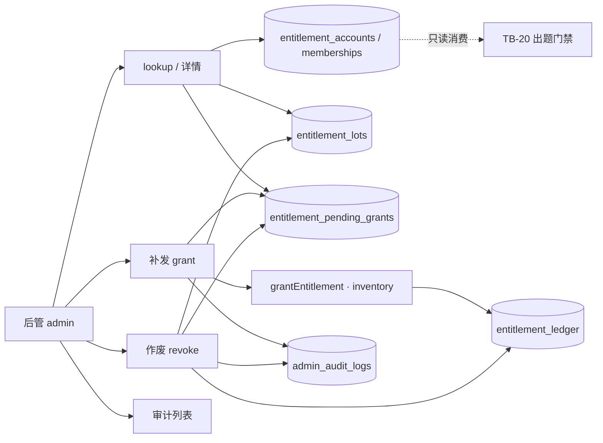

# 题刷刷 · TB-22 / C6 后管用户权益与补发·作废 · C 切片契约（v0.1.0-C）

| 项 | 值 |
| --- | --- |
| 性质 | **C 契约已放行**（辉 t94u「开始实施商业化 v2.0.0…」整线进 C + Owner 点名 TB-22/C6 handoff） |
| 放行 | **2026-11-07**（Asia/Shanghai） |
| hui_quote | 产品经理PRD t94u「开始实施商业化v2.0.0（包含免费用户题库优先功能）的代码开发」 |
| 架构版本旁注 | **v0.1.0-C**（TB-22 / 看板 C6；相对商业化 PRD v2.0.0 + TB-20/TB-21 C 契约） |
| 依据 | 商业化 PRD v2.0.0 §6.3/§8 · 看板规划 C6 · 后管 design 包帧 `13:252`/`13:816` · TB-20 四桶账本 · TB-21 `admin_audit_logs` |
| 上游 | **TB-20 已合**（权益账本）· **TB-21 已合** `main@00daf28e`（配额/SKU/增长 + 审计表） |
| 仓 | https://github.com/zh7551069/ai-tishuashua |
| 进仓约定 | 合码 PR 应落到 `docs/contracts/tb22-admin-entitlement-grant-revoke-C-contracts-v0.1.0-C.md`；旁注修订 `docs/admin-commerce-config.md`（或新建 `docs/admin-entitlement-ops.md`） |
| 本地 arch 副本 | `/Volumes/My PSSD/notion_files/题刷刷/arch/C 契约 · TB-22 后管用户权益与补发作废（2026-11-07）.md` |
| 契约归属 | 架构师；**全栈不得私改路径 / 四桶语义 / ledger 只追加 / 禁直接改余额 / 会员 ends_at 只读 / 禁支付 而不申报** |
| 业务对接 | 题刷刷 · 业务组 |
| 合码 | **仅辉当面「合」授权** |
| 写码 | **等 Owner 点全栈**；本文件不授权开工写码、不点名 Cloud Agent |
| UI 开工 | **须先过「UI 技术评审三行留痕」**；未过审禁前端开工 |

> **放行范围**：本文件为正式 C。后管 admin API + admin 页（用户权益只读 / 补发 / 作废 / 商业化审计列表）可按本契约在 Owner 点名后开工。**严禁**本刀引入支付 UI / 微信商户 / 统一下单 / 支付回调 / C 端购买页 / 改 `memberships.ends_at`。不合码直至辉当面「合」。

---

## 0. 硬拍板（不可改）

| # | 拍板 | 备注 |
| --- | --- | --- |
| **H1** | **禁止直接改余额数字**；补发 / 作废必须走 **ledger 分录** + **`admin_audit_logs`** | 对齐 design 文案与 TB-20 H7 |
| **H2** | **复用** TB-20 `grantEntitlement` 入账；本刀 UI **只允许补发入 `inventory`（跨日库存）** | 弹层「入桶」钉死 inventory；不开放 daily_free / membership 写 |
| **H3** | **会员态只读展示**（`active` / `endsAt` / `skuCode`）；**禁止**本刀改 `ends_at` / 续费 / 退款 | 归订单流 · TB-23/C7 |
| **H4** | **作废对象**：① `entitlement_lots` 且 `remain>0` 的可用库存批次；② `entitlement_pending_grants` 且 `status=pending` | 日免 / 当日任务奖行展示可只读，**无作废按钮**（对稿「—」） |
| **H5** | 作废库存批次 = 将 `remain→0` + ledger **`admin_revoke`**（`delta=−原 remain`）+ audit；**不可**数字回滚，仅可再补发新批次 | 部分已消耗批次只作废剩余 |
| **H6** | **待发放（pending）** 落独立表 `entitlement_pending_grants`；本刀提供读 + 人工通过（补发）/ 作废；**写入方属 C13**（本刀可测种子） | PRD「风控待发放一律人工」 |
| **H7** | ledger reason **扩展** `admin_revoke`；补发仍用既有 `inventory_grant`（`source` 建议 `admin_grant` / 或 pending 来源码） | 须改 migration CHECK + shared 枚举 |
| **H8** | **禁支付 / 微信商户 / 统一下单 / 回调 / C 端下单** | 归 **TB-23 / C7** |
| **H9** | **不改** TB-20 四桶语义 / 扣场顺序 / reserve 状态机 / 日切时区；**不改** TB-21 配额·SKU·增长写路径 | 只消费账本与审计表 |
| **H10** | 样式权威：`design/后管（商业化v2.0.0）/`；对稿 **`13:252` / `13:816`**；**禁** `design/dev-cache` / `figma-dev-cache` / `get_design_context` | Bridge 仅副源 |
| **H11** | 本刀 **含后管前端**；前端开工前必须有 Arch「UI 技术评审三行留痕」 | 见 §8 |
| **H12** | 商业化 **审计列表 API+页** 本刀最小交付；全站 `/system/audit`（TB-13）仍可占位 | TB-21 H10 已声明列表归 C6 |



---

## 1. 范围与硬约束

### 1.1 做（本刀）

1. **用户权益页**（对稿 `13:252`）+ API：按昵称 / 脱敏手机 / openId / userId 查询；展示会员态、四桶摘要、待发放数、待发放/库存批次表。
2. **补发弹层**（对稿 `13:816`）+ API：数量 + 入桶（固定 inventory）+ **原因必填** → ledger + audit。
3. **作废**：单行 / 「作废选中」；原因必填；库存批次或 pending。
4. **pending 表** migration + 读/决议 API（C13 写入约定见 §3.3）。
5. **商业化审计列表**（页顶「审计」+ 路由 `/commerce/audit`）：读 `admin_audit_logs`（含 TB-21 已有配置写与本刀补发/作废）。
6. shared：扩展 `admin_revoke`；提供 `revokeInventoryLot`（或等价）纯函数/服务；**禁止** browser barrel 引入 `node:`。
7. 导航：侧栏「用户权益」由 TB-21 灰置改为可点 → `/commerce/entitlements`。
8. 文档进仓约定路径见文首。

### 1.2 不做（本刀严禁）

| 禁项 | 归属 |
| --- | --- |
| 支付 UI / 微信商户 / 统一下单 / 支付回调 / 订单业务写入 | **C7 / TB-23** |
| 改会员 `ends_at` / 退款冲正 / 升级补差 | 订单流 |
| 增长 runtime（签到发奖、分享、邀请绑定、自动写 pending） | **C13** |
| 小程序用尽半屏 / 定价 / 加油 / Me / 明细 | **C8–C12** |
| 直接 `UPDATE` 账户 remain / lot.remain **不写 ledger** | 架构禁 |
| 证书通关包 / sellable / 题库编辑器 | 总禁 |
| 完整 RBAC / 全站审计台打磨 | **TB-13**（本刀仅商业化审计最小列表） |
| 开启会员日上限 / `member_quota` | 架构禁 |

---

## 2. 认证、Base、错误外壳

- Base：现网 `/api`。
- 鉴权：**后管 Bearer**（`AdminSessionGuard`）；微信用户 token → `401 UNAUTHORIZED`。
- 错误体：`{ "code": ApiErrorCode, "message": string }`。
- 复用：`VALIDATION_ERROR` / `UNAUTHORIZED` / `NOT_FOUND` / `ENTITLEMENT_CONFLICT` / `DATABASE_UNAVAILABLE` / `REDIS_UNAVAILABLE`（本刀无强依赖 Redis）。
- 本刀**不**新增 C 端错误码；admin 业务冲突统一 **409** + `ENTITLEMENT_CONFLICT` 或 `VALIDATION_ERROR`（见 §4.6）。

---

## 3. 数据模型

### 3.1 复用（只读 / 经 ledger 写）

| 表 | 本刀用法 |
| --- | --- |
| `entitlement_accounts` | 读余额；补发/作废经 shared 服务改 remain（禁止裸 SQL 改数） |
| `entitlement_lots` | 列表；作废 `remain→0` |
| `entitlement_ledger` | 只追加；补发 `inventory_grant`；作废 `admin_revoke` |
| `memberships` | **只读** |
| `users` | 查询：`id` / `nick` / `phone_masked` / `wx_open_id` |
| `admin_audit_logs` | INSERT + 列表读（TB-21 已建） |
| `commerce_skus` | 可选：展示会员 sku 名；不写 |

### 3.2 ledger reason 扩展

现网 CHECK / shared 枚举追加：

```ts
'admin_revoke'  // 后管作废库存剩余；delta < 0；bucket = inventory
```

补发：**不**新增 reason；继续 `inventory_grant` + `ref_type='grant'`（与 `grantEntitlement` 幂等键一致）。

### 3.3 `entitlement_pending_grants`（新建）

| 字段 | 类型（概念） | 说明 |
| --- | --- | --- |
| `id` | uuid PK | |
| `user_id` | uuid → users | |
| `qty` | int ≥ 1 | 待发场次数 |
| `source` | text | 如 `invite_first_submit` / `invite_register`；展示「来源」 |
| `risk_code` | text NULL | 如 `daily_cap` / `weekly_cap` / `self_invite` |
| `risk_text` | text | 展示「原因 / 风控」 |
| `status` | text | `pending` \| `granted` \| `voided` |
| `related_ref` | text NULL | C13 幂等/业务引用 |
| `grant_lot_id` | uuid NULL | 通过后指向新 lot |
| `resolved_by` | text NULL | 后管用户名 |
| `resolved_at` | timestamptz NULL | |
| `created_at` | timestamptz | |

约束：

- `status` CHECK 如上三态。
- 部分唯一建议：`UNIQUE (user_id, related_ref) WHERE related_ref IS NOT NULL`（防 C13 重复 pending）；若实现困难可退化为应用层幂等并在 PR 说明。
- **本刀不实现** C13 写入路径；migration 建表即可；单测 INSERT 种子。

### 3.4 `admin_audit_logs` action 约定（本刀）

| action | target 示例 | after 要点 |
| --- | --- | --- |
| `commerce.entitlement.grant` | `user:{userId}` | `{ qty, bucket:"inventory", lotId, reason, pendingId? }` |
| `commerce.entitlement.revoke_lot` | `lot:{lotId}` | `{ userId, beforeRemain, afterRemain:0, reason }` |
| `commerce.entitlement.void_pending` | `pending:{id}` | `{ userId, qty, reason }` |
| （既有）`commerce.quota.*` / `commerce.sku.*` / `commerce.growth.*` | — | 列表一并展示 |

`before`/`after` 为 jsonb；**原因文案必须进入 after.reason**（或并列 `note` 字段于 after）。

### 3.5 migration 要求

1. 下一可用号（如 `011_entitlement_admin_ops.sql`）。
2. 扩展 `entitlement_ledger` reason CHECK：加入 `admin_revoke`（`ALTER` 掉旧约束再加新约束）。
3. 建 `entitlement_pending_grants` + 索引 `(user_id, status, created_at DESC)`。
4. **禁止**创建 payment / orders / wx 表；**禁止**改四桶账户语义列。

---

## 4. 后管 API

> 均需后管会话。路径钉死在 `admin/commerce` 下，与 TB-21 同模块或邻接 controller。

### 4.1 用户查找

#### `GET /api/admin/commerce/entitlements/lookup?q={text}&limit={n}`

| 项 | 规则 |
| --- | --- |
| `q` | 必填；trim 后长度 1…128 |
| 匹配 | **精确** `users.id`（uuid）· **精确** `wx_open_id` · `phone_masked` ILIKE · `nick` ILIKE |
| `limit` | 默认 10，最大 20 |
| 成功 | 200 `{ "items": LookupItem[] }` |
| 空 | 200 `items: []`（非 404） |

`LookupItem`：

```json
{
  "userId": "…",
  "nick": "阿辉",
  "phoneMasked": "138****1201",
  "openIdMasked": "ox8f…a91c",
  "status": "active"
}
```

- **不得**返回完整 `wx_open_id`（对稿脱敏）；内部精确匹配可用全量列。
- 既有 `GET /api/admin/users` **可不改**；本查找独立，避免破坏「列表不回 openId」约定。

### 4.2 用户权益详情

#### `GET /api/admin/commerce/entitlements/:userId`

- 副作用：允许触发 **懒日切**（与 TB-20 读路径一致），保证日免数字正确。
- 用户不存在 → `404 NOT_FOUND`。
- 200 响应：

```json
{
  "user": {
    "userId": "…",
    "nick": "阿辉",
    "phoneMasked": "138****1201",
    "openIdMasked": "ox8f…a91c",
    "status": "active"
  },
  "membership": {
    "active": true,
    "startsAt": "…",
    "endsAt": "2026-12-01T00:00:00.000Z",
    "skuCode": "member_month",
    "skuName": "会员 · 月卡（荐）"
  },
  "businessDate": "2026-11-07",
  "timezone": "Asia/Shanghai",
  "balances": {
    "dailyFreeRemain": 2,
    "dailyFreeQuota": 2,
    "dailyTaskRemain": 1,
    "inventoryRemain": 8,
    "pendingQty": 3
  },
  "entries": [
    {
      "kind": "pending",
      "id": "…",
      "sourceLabel": "邀请·首刷",
      "bucket": null,
      "qty": 3,
      "remain": 3,
      "status": "pending",
      "riskText": "日封顶超限",
      "expiresAt": null,
      "actions": ["grant", "void"]
    },
    {
      "kind": "lot",
      "id": "…",
      "sourceLabel": "加油包×5",
      "bucket": "inventory",
      "qty": 5,
      "remain": 5,
      "status": "available",
      "riskText": "order_8821",
      "expiresAt": "2027-10-20T00:00:00.000Z",
      "actions": ["void"]
    },
    {
      "kind": "daily_task",
      "id": "synthetic:daily_task",
      "sourceLabel": "分享领场",
      "bucket": "daily_task",
      "qty": 1,
      "remain": 1,
      "status": "today",
      "riskText": "share_open",
      "expiresAt": null,
      "expiresLabel": "今日 24:00 清零",
      "actions": []
    }
  ]
}
```

| 规则 | |
| --- | --- |
| `entries` 排序 | pending（新→旧）→ lots（`remain>0` 且未过期优先，再 `remain=0` 可选省略）→ 若 `dailyTaskRemain>0` 追加一条合成行 |
| `lot.status` | `available`（remain>0 且未过期）\| `exhausted`（remain=0）\| `expired` |
| 过期 lot | `expires_at <= now()` → `expired`；**不可作废**（无余额可收） |
| 日免 | 摘要区展示 `dailyFreeRemain / dailyFreeQuota`；**不**进 entries 作废行 |
| `skuName` | 由 `commerce_skus` 左连；缺失则 null |

### 4.3 补发（grant）

#### `POST /api/admin/commerce/entitlements/:userId/grant`

```json
{
  "qty": 3,
  "bucket": "inventory",
  "reason": "风控待发放人工通过：邀请首刷日封顶误伤",
  "pendingId": null,
  "expiresAt": null,
  "idempotencyKey": "optional-client-key"
}
```

| 规则 | |
| --- | --- |
| `qty` | 整数 **1…999** |
| `bucket` | **必须** `"inventory"`；其它 → 400 |
| `reason` | 必填；trim 后 1…500 字 |
| `pendingId` | 可选；若给：该 pending 须 `status=pending` 且同 user；成功后标 `granted` 并写 `grant_lot_id`；`qty` **必须等于** pending.qty（防篡改） |
| `expiresAt` | 可选 ISO；默认 **null=不过期** |
| `idempotencyKey` | 可选；映射 `grantEntitlement.refId`；缺省服务端生成 `admin:{actor}:{uuid}` |
| 实现 | 调 `grantEntitlement({ type:'inventory', qty, source: pending? pending.source : 'admin_grant', expiresAt?, refId })` |
| 成功 | **200**（幂等重放亦 200）+ 详情摘要 `{ applied, lotId, balances, entry }`；写 audit `commerce.entitlement.grant` |
| 幂等 | 同 `refId` 已存在 ledger → `applied:false`，**不**双加；若带 `pendingId` 且已 granted → 200 幂等 |

### 4.4 作废（revoke / void）

#### `POST /api/admin/commerce/entitlements/:userId/revoke`

```json
{
  "targets": [
    { "kind": "lot", "id": "…" },
    { "kind": "pending", "id": "…" }
  ],
  "reason": "误发回收"
}
```

| 规则 | |
| --- | --- |
| `targets` | 1…50；同 user |
| `reason` | 必填 1…500 |
| `kind=lot` | `remain>0` 且未过期；`UPDATE remain=0`；ledger `admin_revoke` delta=`−beforeRemain`，`ref_type='admin_revoke'`，`ref_id=lot:{id}:{ts或uuid}`（每次作废唯一）；`lot_id` 指向该批 |
| `kind=pending` | `status=pending` → `voided`；**无** ledger 余额分录（尚未入账） |
| 禁止 | `kind=daily_task` / 改会员；targets 跨用户 |
| 部分失败 | **整单事务**：任一条非法 → 全滚 + 400/409；禁止半成功 |
| 成功 | 200 `{ "revoked": [...], "balances": {...} }` + 每条 audit |

单行 UI「作废」= `targets` 长度 1；「作废选中」= 多选 lots/pending。

### 4.5 审计列表

#### `GET /api/admin/commerce/audit`

| Query | |
| --- | --- |
| `page` | 默认 1 |
| `pageSize` | 默认 20，最大 50 |
| `actor` | 可选精确 |
| `actionPrefix` | 可选，如 `commerce.entitlement` / `commerce.`（默认 **`commerce.`**，只列商业化） |
| `userId` | 可选；匹配 `target` 含 `user:{id}` 或 after.userId |
| `from` / `to` | 可选 ISO，滤 `created_at` |

响应：

```json
{
  "items": [
    {
      "id": 12,
      "actor": "hui",
      "action": "commerce.entitlement.grant",
      "target": "user:…",
      "before": null,
      "after": { "qty": 3, "reason": "…" },
      "createdAt": "…"
    }
  ],
  "page": 1,
  "pageSize": 20,
  "total": 100
}
```

- **只读**；无更新/删除 API。
- 页顶「审计」可深链本接口并带当前 `userId`。

### 4.6 错误码表（本刀）

| 场景 | HTTP | code |
| --- | --- | --- |
| 未登录 / 非后管 | 401 | `UNAUTHORIZED` |
| 校验失败（缺原因、bucket 非法、qty） | 400 | `VALIDATION_ERROR` |
| 用户不存在 | 404 | `NOT_FOUND` |
| lot/pending 不存在或不属于该用户 | 404 | `NOT_FOUND` |
| lot 已无剩余 / 已过期 / pending 非 pending | 409 | `ENTITLEMENT_CONFLICT` |
| 幂等冲突极端不可合并 | 409 | `ENTITLEMENT_CONFLICT` |
| DB 挂 | 503 | `DATABASE_UNAVAILABLE` |

---

## 5. 对 UI 约束（帧映射）

### 5.1 路由与帧

| 帧 | 路由 / 组件 | API |
| --- | --- | --- |
| **`13:252`** 用户权益 | `/commerce/entitlements` | lookup + GET `:userId` |
| **`13:816`** 补发弹层 | 页内 Modal | POST `…/grant` |
| 作废确认 | 页内 Confirm（可复用弹层结构） | POST `…/revoke` |
| 审计 | 页顶按钮 → 抽屉 **或** `/commerce/audit` | GET `…/audit` |

侧栏：商业化分组增加 **用户权益**（启用）；与 SKU / 配额 / 增长并列。

### 5.2 `13:252` 字段 ↔ API

| 设计 | API 字段 |
| --- | --- |
| 搜索框「昵称 / 脱敏手机 / openid / userId」 | `lookup?q=` |
| 用户标题「阿辉 · u_…」 | `user.nick` + 短 id |
| 脱敏手机 · openId 片段 | `phoneMasked` / `openIdMasked` |
| 会员生效中 / 月卡至日期 | `membership.active` / `endsAt` + `skuName` |
| 会员「不限场」 | `membership.active` 时展示，非可写 |
| 今日日免剩余 `2/2` | `dailyFreeRemain` / `dailyFreeQuota` |
| 今日任务奖 | `dailyTaskRemain` |
| 跨日库存 | `inventoryRemain` |
| 待发放 | `pendingQty` |
| 表：来源/桶/数量/状态/原因·风控/过期/操作 | `entries[]` |
| 「补发场次」 | 打开 `13:816`；无选 pending 时 `pendingId=null` |
| 行内「补发」（pending） | grant 带 `pendingId` |
| 行内「作废」/「作废选中」 | revoke |
| 脚注：弹窗须原因；会员只读；续费走订单 | 文案固化；控件禁改 ends_at |

### 5.3 `13:816` 补发弹层

| 设计 | 约束 |
| --- | --- |
| 标题「补发场次 · 需审计」 | 固定 |
| 用户行 | 只读展示当前用户 |
| 补发数量（场） | → `qty`；整数 ≥1 |
| 入桶 | **只读**展示 `inventory（跨日库存）`；请求体仍传 `bucket:"inventory"` |
| 原因（必填） | 空禁止提交 |
| 「确认补发并记审计」 | POST grant；成功关闭并刷新详情 |
| 「确认后不可撤销数字回滚…」 | 文案保留 |

**禁**：支付控件、改价、改会员到期、选 daily_free 桶。

---

## 6. 非功能

| 项 | 要求 |
| --- | --- |
| 鉴权 | 后管会话；无细粒度角色（与现网一致）；TB-13 RBAC 不阻塞 |
| 审计不可篡改 | 无 UPDATE/DELETE API；DB 角色亦不授删（文档声明） |
| 幂等 | grant：`refId`/`idempotencyKey`；revoke：同 pending/lot 已终态 → 409 或幂等 200（pending 已 voided 推荐 409 明示） |
| 事务 | grant/revoke 与 audit INSERT **同事务** |
| 限流 | 沿用后管全局限流即可；建议 grant/revoke 额外收紧（如 30/min/actor）——实现可选，契约不强制独立中间件 |
| 可观测 | 结构化日志：`actor, userId, action, lotId/pendingId, qty`；勿打完整 openId |
| shared barrel | **禁** `node:crypto` 进 browser 包；UUID 用现网已有策略（TB-21 已守） |
| 隐私 | 响应仅脱敏手机 / 掩码 openId |

---

## 7. 可测验收（≤8）

1. **A1 查找与只读详情**：用 nick / phone_masked / openId / userId 均可命中；详情余额与 TB-20 `GET /me/entitlement` 同用户一致（允许日切后对齐）；会员 `endsAt` 只读。
2. **A2 补发入库存**：`POST …/grant` qty=3 → 新 lot `remain=3`、`source` 含 admin/pending 来源；ledger `inventory_grant`；`admin_audit_logs` 有 `commerce.entitlement.grant` 且 after.reason 非空；账户 `inventoryRemain+3`。
3. **A3 补发幂等**：同 `idempotencyKey` 连发两次 → 仅一笔余额增加；第二次 `applied=false`（或等价），无双 lot。
4. **A4 作废库存批次**：对 remain=5 的 lot revoke → remain=0；ledger `admin_revoke` delta=−5；audit `revoke_lot`；再 revoke 同 lot → 409。
5. **A5 pending 通过 / 作废**：种子 pending → grant 带 `pendingId` 后 status=`granted` 且库存增加；另一 pending void → status=`voided`、库存不变、无正 delta ledger。
6. **A6 禁面**：请求 `bucket:"daily_free"` 或 body 含改 `endsAt` → 400；PR diff **无** 支付/wx 商户/统一下单路由。
7. **A7 审计列表**：`GET …/audit?actionPrefix=commerce.` 可见 TB-21 配置写与本刀补发/作废；`userId` 过滤有效；无写接口。
8. **A8 门禁回归**：补发后非会员用户可 `reserve` 消耗新库存；作废后余额不足得到 `402 ENTITLEMENT_EXHAUSTED`（单测或 http 测）；不破坏 wrongSet 不扣场。

---

## 8. UI 技术评审门禁

- 前端开工前：Arch 对照本契约 §5 + design `13:252`/`13:816` 出**三行留痕**（结论 / 必改 / 建议），必改=0 方可开工。
- 样式源：仅 `design/后管（商业化v2.0.0）/`（及仓内 bridge-export 拷贝）；禁 dev-cache / `get_design_context`。
- 写码：等 **Owner 点全栈**；合码仅辉当面「合」。

---

## 9. 开放问题 / 阻塞

| # | 状态 | 说明 |
| --- | --- | --- |
| — | **阻塞 = 0** | 无须辉当场拍板项 |

**非阻塞备忘（实现可选，勿反向阻塞）**：

- E1：审计抽屉 vs 独立 `/commerce/audit` 页 — 两者都可；契约要求 API 必有，UI 至少一种入口。
- E2：`entries` 是否展示 `remain=0` 历史 lot — 默认**不展示**，可用查询参数 `includeExhausted=1` 扩展（非本刀必做）。
- E3：C13 写入 pending 的 `related_ref` 格式 — 留给 C13 契约；本刀只读/决议。

---

## 10. 与上下游切片

| 切片 | 关系 |
| --- | --- |
| TB-20 / C4 | 账本与 `grantEntitlement`；本刀扩展 revoke |
| TB-21 / C5 | `admin_audit_logs`、侧栏商业化分组；本刀启用「用户权益」 |
| TB-23 / C7 | 支付与订单回写会员/库存；本刀不改 ends_at |
| C13 | 增长 runtime 写 pending；本刀人工处理 |
| TB-13 | 全站审计/RBAC；本刀仅 `commerce.*` 最小列表 |

---

## 11. 版本与落盘

| 副本 | 路径 |
| --- | --- |
| Box | `/workspace/tishuashua-tb22-admin-entitlement-grant-revoke-C-contracts-v0.1.0-C.md` |
| 外盘 arch | `/Volumes/My PSSD/notion_files/题刷刷/arch/C 契约 · TB-22 后管用户权益与补发作废（2026-11-07）.md` |
| 进仓约定 | `docs/contracts/tb22-admin-entitlement-grant-revoke-C-contracts-v0.1.0-C.md`（全栈合码 PR 带入；**本任务不 push**） |

**版本**：`v0.1.0-C`  
**日期**：2026-11-07（Asia/Shanghai）

---

*完 · TB-22 / C6 C 切片契约 v0.1.0-C · 架构师 Arch · 不合码 · 不点全栈 · 前端须另过 UI 技术评审*
