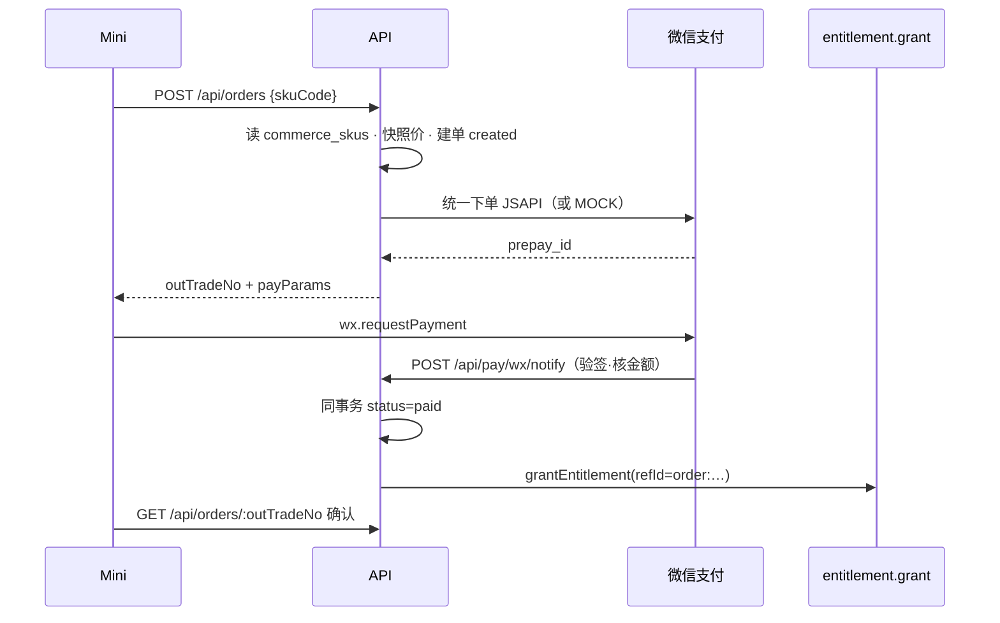

# 题刷刷 · TB-23 / C7 微信支付与订单回写 · C 切片契约（v0.1.0-C）

| 项 | 值 |
| --- | --- |
| 性质 | **C 契约已放行**（辉 t94u「开始实施商业化 v2.0.0…」整线进 C + Owner 点名 TB-23/C7 handoff） |
| 放行 | **2026-11-07**（Asia/Shanghai） |
| hui_quote | 产品经理PRD t94u「开始实施商业化v2.0.0（包含免费用户题库优先功能）的代码开发」 |
| 架构版本旁注 | **v0.1.0-C**（TB-23 / 看板 C7；相对商业化架构 v0.2 §6 + PRD v2.0.0 + TB-20/21/22 C 契约） |
| 依据 | 商业化 PRD v2.0.0 §3.1/§2#9/#14/§5.5/§7 · 商业化架构 v0.2 §6 · 看板规划 C7 · TB-20 `grantEntitlement` · TB-21 `commerce_skus` |
| 上游 | **TB-20 已合**（四桶账本 + grant）· **TB-21 已合**（SKU）· **TB-22 已合** `main@0fa0f03a` |
| 仓 | https://github.com/zh7551069/ai-tishuashua |
| 进仓约定 | 合码 PR 应落到 `docs/contracts/tb23-wechat-pay-order-C-contracts-v0.1.0-C.md`；旁注修订 `docs/payment.md`（新建）与 `.env.example`（**仅变量名**） |
| 本地 arch 副本 | `/Volumes/My PSSD/notion_files/题刷刷/arch/C 契约 · TB-23 微信支付与订单回写（2026-11-07）.md` |
| 契约归属 | 架构师；**全栈不得私改路径 / 订单状态机 / 金额以服务端 SKU 为准 / 回调验签 / grant 同事务 / 密钥入库禁令 而不申报** |
| 业务对接 | 题刷刷 · 业务组 |
| 合码 | **仅辉当面「合」授权** |
| 写码 | **等 Owner 点全栈**；本文件不授权开工写码、不点名 Cloud Agent |
| UI 开工 | **本刀以后端为主，无 UI 必评帧**；若 PR 夹带小程序支付页（对稿 `122:4`/`122:6`），须先另做 Arch「UI 技术评审三行留痕」 |

> **放行范围**：本文件为正式 C。支付 / 订单 / 回调 / 入账服务可按本契约在 Owner 点名后开工。**严禁**密钥真值入库、手改余额、跳过订单直接加权益、微信退款自动冲正。不合码直至辉当面「合」。

---

## 0. 硬拍板（不可改）

| # | 拍板 | 备注 |
| --- | --- | --- |
| **H1** | **金额以服务端 `commerce_skus.price_fen`（或升级询价结果）为准**；客户端不得传应付金额；回调须校验 `amount.total == order.amount_fen` | 防篡改 |
| **H2** | **支付成功入账必须**同事务：`orders.status→paid` + 调用 TB-20 **`grantEntitlement`**；禁止裸 SQL 改余额 / 直接 UPDATE `ends_at` 绕过 grant | 覆盖 TB-20 时代「支付勿调 grant」注释——**C7 正式授权回调履约调用 grant** |
| **H3** | **幂等**：`out_trade_no` 唯一；回调按 `out_trade_no`（及 `wx_transaction_id`）去重；已 `paid` 重复回调 → **成功 ACK、不再次 grant** | grant `refId = order:{out_trade_no}` |
| **H4** | **密钥 / 商户证书 / APIv3 key 仅环境变量或密钥挂载**；`.env.example` 与契约 / PR / 日志 **只写变量名**；严禁真值入库 | 见 §5 |
| **H5** | **会员降级禁止**；续费延长 `ends_at`；升级补差价（公式 §4.5） | 对齐 PRD #9 |
| **H6** | **退款一律人工**；本刀 **不**调微信退款 API、**不**自动冲正权益；加油包未使用也不自动退 | 对齐 PRD #14；退款工单表可建但执行非本刀 |
| **H7** | **不改** TB-20 四桶 / reserve / 日切；**不改** TB-21 SKU 写路径语义；下单只读 `enabled=true` 的 SKU 并快照价 | |
| **H8** | 本刀 **支付/API 为主**；小程序定价/加油 UI 归 **C9/C10**；后管订单只读列表为本刀可选最小交付 | 见 §6 |
| **H9** | 本地 / CI 必须可走 **`WECHAT_PAY_MOCK`** 全路径（下单→mock 回调→入账），不依赖真实商户 | 对齐登录 mock 门闩风格 |
| **H10** | JSAPI 支付：`payer.openid` = 当前用户 `users.wx_open_id`；AppId 复用 `WECHAT_APP_ID`（或显式 `WECHAT_PAY_APP_ID` 覆盖） | |



---

## 1. 范围与硬约束

### 1.1 做（本刀）

1. **`commerce_orders`** migration（建议 `012_commerce_orders.sql`）+ 可选 **`commerce_refund_tickets`** 空壳（status 仅 `open`，无执行器）。
2. C 端：**SKU 只读目录**、**创建订单+预下单**、**查单**、**升级询价**、**微信支付回调**。
3. 履约：`paid` → `grantEntitlement`（会员 / 加油包）；写 `memberships.last_order_id`；inventory lot 回填 `order_id`。
4. 安全：回调验签、金额校验、日志脱敏、mock 门闩、`.env.example` 变量名。
5. 单测 / http 测：mock 回调入账、重复回调、错签、降级拒绝、续费延长、加油包入库存。
6. 文档：`docs/payment.md` + 本契约进仓约定路径。
7. （可选）后管 **`GET /api/admin/commerce/orders`** 只读列表（无退款按钮）。

### 1.2 不做（本刀严禁）

| 禁项 | 归属 |
| --- | --- |
| 小程序会员定价页 / 加油包页 / 用尽半屏 / Me / 明细 UI | **C8–C12**（须 UI 技术评审） |
| 微信退款 API、自动冲正、按比例退 | 后置；人工工单 |
| Worker 日拉微信账单对账（可留 job 名 stub） | 后置 |
| 手改余额 / 跳过订单直接 grant 给真实支付路径 | 架构禁 |
| 密钥真值写入仓 / PR / 契约示例 | 安全禁 |
| 证书通关包 / sellable / 金币广告 / 短信登录 | 总禁 |
| 增长签到/分享/拉新 runtime | **C13** |
| 后管改 SKU 价影响**已创建订单**快照 | 已快照钉死 |

---

## 2. 认证、Base、错误外壳

- Base：现网 `/api`。
- C 端下单 / 查单 / 询价 / SKU 目录：`Authorization: Bearer <微信用户 token>`。
- **回调** `POST /api/pay/wx/notify`：**无**用户 Bearer；依赖微信平台签名（或 mock 头）。
- 后管订单列表：后管 Bearer。
- 错误体：`{ "code": ApiErrorCode, "message": string }`。
- 复用：`VALIDATION_ERROR` / `UNAUTHORIZED` / `NOT_FOUND` / `FORBIDDEN` / `DATABASE_UNAVAILABLE` / `REDIS_UNAVAILABLE` / `WECHAT_NOT_CONFIGURED` / `ENTITLEMENT_CONFLICT`。
- **本刀新增**（shared `ApiErrorCode` 一次改齐）：

| code | HTTP | 何时 |
| --- | --- | --- |
| **`PAY_NOT_CONFIGURED`** | **503** | 未配商户且未开 `WECHAT_PAY_MOCK` |
| **`PAY_SKU_UNAVAILABLE`** | **409** | SKU 不存在 / `enabled=false` |
| **`PAY_DOWNGRADE_FORBIDDEN`** | **409** | 会员降档 |
| **`PAY_AMOUNT_MISMATCH`** | **400** | 回调金额 ≠ 订单快照（回调路径也可直接失败 ACK 策略见 §4.4） |
| **`PAY_SIGN_INVALID`** | **401** | 回调验签失败 |
| **`PAY_ORDER_STATE`** | **409** | 非法状态迁移（如对 `paid` 再预下单） |

> 回调对微信侧：验签失败返回 **非 2xx** / 失败 JSON（按微信 APIv3 约定）；业务已处理成功须 **2xx**，避免无限重试。实现选一种并在 `docs/payment.md` 写清。

---

## 3. 数据模型

### 3.1 `commerce_orders`（新建）

| 字段 | 类型（概念） | 说明 |
| --- | --- | --- |
| `id` | uuid PK | 内部 id |
| `out_trade_no` | text UNIQUE | 商户订单号；≤32；建议 `t`+紧凑时间+随机 |
| `user_id` | uuid → users | |
| `sku_code` | text | 下单时 SKU code（不可因后管改名而变） |
| `sku_type` | text | `member` \| `session_pack` 快照 |
| `order_kind` | text | `purchase` \| `renew` \| `upgrade` |
| `amount_fen` | int ≥ 0 | **应付快照**（分） |
| `currency` | text | 钉死 `CNY` |
| `status` | text | 见 §3.3 |
| `price_snapshot` | jsonb | 下单时 SKU 全量快照（name/priceFen/durationDays/sessions/inventoryExpireDays/summary…） |
| `upgrade_from_sku` | text NULL | 仅 upgrade |
| `upgrade_quote` | jsonb NULL | 询价明细快照（remainingDays / remainingValueFen / payFen） |
| `wx_prepay_id` | text NULL | |
| `wx_transaction_id` | text NULL UNIQUE | 微信支付单号；paid 后必填（mock 可用 `mock_tx_…`） |
| `payer_openid` | text NULL | 下单时用户 openid 快照 |
| `paid_at` | timestamptz NULL | |
| `closed_at` | timestamptz NULL | |
| `client_idempotency_key` | text NULL | 客户端防重；与 user 部分唯一 |
| `fail_reason` | text NULL | |
| `created_at` / `updated_at` | timestamptz | |

建议唯一：

- `UNIQUE (out_trade_no)`
- `UNIQUE (wx_transaction_id) WHERE wx_transaction_id IS NOT NULL`
- `UNIQUE (user_id, client_idempotency_key) WHERE client_idempotency_key IS NOT NULL`

索引：`(user_id, created_at DESC)`、`(status, created_at)`。

### 3.2 状态机

```text
created → prepay → paid
                 → closed   （超时关单 / 用户放弃；本刀可提供关单或预下单失败回落）
                 → failed   （微信下单失败）
paid →（预留）refunding → refunded   ## 本刀不实现迁移写出路径
```

| 规则 | |
| --- | --- |
| **禁止** `paid` 回退到 `prepay`/`created` | |
| `prepay` 可重复拉起支付（同 `out_trade_no` 刷新 `prepay_id` 允许，须幂等） | |
| 仅 `created`/`prepay` 可被 mock/真实回调置 `paid` | |
| 已 `paid` 再回调 → no-op 成功 | |

### 3.3 `commerce_refund_tickets`（可选最小）

| 字段 | 说明 |
| --- | --- |
| `id` | uuid |
| `order_id` | → commerce_orders |
| `user_id` | |
| `reason` | text |
| `status` | 本刀仅 `open`（执行 / 同意 / 驳回后置） |
| `created_at` | |

本刀 **可不**暴露创建工单 API；建表即可。禁止本刀调用微信退款。

### 3.4 与权益表关系

| 表 | 支付履约 |
| --- | --- |
| `commerce_skus` | 下单只读 `enabled`；价与权益字段写入 `price_snapshot` |
| `memberships` | 经 `grantEntitlement({type:'membership', endsAt, skuCode, refId})`；另 `UPDATE last_order_id` |
| `entitlement_lots` | 经 grant inventory；履约后 `UPDATE order_id = out_trade_no`（列已在 TB-20） |
| `entitlement_ledger` | grant 只追加；`ref_type=grant`，`ref_id=order:{out_trade_no}` |

> 现网 `grantEntitlement` 会员分支用 `GREATEST(ends_at)`。支付层须算好最终 `endsAt` 再传入（见 §4.5），与现实现兼容。

---

## 4. API 契约

### 4.1 `GET /api/commerce/skus`

- 认证：微信用户。
- Query：`type?=member|session_pack`。
- 行为：只返回 **`enabled=true`**，按 `sort_order ASC, code ASC`。
- 响应：`{ items: CommerceSkuPublic[] }`（含 `code,type,name,priceFen,priceYuan,durationDays,sessions,inventoryExpireDays,summary,recommended`；**无** `updatedBy`）。
- 可短缓存（复用 `COMMERCE_SKUS_CACHE_KEY` 思路）；后管改 SKU 已有失效则共享。

### 4.2 `POST /api/orders`

- 认证：微信用户。
- Body：

```json
{
  "skuCode": "member_month",
  "orderKind": "purchase",
  "clientIdempotencyKey": "optional-uuid"
}
```

| 字段 | 规则 |
| --- | --- |
| `skuCode` | 必填；须存在且 enabled |
| `orderKind` | 默认：无有效会员 → `purchase`；有有效会员且同档/更长 → `renew`；更高档 → 须显式 `upgrade` 或自动判为 upgrade；**降档 → 409 `PAY_DOWNGRADE_FORBIDDEN`** |
| `clientIdempotencyKey` | 可选；同用户重复提交返回同一订单 |

- 金额：
  - `purchase` / `renew`：`amount_fen = sku.price_fen`
  - `upgrade`：`amount_fen = upgrade_quote.pay_fen`（须先能算出与 §4.5 一致；也可要求客户端先调询价，服务端仍重算）
- 流程：建单 `created` → 调微信统一下单（或 mock）→ 写 `wx_prepay_id` → `prepay` → 返回：

```json
{
  "id": "…",
  "outTradeNo": "t…",
  "status": "prepay",
  "amountFen": 2800,
  "skuCode": "member_month",
  "orderKind": "purchase",
  "payParams": {
    "timeStamp": "…",
    "nonceStr": "…",
    "package": "prepay_id=…",
    "signType": "RSA",
    "paySign": "…"
  }
}
```

- Mock：`payParams` 可为占位；客户端测可用 dev mock-notify。
- 未配置支付且未 mock → `503 PAY_NOT_CONFIGURED`。
- `session_pack`：`orderKind` 仅 `purchase`（无 renew/upgrade 语义）。

### 4.3 `GET /api/orders/:outTradeNo`

- 认证：微信用户；**仅本人**订单。
- 响应：订单摘要（`outTradeNo,status,amountFen,skuCode,orderKind,paidAt,createdAt,membership?` 不回传商户密钥）。

### 4.4 `GET /api/orders`

- 认证：微信用户。
- Query：`limit`（默认 20，最大 50）、`cursor`。
- 本人订单分页；只读。

### 4.5 `POST /api/orders/upgrade-quote`

- 认证：微信用户。
- Body：`{ "targetSkuCode": "member_year" }`。
- 前置：当前 `isMemberActive`；目标 type=member、enabled；目标档位 **严格高于** 当前档（见档位序）。
- **档位序（钉死）**：`member_week(7) < member_month(30) < member_quarter(90) < member_year(365)`；比较 `duration_days`，相等则不可 upgrade（视为同档 → 走 renew）。
- **差价公式（钉死可测）**：

```text
remainingDays = max(0, ceil((ends_at - now) / 86400s))
remainingValueFen = floor(current.price_fen * remainingDays / current.duration_days)
payFen = max(0, target.price_fen - remainingValueFen)
```

- 响应：`{ currentSkuCode, targetSkuCode, remainingDays, remainingValueFen, payFen, currency:"CNY" }`。
- 无有效会员 → `409` + 提示走 purchase。

### 4.6 `POST /api/pay/wx/notify`

- **无**用户认证。
- 验签：微信 APIv3（平台证书 / 序列号头）；失败 → `PAY_SIGN_INVALID` 语义（HTTP 按微信要求）。
- 解析 `out_trade_no`、`transaction_id`、`amount.total`、`trade_state`。
- `trade_state=SUCCESS` 时：
  1. 锁订单行；
  2. 校验 `amount.total == order.amount_fen`；否则记 `fail_reason`、**不**入账、响应失败（或告警表）；
  3. 若已 `paid` → 直接成功 ACK；
  4. 同事务：`status=paid`、`paid_at=now`、`wx_transaction_id=…` + **履约 grant**（§4.7）；
  5. ACK 成功。
- 微信重试：必须幂等。
- **Mock**：当 `WECHAT_PAY_MOCK` 开启，允许 `POST /api/dev/pay/mock-notify`（见 §4.8）注入等价履约；**生产编译路径须 404**。

### 4.7 履约 grant（同事务）

| sku_type / kind | grant |
| --- | --- |
| `session_pack` | `{ type:'inventory', qty: snapshot.sessions, source:'session_pack', expiresAt: paid_at + inventoryExpireDays(默认365)d, refId:'order:'+out_trade_no }`；成功后 `lots.order_id=out_trade_no` |
| `member` + `purchase` | `endsAt = paid_at + duration_days`；`skuCode`；refId 同上 |
| `member` + `renew` | `base = max(current.ends_at ?? paid_at, paid_at)`；`endsAt = base + duration_days`；`skuCode` 更新为本单（同档或更长） |
| `member` + `upgrade` | `endsAt = paid_at + target.duration_days`（**满档重算**；差价已折旧剩余）；`skuCode=target` |

另：`memberships.last_order_id = out_trade_no`（会员单）。

> 禁止支付路径调用 admin 补发 API；只走 shared `grantEntitlement`。

### 4.8 `POST /api/dev/pay/mock-notify`（仅非生产）

- 门闩：与 entitlement seed 同风格——`NODE_ENV≠production` 且 `WECHAT_PAY_MOCK`∈{`true`,`1`}。
- Body：`{ "outTradeNo": "…" }`（可选 `transactionId`）。
- 行为：跳过微信验签，按 §4.6 成功路径履约。
- 生产：路由不注册或恒 404。

### 4.9 （可选）`GET /api/admin/commerce/orders`

- 后管 Bearer。
- Query：`userId?` / `outTradeNo?` / `status?` / `limit` / `cursor`。
- 只读；**无**退款按钮、**无**改状态。

---

## 5. 安全与环境变量（名 only · 无真值）

### 5.1 环境变量清单

| 变量名 | 用途 | 备注 |
| --- | --- | --- |
| `WECHAT_APP_ID` | 小程序 AppId（JSAPI） | 已有；可复用 |
| `WECHAT_PAY_APP_ID` | 可选覆盖支付 AppId | 空则用 `WECHAT_APP_ID` |
| `WECHAT_PAY_MCH_ID` | 商户号 | |
| `WECHAT_PAY_MCH_SERIAL_NO` | 商户 API 证书序列号 | |
| `WECHAT_PAY_PRIVATE_KEY_PATH` | 商户私钥文件路径 | **优先 path**；容器密钥挂载 |
| `WECHAT_PAY_PRIVATE_KEY` | 可选 PEM 正文 | 与 PATH 二选一；勿写入仓库 |
| `WECHAT_PAY_API_V3_KEY` | APIv3 密钥 | 解密回调资源 |
| `WECHAT_PAY_NOTIFY_URL` | 公网回调 URL | 须 HTTPS |
| `WECHAT_PAY_PLATFORM_CERT_PATH` | 平台证书（验签） | 或实现期自动拉取并缓存 |
| `WECHAT_PAY_MOCK` | `true`/`1` 开 mock | 默认关；生产禁开 |
| `WECHAT_PAY_ENABLED` | 可选总开关 | 缺省：配齐商户或 mock 即视为可下单 |

`.env.example` **只追加空赋值行与注释**；示例值不得伪造「看起来真」的 key 材料。

### 5.2 其它安全钉死

1. 回调验签失败不得入账。
2. 日志：脱敏 `paySign` / 私钥 / APIv3 key / 证书；订单号可留。
3. HTTPS 通知 URL；本地 mock 不依赖公网。
4. `shared` browser barrel **不得**引入微信支付 SDK / `node:fs` 读私钥；支付客户端放 `apps/api`。
5. 客户端传的任何 `amountFen` **忽略**。

---

## 6. 对 UI 约束

| 帧 / 页 | 本刀 |
| --- | --- |
| 小程序 `122:4` 会员定价、`122:6` 加油包、`122:3` 用尽半屏 | **非本刀 UI**；仅提供 API。C9/C10/C8 对稿；**须另 UI 技术评审**后方可前端开工 |
| 后管订单列表 | 无 design 必评帧；若做只读表，跟现网 admin 表格风格即可，**不**阻断本刀后端 |
| 本刀结论 | **无 UI 必评帧**；纯 API 可在 Owner 点全栈后开工 |

---

## 7. 可测验收（≤8）

| # | 验收 |
| --- | --- |
| **A1** | Mock：购买 `member_month` → 回调成功 → `orders.paid` + `memberships` 生效且 `ends_at≈paid_at+30d` + ledger `membership_grant` 且 `ref_id=order:…` |
| **A2** | Mock：购买 `session_pack_5` → inventory `remain=5` + `order_id` 回填 + ledger `inventory_grant` |
| **A3** | 同一 `out_trade_no` **重复回调** → 仍 2xx，权益 **不双发**（余额/lot/ends_at 不变） |
| **A4** | 错签 / 伪造回调 → **拒绝**，订单保持非 paid，无 grant |
| **A5** | 回调金额 ≠ 快照 → **拒绝入账** |
| **A6** | 有效周卡用户下单年卡 upgrade：询价 `payFen` 符合 §4.5；支付后 `sku_code=member_year` 且 `ends_at=paid_at+365d` |
| **A7** | 有效年卡用户下单周卡 → **`PAY_DOWNGRADE_FORBIDDEN`**；续费同档月卡 → `ends_at` 延长 |
| **A8** | 仓内 / `.env.example` **无**商户私钥·APIv3·证书真值；缺配且未 mock 时下单 → `PAY_NOT_CONFIGURED` |

---

## 8. 门禁与交付

1. **写码**：等 Owner 点全栈（Cloud Agent）；本契约不点名。
2. **合码**：仅辉当面「合」。
3. **UI**：本刀无必评帧；若夹带 C 端支付页 → 先 UI 技术评审。
4. **进仓**：`docs/contracts/tb23-wechat-pay-order-C-contracts-v0.1.0-C.md` + `docs/payment.md`（实现 PR 带上；本任务不 push）。
5. **生产商户**：真实收款另需辉侧完成微信商户号 / 小程序支付目录配置——**不阻塞本契约与 mock 开发**；上线前检查清单写入 `docs/payment.md`。

---

## 9. 阻塞 / 开放问题

| # | 项 | 状态 |
| --- | --- | --- |
| — | — | **阻塞 0** |

非阻塞备注（实现自决，勿回头问辉除非要改公式）：

- 预下单超时自动 `closed` 的 TTL（建议 2h）可在 PR 说明。
- 平台证书自动下载 vs 文件挂载：优先 env path，自动拉取可做。
- 升级「满档重算」已钉死；若产品改「保留折算天数叠加」须新开契约修订。

---

## 10. 版本

- **v0.1.0-C** · 2026-11-07（Asia/Shanghai）
- 取代关系：无既有 TB-23 契约；对齐并落地架构 v0.2 §6。
