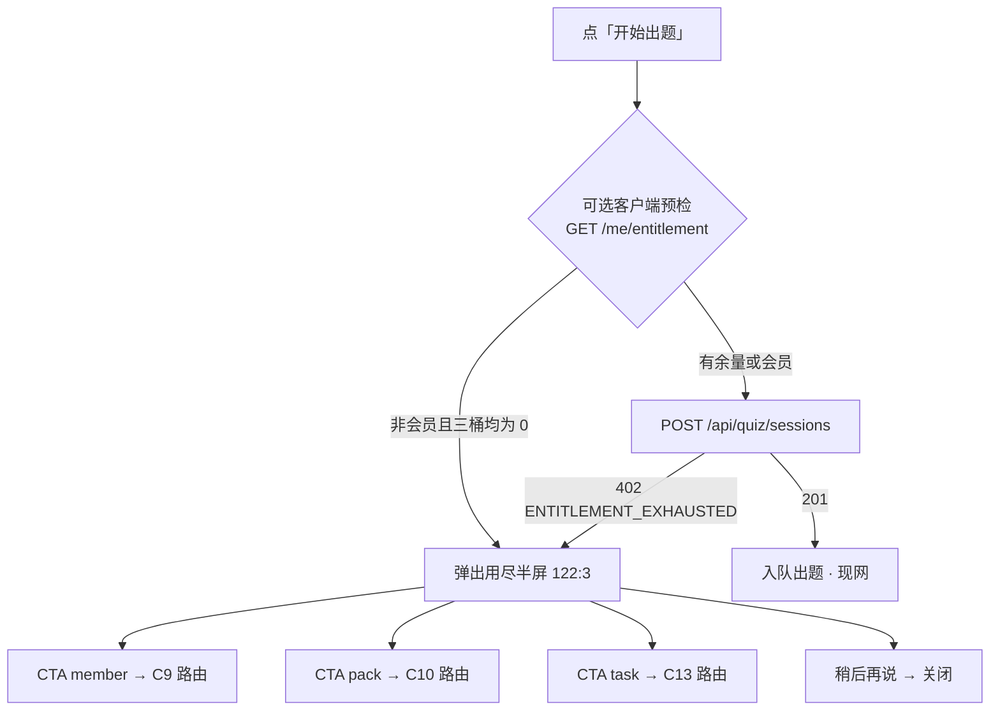

# 题刷刷 · TB-24 / C8 小程序用尽半屏 · C 切片契约（v0.1.0-C）

| 项 | 值 |
| --- | --- |
| 性质 | **C 契约已放行**（辉 t94u「开始实施商业化 v2.0.0…」整线进 C + Owner 点名 TB-24/C8 handoff） |
| 放行 | **2026-11-07**（Asia/Shanghai） |
| hui_quote | 产品经理PRD t94u「开始实施商业化v2.0.0（包含免费用户题库优先功能）的代码开发」 |
| 架构版本旁注 | **v0.1.0-C**（TB-24 / 看板 C8；相对商业化 PRD v2.0.0 + TB-20 §2.2 半屏 payload + TB-23 下单/SKU） |
| 依据 | 商业化 PRD v2.0.0 §3.1/§5.4/§7 · 看板规划 C8 · 小程序 design 包帧 **`122:3`** · TB-20 `ENTITLEMENT_EXHAUSTED` · TB-23 `commerce/skus`+`orders` |
| 上游 | **TB-20 已合**（四桶 + 402 payload）· **TB-23 已合** `main@b28ebcbc`（支付/SKU；本刀只读消费） |
| 仓 | https://github.com/zh7551069/ai-tishuashua |
| 进仓约定 | 合码 PR 应落到 `docs/contracts/tb24-miniapp-exhausted-sheet-C-contracts-v0.1.0-C.md`；旁注修订 `docs/quiz.md`（门禁→半屏）与可选 `docs/mini-commerce.md` |
| 本地 arch 副本 | `/Volumes/My PSSD/notion_files/题刷刷/arch/C 契约 · TB-24 小程序用尽半屏（2026-11-07）.md` |
| 契约归属 | 架构师；**全栈不得私改触发条件 / 402 语义 / CTA type 枚举 / 禁广告 / 禁改支付密钥 / 禁新造账本 而不申报** |
| 业务对接 | 题刷刷 · 业务组 |
| 合码 | **仅辉当面「合」授权** |
| 写码 | **等 Owner 点全栈**；本文件不授权开工写码、不点名 Cloud Agent |
| UI 开工 | **须先过「UI 技术评审三行留痕」**；未过审禁前端开工 |

> **放行范围**：本文件为正式 C。小程序用尽半屏（对稿 `122:3`）+ 对 402/`GET /me/entitlement` 的**加法扩展（可选）**可按本契约在 Owner 点名后开工。**严禁**改支付密钥、新造账本、内嵌完整定价/加油/支付页（归 C9/C10）、广告、退款。不合码直至辉当面「合」。

---

## 0. 硬拍板（不可改）

| # | 拍板 | 备注 |
| --- | --- | --- |
| **H1** | **权威触发** = 服务端 `POST /api/quiz/sessions` 返回 **`402` + `code=ENTITLEMENT_EXHAUSTED`**（TB-20 §2.2）；半屏消费其 `details` | 客户端预检仅为 UX 加速，**不得**替代门禁 |
| **H2** | **不改** TB-20 四桶 / reserve / 日切；**不改** TB-23 订单状态机 / 验签 / grant 同事务；**不越权改支付密钥**（密钥仍仅 env 名） | 本刀只读消费 |
| **H3** | **新 HTTP endpoint = 0**（推荐）；允许对既有响应**加法字段**（见 §4.2），禁止删改既有字段语义 | |
| **H4** | CTA 三件套顺序钉死：**member → pack → task**；type 枚举仍为 TB-20 的 `member` \| `pack` \| `task` | 对稿三按钮 |
| **H5** | 半屏**不内嵌**微信支付 / 统一下单 / `wx.requestPayment`；点 CTA **导航**到 C9/C10/C13 路由（可 stub） | 支付页归 C9/C10 |
| **H6** | **禁广告** / 金币；「做任务」仅指向增长入口（签到/分享/邀请占位），本刀不实现发奖 runtime | 对齐 PRD §3.2；发奖归 C13 |
| **H7** | `source=wrongSet` **不**弹本半屏（服务端不扣场；客户端亦不预检拦截） | TB-20 H4 |
| **H8** | 会员生效用户**不得**见到本半屏（服务端不应 402；若误弹须视为缺陷） | TB-20 |
| **H9** | 样式权威：`design/小程序（商业化v2.0.0）/`；对稿 **`122:3`**；**禁** `design/dev-cache` / `figma-dev-cache` / `get_design_context` | Bridge 仅副源 |
| **H10** | 本刀 **含小程序前端**；前端开工前必须有 Arch「UI 技术评审三行留痕」 | 见 §8 |
| **H11** | 关闭行为：「稍后再说」/ 遮罩点击 / 下滑关闭 → **仅关半屏**，停留当前页，**不**改余额、**不**建单 | |



---

## 1. 范围与硬约束

### 1.1 做（本刀）

1. **用尽半屏 UI**（对稿 `122:3`）：遮罩 + 底部半屏；标题 / 副文案 / 余额摘要行 / 三 CTA / 「稍后再说」。
2. **挂载点**：刷题包「开始出题」主路径（及任何会调 `POST /api/quiz/sessions` 且 `source≠wrongSet` 的入口）；统一错误拦截 `code===ENTITLEMENT_EXHAUSTED`。
3. **可选客户端预检**：出题前 `GET /api/me/entitlement`；若 `!membership.active` 且三桶 remain 均为 0 → 直接弹半屏（仍须能处理随后真实 402）。
4. **CTA 导航**到预留路由（见 §5.3）；目标页未交付时允许**最小 stub**（标题 +「即将上线」），禁止在半屏内完成支付。
5. **文案 enrichment（可选）**：用 `GET /api/commerce/skus?type=session_pack` 取推荐/排序第一加油包，拼 pack 按钮副标「N 场 ¥X」；member 按钮可用推荐会员 SKU 名或固定「开通会员 · 不限场」。
6. **（可选加法）** `GET /api/me/entitlement` 与/或 402 `details` 增加 `dailyFreeQuota`（见 §4.2），便于拼「今日免费 used/quota 已用」。
7. 文档进仓约定路径见文首。

### 1.2 不做（本刀严禁）

| 禁项 | 归属 |
| --- | --- |
| 新造 entitlement 表 / 改四桶 / 手改余额 | 架构禁；账本归 TB-20 |
| 改支付密钥 / 商户证书 / 回调验签 / 订单状态机 | **TB-23**；密钥仅 env |
| 完整会员定价页 / 加油包页 / 支付确认条 | **C9 / C10**（`122:4` / `122:6`） |
| 「我」会员态大改 / 场次明细页 | **C11 / C12** |
| 签到/分享/邀请发奖 runtime、拉新绑定 | **C13** |
| 广告 / 金币 / 短信登录 / 证书通关包 | 总禁 |
| 退款 / 冲正 | 人工；非本刀 |
| 在半屏内直接 `POST /api/orders` + `requestPayment` | 禁止；须进 C9/C10 页 |

---

## 2. 触发与关闭

### 2.1 触发条件（须同时满足展示）

| # | 条件 |
| --- | --- |
| T1 | 用户主动发起「开始出题」（或等价创建 session） |
| T2 | `source ∈ {normal, retrain_similar, variant}`（**排除** `wrongSet`） |
| T3 | 出现 **权威** `402 ENTITLEMENT_EXHAUSTED`，**或** 可选预检判定三桶耗尽且非会员 |

### 2.2 不触发

- 会员生效；
- 任一桶 remain > 0；
- `wrongSet`；
- 其它错误码（`VALIDATION_ERROR` / `PACK_UNAVAILABLE` / `LLM_*` 等）→ 走既有 toast/错误页，**不**冒充用尽半屏。

### 2.3 关闭

| 动作 | 结果 |
| --- | --- |
| 「稍后再说」 | 关闭半屏；停留当前页 |
| 点击遮罩 / 下滑（若实现） | 同「稍后再说」 |
| 点任一 CTA | 先关半屏（或保持至跳转完成），再 `navigateTo` 目标路由 |
| 支付成功返回 | 非本刀强制；若从 C9/C10 返回，调用方**应**刷新 `GET /me/entitlement` 后再允许重试出题 |

---

## 3. 状态机（客户端）

```text
idle ──开始出题──► checking（可选 GET entitlement）
checking ──有余量/会员──► posting（POST sessions）
checking ──耗尽──► sheet_open
posting ──201──► quiz_flow
posting ──402 ENTITLEMENT_EXHAUSTED──► sheet_open
posting ──其它错误──► error_toast（非本半屏）
sheet_open ──稍后再说──► idle
sheet_open ──CTA──► navigated（C9/C10/C13 路由）
```

并发：出题按钮在 `checking|posting|sheet_open` 期间须防抖/禁用，避免双单。

---

## 4. API 触达（新旧）

### 4.1 既有 API（本刀只读 / 消费 · **无新 endpoint**）

| API | 用途 |
| --- | --- |
| **`POST /api/quiz/sessions`** | 权威门禁；402 + TB-20 §2.2 `details` → 弹半屏 |
| **`GET /api/me/entitlement`** | 可选预检；半屏余额摘要；返回后刷新 |
| **`GET /api/commerce/skus`** | 可选：enrich pack/member 按钮价格文案（`enabled=true`） |
| **`POST /api/orders`** / **`GET /api/orders/:outTradeNo`** | **本刀半屏不直接调用**；留给 C9/C10 页 |
| **`GET /api/me/entitlement/ledger`** | 本刀不强制；明细归 C12 |

### 4.2 允许的加法扩展（仍 0 新路由）

为对齐稿面「今日免费 2/2 已用 · 明日 00:00 重置」，**推荐**（非阻塞若暂用默认配额展示）在以下响应**追加**字段，不得删除/改义既有键：

**A. `GET /api/me/entitlement`**

```json
{
  "balances": {
    "dailyFreeRemain": 0,
    "dailyTaskRemain": 0,
    "inventoryRemain": 0,
    "dailyFreeQuota": 2
  }
}
```

**B. `402 details`（可选同步）**

```json
{
  "details": {
    "reason": "exhausted",
    "businessDate": "2026-11-07",
    "membershipActive": false,
    "balances": {
      "dailyFreeRemain": 0,
      "dailyTaskRemain": 0,
      "inventoryRemain": 0,
      "dailyFreeQuota": 2
    },
    "cta": [
      { "type": "member", "label": "开通会员" },
      { "type": "pack", "label": "购买加油包" },
      { "type": "task", "label": "做任务领场次" }
    ]
  }
}
```

| 规则 | |
| --- | --- |
| `dailyFreeQuota` | 来自 TB-20/21 `dailyFreeQuota()`（键 `dailyFreeSessions` 或默认 2） |
| 展示 `used` | `max(0, dailyFreeQuota - dailyFreeRemain)`（注意 held 已扣场景） |
| 缺省 | 客户端可回退配额常量 `2` 拼文案；**不得**因此阻塞 UI 评审/开工 |
| CTA `label` | 服务端最小 label 可保留；**客户端可用 design 文案覆盖**（见 §5） |
| 深链 / skuCode | **本刀不强制**写入 402；价格用 skus API 客户端拼 |

### 4.3 新 endpoint

**无。** 若实现期认为必须新增，须回 Arch 修订契约后再写。

---

## 5. 对 UI 约束（帧 `122:3`）

> 样式源：`/Volumes/My PSSD/notion_files/题刷刷/design/小程序（商业化v2.0.0）/`（辉手导）。PRD/看板将本帧钉为 Figma node **`122:3`**（PAGE `122:2` 下）。导出 HTML 以文案/层级为准；**禁** `get_design_context`。

### 5.1 字段 ↔ 稿面

| 稿面元素（design 正文） | 数据来源 | 约束 |
| --- | --- | --- |
| 标题「今日场次已用完」 | 可固定；或 `message` 兜底 | 主标题加粗居中 |
| 副文案「开通会员不限场，或买场次加油包 / 做任务领场次」 | 固定对稿 | |
| 摘要「今日免费 {used}/{quota} 已用 · 明日 00:00 重置」 | `dailyFreeQuota` + remain；时区文案固定「明日 00:00」= Asia/Shanghai 日切 | 若有库存/任务余量但仍 402（不应发生）以服务端为准 |
| 图标（钞票/额度） | design SVG | 对稿 |
| 主按钮「开通会员 · 不限场」 | CTA `member` | 视觉权重最高 |
| 次按钮「买场次加油包 · {sessions} 场 ¥{yuan}」 | CTA `pack` + skus enrich；无 SKU 时回退「买场次加油包」 | 金额**不得**手写死进生产逻辑；示例 ¥6 仅稿面 |
| 次按钮「做任务领场次」 | CTA `task` | |
| 「稍后再说」 | 关闭 | 弱样式 |

### 5.2 交互

- 半屏自底部滑入；遮罩可点关。
- 三 CTA 纵向排列，顺序 member→pack→task。
- 键盘/安全区：避开 Home Indicator。

### 5.3 路由预留（CTA 导航）

| CTA | 目标路由（建议） | 本刀 |
| --- | --- | --- |
| `member` | `pages/commerce/member/index`（对稿后续 `122:4`） | 可 stub |
| `pack` | `pages/commerce/session-pack/index`（对稿后续 `122:6`） | 可 stub |
| `task` | `pages/commerce/tasks/index`（后续接 `122:8`/`122:10`）或临时跳 `pages/me/index` + query `?growth=1` | 可 stub；**不**发奖 |

> stub 须注册进 `app.config.ts`，避免 navigate 失败。完整视觉归 C9/C10/C13，不在本刀 UI 评审强制对那三帧。

### 5.4 非本刀帧（导航目标，不对稿验收）

| 帧 | 切片 |
| --- | --- |
| `122:4` 会员定价 | C9 |
| `122:6` 场次加油包 | C10 |
| `122:5` / `122:11` / `122:7` 我 | C11 |
| `122:9` 场次明细 | C12 |
| `122:8` / `122:10` 分享/邀请 | C13 |

---

## 6. 可测验收（恰好 8 条）

1. **402 弹半屏**：非会员三桶耗尽用户点「开始出题」→ `POST /api/quiz/sessions` 得 402 `ENTITLEMENT_EXHAUSTED` → 出现对稿半屏；**无**新建 `quiz_sessions`。
2. **有余量不弹**：`dailyFreeRemain≥1`（或其它桶有余量）→ 201 入队；半屏不出现。
3. **会员不弹**：`membership.active=true` → 出题成功；半屏不出现。
4. **wrongSet 不弹**：`source=wrongSet` 路径不展示本半屏（现网创建仍可 400；门禁跳过扣场）。
5. **关闭**：点「稍后再说」（及遮罩关，若实现）→ 半屏消失，停留原页，无订单、余额不变。
6. **CTA 导航**：member/pack/task 分别进入 §5.3 路由（或约定 stub），半屏关闭或随跳转销毁；半屏内**无** `requestPayment`。
7. **文案/余额**：半屏展示标题 + 三 CTA；摘要行能反映日免用尽（有 `dailyFreeQuota` 则 `used/quota`，否则等价「日免已用完」类对稿信息）；可选 pack 按钮价格来自 `GET /api/commerce/skus` 且与 enabled SKU 一致。
8. **范围锁**：本 PR **无**支付密钥真值、**无**改 TB-20 扣场顺序/表结构、**无**微信退款、**无**广告 SDK；shared browser barrel **不**引入 `node:`。

---

## 7. 开放问题

**阻塞开放问题：0。**

| # | 项 | 状态 |
| --- | --- | --- |
| O1 | 半屏触发权威源 | **已拍**：服务端 402；预检可选 |
| O2 | 新 API | **已拍**：0；仅加法字段可选 |
| O3 | CTA 落地页 | **已拍**：导航 C9/C10/C13 路由；允许 stub |
| O4 | 价格文案 | **已拍**：skus enrich；禁写死生产价 |
| O5 | 广告 | **已拍**：禁 |
| E1 | stub 文案精细度 | 工程细化；不阻塞 |
| E2 | 预检与 402 竞态 | 以 402 为准；预检仅加速 |

---

## 8. 门禁

| 项 | 规则 |
| --- | --- |
| 写码 | **等 Owner 点全栈** |
| 前端 | **须先** Arch「UI 技术评审三行留痕」通过（必改=0）后方可开工对稿 |
| 合码 | **仅辉当面「合」**；Arch 合码评审三行 ≠ 合码授权 |
| 样式 | 只用 `design/小程序（商业化v2.0.0）/`；禁 cache / `get_design_context` |

---

## 9. shared / 文档同步清单（合码 PR 用）

1. `docs/contracts/tb24-miniapp-exhausted-sheet-C-contracts-v0.1.0-C.md`（本文）。
2. `docs/quiz.md`：门禁段补「客户端遇 `ENTITLEMENT_EXHAUSTED` → 用尽半屏（TB-24）」。
3. （可选）`packages/shared`：若加法 `dailyFreeQuota`，更新 EntitlementView 类型。
4. `apps/mini`：`app.config.ts` 注册 commerce 路由（半屏可为组件，挂在 pack/quiz 页）。

---

## 10. 非目标 / 后续指针

| 切片 | 内容 |
| --- | --- |
| C9 | 会员定价 `122:4` + 下单支付 |
| C10 | 加油包 `122:6` + 下单支付 |
| C11 | 「我」会员/用量 |
| C12 | 场次明细（ledger） |
| C13 | 分享/邀请发奖 |

---

*完 · 题刷刷 · TB-24 / C8 小程序用尽半屏 · C 契约 v0.1.0-C · 2026-11-07（Asia/Shanghai）· 对齐 PRD v2.0.0 / TB-20 / TB-23 · 写码不开 · 合码仅辉当面「合」*
