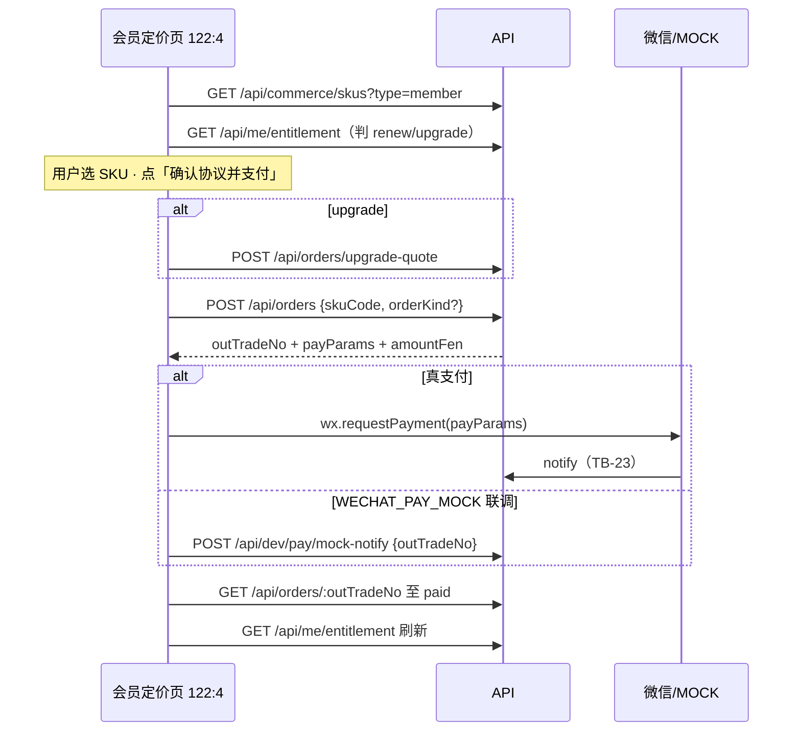

# 题刷刷 · TB-25 / C9 小程序会员定价 · C 切片契约（v0.1.0-C）

| 项 | 值 |
| --- | --- |
| 性质 | **C 契约已放行**（辉 t94u「开始实施商业化 v2.0.0…」整线进 C + Owner 点名 TB-25/C9 handoff） |
| 放行 | **2026-11-07**（Asia/Shanghai） |
| hui_quote | 产品经理PRD t94u「开始实施商业化v2.0.0（包含免费用户题库优先功能）的代码开发」 |
| 架构版本旁注 | **v0.1.0-C**（TB-25 / 看板 C9；相对商业化 PRD v2.0.0 §5.5 + TB-23 支付/SKU + TB-24 半屏 CTA→本页） |
| 依据 | 商业化 PRD v2.0.0 §3.1/§5.4/§5.5/§7 · 看板规划 C9 · 小程序 design 包帧 **`122:4`** · TB-21 `commerce_skus` · TB-23 orders/wx · TB-24 `pages/commerce/member` |
| 上游 | **TB-23 已合**（支付/订单/回调/grant）· **TB-24 已合** `main@e0d15ab5`（半屏 CTA stub → 本页路由已注册） |
| 仓 | https://github.com/zh7551069/ai-tishuashua |
| 进仓约定 | 合码 PR 应落到 `docs/contracts/tb25-miniapp-membership-pricing-C-contracts-v0.1.0-C.md`；旁注修订可选 `docs/mini-commerce.md` |
| 本地 arch 副本 | `/Volumes/My PSSD/notion_files/题刷刷/arch/C 契约 · TB-25 小程序会员定价（2026-11-07）.md` |
| 契约归属 | 架构师；**全栈不得私改金额以服务端为准 / 降级禁 / 半屏禁支付边界 / 密钥入库禁令 / SKU code 映射 而不申报** |
| 业务对接 | 题刷刷 · 业务组 |
| 合码 | **仅辉当面「合」授权** |
| 写码 | **等 Owner 点全栈**；本文件不授权开工写码、不点名 Cloud Agent |
| UI 开工 | **须先过「UI 技术评审三行留痕」**；未过审禁前端开工 |

> **放行范围**：本文件为正式 C。小程序会员定价页（对稿 `122:4`）+ 选 SKU → 复用 C7 下单 → **本页允许** `wx.requestPayment`（与 TB-24 半屏禁支付划清）。**严禁**新造支付 endpoint、改密钥真值入库、手改余额、在半屏内支付、实现加油包完整页（C10）、退款。不合码直至辉当面「合」。

---

## 0. 硬拍板（不可改）

| # | 拍板 | 备注 |
| --- | --- | --- |
| **H1** | **支付依赖 = 复用 C7（TB-23）真支付链路**；本地/CI/联调用 **`WECHAT_PAY_MOCK`** 可测全路径；**不**另开「仅 mock 无真支付」平行契约 | 对齐看板「C7 或 mock · Owner 定」→ 本刀拍板复用 C7 |
| **H2** | **新 HTTP endpoint = 0**；只消费既有 `GET /api/commerce/skus`、`POST /api/orders`、`POST /api/orders/upgrade-quote`、`GET /api/orders/:outTradeNo`、（dev）`POST /api/dev/pay/mock-notify`、`GET /api/me/entitlement` | 改路由须回 Arch |
| **H3** | **金额以服务端为准**；客户端**不得**传/信任本地写死应付金额；CTA 展示价 = 下单响应 `amountFen` 或选中 SKU 的 `priceYuan`/`priceFen`（升级场景用询价 `payFen`） | TB-23 H1 |
| **H4** | **本页允许支付**（`POST /api/orders` + `wx.requestPayment` / mock-notify）；**半屏（TB-24）仍禁止**支付 | 边界钉死 |
| **H5** | **会员降级禁止**；同档/更长 → renew；更高档 → upgrade（先询价再下单）；降档 → toast + **不**建单（服务端 `PAY_DOWNGRADE_FORBIDDEN`） | PRD #9 / TB-23 H5 |
| **H6** | **不改** TB-20 四桶 / reserve / 日切；**不改** TB-23 订单状态机 / 验签 / grant 同事务；**不越权改支付密钥**（密钥仍仅 env 名，禁真值入库） | |
| **H7** | 会员 SKU 列表只展示 `type=member` 且 `enabled=true`；试用价文案对齐 PRD §5.5（后管改价后以 API 为准，**禁**生产写死 ¥12/28/68/198） | 稿面数字仅对稿参考 |
| **H8** | 默认选中：**`recommended=true` 的会员 SKU**；若无推荐则选 `sort_order` 第一；稿面默认月卡「推荐」 | |
| **H9** | 样式权威：`design/小程序（商业化v2.0.0）/`；对稿 **`122:4`**；**禁** `design/dev-cache` / `figma-dev-cache` / `get_design_context` | Bridge 仅副源 |
| **H10** | 本刀 **含小程序前端**；前端开工前必须有 Arch「UI 技术评审三行留痕」 | 见 §8 |
| **H11** | 「场次加油包」入口仅 **导航** 至 C10 路由（可仍 stub）；**不**在本页内完成加油包下单 | 归 C10 / `122:6` |
| **H12** | 支付成功后须刷新 `GET /api/me/entitlement`；成功态可 toast「开通成功」并 `navigateBack`（或回刷题包）；**不**本刀改「我」大页（C11） | |



---

## 1. 范围与硬约束

### 1.1 做（本刀）

1. **会员定价页 UI**（对稿 `122:4`）：替换 TB-24 stub `pages/commerce/member/index` 为完整对稿页。
2. **拉会员 SKU 目录**并渲染周/月/季/年（以 API 返回为准；缺档不造假卡）。
3. **选档 + 底部支付条**：文案「确认协议并支付 ¥{n}」；副标「微信支付 · 开通后立即生效」。
4. **下单 + 拉起支付**（真 `requestPayment` 或 mock-notify）；查单确认；刷新权益。
5. **续费 / 升级**路径：有有效会员时自动判 `orderKind`（服务端亦可自判）；升级展示差价（询价）。
6. **规则说明卡** + **加油包入口**导航 C10。
7. 从 TB-24 半屏 CTA `member`、以及其它入口 `navigateTo` 本页均可到达。
8. 文档进仓约定路径见文首。

### 1.2 不做（本刀严禁）

| 禁项 | 归属 |
| --- | --- |
| 新造支付/订单/回调 endpoint；改验签 / grant 同事务 / 订单状态机 | **TB-23**；本刀 0 新路由 |
| 密钥真值写入仓 / PR / 契约 / 日志 | 安全禁；仅 env 名 |
| 用尽半屏内 `requestPayment` / 直接下单 | **TB-24 H5** |
| 完整加油包定价/支付页 | **C10**（`122:6`） |
| 「我」会员态大改 / 场次明细 | **C11 / C12** |
| 签到/分享/邀请发奖 runtime | **C13** |
| 手改余额 / 跳过订单 grant / 退款冲正 | 架构禁；退款人工 |
| 广告 / 金币 / 证书通关包 / 短信登录 | 总禁 |
| 生产写死试用价或忽略后管改价 | 禁 |

---

## 2. 支付依赖结论（Owner 要求钉死）

| 项 | 结论 |
| --- | --- |
| 依赖 | **依赖 C7（TB-23）真支付与订单回写**（`main` 已合 `PaymentModule`） |
| 可测 | **`WECHAT_PAY_MOCK=true|1`** + `POST /api/dev/pay/mock-notify`（非生产）；真商户号非本刀阻塞 |
| 不采用 | 「本刀只做 UI、支付永远 mock、不上真链路」——**否决**；mock 仅为开发/CI 门闩 |
| 客户端金额 | 忽略任何客户端传入 `amountFen`；展示用 SKU/`payParams` 对应服务端快照 |

---

## 3. API 触达（复用 · **0 新 endpoint**）

| API | 本刀用途 |
| --- | --- |
| **`GET /api/commerce/skus?type=member`** | 定价列表；`enabled` only；价/名/duration/recommended/summary |
| **`GET /api/me/entitlement`** | 是否会员、当前 `skuCode`/`endsAt` → 决定 purchase/renew/upgrade UI |
| **`POST /api/orders/upgrade-quote`** | 选更高档时取 `payFen`；展示「补差价 ¥x」 |
| **`POST /api/orders`** | Body：`{ skuCode, orderKind?, clientIdempotencyKey? }`；得 `payParams` |
| **`GET /api/orders/:outTradeNo`** | 支付后轮询至 `paid` / 失败提示 |
| **`POST /api/dev/pay/mock-notify`** | 仅 mock 门闩联调；**生产不可达** |
| **`GET /api/commerce/skus?type=session_pack`** | 可选：加油包入口价文案 enrich（与稿「5 场 ¥6」对齐 API，禁写死） |

### 3.1 下单 `orderKind` 客户端建议（服务端仍权威）

| 当前权益 | 所选会员档 | 建议 `orderKind` |
| --- | --- | --- |
| 非会员 | 任一会员 SKU | `purchase`（可省略，服务端默认） |
| 有效会员 · 同档或 duration≤所选 | 同档/更长同价档 | `renew` |
| 有效会员 · 更低档 | 更短 duration | **禁止点支付**；toast「不支持降级」 |
| 有效会员 · 更高档 | 更长 duration | 先 `upgrade-quote`，再 `orderKind: "upgrade"` |

档位序（与 TB-23 钉死一致）：`member_week(7) < member_month(30) < member_quarter(90) < member_year(365)`。

### 3.2 支付完成判定

1. `wx.requestPayment` success **或** mock-notify 2xx；
2. 轮询 `GET /api/orders/:outTradeNo` 至 `status===paid`（建议间隔 1s，最多 ~15 次）；
3. 再 `GET /api/me/entitlement` 确认 `membership.active`；
4. 用户取消支付 → 停在本页，订单可保持 `prepay`（不强制关单）。

---

## 4. 对 UI 约束（帧 `122:4`）

> 样式源：`/Volumes/My PSSD/notion_files/题刷刷/design/小程序（商业化v2.0.0）/`（辉手导）。PRD/看板钉 Figma node **`122:4`**（PAGE `122:2` 下）。导出 HTML 以文案/层级为准；**禁** `get_design_context`。

### 4.1 字段 ↔ 稿面

| 稿面元素（design 正文） | 数据来源 | 约束 |
| --- | --- | --- |
| 导航标题「开通会员」+ 返回 | 固定；`navigateBack` | 已注册路由 |
| 角标 `v2.0.0` | 可固定产品标 | 弱样式 |
| 蓝卡 Hero「题刷刷会员」 | 固定对稿 | |
| Hero 副文案「不限场次 · 会员提炼不限 · AI 点评不限」 | 固定 | |
| Hero 底注「免费上传提炼终身仅 1 次 · 会员期内提炼不限次」 | 固定；对齐 PRD | |
| 利益 chips：不限 AI 出题场次 / 会员提炼不限 / AI 点评摘要不限 | 固定三枚 | |
| SKU 行：周卡 ¥12「灵活尝鲜」 | `member_week` | 价来自 API |
| SKU 行：月卡 ¥28「最受欢迎」+「推荐」角标 | `member_month`；`recommended` | **默认选中**（若 recommended） |
| SKU 行：季卡 ¥68「约 ¥22.7/月」 | `member_quarter`；月均=价/3 可客户端算 | |
| SKU 行：年卡 ¥198「约 ¥16.5/月」 | `member_year`；月均=价/12 | |
| 选中态 | 蓝底/蓝描边 + 勾选 | 对稿 |
| 规则卡「升级可补差价 · 不支持降级」「续费延长到期日 · 会员不受日免场次限制」 | 固定 | |
| 次入口「场次加油包 5 场 ¥6（非刷题包）」 | 导航 C10；价可 skus enrich | 非本页支付 |
| 底栏「微信支付 · 开通后立即生效」 | 固定 | |
| 主按钮「确认协议并支付 ¥{n}」 | `{n}` = 选中应付（upgrade 用 `payFen`） | 支付中 disabled |

试用价参考（PRD §5.5 / 种子，**非写死生产**）：

| code | 名 | 参考价 |
| --- | --- | --- |
| `member_week` | 周卡 | ¥12 / 7 天 |
| `member_month` | 月卡 | ¥28 / 30 天 |
| `member_quarter` | 季卡 | ¥68 / 90 天 |
| `member_year` | 年卡 | ¥198 / 365 天 |

### 4.2 路由

| 路由 | 说明 |
| --- | --- |
| `pages/commerce/member/index` | **本刀主页**（TB-24 已注册 stub，本刀替换实现） |
| `pages/commerce/session-pack/index` | 加油包入口目标（C10；可 stub） |
| `pages/legal/terms/index` | 「确认协议」可点进用户协议（既有）；未读协议不另造阻塞弹层亦可（稿无强制 checkbox） |

入口：TB-24 半屏 CTA `member`；后续 Me「开通会员」（C11）亦可复用本路由。

### 4.3 非本刀帧

| 帧 | 切片 |
| --- | --- |
| `122:3` 用尽半屏 | C8 已合；仅导航来源 |
| `122:6` 加油包 | C10 |
| `122:5` / `122:11` / `122:7` 我 | C11 |
| `122:9` 场次明细 | C12 |

---

## 5. 前端四件套（专节 · Owner 要求）

> 四件套 = **组件 / 状态 / 对稿帧 / 禁项**。UI 技术评审与合码评审均按此核对；下列可测点须能在实现/冒烟中点名。

### 5.1 组件（可测）

| 组件（建议名，可合并） | 职责 | 可测点 |
| --- | --- | --- |
| **`MemberPricingPage`**（`pages/commerce/member/index`） | 页壳：导航、加载/错误、组装子块 | 路由可达；替换 CommerceStub |
| **`MemberHeroCard`** | 蓝卡标题+权益摘要+底注 | 文案对稿 |
| **`MemberBenefitChips`** | 三枚利益 chip | 三枚均在 |
| **`MemberSkuList` / `MemberSkuRow`** | 会员 SKU 列表与选中态/推荐角标 | 仅 member+enabled；点选切换；推荐默认选中 |
| **`MemberRulesCard`** | 升级/续费/日免规则说明 | 固定文案在 |
| **`SessionPackEntryRow`** | 加油包次入口 | 点击 → C10 路由；本页无 pack 下单 |
| **`MemberPayBar`** | 底栏支付说明 + 主 CTA | CTA 金额随选中/询价变；支付中禁用防双单 |
| **`payMembership()` service** | 封装询价→下单→requestPayment/mock→轮询→刷新 entitlement | 单元/联调可测；**不**把私钥逻辑放 mini |

### 5.2 状态（客户端状态机 · 可测）

```text
idle
  → loading_skus（GET skus + entitlement）
  → ready（已默认选中 recommended）
  → quoting（仅 upgrade：upgrade-quote）
  → paying（POST orders → requestPayment | mock-notify）
  → confirming（轮询 GET order）
  → success（toast + 刷新 entitlement + 返回）
  → error_toast（PAY_* / 取消 / 网络）→ 回到 ready
```

| 状态约束 | 可测点 |
| --- | --- |
| `paying|confirming` 期间主按钮 disabled / 防抖 | 连点不双单（同 `clientIdempotencyKey` 或 UI 锁） |
| 用户取消微信支付 | 回 `ready`；不假装成功 |
| `PAY_DOWNGRADE_FORBIDDEN` | toast；不进入 confirming |
| `PAY_NOT_CONFIGURED` | toast「支付暂不可用」；不崩页 |
| success 后 | `membership.active===true`（mock 路径） |

### 5.3 对稿帧（可测）

| 帧 | 要求 |
| --- | --- |
| **`122:4`** | **本刀唯一必评帧**；层级/文案/默认月卡选中/底栏支付条可对稿 |
| 非评 | `122:6` 等导航目标不对稿验收 |

像素容差与色值跟既有小程序商业化刀惯例；UI 技术评审三行通过后方可前端开工。

### 5.4 禁项清单（可测）

| # | 禁项 | 验收抓手 |
| --- | --- | --- |
| F1 | 半屏组件内调用 `requestPayment` / `POST /api/orders` | TB-24 范围锁仍成立；本 PR 不回退半屏 |
| F2 | 生产写死 ¥12/28/68/198 | 改后管价后列表价变 |
| F3 | 客户端传 `amountFen` 影响应付 | 服务端忽略；以响应为准 |
| F4 | 降级可支付 | 必须被拦 |
| F5 | 新 endpoint / 改 notify / 改 grant | diff 无 payment 核心状态机改义（除非 bugfix 另报） |
| F6 | 密钥真值入库 | `.env.example` 无真值 |
| F7 | 本页完成加油包支付 | 仅 navigate |
| F8 | 广告 SDK / 退款 API | 无 |

---

## 6. 可测验收（恰好 8 条）

1. **目录渲染**：登录用户进 `pages/commerce/member/index` → `GET /api/commerce/skus?type=member` 成功 → 展示 enabled 会员档；默认选中 `recommended`（种子为月卡）；价格与 API 一致（非写死）。
2. **首购支付（mock）**：非会员选月卡 → 点「确认协议并支付」→ `POST /api/orders` 得 `prepay` → mock-notify → 查单 `paid` → entitlement 会员生效；CTA 金额与 `amountFen` 一致。
3. **真支付参数**：非 mock 环境下订单响应含完整 `payParams` 五件套；客户端调用 `wx.requestPayment`（开发者工具可测到调用；真收款不阻塞合码）。
4. **续费**：有效同档会员再购同 SKU → `renew`；支付后 `ends_at` 延长（服务端 TB-23 行为）；本页不报错。
5. **升级补差价**：有效低档选更高档 → 先询价展示/使用 `payFen` → `upgrade` 下单支付成功 → `skuCode` 升档。
6. **降级拒绝**：有效高档选更低档 → **不**成功支付；出现降级提示（客户端预拦或服务端 `PAY_DOWNGRADE_FORBIDDEN`）。
7. **半屏边界 + 加油包入口**：从 TB-24 半屏 CTA 能进本页；本页「场次加油包」进入 C10 路由且**不**在本页对 pack 调 `requestPayment`；半屏代码路径仍无支付。
8. **范围锁**：本 PR **无**新支付 HTTP 路由、**无**密钥真值、**无**退款 API、**无**改 TB-20 扣场顺序；shared browser barrel **不**引入 `node:` / 商户私钥读取。

---

## 7. 开放问题

**阻塞开放问题：0。**

| # | 项 | 状态 |
| --- | --- | --- |
| O1 | 支付依赖 C7 还是纯 mock | **已拍**：复用 C7 + `WECHAT_PAY_MOCK` 可测 |
| O2 | 新 API | **已拍**：0 |
| O3 | 本页可否支付 | **已拍**：可；半屏不可 |
| O4 | 默认选中 | **已拍**：recommended → 否则 sort 第一 |
| O5 | 协议 checkbox | **已拍**：稿无强制勾选；按钮文案含「确认协议」；可链 terms |
| E1 | 支付成功落点（navigateBack vs 成功页） | 工程自决；推荐 back + toast |
| E2 | 月均价文案算法四舍五入 | 对稿近似即可；不阻塞 |

**需辉拍板：无。**

---

## 8. 门禁

| 项 | 规则 |
| --- | --- |
| 写码 | **等 Owner 点全栈** |
| 前端 | **须先** Arch「UI 技术评审三行留痕」通过（必改=0）后方可开工对稿 |
| 合码 | **仅辉当面「合」**；Arch 合码评审三行 ≠ 合码授权 |
| 样式 | 只用 `design/小程序（商业化v2.0.0）/`；禁 cache / `get_design_context` |
| 可选 API | 本刀后端改动预期 ≈0；若需小加法字段须回 Arch |

---

## 9. shared / 文档同步清单（合码 PR 用）

1. `docs/contracts/tb25-miniapp-membership-pricing-C-contracts-v0.1.0-C.md`（本文）。
2. （可选）`docs/mini-commerce.md`：会员定价页路由与支付时序。
3. `apps/mini`：实现 `pages/commerce/member/*`；支付封装；勿把 wx pay SDK 密钥逻辑放 shared barrel。
4. 不要求改 `apps/api/src/payment` 状态机；发现 bug 另开说明。

---

## 10. 非目标 / 后续指针

| 切片 | 内容 |
| --- | --- |
| C10 | 加油包 `122:6` + 本页同款支付编排 |
| C11 | 「我」会员/用量入口深链本页 |
| C12 | 场次明细 |
| C13 | 分享/邀请发奖 |

---

*完 · 题刷刷 · TB-25 / C9 小程序会员定价 · C 契约 v0.1.0-C · 2026-11-07（Asia/Shanghai）· 对齐 PRD v2.0.0 / TB-23 / TB-24 · 写码不开 · 合码仅辉当面「合」*
