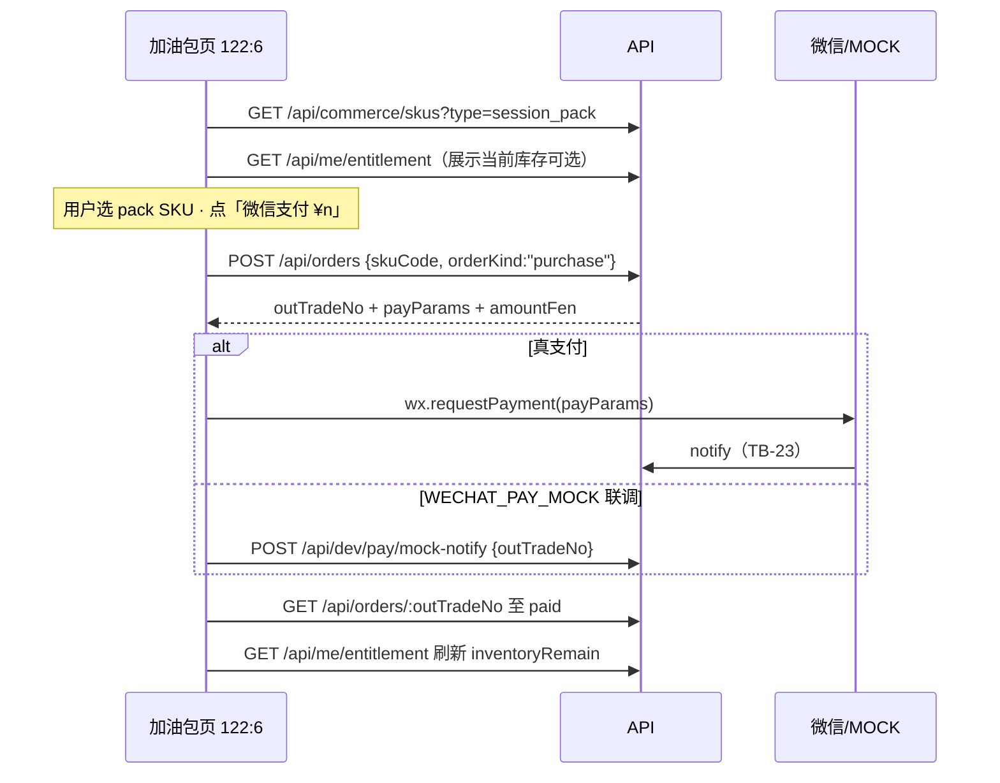

# 题刷刷 · TB-26 / C10 小程序场次加油包 · C 切片契约（v0.1.0-C）

| 项 | 值 |
| --- | --- |
| 性质 | **C 契约已放行**（辉 t94u「开始实施商业化 v2.0.0…」整线进 C + Owner 点名 TB-26/C10 handoff） |
| 放行 | **2026-11-07**（Asia/Shanghai） |
| hui_quote | 产品经理PRD t94u「开始实施商业化v2.0.0（包含免费用户题库优先功能）的代码开发」 |
| 架构版本旁注 | **v0.1.0-C**（TB-26 / 看板 C10；相对商业化 PRD v2.0.0 §5.5 + TB-23 支付/SKU + TB-20 inventory + TB-24/TB-25 入口） |
| 依据 | 商业化 PRD v2.0.0 §2#14/#15/#16 / §3.1 / §5.2–§5.5 / §7 · 看板规划 C10 · 小程序 design 包帧 **`122:6`** · TB-21 `commerce_skus` · TB-23 orders/wx · TB-24 CTA pack · TB-25 会员页次入口 |
| 上游 | **TB-23 已合**（支付/订单/回调/grant inventory）· **TB-24 已合**（半屏 CTA → `pages/commerce/session-pack`）· **TB-25 已合** `main@42fdc7d1`（会员页导航本路由；本路由仍 stub） |
| 仓 | https://github.com/zh7551069/ai-tishuashua |
| 进仓约定 | 合码 PR 应落到 `docs/contracts/tb26-miniapp-session-boost-C-contracts-v0.1.0-C.md`；旁注修订可选 `docs/mini-commerce.md` |
| 本地 arch 副本 | `/Volumes/My PSSD/notion_files/题刷刷/arch/C 契约 · TB-26 小程序场次加油包（2026-11-07）.md` |
| 契约归属 | 架构师；**全栈不得私改金额以服务端为准 / 半屏禁支付边界 / 密钥入库禁令 / SKU type=session_pack 映射 / inventory 入账语义 / 退款自动冲正 而不申报** |
| 业务对接 | 题刷刷 · 业务组 |
| 合码 | **仅辉当面「合」授权** |
| 写码 | **等 Owner 点全栈**；本文件不授权开工写码、不点名 Cloud Agent |
| UI 开工 | **须先过「UI 技术评审三行留痕」**；未过审禁前端开工 |

> **放行范围**：本文件为正式 C。小程序场次加油包页（对稿 `122:6`）+ 选 `session_pack` SKU → 复用 C7 下单 → **本页允许** `wx.requestPayment`（与 TB-24 半屏禁支付划清；与 TB-25 会员页同款支付编排）。**严禁**新造支付 endpoint、改密钥真值入库、手改余额、在半屏内支付、实现「我」大页/场次明细（C11/C12）、退款。不合码直至辉当面「合」。

---

## 0. 硬拍板（不可改）

| # | 拍板 | 备注 |
| --- | --- | --- |
| **H1** | **支付依赖 = 复用 C7（TB-23）真支付链路**；本地/CI/联调用 **`WECHAT_PAY_MOCK`** 可测全路径；**不**另开「仅 mock 无真支付」平行契约 | 对齐 TB-25 H1 |
| **H2** | **新 HTTP endpoint = 0**；只消费既有 `GET /api/commerce/skus`、`POST /api/orders`、`GET /api/orders/:outTradeNo`、（dev）`POST /api/dev/pay/mock-notify`、`GET /api/me/entitlement` | **不**调 `upgrade-quote`（加油包无升级语义）；改路由须回 Arch |
| **H3** | **金额以服务端为准**；客户端**不得**传/信任本地写死应付金额；CTA 展示价 = 下单响应 `amountFen` 或选中 SKU 的 `priceYuan`/`priceFen` | TB-23 H1；**禁**写死「5 场 ¥6」 |
| **H4** | **本页允许支付**（`POST /api/orders` + `wx.requestPayment` / mock-notify）；**半屏（TB-24）仍禁止**支付下单 | 边界钉死 |
| **H5** | SKU 范围：仅展示 `type=session_pack` 且 `enabled=true`；`orderKind` **仅 `purchase`**（无 renew/upgrade/降级） | TB-23 §4.2 |
| **H6** | **履约入账桶 = `inventory`**（TB-20 Lot）；`qty = price_snapshot.sessions`；`source='session_pack'`；`expiresAt = paid_at + inventoryExpireDays`（默认 **365** 天，以 SKU/快照为准）；`lots.order_id` 回填 | TB-23 §4.7 / TB-20 H1·H8 |
| **H7** | **不改** TB-20 四桶 / reserve / 日切 / 扣场序；**不改** TB-23 订单状态机 / 验签 / grant 同事务；**不越权改支付密钥**（密钥仍仅 env 名，禁真值入库） | |
| **H8** | **会员叠乘**：会员生效时出题**不扣** inventory（TB-20 H2）；本页仍允许会员购买加油包并入账 Lot——库存保留至会员失效后再按近过期优先扣；**不**因会员态禁购或隐藏本页 | 产品辅推；非阻塞文案见 E1 |
| **H9** | **退款一律人工**；加油包**未使用也不自动退**；本刀不调退款 API、不冲正 Lot | PRD #14 / TB-23 H6 |
| **H10** | 样式权威：`design/小程序（商业化v2.0.0）/`；对稿 **`122:6`**；**禁** `design/dev-cache` / `figma-dev-cache` / `get_design_context` | Bridge 仅副源 |
| **H11** | 本刀 **含小程序前端**；前端开工前必须有 Arch「UI 技术评审三行留痕」 | 见 §8 |
| **H12** | 支付成功后须刷新 `GET /api/me/entitlement`（`inventoryRemain` 应增加）；成功态可 toast「购买成功」并关闭/返回；**不**本刀改「我」大页（C11）或场次明细（C12） | |
| **H13** | 名词钉死：加油包 = **出题场次库存 SKU**；**≠** 刷题包（packs）；文案须含「非刷题包」对稿约束 | PRD #16 / §5.5 |



---

## 1. 范围与硬约束

### 1.1 做（本刀）

1. **场次加油包页 UI**（对稿 `122:6`）：替换 TB-24/TB-25 stub `pages/commerce/session-pack/index` 为完整对稿页（稿面为底部半屏视觉；实现可为独立路由页呈现同等信息架构）。
2. **拉 `session_pack` SKU 目录**并渲染（以 API 返回为准；缺档不造假卡；种子 `session_pack_5` 参考非写死）。
3. **选档 + 支付 CTA**：文案对齐稿「微信支付 ¥{n}」；副说明含「非刷题包 · 购后 {expireDays} 天 · 跨日不清零」等（天数/场次来自 API）。
4. **下单 + 拉起支付**（真 `requestPayment` 或 mock-notify）；查单确认；刷新权益（inventory）。
5. **规则说明**：1 场定义 / 「再练这 N 道」不扣 / 扣场顺序（对稿三条；与 TB-20 一致）。
6. 入口可达：TB-24 半屏 CTA `pack`、TB-25 会员页「场次加油包」次入口、其它 `navigateTo` 本路由。
7. 文档进仓约定路径见文首。

### 1.2 不做（本刀严禁）

| 禁项 | 归属 |
| --- | --- |
| 新造支付/订单/回调 endpoint；改验签 / grant 同事务 / 订单状态机 | **TB-23**；本刀 0 新路由 |
| 密钥真值写入仓 / PR / 契约 / 日志 | 安全禁；仅 env 名 |
| 用尽半屏内 `requestPayment` / 直接下单 | **TB-24 H5** |
| 会员定价页改义 / 半屏禁支付回退 | **TB-25 / TB-24** |
| 「我」会员态大改 / 场次明细 | **C11 / C12** |
| 签到/分享/邀请发奖 runtime | **C13** |
| 手改余额 / 跳过订单 grant / 退款冲正 / 未使用自动退 | 架构禁；退款人工 |
| 广告 / 金币 / 证书通关包 / 短信登录 | 总禁 |
| 生产写死 ¥6 / 5 场 / 365 天而忽略后管改价 | 禁 |
| 把加油包当成刷题包数量售卖 | 禁（PRD #16） |

---

## 2. 支付依赖结论（Owner 要求钉死）

| 项 | 结论 |
| --- | --- |
| 依赖 | **依赖 C7（TB-23）真支付与订单回写**（`main` 已合 `PaymentModule`；含 `session_pack` → inventory grant） |
| 可测 | **`WECHAT_PAY_MOCK=true|1`** + `POST /api/dev/pay/mock-notify`（非生产）；真商户号非本刀阻塞 |
| 不采用 | 「本刀只做 UI、支付永远 mock、不上真链路」——**否决**；mock 仅为开发/CI 门闩 |
| 客户端金额 | 忽略任何客户端传入 `amountFen`；展示用 SKU/`payParams` 对应服务端快照 |
| 新 endpoint | **0**（论证：TB-23 已覆盖 `session_pack` 下单/履约；本刀纯前端消费） |

---

## 3. API 触达（复用 · **0 新 endpoint**）

| API | 本刀用途 |
| --- | --- |
| **`GET /api/commerce/skus?type=session_pack`** | 加油包目录；`enabled` only；价/`sessions`/`inventoryExpireDays`/`name`/`summary`/`recommended` |
| **`GET /api/me/entitlement`** | 可选展示当前 `inventoryRemain`；支付成功后刷新 |
| **`POST /api/orders`** | Body：`{ skuCode, orderKind: "purchase", clientIdempotencyKey? }`；得 `payParams` |
| **`GET /api/orders/:outTradeNo`** | 支付后轮询至 `paid` / 失败提示 |
| **`POST /api/dev/pay/mock-notify`** | 仅 mock 门闩联调；**生产不可达** |
| **`POST /api/orders/upgrade-quote`** | **本刀不调用**（无会员升级语义） |

### 3.1 下单规则（加油包）

| 规则 | 说明 |
| --- | --- |
| `skuCode` | 须为 `type=session_pack` 且 `enabled=true` |
| `orderKind` | **仅** `purchase`（可显式传；服务端对 session_pack 亦只接受 purchase） |
| 金额 | `amount_fen = sku.price_fen`（服务端快照） |
| 可重复购 | 允许多次购买；每次支付成功新开 Lot（可叠加库存） |
| 会员态 | **不**拦截下单（见 H8） |

### 3.2 履约（服务端既有 · 本刀验收）

对齐 TB-23 §4.7：

```text
grantEntitlement({
  type: 'inventory',
  qty: snapshot.sessions,
  source: 'session_pack',
  expiresAt: paid_at + inventoryExpireDays(默认365)d,
  refId: 'order:' + outTradeNo
})
→ lots.order_id = outTradeNo
```

### 3.3 支付完成判定

1. `wx.requestPayment` success **或** mock-notify 2xx；
2. 轮询 `GET /api/orders/:outTradeNo` 至 `status===paid`（建议间隔 1s，最多 ~15 次）；
3. 再 `GET /api/me/entitlement` 确认 `inventoryRemain` 相对购买前增加（或至少 Lot 入账可观测）；
4. 用户取消支付 → 停在本页，订单可保持 `prepay`（不强制关单）。

### 3.4 种子 SKU 参考（**非写死生产**）

| code | 名（种子） | 参考价 | sessions | inventoryExpireDays |
| --- | --- | --- | --- | --- |
| `session_pack_5` | 场次加油包 ×5 | ¥6（600 分） | 5 | 365 |

后管可增/改价/改场次/改有效期；列表与 CTA **一律跟 API**。

---

## 4. 对 UI 约束（帧 `122:6`）

> 样式源：`/Volumes/My PSSD/notion_files/题刷刷/design/小程序（商业化v2.0.0）/`（辉手导）。PRD/看板钉 Figma node **`122:6`**（PAGE `122:2` 下）。导出 HTML 以文案/层级为准；包内顶层 id 可能不出现字面 `122:6`（同 TB-24/25 先例，以「购买场次加油包」正文为准）；**禁** `get_design_context`。

### 4.1 字段 ↔ 稿面

| 稿面元素（design 正文） | 数据来源 | 约束 |
| --- | --- | --- |
| 标题「购买场次加油包」 | 固定 | |
| 角标 `v2.0.0` | 可固定产品标 | 建议生产省略（同 TB-25） |
| 拖条/半屏壳 + 遮罩 | 对稿视觉；路由页实现可全屏等效 | 「关闭」→ `navigateBack` |
| 黄卡主标「场次加油 · {n} 场出题额度」 | `sessions` / `name` | **禁**写死 5 |
| 黄卡副标「非刷题包 · 购后 {d} 天 · 跨日不清零」 | `inventoryExpireDays` | **禁**写死 365（可用 API；缺省展示跟快照） |
| 黄卡价「¥{n}」 | `priceYuan`/`priceFen` | **禁**写死 ¥6 |
| 规则三条：1 场定义 / 再练不扣 / 扣场顺序 | 固定对稿；对齐 TB-20 | |
| 主按钮「微信支付 ¥{n}」 | `{n}` = 选中应付 | 支付中 disabled |
| 「关闭」 | `navigateBack` | 不建单、不改余额 |

多 SKU：若 API 返回 >1 条 `session_pack`，须可点选；默认选中 `recommended=true`，否则 `sort_order` 第一。种子仅 1 条时直接展示该卡。

### 4.2 路由

| 路由 | 说明 |
| --- | --- |
| `pages/commerce/session-pack/index` | **本刀主页**（TB-24 已注册 stub，本刀替换实现） |
| `pages/commerce/member/index` | 会员页次入口来源（TB-25 已合）；本刀不改其支付 |
| 半屏 CTA `pack` | TB-24 → 本路由；半屏**仍禁**支付 |

### 4.3 非本刀帧

| 帧 | 切片 |
| --- | --- |
| `122:3` 用尽半屏 | C8 已合；仅导航来源 |
| `122:4` 会员定价 | C9 已合；次入口来源 |
| `122:5` / `122:11` / `122:7` 我 | C11 |
| `122:9` 场次明细 | C12 |

---

## 5. 前端四件套（专节）

> 四件套 = **组件 / 状态 / 对稿帧 / 禁项**。UI 技术评审与合码评审均按此核对。

### 5.1 组件（可测）

| 组件（建议名，可合并） | 职责 | 可测点 |
| --- | --- | --- |
| **`SessionPackPage`**（`pages/commerce/session-pack/index`） | 页壳：遮罩/半屏或全屏、加载/错误、关闭 | 路由可达；替换 CommerceStub |
| **`SessionPackSkuCard`** | 黄卡：场次/有效期/价/「非刷题包」 | 字段来自 API；禁写死 |
| **`SessionPackSkuList`**（可选） | 多 SKU 时列表+选中 | recommended 默认 |
| **`SessionPackRules`** | 三条规则说明 | 固定文案在 |
| **`SessionPackPayBar`** | 「微信支付 ¥{n}」CTA | 金额随选中变；支付中禁用 |
| **`paySessionPack()` service** | 封装下单→requestPayment/mock→轮询→刷新 entitlement | 可测；**不**把私钥逻辑放 mini |

可复用 TB-25 `membership-pay` 中与 C7 下单/轮询相同的基础设施，但 **不得** 把 member upgrade/renew 逻辑误用到 pack。

### 5.2 状态（客户端状态机 · 可测）

```text
idle
  → loading_skus（GET skus?type=session_pack [+ entitlement]）
  → ready（已默认选中 recommended / 唯一档）
  → paying（POST orders → requestPayment | mock-notify）
  → confirming（轮询 GET order）
  → success（toast + 刷新 entitlement + 关闭/返回）
  → error_toast（PAY_* / 取消 / 网络）→ 回到 ready
```

| 状态约束 | 可测点 |
| --- | --- |
| `paying|confirming` 期间主按钮 disabled / 防抖 | 连点不双单（同 `clientIdempotencyKey` 或 UI 锁） |
| 用户取消微信支付 | 回 `ready`；不假装成功 |
| `PAY_SKU_UNAVAILABLE` / `PAY_NOT_CONFIGURED` | toast；不崩页 |
| success 后 | `inventoryRemain` 增加（mock 路径可证） |
| 空目录（无 enabled pack） | 友好空态；不造假卡、不写死种子 |

### 5.3 对稿帧（可测）

| 帧 | 要求 |
| --- | --- |
| **`122:6`** | **本刀唯一必评帧**；标题/黄卡/规则/支付 CTA/关闭可对稿 |
| 非评 | `122:3`/`122:4` 等仅作导航来源，不对稿验收 |

像素容差与色值跟既有小程序商业化刀惯例；**UI 技术评审三行通过后方可前端开工**。

### 5.4 禁项清单（可测）

| # | 禁项 | 验收抓手 |
| --- | --- | --- |
| F1 | 半屏组件内调用 `requestPayment` / `POST /api/orders` | TB-24 范围锁仍成立；本 PR 不回退半屏 |
| F2 | 生产写死 ¥6 / 5 场 / 365 天 | 改后管价/场次后列表与 CTA 变 |
| F3 | 客户端传 `amountFen` 影响应付 | 服务端忽略；以响应为准 |
| F4 | 对 pack 调 `upgrade-quote` / 传 `renew`/`upgrade` | 仅 purchase |
| F5 | 新 endpoint / 改 notify / 改 grant | diff 无 payment 核心状态机改义（除非 bugfix 另报） |
| F6 | 密钥真值入库 | `.env.example` 无真值 |
| F7 | 把加油包实现成刷题包数量售卖 | 文案/入账仅为 inventory 场次 |
| F8 | 广告 SDK / 退款 API / 未使用自动退 | 无 |

---

## 6. 可测验收（恰好 8 条）

1. **目录渲染**：登录用户进 `pages/commerce/session-pack/index` → `GET /api/commerce/skus?type=session_pack` 成功 → 展示 enabled 加油包；价格/场次/有效期与 API 一致（**非**写死 ¥6/5/365）；默认选中 recommended（或唯一档）。
2. **首购支付（mock）**：选 `session_pack_5`（或当前 enabled 档）→ 点「微信支付」→ `POST /api/orders`（`orderKind=purchase`）得 `prepay` → mock-notify → 查单 `paid` → `inventoryRemain` 增加对应 `sessions`；CTA 金额与 `amountFen` 一致。
3. **真支付参数**：非 mock 环境下订单响应含完整 `payParams` 五件套；客户端调用 `wx.requestPayment`（开发者工具可测到调用；真收款不阻塞合码）。
4. **入账语义**：支付成功后存在 inventory Lot：`source=session_pack`、`remain=sessions`、`expires_at≈paid_at+inventoryExpireDays`、`order_id=outTradeNo`（服务端 TB-23 行为；本页刷新可见余额）。
5. **可叠加购买**：同一用户连续购买两单（mock）→ `inventoryRemain` 累加；两笔 Lot 并存（不合并吞掉）。
6. **半屏边界 + 入口**：从 TB-24 半屏 CTA `pack`、TB-25 会员页次入口均可进本页；本页可支付；半屏代码路径仍**无** `requestPayment`/`POST /api/orders`。
7. **会员可购不误扣**：有效会员用户仍可完成本页支付并入账；会员态出题仍不扣 inventory（TB-20；可用既有门禁测或注明联调）。
8. **范围锁**：本 PR **无**新支付 HTTP 路由、**无**密钥真值、**无**退款 API、**无**改 TB-20 扣场顺序、**无** `upgrade-quote` 误用；shared browser barrel **不**引入 `node:` / 商户私钥读取。

---

## 7. 开放问题

**阻塞开放问题：0。**

| # | 项 | 状态 |
| --- | --- | --- |
| O1 | 支付依赖 C7 还是纯 mock | **已拍**：复用 C7 + `WECHAT_PAY_MOCK` 可测 |
| O2 | 新 API | **已拍**：0 |
| O3 | 本页可否支付 | **已拍**：可；半屏不可 |
| O4 | 会员可否买加油包 | **已拍**：可；库存闲置至会员失效 |
| O5 | 多 SKU UI | **已拍**：跟 API；默认 recommended / sort 第一 |
| E1 | 会员态是否展示「会员期内库存暂不扣」提示 | 工程自决；不阻塞；建议弱文案 |
| E2 | 稿面半屏 vs 独立页壳 | 路由已注册为页；视觉对稿半屏即可；不阻塞 |
| E3 | 成功后 navigateBack vs 留页 | 工程自决；推荐 back/关闭 + toast |

**需辉拍板：无。**

---

## 8. 门禁

| 项 | 规则 |
| --- | --- |
| 写码 | **等 Owner 点全栈** |
| 前端 | **须先** Arch「UI 技术评审三行留痕」通过（必改=0）后方可开工对稿 |
| 合码 | **仅辉当面「合」**；Arch 合码评审三行 ≠ 合码授权 |
| 样式 | 只用 `design/小程序（商业化v2.0.0）/`；禁 cache / `get_design_context` |
| 后端 | 本刀后端改动预期 ≈0；若需小加法字段须回 Arch |

---

## 9. shared / 文档同步清单（合码 PR 用）

1. `docs/contracts/tb26-miniapp-session-boost-C-contracts-v0.1.0-C.md`（本文）。
2. （可选）`docs/mini-commerce.md`：加油包页路由与支付时序、与会员页边界。
3. `apps/mini`：实现 `pages/commerce/session-pack/*`；支付封装可抽共用 C7 client；勿把 wx pay SDK 密钥逻辑放 shared barrel。
4. 不要求改 `apps/api/src/payment` 状态机；发现 bug 另开说明。

---

## 10. 非目标 / 后续指针

| 切片 | 内容 |
| --- | --- |
| C11 | 「我」会员/用量入口深链本页 / 会员页 |
| C12 | 场次明细（含 inventory Lot 展示） |
| C13 | 分享/邀请发奖 |

---

*完 · 题刷刷 · TB-26 / C10 小程序场次加油包 · C 契约 v0.1.0-C · 2026-11-07（Asia/Shanghai）· 对齐 PRD v2.0.0 / TB-20 / TB-23 / TB-24 / TB-25 · 写码不开 · 合码仅辉当面「合」*
