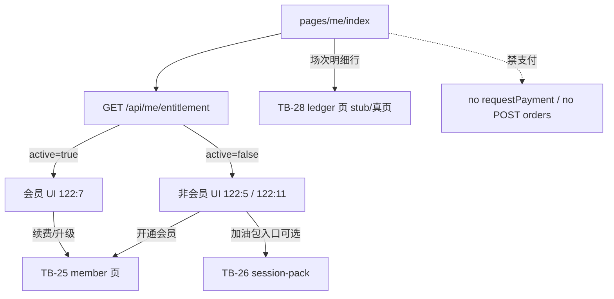

# 题刷刷 · TB-27 / C11 小程序「我」非会员/会员 · C 切片契约（v0.1.0-C）

| 项 | 值 |
| --- | --- |
| 性质 | **C 契约已放行**（辉 t94u「开始实施商业化 v2.0.0…」整线进 C + Owner 点名 TB-27/C11 handoff；辉确认进C=YES） |
| 放行 | **2026-11-07**（Asia/Shanghai） |
| hui_quote | 产品经理PRD t94u「开始实施商业化v2.0.0（包含免费用户题库优先功能）的代码开发」 |
| 架构版本旁注 | **v0.1.0-C**（TB-27 / 看板 C11；相对商业化 PRD v2.0.0 §3.1/§5.4/§7 + TB-20 entitlement + TB-23/C7 支付页入口 + TB-24/25/26） |
| 依据 | 商业化 PRD v2.0.0 §「我」会员状态/到期/用量 · 看板规划 C11 · 小程序 design 包帧 **`122:5` / `122:11` / `122:7`** · TB-20 `GET /api/me/entitlement` · TB-4 Me 页现状 |
| 上游 | **TB-20 已合**（账本/只读 entitlement）· **TB-23/C7 已合**（支付）· **TB-24/25/26 已合**（半屏/会员页/加油包页；main@`bfd21c25`） |
| 仓 | https://github.com/zh7551069/ai-tishuashua |
| 进仓约定 | 合码 PR 应落到 `docs/contracts/tb27-miniapp-me-member-states-C-contracts-v0.1.0-C.md`；旁注修订可选 `docs/mini-commerce.md` |
| 本地 arch 副本 | `/Volumes/My PSSD/notion_files/题刷刷/arch/C 契约 · TB-27 小程序「我」非会员会员（2026-11-07）.md` |
| 契约归属 | 架构师；**全栈不得私开支付于「我」页 / 禁写死价·场次·到期 / 禁双开 Me 路由 / 禁把场次明细全量塞进本刀 / 禁改 entitlement 扣场语义 而不申报** |
| 业务对接 | 题刷刷 · 业务组 |
| 合码 | **仅辉当面「合」授权** |
| 写码 | **等 Owner 点全栈**；本文件不授权开工写码、不点名 Cloud Agent |
| UI 开工 | **须先过「UI 技术评审三行留痕」**；未过审禁前端开工 |
| 开工包齐 | **仍否**（本刀只出契约） |

> **放行范围**：本文件为正式 C。在既有 `pages/me/index`（TB-4 Me 壳）上叠加商业化态：非会员（`122:5`/`122:11`）与会员（`122:7`）对稿；会员状态/到期/用量以 **`GET /api/me/entitlement`** 为准。**「我」页禁止支付下单**；开通/续费/升级 CTA → TB-25 `pages/commerce/member`；加油包入口 → TB-26 `pages/commerce/session-pack`。场次明细**全量列表**归 TB-28（`122:9`）。签到/分享/邀请**发奖 runtime** 归 C13。新 HTTP endpoint = **0**。不合码直至辉当面「合」。

---

## 0. 硬拍板（不可改）

| # | 拍板 | 备注 |
| --- | --- | --- |
| **H1** | **路由唯一**：只增强既有 **`pages/me/index`**；**禁止**新建第二套「我」页 / 平行 tab / 双开与 TB-4 抢同一入口 | 避免与 TB-4 双开 |
| **H2** | **新 HTTP endpoint = 0**；只消费既有 `GET /api/me/entitlement`（主数据源）；可选只读 `GET /api/commerce/skus`（会员档展示名/入口价文案 enrich，禁写死）；**本刀不强制**调 ledger（全量明细归 TB-28） | 改路由须回 Arch |
| **H3** | **到期/用量/会员态以服务端 entitlement 为准**；禁客户端写死日免配额、库存、到期日、SKU 价 | `balances.*` / `membership.*` / `refine.*` |
| **H4** | **「我」页禁止支付**：不得 `wx.requestPayment` / `POST /api/orders` / mock-notify；CTA 仅 `navigateTo` 支付页 | 对齐 Owner；与 TB-25/26 划界 |
| **H5** | **与 TB-4 边界**：TB-4 保留壳（资料卡/刷题统计/主题色/错题本·刷题包·练习记录·设置、本地签到 UI 壳）；本刀加商业化块（会员卡/今日剩余场次/开通·续费入口/场次明细行/分享·邀请入口行 + v2 签到文案）。TB-4 业务需求「明确不做计费/会员/配额」→ **商业化增量归 TB-27，不回写进 TB-4 范围** | 见 §1.3 |
| **H6** | **与 TB-28 边界**：本刀仅「场次明细」**入口行 + 摘要 meta**；**不做** `122:9` 流水全量列表/筛选/分页 UI；点行 → 导航 TB-28 路由（可 stub） | 见 §1.3 |
| **H7** | **签到发奖 runtime ≠ 本刀**：可对稿签到区 v2 文案与态（非会员「领 +1 场」/ 会员不限场「提炼次」展示）；**服务端 grant daily_task / 会员提炼次发放** 归 **C13**；本刀不得假装已入账改余额 | 现状 Me 签到仍为 local-prefs；可保留至 C13 |
| **H8** | **不改** TB-20 四桶 / reserve / 日切 / 扣场序；**不改** TB-23 支付状态机；**不回退** TB-24 半屏禁支付 | |
| **H9** | 样式权威：`design/小程序（商业化v2.0.0）/`；必评帧 **`122:5` / `122:11` / `122:7`**；**禁** `design/dev-cache` / `figma-dev-cache` / `get_design_context` | Bridge 仅副源 |
| **H10** | 本刀 **含小程序前端**；前端开工前必须有 Arch「UI 技术评审三行留痕」 | 见 §8 |
| **H11** | 会员卡展示：`membership.active===true` → `122:7` 态；否则 → 非会员态（`122:5`/`122:11` 为同一页不同子态，见 §4） | |
| **H12** | 会员档文案（周/月/季/年卡）由 `skuCode` +（可选）`GET /api/commerce/skus?type=member` 名称映射；**到期日**格式化 `membership.endsAt`（Asia/Shanghai 日历日）；禁写死「2026-12-01」 | |
| **H13** | 分享/邀请菜单行：可对稿入口；深链至既有 `pages/commerce/tasks`（或后续 C13 页）；**发奖/绑定/封顶 runtime 非本刀** | |



---

## 1. 范围与硬约束

### 1.1 做（本刀）

1. **「我」页商业化对稿**（增强 `pages/me/index`）：非会员 / 会员两套主态；非会员含签到前后子态（对稿 `122:5`/`122:11`）。
2. **拉 `GET /api/me/entitlement`**（`useDidShow` / 回页刷新）：渲染会员状态、到期、今日剩余场次（日免 remain/quota · 奖励 · 库存）、提炼提示。
3. **非会员用量卡**：大数字「今日剩余」= `dailyFreeRemain + dailyTaskRemain + inventoryRemain`（会员态不展示该扣场合计，改展示会员卡）；副文案 `日免 {remain}/{quota} · 奖励 {dailyTaskRemain} · 库存 {inventoryRemain}`；主 CTA「开通会员」→ TB-25。
4. **会员卡**：标题「题刷刷会员 · 生效中」；副标「{档名} · 到期 {YYYY-MM-DD} · 不限场」；辅文「提炼不限 · 可升级补差价续费」→ 点卡或 CTA 进 TB-25。
5. **菜单增量行**（插入既有菜单合适位置，对稿）：
   - **场次明细**：非会员 meta 优先 `库存 {inventoryRemain}`（可选「今日消耗」见 E1）；会员 meta「会员不限场 · 明细可查」；导航 TB-28。
   - **邀请有礼** / **每日分享**：入口行 + v2 摘要文案；runtime 归 C13。
6. **签到区文案 v2**：非会员未签「今日签到 · 领 +1 场」；已签「今日已签到 · 已领 +1 场」；会员不限场展示「提炼次」向文案（对稿 `122:7`）；**不**在本刀改服务端余额。
7. 保留 TB-4 既有：资料卡、刷题数/正确率/连续天数、错题本/刷题包/练习记录/设置、主题色。
8. 文档进仓约定路径见文首。

### 1.2 不做（本刀严禁）

| 禁项 | 归属 |
| --- | --- |
| 新造 entitlement/支付/订单 HTTP endpoint | **0 新路由** |
| 「我」页内 `requestPayment` / `POST /api/orders` / mock-notify | 禁；归 TB-25/26 |
| 场次明细全量列表 / 筛选 / 分页 UI（`122:9`） | **TB-28 / C12** |
| 签到/分享/邀请服务端发奖、邀请绑定、封顶 | **C13** |
| 新建第二套 Me 页或拆 tab 双开 | 与 TB-4 冲突 |
| 手改余额 / 客户端伪造会员 / 写死价与场次 | 架构禁 |
| 半屏内支付回退 | **TB-24 H5** |
| 广告 / 金币 / 证书通关包 / 短信登录 | 总禁 |
| 退款 | 人工；非本刀 |

### 1.3 边界钉死（TB-4 · TB-28 · C13）

| 切片 | 本刀关系 |
| --- | --- |
| **TB-4** Me/签到/主题色 | **同路由增强，不双开**。TB-4：壳与非商业化能力；TB-27：会员/用量/商业化入口与 v2 签到文案。TB-4 原「不做计费/会员/配额」继续成立——那些由 TB-27 承担。若 TB-4 后续视觉对齐，不得覆盖本刀商业化块语义。 |
| **TB-28** 场次明细 `122:9` | 本刀只做入口行；列表/「当前可用」大卡/流水条目归 TB-28。可注册 stub 路由（建议 `pages/commerce/session-ledger/index` 或 Owner/全栈既定名）以便导航，真实现 TB-28。 |
| **C13** 增长 runtime | 签到入账、分享打开发奖、邀请绑定；本刀 UI 入口可先挂 `pages/commerce/tasks`。 |
| **TB-25 / TB-26** | 支付与定价页；本刀只导航。 |
| **TB-24** | 半屏仍禁支付；与「我」无关。 |

---

## 2. 支付依赖结论

| 项 | 结论 |
| --- | --- |
| 「我」页支付 | **不做**（H4） |
| 开通/续费/升级 | 跳转 **TB-25**（已复用 C7） |
| 加油包 | 跳转 **TB-26**（已复用 C7） |
| 新 endpoint | **0**（论证：TB-20 entitlement 已覆盖会员/四桶/提炼只读；支付已在 C7 页完成） |

---

## 3. API 触达（复用 · **0 新 endpoint**）

| API | 本刀用途 |
| --- | --- |
| **`GET /api/me/entitlement`** | **主数据源**：`membership.active/endsAt/skuCode`、`balances.dailyFreeRemain/dailyFreeQuota/dailyTaskRemain/inventoryRemain`、`refine.unlimited` 等 |
| **`GET /api/commerce/skus?type=member`** | 可选：档名/推荐价文案 enrich（入口副文案）；**禁**写死 ¥28 等 |
| **`GET /api/commerce/skus?type=session_pack`** | 可选：加油包入口价 enrich；**禁**写死 ¥6/5 场 |
| **`GET /api/me/entitlement/ledger`** | **本刀不强制**；全量 UI 归 TB-28。若为「今日消耗」摘要可选只读粗算（E1），不得借机做明细页 |
| **`POST /api/orders` / upgrade-quote / mock-notify** | **本刀禁止调用** |
| 既有 user/packs/scores/wrong-book | 继续服务 TB-4 壳（资料/统计/菜单） |

### 3.1 字段 ↔ UI（entitlement）

| UI | 字段 |
| --- | --- |
| 是否会员态 | `membership.active` |
| 到期日 | `membership.endsAt` → Asia/Shanghai `YYYY-MM-DD` |
| 档名 | `membership.skuCode` → skus.name 或约定映射（`member_week/month/quarter/year` → 周/月/季/年卡） |
| 日免 remain/quota | `balances.dailyFreeRemain` / `balances.dailyFreeQuota` |
| 奖励 | `balances.dailyTaskRemain` |
| 库存 | `balances.inventoryRemain` |
| 今日剩余（非会员大数字） | remain 三桶之和 |
| 提炼不限 | `refine.unlimited`（= active） |

### 3.2 刷新时机

- 进入/回前台 `useDidShow` 必拉 entitlement（支付页返回后可见会员/库存变化）。
- 加载/失败态沿用 Me 页既有 LoadingBlock / ErrorBlock 模式；entitlement 失败时不得假装会员或写死用量。

---

## 4. 对 UI 约束（帧 `122:5` / `122:11` / `122:7`）

> 样式源：`/Volumes/My PSSD/notion_files/题刷刷/design/小程序（商业化v2.0.0）/`（辉手导）。PRD 钉 Figma：非会员 `122:5`/`122:11`，会员 `122:7`。导出 HTML 以文案/层级为准；包内顶层 id 可能不出现字面 `122:*`（同 TB-24/25/26 先例）；**禁** `get_design_context`。

### 4.1 帧分工

| 帧 | 态 | 要点（design 正文） |
| --- | --- | --- |
| **`122:5`** | 非会员主态 | 今日剩余场次卡 +「开通会员」；签到「今日签到 · 领 +1 场」；场次明细 meta 含库存 |
| **`122:11`** | 非会员子态（已签到等） | 同页结构；签到区「今日已签到 · 已领 +1 场」等；用量仍跟 API |
| **`122:7`** | 会员生效中 | 「题刷刷会员 · 生效中」+ 档/到期/不限场；「提炼不限 · 可升级补差价续费」；签到「提炼次」向；场次明细「会员不限场 · 明细可查」 |

实现：**单页状态机**，非三路由。

### 4.2 非本刀帧

| 帧 | 切片 |
| --- | --- |
| `122:3` 用尽半屏 | C8 已合 |
| `122:4` 会员定价 | C9 已合 · CTA 目标 |
| `122:6` 加油包 | C10 已合 · 可选入口目标 |
| `122:9` 场次明细 | **C12 / TB-28** |
| `122:8` / `122:10` 分享/邀请 | C13 |

### 4.3 路由

| 路由 | 说明 |
| --- | --- |
| `pages/me/index` | **本刀主页**（增强） |
| `pages/commerce/member/index` | 开通/续费/升级 |
| `pages/commerce/session-pack/index` | 加油包 |
| `pages/commerce/tasks/index` | 任务/分享入口（既有；C13 深做） |
| `pages/commerce/session-ledger/index`（建议名） | TB-28；本刀可 stub 注册 |

---

## 5. 前端四件套（专节）

> 四件套清单 = **PRD / 契约 / 必评帧 / design 包路径**（开工门禁）+ 组件/状态/禁项（评审抓手）。

### 5.0 开工四件套路径（Owner 清单）

| # | 件 | 路径 |
| --- | --- | --- |
| 1 | PRD | `/Volumes/My PSSD/notion_files/题刷刷/prd/题刷刷 · 商业化 _ 权益 _ 增长 PRD（v2.0.0）__7ccdbf2e.md` |
| 2 | 本契约 | `/Volumes/My PSSD/notion_files/题刷刷/arch/C 契约 · TB-27 小程序「我」非会员会员（2026-11-07）.md`（进仓 `docs/contracts/tb27-miniapp-me-member-states-C-contracts-v0.1.0-C.md`） |
| 3 | 必评帧 | **`122:5` / `122:11` / `122:7`** |
| 4 | design 包 | `/Volumes/My PSSD/notion_files/题刷刷/design/小程序（商业化v2.0.0）/`（禁 cache / `get_design_context`；Bridge 仅副源） |

### 5.1 组件（可测）

| 组件（建议名，可合并） | 职责 | 可测点 |
| --- | --- | --- |
| **`MePage`**（既有增强） | 拉 entitlement + 原 TB-4 数据；按 active 切态 | 回页刷新 |
| **`MeUsageCard`** | 非会员今日剩余 + 三桶文案 + 开通 CTA | 数字=API；CTA→member |
| **`MeMemberCard`** | 会员生效卡 + 到期 + 续费/升级入口 | active 时出现；禁写死到期 |
| **`MeCheckinPanel`** | v2 文案；本地或后续 C13 | 会员/非会员文案分支 |
| **`MeCommerceMenu`** | 场次明细/邀请/分享行 + 既有菜单 | 明细→TB-28；无支付调用 |

### 5.2 状态（客户端 · 可测）

```text
loading → ready_non_member（122:5 / 122:11 子态）
        → ready_member（122:7）
        → error（可重试；不伪造权益）
```

| 约束 | 可测点 |
| --- | --- |
| `membership.active` 决定主态 | 灌会员后回「我」变 122:7 |
| 支付成功返回 | 库存/会员字段更新 |
| 无 entitlement 时 | 不展示假「不限场」 |

### 5.3 对稿帧（可测）

| 帧 | 要求 |
| --- | --- |
| **`122:5`** | 非会员主态可对稿 |
| **`122:11`** | 非会员子态（如已签到）可对稿 |
| **`122:7`** | 会员态可对稿 |
| 非评 | `122:9` 等不对稿验收 |

### 5.4 禁项清单（可测）

| # | 禁项 | 验收抓手 |
| --- | --- | --- |
| F1 | 「我」页调用支付/下单 API | grep 无 `requestPayment`/`POST /api/orders` 于 me 树 |
| F2 | 写死日免 2 / 库存 / 到期日 / ¥ 价 | 改后管配额或灌 entitlement 后 UI 变 |
| F3 | 新 HTTP endpoint | diff 无新 controller 路由（除非 Arch 修订） |
| F4 | 实现 `122:9` 全量明细 | 无 ledger 列表页完备实现 |
| F5 | 双开 Me 路由 | 仍唯一 `pages/me/index` |
| F6 | 签到直接改服务端余额（本刀） | 无新增 grant 调用冒充 C13 |
| F7 | 半屏禁支付回退 | TB-24 锁仍在 |
| F8 | 广告 SDK / 金币 | 无 |

---

## 6. 可测验收（恰好 8 条）

1. **非会员对稿**：非会员用户进 `pages/me/index` → 拉 entitlement 成功 → 展示今日剩余三桶文案与「开通会员」；数字与 API 一致（**非**写死）；主结构可对 `122:5`。
2. **会员对稿**：有效会员（`membership.active`）→ 展示「题刷刷会员 · 生效中」+ 档名 + 到期日（来自 `endsAt`）+ 不限场/提炼不限；可对 `122:7`；**无**「今日剩余」扣场大数字误导。
3. **开通导航**：点「开通会员」→ `navigateTo` `pages/commerce/member/index`；**不**在「我」页建单/支付。
4. **续费/升级导航**：会员卡「可升级补差价续费」（或等价 CTA）→ TB-25；「我」页无 `upgrade-quote`/下单。
5. **回页刷新**：在 TB-25/26 mock 支付成功返回「我」→ entitlement 重拉 → 会员态或 `inventoryRemain` 变化可见。
6. **场次明细边界**：存在「场次明细」入口行；点击进入 TB-28 路由（stub 可）；本 PR **无** `122:9` 流水全量列表完备实现。
7. **TB-4 不双开**：仍为单一 `pages/me/index`；资料卡/统计/错题本/设置等壳能力保留；无第二 Me 页注册抢入口。
8. **范围锁**：本 PR **无**新支付/entitlement HTTP 路由、**无**「我」页 `requestPayment`、**无**密钥真值、**无**改 TB-20 扣场顺序；签到服务端发奖未冒充完成（C13）。

---

## 7. 开放问题

**阻塞开放问题：0。**

| # | 项 | 状态 |
| --- | --- | --- |
| O1 | 「我」页可否支付 | **已拍**：否；CTA 跳 TB-25/26 |
| O2 | 新 API | **已拍**：0 |
| O3 | 与 TB-4 | **已拍**：同路由增强，商业化归 TB-27 |
| O4 | 场次明细 | **已拍**：入口本刀；全量 TB-28 |
| O5 | 签到发奖 | **已拍**：文案本刀；runtime C13 |
| E1 | 「今日消耗」摘要是否用 ledger 粗算 | 工程自决；不阻塞；无则只展示库存 meta |
| E2 | TB-28 stub 路由最终 path 名 | 工程自决；契约建议 `session-ledger` |
| E3 | 122:5 vs 122:11 精确子态划分（已签到/其它） | 以 design 正文为准；同页状态机；不阻塞 |

**需辉拍板：无。**

---

## 8. 门禁

| 项 | 规则 |
| --- | --- |
| 写码 | **等 Owner 点全栈** |
| 前端 | **须先** Arch「UI 技术评审三行留痕」通过（必改=0）后方可开工对稿 |
| 合码 | **仅辉当面「合」**；Arch 合码评审三行 ≠ 合码授权 |
| 样式 | 只用 `design/小程序（商业化v2.0.0）/`；禁 cache / `get_design_context` |
| 后端 | 本刀后端改动预期 ≈0；若需改 entitlement 响应字段须回 Arch |
| 广播 | **禁**本执行助手点全栈 / merge / 广播设计或全栈 |

---

## 9. shared / 文档同步清单（合码 PR 用）

1. `docs/contracts/tb27-miniapp-me-member-states-C-contracts-v0.1.0-C.md`（本文）。
2. （可选）`docs/mini-commerce.md`：「我」页态与 TB-25/26/28 导航边界。
3. `apps/mini`：增强 `pages/me/*`；可选 stub TB-28 路由；**勿**在 me 树引入支付下单。
4. 不要求改 `apps/api` entitlement/payment 核心；发现字段缺口另报 Arch。

---

## 10. 非目标 / 后续指针

| 切片 | 内容 |
| --- | --- |
| TB-28 / C12 | 场次明细全量（`122:9`） |
| C13 | 签到/分享/邀请发奖 runtime |
| TB-4 | 非商业化 Me 视觉对齐（若仍排队）；不得双开路由 |

---

*完 · 题刷刷 · TB-27 / C11 小程序「我」非会员/会员 · C 契约 v0.1.0-C · 2026-11-07（Asia/Shanghai）· 对齐 PRD v2.0.0 / TB-4 / TB-20 / TB-25 / TB-26 / TB-28 · 写码不开 · 合码仅辉当面「合」*
