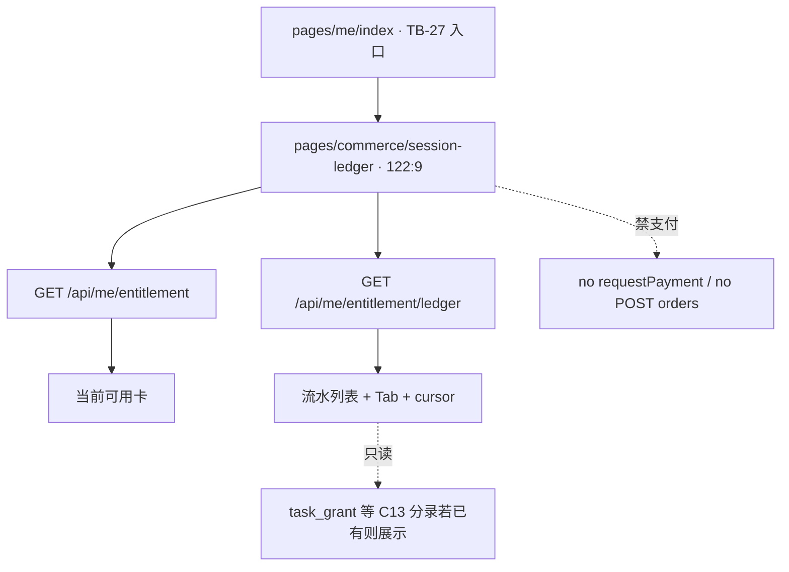

# 题刷刷 · TB-28 / C12 小程序场次明细 · C 切片契约（v0.1.0-C）

| 项 | 值 |
| --- | --- |
| 性质 | **C 契约已放行**（辉 t94u「开始实施商业化 v2.0.0…」整线进 C + Owner 点名 TB-28/C12 handoff；辉确认进C=YES） |
| 放行 | **2026-11-07**（Asia/Shanghai） |
| hui_quote | 产品经理PRD t94u「开始实施商业化v2.0.0（包含免费用户题库优先功能）的代码开发」 |
| 架构版本旁注 | **v0.1.0-C**（TB-28 / 看板 C12；相对商业化 PRD v2.0.0 §3.1/§7 + 架构 v0.2 Me 场次明细 + TB-20 ledger API + TB-27 入口 stub） |
| 依据 | 商业化 PRD v2.0.0 §「我」场次明细 · 看板规划 C12 · 小程序 design 包帧 **`122:9`** · TB-20 `GET /api/me/entitlement` + `GET /api/me/entitlement/ledger` · TB-27 stub `pages/commerce/session-ledger` |
| 上游 | **TB-20 已合**（账本/ledger 只读 API）· **TB-27 已合** `main@39f92720`（「我」入口行 + session-ledger stub） |
| 仓 | https://github.com/zh7551069/ai-tishuashua |
| 进仓约定 | 合码 PR 应落到 `docs/contracts/tb28-miniapp-session-ledger-C-contracts-v0.1.0-C.md`；旁注修订可选 `docs/mini-commerce.md` |
| 本地 arch 副本 | `/Volumes/My PSSD/notion_files/题刷刷/arch/C 契约 · TB-28 小程序场次明细（2026-11-07）.md` |
| 契约归属 | 架构师；**全栈不得私开支付于明细页 / 禁写死可用场次·消耗数 / 禁新 HTTP endpoint（默认） / 禁改 ledger 只追加语义 / 禁把 C13 发奖 runtime 塞进本刀 / 禁回退 TB-27 入口边界 而不申报** |
| 业务对接 | 题刷刷 · 业务组 |
| 合码 | **仅辉当面「合」授权** |
| 写码 | **等 Owner 点全栈**；本文件不授权开工写码、不点名 Cloud Agent |
| UI 开工 | **须先过「UI 技术评审三行留痕」**；未过审禁前端开工 |
| 开工包齐 | **仍否**（本刀只出契约） |

> **放行范围**：本文件为正式 C。将 TB-27 占位页 **`pages/commerce/session-ledger/index`** 换成对稿 **`122:9`** 真页：顶卡「当前可用」+ 流水全量列表 + Tab 筛选（全部/获得/消耗）+ cursor 分页。数据源 **`GET /api/me/entitlement`**（摘要）+ **`GET /api/me/entitlement/ledger`**（流水）。**本页禁止支付下单**；若稿面出现购买 CTA，仅 `navigateTo` TB-25/26。C13 增长发奖 **runtime 非本刀**；ledger 已有任务/邀请分录则 **只读展示**。新 HTTP endpoint = **0**（既有 ledger 已覆盖列表/分页）。不合码直至辉当面「合」。

---

## 0. 硬拍板（不可改）

| # | 拍板 | 备注 |
| --- | --- | --- |
| **H1** | **路由唯一**：增强既有 **`pages/commerce/session-ledger/index`**（TB-27 stub → 真页）；**禁止**另开第二套明细页抢入口 | TB-27 已注册 app.config |
| **H2** | **新 HTTP endpoint = 0**；只消费既有 `GET /api/me/entitlement` + `GET /api/me/entitlement/ledger?limit&cursor`；**不**为筛选项新开路由；**不**暴露 grant/支付 | 改路由须回 Arch |
| **H3** | **可用场次 / 流水数字以服务端为准**；禁客户端写死「当前可用 3」「今日消耗 2」「+2 场」等 | entitlement.balances + ledger.items |
| **H4** | **本页禁止支付**：不得 `wx.requestPayment` / `POST /api/orders` / mock-notify / upgrade-quote；购买 CTA（若有）仅 `navigateTo` TB-25/26 | Owner 默认只读 |
| **H5** | **与 TB-27 边界**：TB-27 仅「我」页入口行 + 摘要 meta + stub 导航；本刀做 `122:9` 全量列表/筛选/分页；**不回改**「我」页支付禁令与三态语义 | 见 §1.3 |
| **H6** | **与 C13 边界**：签到/分享/邀请 **发奖 runtime、绑定、封顶** 归 C13；本刀对已入账的 `task_grant` / 邀请类 inventory 等分录 **只读展示**；不得本刀调 grant 假装已发奖 | 见 §1.3 |
| **H7** | **ledger 只追加、只读消费**；不改 TB-20 四桶 / reserve / 日切 / 扣场序；不改 entitlement_ledger 写路径 | TB-20 H7 |
| **H8** | 列表主数据 = ledger `items`（新→旧）；分页 = 既有 `nextCursor`（limit 默认 20、最大 50）；触底/「加载更多」续拉 | API 已具备 |
| **H9** | Tab 筛选对齐稿：**全部 / 获得 / 消耗**；映射 `全部`=不过滤、`获得`=`delta>0`、`消耗`=`delta<0`（含 delta=0 会员场见 E2）；**默认客户端过滤已加载页**；不要求本刀加服务端 filter query | 见 E1 |
| **H10** | 样式权威：`design/小程序（商业化v2.0.0）/`；必评帧 **`122:9`**；**禁** `design/dev-cache` / `figma-dev-cache` / `get_design_context` | Bridge 仅副源 |
| **H11** | 本刀 **含小程序前端**；前端开工前必须有 Arch「UI 技术评审三行留痕」 | 见 §8 |
| **H12** | 会员态：`membership.active===true` → 「当前可用」展示 **不限场** 向文案（对稿/产品一致即可）；**不**用三桶之和冒充「剩余场次」误导；流水仍展示（含 membership/deduct） | |
| **H13** | 行文案：`reason`→可读标题（见 §4.3）；`delta` 带符号（`+N 场` / `−N 场`）；时间用 `createdAt`（Asia/Shanghai）；**禁** invent 订单金额/支付态 | ledger 不含订单详情（TB-20 §6.2） |



---

## 1. 范围与硬约束

### 1.1 做（本刀）

1. **场次明细真页**（对稿 `122:9`）：替换 TB-27 `CommerceStub` 为完整页。
2. **顶卡「当前可用」**：非会员 = `dailyFreeRemain + dailyTaskRemain + inventoryRemain`（与 TB-27 今日剩余同口径）；副文对齐稿意（如日免用尽提示 + 库存说明，数字来自 API）；会员 = 不限场文案（H12）。
3. **「今日消耗」摘要**（若稿面有）：当日 `bizDate===businessDate` 且 `delta<0` 的场次合计（可由已拉 ledger 粗算，或首屏足够后展示；**禁写死**）。计算策略见 E3，不阻塞。
4. **流水列表**：渲染 `GET /api/me/entitlement/ledger`；行含类型标（获得/消耗）、标题、时间、±场次。
5. **Tab：全部 / 获得 / 消耗**（H9）。
6. **分页**：`nextCursor` 续拉；空态/加载/失败可重试；失败不伪造流水。
7. **入口可达**：自「我」场次明细行 `navigateTo` 本路由（TB-27 已接）。
8. 文档进仓约定路径见文首。

### 1.2 不做（本刀严禁）

| 禁项 | 归属 |
| --- | --- |
| 新造 entitlement/支付/订单/ledger 写 HTTP endpoint | **0 新路由** |
| 本页 `requestPayment` / `POST /api/orders` / mock-notify / upgrade-quote | 禁；归 TB-25/26 |
| 签到/分享/邀请服务端发奖、邀请绑定、封顶 | **C13** |
| 改「我」页三态主逻辑 / 双开 Me | **TB-27 / TB-4** |
| 手改余额 / 客户端伪造流水 / 写死可用场次 | 架构禁 |
| 半屏内支付回退 | **TB-24 H5** |
| 广告 / 金币 / 证书通关包 / 短信登录 | 总禁 |
| 退款 / 冲正 Lot | 人工；非本刀 |
| 把支付订单详情页塞进本刀 | ledger 不含订单；非本刀 |

### 1.3 边界钉死（TB-27 · C13 · 支付页）

| 切片 | 本刀关系 |
| --- | --- |
| **TB-27** 「我」 | 入口 + 摘要 meta 已合；本刀只替换 stub 真页。不回改「我」禁支付。 |
| **C13** 增长 | 发奖 runtime 非本刀；**已入账**分录只读展示（含签到/分享/邀请文案映射）。 |
| **TB-25 / TB-26** | 若稿有购买入口 → 仅导航；本页无支付。 |
| **TB-20** | 复用 ledger/entitlement；不改写路径。 |
| **TB-22** 后管补发/作废 | 分录若出现（如 `admin_revoke` / grant）→ 只读展示；不做后管 UI。 |
| **TB-24** | 半屏仍禁支付；与明细无关。 |

---

## 2. 支付依赖结论

| 项 | 结论 |
| --- | --- |
| 明细页支付 | **不做**（H4） |
| 购买 CTA | 仅跳转 **TB-25 / TB-26**（稿面若无 CTA 则可不做按钮） |
| 新 endpoint | **0**（论证：TB-20 已提供 ledger 分页只读；摘要用 entitlement） |

---

## 3. API 触达（复用 · **0 新 endpoint**）

| API | 本刀用途 |
| --- | --- |
| **`GET /api/me/entitlement`** | 顶卡：三桶 remain、`dailyFreeQuota`、`membership.active`、`businessDate` |
| **`GET /api/me/entitlement/ledger`** | 流水：`limit`（默认 20，最大 50）、`cursor`；响应 `{ items, nextCursor }` |
| **`POST /api/orders` / mock-notify / upgrade-quote / grant** | **本刀禁止调用**（含 dev grant；测数据由环境预置，不在本页灌） |
| skus | **不强制**；本页非售卖页 |

### 3.1 `EntitlementLedgerItem` ↔ UI

| UI | 字段 |
| --- | --- |
| ±场次 | `delta`（正=获得，负=消耗；0 见 E2） |
| 获得/消耗标 | `delta>0` → 获得；`delta<0` → 消耗 |
| 标题 | `reason`（+ 可选 bucket）映射，见 §4.3 |
| 时间 | `createdAt` → Asia/Shanghai 可读（「今天 HH:mm」/日期） |
| 业务日 | `bizDate`（今日消耗粗算） |
| 分页 | `nextCursor` |

### 3.2 刷新时机

- 进入页 / `useDidShow`：并行拉 entitlement + ledger 首页。
- 切 Tab：优先本地过滤；必要时可重置 cursor 重拉（工程自决，不阻塞）。
- 加载失败：ErrorBlock + 重试；不得展示假流水。

---

## 4. 对 UI 约束（帧 `122:9`）

> 样式源：`/Volumes/My PSSD/notion_files/题刷刷/design/小程序（商业化v2.0.0）/`（辉手导）。PRD 钉 Figma node `122:9`。导出 HTML 以文案/层级为准；包内顶层 id 可能不出现字面 `122:9`（同 TB-24–27 先例）；**禁** `get_design_context`。

### 4.1 帧要点（design 正文摘录）

| 区域 | 文案/结构（对稿） |
| --- | --- |
| 标题 | 场次明细 |
| 顶卡 | 「当前可用」+ 大数字；副文如「日免已用完 · 含场次加油库存 {n}」 |
| 区块 | 「今日消耗」 |
| Tab | **全部 / 获得 / 消耗** |
| 行例（获得） | 「日免额度发放」+2；「每日签到奖励」+1；「场次加油包 · 5 场」+5；「次日 00:00 日免重置」 |
| 行例（消耗） | 「AI 出题 · {证} · {N} 题」−1 |

生产页**不带** `v2.0.0` 角标（与 TB-27 建议一致）。

### 4.2 非本刀帧

| 帧 | 切片 |
| --- | --- |
| `122:5` / `122:11` / `122:7` | C11 已合（入口） |
| `122:3` / `122:4` / `122:6` | C8–C10 已合 |
| `122:8` / `122:10` | **C13** |

### 4.3 reason → 标题映射（建议表 · 可微调文案不得改 reason 枚举）

| reason | 默认标题（可对稿微调） |
| --- | --- |
| `daily_grant` | 日免额度发放 |
| `daily_expire` | 日免/奖励过期清零（或稿「次日 00:00 日免重置」） |
| `task_grant` | 任务奖励（签到/分享等；细分文案见 E4） |
| `inventory_grant` | 场次加油入账（可拼 qty；来源 session_pack 时对「场次加油包」） |
| `membership_grant` | 会员生效/续费 |
| `deduct` | AI 出题（证/题数若无元数据则短标题「AI 出题」） |
| `release_restore` | 出题取消退回 |
| `reserve_hold` | 预扣（若列表出现；可折叠或同消耗风格） |
| `admin_revoke` | 权益调整（作废） |

> **E5**：消耗行「· FDE · 20 题」依赖 session 元数据；ledger 现无该字段 → **本刀不新开 endpoint**；先短标题，enrich 另议。

### 4.4 路由

| 路由 | 说明 |
| --- | --- |
| `pages/commerce/session-ledger/index` | **本刀主页**（替换 stub） |
| `pages/me/index` | 入口（TB-27） |
| `pages/commerce/member` / `session-pack` | 可选购买导航目标 |

---

## 5. 前端四件套（专节）

> 四件套清单 = **PRD / 契约 / 必评帧 / design 包路径**（开工门禁）+ 组件/状态/禁项（评审抓手）。

### 5.0 开工四件套路径（Owner 清单）

| # | 件 | 路径 |
| --- | --- | --- |
| 1 | PRD | `/Volumes/My PSSD/notion_files/题刷刷/prd/题刷刷 · 商业化 _ 权益 _ 增长 PRD（v2.0.0）__7ccdbf2e.md` |
| 2 | 本契约 | `/Volumes/My PSSD/notion_files/题刷刷/arch/C 契约 · TB-28 小程序场次明细（2026-11-07）.md`（进仓 `docs/contracts/tb28-miniapp-session-ledger-C-contracts-v0.1.0-C.md`） |
| 3 | 必评帧 | **`122:9`** |
| 4 | design 包 | `/Volumes/My PSSD/notion_files/题刷刷/design/小程序（商业化v2.0.0）/`（禁 cache / `get_design_context`；Bridge 仅副源） |

### 5.1 组件（可测）

| 组件（建议名，可合并） | 职责 | 可测点 |
| --- | --- | --- |
| **`SessionLedgerPage`** | 拉 entitlement+ledger；编排顶卡/Tab/列表 | 进页双请求 |
| **`LedgerAvailabilityCard`** | 当前可用 + 副文；会员不限场 | 数字=API；禁写死 |
| **`LedgerFilterTabs`** | 全部/获得/消耗 | Tab 切换过滤 |
| **`LedgerList`** | 行渲染 + 空态 + 续拉 | cursor 分页；失败可重试 |
| **`LedgerRow`** | reason 映射 + ± 符号 + 时间 | 获得/消耗标正确 |

### 5.2 状态（客户端 · 可测）

```text
loading → ready（有/无数据）
        → loading_more
        → error（可重试；不伪造流水）
filter ∈ { all, credit, debit }
```

| 约束 | 可测点 |
| --- | --- |
| 非会员当前可用=三桶之和 | 改 entitlement 后数字变 |
| 会员顶卡不限场 | active 时不展示误导性剩余大数 |
| nextCursor 非空可续拉 | 灌多条后触底增加行 |
| 无支付 API 调用 | grep 页树 |

### 5.3 对稿帧（可测）

| 帧 | 要求 |
| --- | --- |
| **`122:9`** | 顶卡 + Tab + 列表示意可对稿 |
| 非评 | `122:8`/`122:10` 等不对稿验收 |

### 5.4 禁项清单（可测）

| # | 禁项 | 验收抓手 |
| --- | --- | --- |
| F1 | 本页调用支付/下单 API | grep 无 `requestPayment`/`POST /api/orders` 于 session-ledger 树 |
| F2 | 写死当前可用 / 今日消耗 / ± | 改 entitlement/ledger 后 UI 变 |
| F3 | 新 HTTP endpoint | diff 无新 controller 路由（除非 Arch 修订） |
| F4 | 本刀实现 C13 发奖 grant | 无新增用户侧 grant/任务完成写路径 |
| F5 | 另开第二明细路由 | 仍唯一 `pages/commerce/session-ledger` |
| F6 | 改 TB-20 扣场/日切/ledger 写 | 无 entitlement 写路径行为变更 |
| F7 | 半屏禁支付回退 | TB-24 锁仍在 |
| F8 | 广告 SDK / 金币 | 无 |

---

## 6. 可测验收（恰好 8 条）

1. **对稿进页**：自「我」点「场次明细」→ 进入 `pages/commerce/session-ledger` → 拉 entitlement + ledger 成功 → 顶卡「当前可用」与 API 一致（**非**写死）；主结构可对 `122:9`。
2. **流水列表**：存在 ledger 分录时列表展示获得/消耗标、±场次、可读标题、时间；顺序新→旧。
3. **Tab 筛选**：切换「全部 / 获得 / 消耗」后列表符合 H9 映射（获得仅 `delta>0`，消耗仅 `delta<0`）。
4. **分页**：`nextCursor` 非空时续拉追加行且无整表重置丢数据；末页 `nextCursor=null` 停止。
5. **会员顶卡**：`membership.active` → 顶卡为不限场向文案；不把三桶之和当「剩余可扣场」大数字误导。
6. **空/错态**：无流水 → 明确空态；接口失败 → 可重试且不展示假数据。
7. **禁支付**：本页树无 `requestPayment` / `POST /api/orders` / mock-notify；若有购买入口仅 `navigateTo` TB-25/26。
8. **范围锁**：本 PR **无**新 HTTP 路由、**无**C13 发奖 runtime、**无**改 TB-20 扣场语义、**无**密钥真值；TB-27「我」入口仍可达本页。

---

## 7. 开放问题

**阻塞开放问题：0。**

| # | 项 | 状态 |
| --- | --- | --- |
| O1 | 本页可否支付 | **已拍**：否；CTA 仅导航 |
| O2 | 新 API | **已拍**：0；复用 ledger |
| O3 | 与 TB-27 | **已拍**：入口归 27；全量归 28 |
| O4 | 与 C13 | **已拍**：runtime 归 C13；分录只读展示 |
| E1 | Tab 是否要服务端 filter query | 工程自决；默认客户端过滤；不阻塞 |
| E2 | `delta===0`（会员场）归入哪 Tab | 建议「全部」可见；「消耗」可含或不含——工程自决并在 PR 说明 |
| E3 | 「今日消耗」数字算法（仅首屏 / 另计） | 工程自决；禁写死；不阻塞 |
| E4 | `task_grant` 细分为签到/分享文案 | 无额外字段时统一「任务奖励」；有 ref/source 再细分；不阻塞 |
| E5 | 消耗行证名/题数 enrich | **本刀不新开 API**；短标题即可；另议不阻塞 |

**需辉拍板：无。**

---

## 8. 门禁

| 项 | 规则 |
| --- | --- |
| 写码 | **等 Owner 点全栈** |
| 前端 | **须先** Arch「UI 技术评审三行留痕」通过（必改=0）后方可开工对稿 |
| 合码 | **仅辉当面「合」**；Arch 合码评审三行 ≠ 合码授权 |
| 样式 | 只用 `design/小程序（商业化v2.0.0）/`；禁 cache / `get_design_context` |
| 后端 | 本刀后端改动预期 ≈0；若需改 ledger 响应字段须回 Arch |
| 广播 | **禁**本执行助手点全栈 / merge / 广播设计或全栈 |

---

## 9. shared / 文档同步清单（合码 PR 用）

1. `docs/contracts/tb28-miniapp-session-ledger-C-contracts-v0.1.0-C.md`（本文）。
2. （可选）`docs/mini-commerce.md`：场次明细页与 TB-27 入口、C13 只读分录边界。
3. `apps/mini`：替换 `pages/commerce/session-ledger/*` stub 为真页；**勿**引入支付下单。
4. 不要求改 `apps/api` entitlement 核心；发现字段缺口另报 Arch（E5）。

---

## 10. 非目标 / 后续指针

| 切片 | 内容 |
| --- | --- |
| C13 | 签到/分享/邀请发奖 runtime（`122:8`/`122:10`） |
| TB-27 | 「我」入口已合；本刀不回改 |
| 可选后续 | ledger 行 session 元数据 enrich（非本刀必做） |

---

*完 · 题刷刷 · TB-28 / C12 小程序场次明细 · C 契约 v0.1.0-C · 2026-11-07（Asia/Shanghai）· 对齐 PRD v2.0.0 / TB-20 ledger / TB-27 stub / 帧 122:9 · 写码不开 · 合码仅辉当面「合」*
