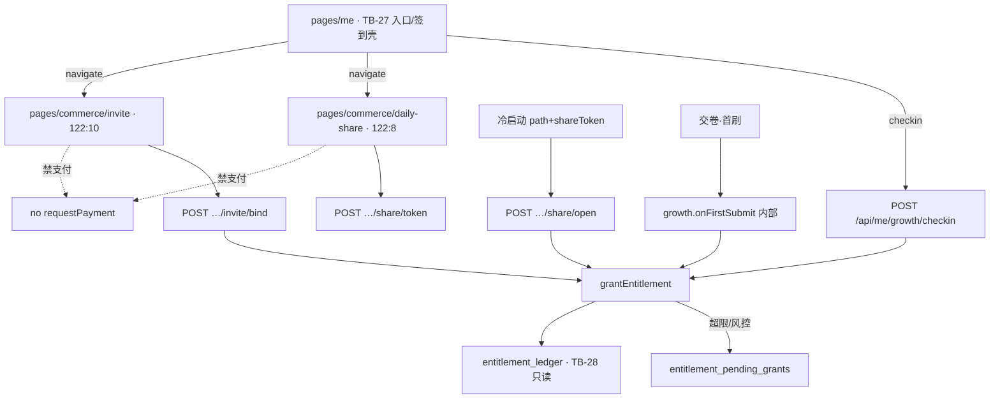

# 题刷刷 · TB-29 / C13 每日分享与邀请有礼 · C 切片契约（v0.1.0-C）

| 项 | 值 |
| --- | --- |
| 性质 | **C 契约已放行**（辉确认进C=YES + Owner 点名 TB-29/C13 handoff；经产品经理PRD） |
| 放行 | **2026-11-07**（Asia/Shanghai） |
| hui_quote | 产品经理PRD t94u「开始实施商业化v2.0.0…」整线进 C；本刀经 Owner handoff 出 C |
| 架构版本旁注 | **v0.1.0-C**（TB-29 / 看板 C13；相对商业化 PRD v2.0.0 §6 增长 + 架构 v0.2 Growth + TB-20 grant + TB-21 growthConfig + TB-22 pending + TB-27 入口） |
| 依据 | 商业化 PRD v2.0.0 §6 签到/分享/拉新 · 看板规划 C13 · 小程序 design 包帧 **`122:8` / `122:10`** · TB-20 `grantEntitlement` · TB-21 `growthConfig` · TB-22 `entitlement_pending_grants` · TB-27 Me 入口行 · TB-28 只读分录已合 |
| 上游 | **TB-20/21/22/27/28 已合**（main 含 `5ef8d2f` TB-28）；本刀读 `growthConfig`、复用 `grantEntitlement`、写 pending |
| 仓 | https://github.com/zh7551069/ai-tishuashua |
| 进仓约定 | 合码 PR 应落到 `docs/contracts/tb29-daily-share-invite-C-contracts-v0.1.0-C.md`；旁注修订可选 `docs/mini-commerce.md` / `docs/growth.md` |
| 本地 arch 副本 | `/Volumes/My PSSD/notion_files/题刷刷/arch/C 契约 · TB-29 每日分享与邀请有礼（2026-11-07）.md` |
| 契约归属 | 架构师；**全栈不得私开支付于分享/邀请页 / 禁写死奖额·封顶数字（须读 growthConfig）/ 禁旁路改余额（必须经 grantEntitlement）/ 禁 pending 自动发奖 / 禁回退 TB-27/28 边界 而不申报** |
| 业务对接 | 题刷刷 · 业务组 |
| 合码 | **仅辉当面「合」授权** |
| 写码 | **等 Owner 点全栈**；本文件不授权开工写码、不点名 Cloud Agent |
| UI 开工 | **须先过「UI 技术评审三行留痕」**；未过审禁前端开工 |
| 开工包齐 | **仍否**（本刀只出契约） |
| 拆刀 | **默认一刀** TB-29 = C13（签到 runtime + 每日分享 + 邀请有礼）；可选拆法见 §11（非默认） |

> **放行范围**：本文件为正式 C。落地增长 **发奖 runtime**：①「我」页签到 CTA 接服务端入账；②对稿 **`122:8` 每日分享**；③对稿 **`122:10` 邀请有礼**。奖额/开关/封顶读 **TB-21 `growthConfig`**；入账一律 **`grantEntitlement`**（签到/分享 → `daily_task` + `task_grant`；拉新 → `inventory` + `inventory_grant`）。超限/风控写入 **`entitlement_pending_grants`**（TB-22 人工）。**本页禁止支付**。TB-28 明细页仍只读；本刀成功 grant 后 ledger 应出现对应分录。**不合码直至辉当面「合」**。

---

## 0. 硬拍板（不可改）

| # | 拍板 | 备注 |
| --- | --- | --- |
| **H1** | **本刀 = 增长发奖 runtime + 分享/邀请对稿页**；含签到服务端入账（Me CTA 接线）、每日分享、邀请绑定与双节点奖 | TB-27 仅文案壳；TB-28 只读分录 |
| **H2** | **入账唯一通道**：`grantEntitlement`（shared）；**禁止**业务 SQL 直接改 `daily_*_remain` / 手插 ledger | 对齐架构 v0.2 |
| **H3** | **配置源 = TB-21 `growthConfig`**（短缓存可读）；奖额/开关/封顶 **禁写死**在小程序或 API 常量（测试 fixture 除外） | 见 §3 |
| **H4** | **本刀页面禁止支付**：分享/邀请/tasks 树不得 `wx.requestPayment` / `POST /api/orders` / mock-notify；购买 CTA（若有）仅 `navigateTo` TB-25/26 | Owner 默认 |
| **H5** | **与 TB-27 边界**：Me 保留入口行与签到 UI 壳；本刀 **接线** `POST …/checkin` + 导航至分享/邀请真页；**不回改**「我」禁支付与三态主语义 | |
| **H6** | **与 TB-28 边界**：本刀 **不做**明细 UI；grant 成功后 ledger 自然出现 `task_grant` / `inventory_grant`；明细页继续只读 | |
| **H7** | **桶语义**：签到/分享 → **`daily_task`**（当日未用随 00:00 清零）；拉新注册/首刷 → **`inventory`**（跨日；近过期优先由 TB-20） | PRD §6 |
| **H8** | **幂等键钉死**（见 §4.4）；重复请求不得双加；返回 200 + `applied:false` 或等价已领态 | |
| **H9** | **邀请**：一人一邀请人（`inviteeUserId` UNIQUE）；**禁自邀**；邀请人日封顶 **6** / 周封顶 **15**（读 config，默认同 PRD）；超限或风控 → **pending**，**一律人工**（禁自动解 pending） | TB-22 |
| **H10** | **分享**：每天最多领 **1** 次（sharer 侧）；须被分享者带 `shareToken` **冷启动 path** 才发奖；空点分享不发；朋友圈与好友 **共用**日额度 | PRD §6.2 |
| **H11** | **会员分享**：`membership.active===true` → **不发** `daily_task` 场次、**不发**提炼次；UI 展示「今日已享会员不限场」向文案。`growthConfig.share.memberRefineBonus` **本刀 runtime 忽略**（配置可存；与 PRD §6.2/§11 拍板一致；design 旧文案「改发提炼次」以 PRD 为准，UI 评审对齐） | 见 E1 |
| **H12** | **样式权威**：`design/小程序（商业化v2.0.0）/`；必评帧 **`122:8` / `122:10`**；**禁** `design/dev-cache` / `figma-dev-cache` / `get_design_context`；Bridge 仅副源。顶层 `data-layer-id="122:*"` 可能缺失时，以正文标题「每日分享领场」「邀请有礼」所在 `844×390` 帧 + 子层 `127:*` 对稿 | 先例同 TB-27/28 |
| **H13** | **新 C 端 growth HTTP 允许且须论证**（§2）；**禁止**把用户侧 grant 挂到 `/api/dev/entitlement/grant`；**禁止**扩 `wrong_items` / 题库编辑 / 广告 / 金币 | |
| **H14** | 本刀 **含 API + 小程序前端**（+ 必要 migration/shared）；前端开工前必须有 Arch「UI 技术评审三行留痕」 | 见 §8 |
| **H15** | **密钥/商户号**：本刀无支付；禁引入微信商户密钥真值；分享仅用业务 `shareToken`（非支付） | |



---

## 1. 范围与硬约束

### 1.1 做（本刀）

1. **Growth 模块（API）**：读 `growthConfig`；签到 / 分享 token+打开领奖 / 邀请绑定 / 首刷奖钩子；封顶与 pending 写入。
2. **签到 runtime**：Me 页既有签到 CTA → `POST /api/me/growth/checkin`；成功刷新 entitlement；已签幂等。
3. **每日分享页**（对稿 `122:8`）：规则说明、今日状态、分享给好友/朋友圈 CTA；拉 token；展示已领/未领/会员跳过态。
4. **邀请有礼页**（对稿 `122:10`）：邀请码/海报入口、奖励一览（注册/首刷双方）、邀请人日周封顶进度、规则脚注。
5. **冷启动**：小程序启动解析 `shareToken` / `inviterId`（或 `inviteCode`）；登录后调 open/bind。
6. **表**：`invite_relations`、`growth_task_states`、`growth_share_tokens`（命名可微调，语义钉死）；复用 TB-22 `entitlement_pending_grants`。
7. **shared**：增长错误码 + 幂等键约定 +（可选）growth 状态 DTO。
8. 文档进仓约定路径见文首。

### 1.2 不做（本刀严禁）

| 禁项 | 归属 |
| --- | --- |
| 本页 `requestPayment` / `POST /api/orders` / mock-notify | 禁；归 TB-25/26 |
| 场次明细全量列表/筛选 UI | **TB-28**（已合） |
| 「我」三态主壳重做 / 双开 Me | **TB-27 / TB-4** |
| 后管 growth 配置 UI / SKU | **TB-21**（已合） |
| 后管 pending 人工补发/作废 UI | **TB-22**（已合）；本刀只 **写入** pending |
| pending 自动解封/自动发奖 | **总禁** |
| 旁路改余额 / 客户端伪造已领 | 架构禁 |
| 广告 / 金币 / 证书通关包 / 短信登录 | 总禁 |
| 支付退款冲正 | 人工；非本刀 |
| 把 C7 支付或 C8 半屏支付回退塞进本刀 | 禁 |

### 1.3 边界钉死（TB-27 · TB-28 · 支付 · 后管）

| 切片 | 本刀关系 |
| --- | --- |
| **TB-27** 「我」 | 入口 + 签到文案壳已合；本刀接线 checkin + 分享/邀请真页导航。不回改禁支付。 |
| **TB-28** 明细 | 只读；本刀 grant 后分录可见即可，不做明细 UI。 |
| **TB-25 / TB-26** | 若稿有购买入口 → 仅导航；本页无支付。 |
| **TB-24** | 半屏仍禁支付；用尽半屏「做任务」可 `navigateTo` 本刀页。 |
| **TB-20** | 复用 `grantEntitlement` / ensureDay / ledger；不改扣场序与四桶定义。 |
| **TB-21** | 只读 `growthConfig`；本刀不改后管配置页。 |
| **TB-22** | 本刀写 pending；人工补发/作废仍走后管。 |

---

## 2. 新 endpoint 论证与清单

### 2.1 为何不能 0 新路由？

| 既有能力 | 能否覆盖本刀 | 结论 |
| --- | --- | --- |
| `GET /api/me/entitlement` (+ ledger) | 只读余额/流水；无「今日是否已签/已领分享」、无 shareToken、无邀请码与封顶进度 | **不足** |
| `POST /api/dev/entitlement/grant` | 仅 seed/门闩；生产 404；非用户任务语义 | **禁用** |
| `POST /api/admin/commerce/entitlements/:id/grant` | 后管补发；鉴权 admin；非 C 端任务 | **禁用** |
| TB-23 订单回调 grant | 付费路径；与增长无关 | **无关** |

→ **必须新增 C 端 growth 路由族**（建议挂 `me/growth`，与 `me/entitlement` 并列）。内部仍只调 `grantEntitlement`。

### 2.2 新增 HTTP（C 端 · 均需登录 Session）

| Method | Path | 职责 |
| --- | --- | --- |
| `GET` | `/api/me/growth` | 聚合态：checkin/share 今日态、邀请码、封顶已用、配置快照（奖额/开关）、pending 摘要（可选） |
| `POST` | `/api/me/growth/checkin` | 签到领场 |
| `POST` | `/api/me/growth/share/token` | 创建或返回今日有效 `shareToken`（sharer） |
| `POST` | `/api/me/growth/share/open` | 被分享者上报冷启动 `shareToken` → 给 **分享者** 发奖（条件满足时） |
| `POST` | `/api/me/growth/invite/bind` | 绑定邀请人（注册/首次携带 inviter） |

**非新 HTTP（内部钩子）**：

| 钩子 | 触发 | 职责 |
| --- | --- | --- |
| `growth.onFirstSubmit(userId)` | 既有交卷成功且判定「生涯首刷交卷」 | 双方首刷奖 / 封顶 / pending |

> 交卷路由 **不**为增长单开 path；在既有 submit handler 末尾调钩子（事务边界见 §4.5）。

### 2.3 支付依赖结论

| 项 | 结论 |
| --- | --- |
| 分享/邀请页支付 | **不做**（H4） |
| 依赖 C7 下单 | **无** |
| 新支付 endpoint | **0** |

---

## 3. 配置（复用 TB-21 · 禁写死）

默认（与 TB-21 §3.2 一致；以库内 settings 为准）：

```json
{
  "checkin": { "enabled": true, "rewardSessions": 1 },
  "share": {
    "enabled": true,
    "rewardSessions": 1,
    "memberRefineBonus": 1
  },
  "invite": {
    "registerEnabled": true,
    "inviterRegisterSessions": 1,
    "inviteeWelcomeSessions": 1,
    "firstSubmitEnabled": true,
    "inviterFirstSubmitSessions": 3,
    "inviteeFirstSubmitSessions": 2,
    "dailyCapEnabled": true,
    "dailyCapSessions": 6,
    "weeklyCapEnabled": true,
    "weeklyCapSessions": 15
  }
}
```

| 键 | 本刀语义 |
| --- | --- |
| `checkin.enabled` / `rewardSessions` | 关则 checkin 返回「未开启」；奖入 `daily_task` |
| `share.enabled` / `rewardSessions` | 同上；会员 active → 跳过发奖（H11）；**忽略** `memberRefineBonus` 入账 |
| `invite.*` | 双节点奖额与日/周封顶；`registerEnabled` 控制注册节点邀请人奖（PRD：可关） |

缓存：沿用 TB-21 `sysset:growthConfig`（建议 ≤60s）；本刀读侧失效策略与 TB-21 一致即可。

---

## 4. 数据模型与发奖规则

### 4.1 表（概念）

#### `invite_relations`

| 字段 | 说明 |
| --- | --- |
| `invitee_user_id` | PK / UNIQUE；一人一邀请人 |
| `inviter_user_id` | 邀请人；≠ invitee |
| `bound_at` | timestamptz |
| `invite_code_used` | text；可选审计 |

#### `growth_task_states`

| 字段 | 说明 |
| --- | --- |
| `(user_id, business_date)` | PK；`business_date` = Asia/Shanghai 日历日 |
| `checkin_done` | bool |
| `share_claimed` | bool |
| `updated_at` | |

#### `growth_share_tokens`

| 字段 | 说明 |
| --- | --- |
| `token` | PK；高熵随机（禁可猜测 userId） |
| `sharer_user_id` | |
| `business_date` | 当日有效；跨日作废 |
| `created_at` | |
| `first_open_at` | nullable；审计 |
| `claimed_at` | nullable；sharer 入账成功时 |

> 同一 sharer 同一 `business_date` 可复用同一 token（`POST …/token` 幂等返回）。

#### 复用 `entitlement_pending_grants`（TB-22）

| `source` 建议值 | 场景 |
| --- | --- |
| `invite_register` | 注册节点超限/风控 |
| `invite_first_submit` | 首刷节点超限/风控 |
| （可选）`share_open` | 仅当实现选择分享也进 pending；**默认分享超日额度直接拒绝/已领，不进 pending** |

`risk_code` 例：`daily_cap` / `weekly_cap` / `self_invite` / `suspicious`（信号清单可后管配置，E2 非阻塞）。

### 4.2 发奖矩阵

| 节点 | 受益方 | 桶 | reason | 默认数量 | 封顶 |
| --- | --- | --- | --- | --- | --- |
| 签到 | 本人 | `daily_task` | `task_grant` | `checkin.rewardSessions`（1） | 日 1 次（状态机） |
| 分享·打开 | **分享者** | `daily_task` | `task_grant` | `share.rewardSessions`（1） | 日 1 次；会员跳过 |
| 拉新·注册 | 邀请人 | `inventory` | `inventory_grant` | `inviterRegisterSessions`（1） | 日/周封顶；可关 |
| 拉新·注册 | 新用户 | `inventory` | `inventory_grant` | `inviteeWelcomeSessions`（1） | 每 invitee 1 次 |
| 拉新·首刷 | 邀请人 | `inventory` | `inventory_grant` | `inviterFirstSubmitSessions`（3） | 日/周封顶 |
| 拉新·首刷 | 新用户 | `inventory` | `inventory_grant` | `inviteeFirstSubmitSessions`（2） | 每 invitee 1 次 |

`inventory` lot：`source` 建议 `invite` / `invite_register` / `invite_first_submit`；`expires_at` 默认与加油包策略对齐（若无单独配置：**365 天**，E3）。

### 4.3 分享打开认定

1. 被分享者冷启动 path 带 `shareToken`（query / scene 解析，实现选一并单测锁）。
2. 用户完成登录后 `POST /api/me/growth/share/open { shareToken }`。
3. 校验：token 存在、`business_date=today`、sharer ≠ opener（**禁给自己刷**）、share.enabled、sharer 非会员（或会员则标记 skip 不发）、sharer 今日未 `share_claimed`。
4. 成功：`grantEntitlement(sharer, { type:'daily_task', qty, refId })`；置 `share_claimed`；写 `claimed_at`。
5. 空点分享（仅点按钮未产生有效 open）→ **不发**。

### 4.4 幂等键（`grantEntitlement.refId`）

| 场景 | `refId` |
| --- | --- |
| 签到 | `checkin:{userId}:{bizDate}` |
| 分享领奖（sharer） | `share:{sharerId}:{bizDate}` |
| 邀请人·注册 | `invite_reg_inviter:{inviteeId}` |
| 新用户·欢迎 | `invite_reg_invitee:{inviteeId}` |
| 邀请人·首刷 | `invite_fs_inviter:{inviteeId}` |
| 新用户·首刷 | `invite_fs_invitee:{inviteeId}` |

重复 → 不双加；API 返回已领/已绑定语义。

### 4.5 事务与封顶

1. **邀请人奖**计入日/周额度前先查已用（建议 Redis 或 PG 聚合 `inventory_grant` where source invite* + bizDate/week）；超限 → **pending**（不 grant），`risk_code=daily_cap|weekly_cap`。
2. 新用户欢迎/首刷奖 **不受**邀请人封顶限制（各自 refId）；但仍禁自邀、须已绑定。
3. checkin / share / bind / firstSubmit 与 ledger 追加 **同事务**（pending INSERT 亦同事务）。
4. 首刷钩子：与交卷成功同请求内调用；失败不得回滚已成功交卷——若增长失败 → 记日志 + 可补偿任务（E4）；契约要求：**不得静默丢首刷奖**（至少进 pending 或可重试队列）。推荐：增长子事务失败则写 pending `source=invite_first_submit` + `risk_code=grant_error` 或同步重试 1 次。

### 4.6 错误码（shared 一次加齐）

| Code | HTTP | 语义 |
| --- | --- | --- |
| `GROWTH_DISABLED` | 403 | 对应开关 enabled=false |
| `GROWTH_ALREADY_CLAIMED` | 409 | 今日已签/已领分享 |
| `GROWTH_ALREADY_BOUND` | 409 | 已有邀请人 |
| `GROWTH_SELF_INVITE` | 400 | 自邀 / 自己打开自己的分享刷奖 |
| `GROWTH_INVALID_TOKEN` | 400 | shareToken 无效/过期 |
| `GROWTH_CAP_REACHED` | 409 | 日/周封顶（若选择不进 pending 而硬拒时）；**默认超限进 pending 则邀请人路径返回 200 + `pending:true`** |
| `GROWTH_CONDITION_NOT_MET` | 400 | 条件不满足（如分享未打开就 claim） |
| `UNAUTHORIZED` | 401 | 未登录（既有） |

> 会员分享跳过：推荐 **200** + `{ applied:false, reason:'member_unlimited' }`，不强制错误码。

---

## 5. API 契约（字段级）

### 5.1 `GET /api/me/growth`

**200** 示例：

```json
{
  "businessDate": "2026-11-07",
  "checkin": { "enabled": true, "done": false, "rewardSessions": 1 },
  "share": {
    "enabled": true,
    "claimed": false,
    "rewardSessions": 1,
    "memberSkip": false,
    "statusText": "今日未领"
  },
  "invite": {
    "code": "TS-HU8",
    "boundInviterId": null,
    "dailyUsed": 2,
    "dailyCap": 6,
    "weeklyUsed": 5,
    "weeklyCap": 15,
    "registerEnabled": true,
    "rewards": {
      "inviterRegister": 1,
      "inviteeWelcome": 1,
      "inviterFirstSubmit": 3,
      "inviteeFirstSubmit": 2
    }
  },
  "membershipActive": false
}
```

数字均来自 config + 服务端计数；**禁**客户端写死 6/15/1/3/2。

### 5.2 `POST /api/me/growth/checkin`

- Body：空 `{}` 或可省略。
- 成功 200：`{ applied: true, rewardSessions, balances }`（balances 可同 entitlement 摘要）。
- 已签：200 `{ applied:false }` 或 409 `GROWTH_ALREADY_CLAIMED`（二选一，**推荐 200 幂等**，单测锁）。
- 关：403 `GROWTH_DISABLED`。

### 5.3 `POST /api/me/growth/share/token`

- 200：`{ shareToken, businessDate, pathHint }`；`pathHint` 为建议冷启动 path 模板（如 `/pages/home/index?shareToken=`）。
- 关：403。

### 5.4 `POST /api/me/growth/share/open`

- Body：`{ "shareToken": "…" }`。
- 成功给 sharer 发奖：200 `{ applied:true, sharerRewarded:true }`。
- 会员 sharer / 已领 / 无效：见 §4.6；**不**给 opener 发分享奖。

### 5.5 `POST /api/me/growth/invite/bind`

- Body：`{ "inviterId": "…" }` 或 `{ "inviteCode": "TS-…" }`（实现须支持其一，文档钉死；推荐 **inviteCode** 对外、内部解析 userId）。
- 成功：绑定 + 按开关发注册双方奖或 pending。
- 自邀 / 已绑定：对应错误码。

### 5.6 首刷钩子

- 无独立 HTTP；交卷成功且 `isLifetimeFirstSubmit(userId)` → 发双方奖。
- 「首刷」定义：**该用户生涯第一次成功交卷**（非本卷重交）；单测锁。

---

## 6. 对 UI 约束（§5 专节）

### 6.1 帧职责

| 帧 | 职责 | 路由 |
| --- | --- | --- |
| **`122:8`** | **每日分享领场**：规则卡、今日状态（未领/等待打开/已领/会员跳过）、主 CTA「分享给微信好友」、次 CTA「分享到朋友圈」 | `pages/commerce/daily-share/index` |
| **`122:10`** | **邀请有礼**：邀请码/头图、奖励一览（注册 +1/+1、首刷 +3/+2）、邀请人封顶「今日 a/6 · 本周 b/15」、主 CTA「分享邀请海报 / 链接」、脚注（一人一邀请人、pending、跨日库存） | `pages/commerce/invite/index` |
| （非对稿帧）签到 | Me 页既有区；本刀接线态 | `pages/me/index` |

design 正文摘录（对稿锚点；顶层 122 可能映射为子层 127）：

- 分享：标题「每日分享领场」；规则 1–5；状态「未领取 · 等待好友打开」；「与朋友圈共用每日额度」。
- 邀请：标题「邀请有礼」；「我的邀请码 TS-HU8」；「日封顶 6 场 · 周封顶 15 场」；CTA「分享邀请海报 / 链接」。

**文案冲突（E1）**：稿面规则第 4 条「会员改发提炼次」→ **以 PRD 为准**改为「会员不限场时不另发场次/提炼次，展示已享会员不限场」。UI 评审三行须确认。

### 6.2 路由

| 路由 | 说明 |
| --- | --- |
| `pages/commerce/daily-share/index` | 新建；对稿 122:8 |
| `pages/commerce/invite/index` | 新建；对稿 122:10 |
| `pages/commerce/tasks/index` | TB-27 stub「做任务领场次」→ 本刀改为 **入口聚合**（两行链到 daily-share / invite）或 `redirectTo` 其一；**禁止**再留空 stub 误导 |
| `pages/me/index` | 签到 CTA 接线；菜单行 navigate 到上述页 |

### 6.3 本页禁支付

默认 **禁**。稿面无支付 CTA 预期；若有会员/加油入口 → 仅 `navigateTo`。

### 6.4 前端四件套（Owner 清单）

| # | 件 | 路径 |
| --- | --- | --- |
| 1 | PRD | `/Volumes/My PSSD/notion_files/题刷刷/prd/题刷刷 · 商业化 _ 权益 _ 增长 PRD（v2.0.0）__7ccdbf2e.md` |
| 2 | 本契约 | `/Volumes/My PSSD/notion_files/题刷刷/arch/C 契约 · TB-29 每日分享与邀请有礼（2026-11-07）.md` |
| 3 | 帧 id | **`122:8`**、**`122:10`**（签到 UI 已在 Me，无独立必评帧） |
| 4 | design 包 | `/Volumes/My PSSD/notion_files/题刷刷/design/小程序（商业化v2.0.0）/` |

四件套 **齐**（开工包齐仍否 = 未点全栈/未 UI 评审）。

### 6.5 组件（可测）

| 组件 | 职责 |
| --- | --- |
| `DailySharePage` | 122:8 对稿；调 token + 微信分享；展示 GET growth.share |
| `InvitePage` | 122:10 对稿；展示 code/封顶/奖励表；分享邀请 |
| `TasksHub`（可选） | tasks 聚合入口 |
| Me checkin wiring | 调 checkin；刷新 entitlement |

### 6.6 禁项清单（可测 · F）

| # | 禁 | 验法 |
| --- | --- | --- |
| **F1** | 分享/邀请/tasks 树调用支付/下单 | grep 无 `requestPayment` / `POST /api/orders` |
| **F2** | 写死奖额 1/3/2 或封顶 6/15 | 改 growthConfig 后 UI/发奖变 |
| **F3** | 绕过 `grantEntitlement` 改余额 | 无裸 SQL 改 remain；ledger 有对应 reason |
| **F4** | pending 自动发奖 | 无定时器/cron 解 pending |
| **F5** | 实现 122:9 明细或回改 Me 三态主逻辑 | 无 |
| **F6** | 用 `/api/dev/entitlement/grant` 冒充任务 | 生产路径无调用 |
| **F7** | 半屏禁支付回退 | TB-24 锁仍在 |
| **F8** | 广告 SDK / 金币 | 无 |

---

## 7. 可测验收（恰好 8 条 · A）

1. **A1 签到**：未签用户 `POST …/checkin` → `daily_task_remain` +config；ledger `task_grant`；再次请求幂等不双加；`GET …/growth.checkin.done=true`。
2. **A2 分享打开**：sharer 取 token → 另一用户冷启动 open → sharer `share_claimed` 且 +场；空点不发；同日第二次 open 不双加。
3. **A3 会员分享**：会员 sharer open → **不**加 `daily_task`、**不**加提炼次；返回 skip/文案「今日已享会员不限场」可测。
4. **A4 邀请绑定**：B 带 A 的 inviteCode bind → 关系唯一；双方注册奖入 `inventory`（或按开关）；自邀 400；重复 bind 409。
5. **A5 首刷奖**：已绑定新用户生涯首次交卷 → 邀请人 +3 / 新用户 +2（读 config）；再次交卷不发。
6. **A6 封顶→pending**：邀请人日已满 6 → 再获邀请人奖进 `entitlement_pending_grants`（status=pending）；**无**自动变 granted；库存不增。
7. **A7 禁支付 + 配置源**：daily-share/invite/tasks 树无支付调用；将 `share.rewardSessions` 改为 2 后新业务日发 2（非写死 1）。
8. **A8 范围锁**：本 PR **无**支付商户密钥真值、**无**改 TB-20 扣场序、**无**明细页重写、**无**pending 自动解；TB-28 对 `task_grant`/`inventory_grant` 仍只读可展示。

---

## 8. 门禁

| 项 | 状态 |
| --- | --- |
| 辉确认进 C | **YES**（Owner handoff） |
| 本契约 v0.1.0-C | **已放行写契约** |
| 开工包齐 | **仍否** |
| 写码 / Cloud | **未开**；等 Owner 点全栈 |
| UI 技术评审三行 | **未做**；前端开工前必过 |
| 合码 | **未合**；仅辉当面「合」 |
| 广播 / SendToAgent / 发用户 | **本执行助手不做** |

---

## 9. shared / 文档同步清单（合码 PR 用）

1. `packages/shared`：增长错误码；（可选）GrowthView 类型；**勿**把 Node SQL 经 browser barrel 导出。
2. `docs/contracts/tb29-daily-share-invite-C-contracts-v0.1.0-C.md`。
3. （可选）`docs/growth.md` 或 `docs/mini-commerce.md`：分享冷启动参数、邀请码、与 TB-27/28 边界。
4. migration：`invite_relations` / `growth_task_states` / `growth_share_tokens`。

---

## 10. 开放问题

| # | 题 | 状态 |
| --- | --- | --- |
| **E1** | design「会员改发提炼次」vs PRD「不改发」 | **已拍（契约）**：跟 PRD；UI 评审改文案 |
| **E2** | 风控进 pending 的行为信号清单 | 非阻塞；可先 cap + self_invite；信号后补 |
| **E3** | 拉新 inventory lot 默认有效期 | **建议 365 天**；若 Owner 另定再改 |
| **E4** | 交卷成功但增长子失败 | 见 §4.5；不得静默丢 |
| **E5** | invite 对外用 inviterId 还是 inviteCode | **推荐 inviteCode**；实现钉死一种 |
| **O1** | 是否拆刀 | **默认不拆**；见 §11 |

---

## 11. 拆刀建议（默认不拆）

| 方案 | 内容 | 依赖 | 建议 |
| --- | --- | --- | --- |
| **默认 · 一刀 TB-29** | 签到 runtime + `122:8` + `122:10` + growth API + 表 | TB-20/21/22/27 | **采用** |
| 可选 TB-29a | 签到 + 分享（`122:8`）+ share API | 同上 | 仅当排期/风险需削峰 |
| 可选 TB-29b | 邀请（`122:10`）+ bind + 首刷钩子 + pending 写 | **建议 29a 先合**（共享 growth 模块骨架） | 非默认 |

若拆：29a 先落地 `GET /api/me/growth` 骨架与 `growth_task_states`；29b 加 `invite_*` 与封顶。

---

## 12. 非目标 / 后续指针

| 项 | 说明 |
| --- | --- |
| 后管 pending 工作台增强 | 已有 TB-22；可视运营再开刀 |
| 分享海报视觉精细化 | 可跟版；不阻塞 runtime |
| 风控信号运营配置页 | 后管另刀 |
| TB-28 reason 细分文案 | 可用 ref/source 增强「签到奖励/分享奖励」；非本刀必做 |

---

*完 · TB-29 / C13 C 契约 v0.1.0-C · 2026-11-07（Asia/Shanghai）· 写码未开 · 未合码 · 未广播*
