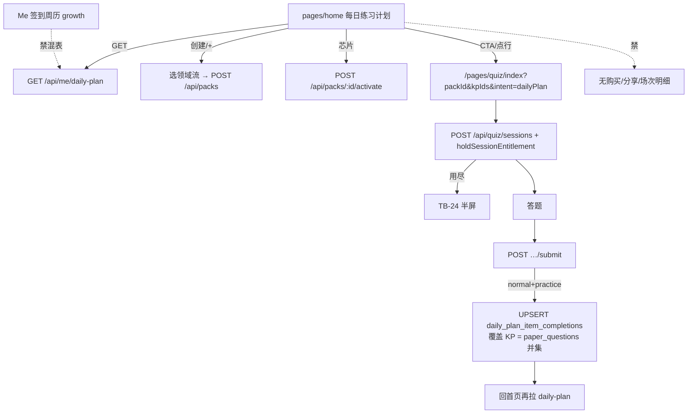

# 题刷刷 · TB-30～34 小程序首页每日练习计划 · C 切片契约（v0.1.0-C）

| 项 | 值 |
| --- | --- |
| 性质 | **C 契约已放行**（辉亲口确认进完整交付 + Owner 点名写 C） |
| 放行 | **2026-11-10**（Asia/Shanghai） |
| hui_quote | Arch 会话用户消息 **t118u**：「按Arch建议全部采纳，确认进入完整交付」（开闸依据仅此原话，不以他人转述为准） |
| 角色 | 架构师 Arch |
| 阶段 | **C** |
| 切片 | **TB-30～TB-34**（**TB-35 可选**，本轮默认不纳入完整交付范围） |
| 架构版本旁注 | **v0.1.0-C**（相对 B 探路短评估 2026-11-10 + 正式 PRD 已开C · 2026-11-10；路径 **A**） |
| 依据 | 正式 PRD · 小程序首页每日练习计划（已开C · 2026-11-10）；业务需求同日；B 架构探路短评估同日；Bridge `design/小程序（首页每日练习）/` |
| 仓 | https://github.com/zh7551069/ai-tishuashua |
| 对照基线 | `origin/main` **`bb21785`**（2026-11-10；B 评估时为 `be11520`，已前进） |
| 看板 | `/Volumes/My PSSD/notion_files/题刷刷/board/题刷刷 · 切片交付看板__25bfa529.json`（行 TB-30～35 已建，状态排队；契约列待挂） |
| 进仓约定 | 合码 PR 应落到 `docs/contracts/tb30-home-daily-plan-C-contracts-v0.1.0-C.md`；旁注修订可选 `docs/packs.md` / `docs/quiz.md`；UI 技术评审落 `docs/delivery/` |
| 本地 arch 副本 | `/Volumes/My PSSD/notion_files/题刷刷/arch/C 契约 · 小程序首页每日练习计划（TB-30～34，2026-11-10）.md` |
| 契约归属 | 架构师；**全栈不得私改路径 / 字段 / 错误码 / 项定义 / 覆盖 KP 算法 / businessDate / 计入 source·mode / 汇总分母规则 而不申报** |
| 业务对接 | 题刷刷 · 业务组 |
| 合码 | **仅辉当面「合」授权** |
| 写码 | **等 Owner 点全栈**；本文件不授权开工写码、不点名 Cloud Agent |
| UI 开工 | **须先过「UI 技术评审三行留痕」**；未过审禁前端开工 |
| 开工包齐 | **仍否**（本刀只出契约） |
| 材料已读 | **正式 PRD**（优先）+ 业务需求 + B 评估 md5 `f99d46dcce74bde82d55c3f265e1ea6e` + Bridge `FRAMES.md`/`index.html`/`styles.css` + 看板 rows TB-30～35 + 仓内 `docs/packs.md` / `docs/quiz.md` / `docs/contracts/` |

> **放行范围**：本文件为正式 C。落地小程序首页「每日练习计划」仪表盘（空态 / 单包 / 多包）+ 与 entitlement **同一** `businessDate` 的「包 × 知识点今日完成」进度层（读聚合 + submit 侧写）。**复用** packs CRUD / 选领域流 / 出题编排 / `holdSessionEntitlement`。**禁止**用成绩列表硬推今日项；**禁止**改四桶语义与扣场序；**禁止**本首页挂购买 / 分享邀请 / 场次明细。写码仍等 Owner 点全栈；前端须 UI 技术评审；**不合码直至辉当面「合」**。

---

## 0. 硬拍板（不可改 · 辉「按 Arch 建议全部采纳」= 对齐 B §5/§9）

| # | 拍板 | 备注 |
| --- | --- | --- |
| **H1** | **路径 A**：独立表 `daily_plan_item_completions` + `GET /api/me/daily-plan` + `QuizService.submit` 成功侧幂等 UPSERT。路径 B（仅用已交卷会话推导）**不作主路径**；仅可作可选冷启动/对账旁路。客户端 **禁止**本地假进度当权威 | B §4 |
| **H2** | **项定义**：1 个知识点在「今日」被标记完成 = **1 项**；每包每日总项 = 该包当前上架 `knowledgePointCount`；多包总项 = 各**可用**包知识点数之和。**禁止**「1 场 / 1 套题 = 1 项」 | B §5.1 |
| **H3** | **完成判定**：用户在业务日内针对该包该 KP **至少成功交卷 1 场**且本场覆盖该 KP。不要求答对；取消 / 未交卷不算 | |
| **H4** | **本场覆盖哪些 KP（钉死）**：以**已交卷试卷上实际出现的 KP**为准——`paper_questions` 上 KP 覆盖的**并集**（题行 `kp_ids` / 等价字段并集；空则该题不计）。**不是**仅看创建会话请求里的 `knowledgePointIds`（请求可作提示，权威以成卷落库为准） | 配合 H6 防整包一场 |
| **H5** | **「今日」** = entitlement 同一套 **`businessDate`（Asia/Shanghai 日历日，00:00 切日）**。进度按日重置（未完成项次日回到待练习）。`inventory` 跨日不清零与此正交：日切清的是「今日项勾选」，不是库存余额。**禁止**自定义「自然日本地时区」 | TB-20 H5 |
| **H6** | **CTA 默认 K=1**：主 CTA「开始今日刷题练习」默认只带当前包「待练习优先」列表中**第一个待练习 KP** 作为 `knowledgePointIds`。用户若在出题设置页改回多 KP / 整包并交卷，则按 H4 试卷实际覆盖的 KP **全部**标 done（**不**因此禁用既有设置页） | P0 |
| **H7** | **计入今日项的 source/mode**：仅 `source=normal` **且** `mode=practice`。`exam`、`retrain_similar`、`variant`（及预留 `wrongSet`）**默认不计入** | |
| **H8** | **读模型**：新增 `GET /api/me/daily-plan`（与 `me/entitlement`、`me/growth` 并列）。`GET /api/packs` **继续只返包元数据**（禁止 `?view=home` 脸胀 PackList）。**禁止**扩展 `GET /api/quiz/sessions` 成绩列表充当首页进度 | |
| **H9** | **写模型**：仅在 `QuizService.submit` **成功**且 H7 满足时 UPSERT；**零扣场**。回写失败 **不阻断**交卷成功响应，但必须有日志/指标（见 §4.5） | |
| **H10** | **周历 v1**：仅展示本周日期条；可用本周「有完成项的日期」做轻量标记；**不可点**历史日改列表 / 回看。**不是**「我」页签到周历：Me=`growth` 签到/本地 streak；首页=练习完成日。UI 可形似，**API/表禁止混用** | |
| **H11** | **知识点行可点**：进入该 KP 练习（预填 `knowledgePointIds`）；已完成行可再练，再练 **保持 done** | |
| **H12** | **创建 /「+」**完全复用选领域流 + `POST /api/packs`；芯片切换 = `POST /api/packs/:id/activate`。保留 `PackSheet`（重命名/删除/不可用）；入口工程约定可接受（头图「…」或芯片区管理/长按），不堵主路径 | |
| **H13** | **不可用包**不计入今日总项与汇总分母；芯片仍可见并标不可用；CTA 对不可用包**禁用** | |
| **H14** | 「我」页刷题包与首页 **同一 `packs` 实体** | |
| **H15** | 本首页 **禁做**购买 / 分享邀请 / 场次明细；**不改** TB-16 选知识点像素；**不改** TB-17 题库编排；**不改**支付/SKU；**不改** entitlement 四桶语义与扣场顺序 | |
| **H16** | **样式权威**：`/Volumes/My PSSD/notion_files/题刷刷/design/小程序（首页每日练习）/`（`index.html` + `styles.css` + `svgs/` + `images/` + `FRAMES.md`）；三态 left **0 单包** / **470 空态** / **940 多包**；主色 `#2563EB`；宽 390。**禁** `design/dev-cache` / `figma-dev-cache` / `get_design_context`。Bridge 副源仅对照 | |
| **H17** | 本刀 **含 API + 小程序前端**（+ 必要 migration/shared）；前端开工前必须有 Arch「UI 技术评审三行留痕」 | 见 §9 |
| **H18** | **TB-35 可选**：不堵 TB-30～34；前端主路径**不等待** TB-35；旧异常态沿用现网工程态 | 见 §8 |



---

## 1. 范围与硬约束

### 1.1 做（TB-30～34）

1. **数据模型**：表 `daily_plan_item_completions` + 索引；migration 进仓。
2. **读 API**：`GET /api/me/daily-plan` 聚合业务日、包列表、KP done、计数/百分比、周条标记、空态标识。
3. **写钩子**：`QuizService.submit` 成功后按 H4/H7 幂等 UPSERT；可观测失败不阻断交卷。
4. **首页 UI 三态对稿**：空态（TB-31）/ 单包（TB-32）/ 多包（TB-33）；替换旧「当前包卡片」IA。
5. **接线（TB-34）**：CTA / 点行 → 现网出题设置 + 创建会话扣场；用尽走 TB-24；交卷回写冒烟。
6. **复用**：packs CRUD、activate、选领域流、PackSheet（管理能力）、出题设置页（可增 query，不禁用改 KP）。
7. **shared**：daily-plan DTO / 错误码（若需）+（可选）类型；禁把 Node SQL 经 browser barrel 导出。
8. 文档进仓约定见文首。

### 1.2 不做（严禁）

| 禁项 | 归属 / 说明 |
| --- | --- |
| 用 `GET /api/quiz/sessions` 或客户端成绩反推今日项 | **总禁**（H8） |
| 改 entitlement 四桶 / 扣场序 / 库存跨日 / `businessDate` 时区 | **TB-20** |
| 本首页 `requestPayment` / 下单 / mock-notify / 内嵌购买 | **TB-23～26** |
| 本首页挂分享邀请 / 签到发奖页 | **TB-29** |
| 本首页挂场次明细 | **TB-28** |
| 重做选领域 / 选证书 / 选知识点像素 | **TB-16** 范围外 |
| 改题库优先编排 / 后管题库 | **TB-17～19** |
| 混用 Me 签到周历表/API | **TB-27/29 growth** |
| 路径 B 作主读；本地假进度权威 | **总禁** |
| 点历史日回看当日完成列表 | **非本轮**（另刀） |
| 短信登录 / RAG / 新 SKU·会员套餐 / 广告 / 金币 | **总禁** |
| `design/dev-cache` / `get_design_context` | **总禁** |

### 1.3 边界钉死（既有切片）

| 切片 | 本刀关系 |
| --- | --- |
| **TB-16** | 创建包只 `navigateTo` 复用选知识点；不对稿其像素、不改搜索/进度条契约 |
| **TB-17** | 只消费既有出题/`paper_questions`；不改 bank 抽题 |
| **TB-20** | 创建会话仍 `holdSessionEntitlement`；进度层零扣场；共用 `businessDate` / `BUSINESS_TZ` |
| **TB-23～26** | 本首页无支付入口；用尽半屏购买仍归既有页 |
| **TB-24** | 用尽回归半屏；本刀不改半屏禁支付 |
| **TB-27** | Me 刷题包行继续 `fetchPacks`；不回改 Me 三态主壳 |
| **TB-28** | 不做明细 UI；不扩成绩列表 |
| **TB-29** | 签到/分享/邀请与首页练习周历 **分离**；不混 `growth_task_states` |

---

## 2. 新 endpoint 论证与清单

### 2.1 为何必须新读路由？

| 既有能力 | 能否覆盖 | 结论 |
| --- | --- | --- |
| `GET /api/packs` | 包元数据 + `activePackId`；无今日 KP done / 待练优先 / 周标 | **不足**；且禁脸胀 |
| `GET /api/quiz/sessions` | 场次级成绩摘要；无「项=KP」；一场整包无法对齐待练优先 | **禁用充当进度** |
| `GET /api/me/entitlement` | 余额/业务日；无练习完成 | **只复用 businessDate 语义** |
| `GET /api/me/growth` | 签到/分享；非练习完成 | **禁混用** |

→ **必须新增** `GET /api/me/daily-plan`。写侧 **不**新开 HTTP；挂既有 submit。

### 2.2 新增 / 变更清单

| Method | Path | 职责 | 切片 |
| --- | --- | --- | --- |
| `GET` | `/api/me/daily-plan` | 首页聚合读（见 §3） | TB-30 |
| （内部） | `QuizService.submit` 成功钩子 | 条件满足 → UPSERT 完成行 | TB-30 |
| （复用） | `GET/POST/PUT/DELETE /api/packs`、`POST …/activate` | 不变语义 | TB-31～33 |
| （复用） | `POST /api/quiz/sessions`、`…/submit` | 创建可接收首页带来的 `knowledgePointIds`；submit 增钩子 | TB-34 |

**新支付 / 新 growth / 新 packs 语义 endpoint：0。**

### 2.3 无分页理由

单用户刷题包数量通常个位数；每包知识点为包内绑定上架 KP（稿示意量级 5）。一次返回全部可用包 + 当前包 KP 列表即可驱动三态。**本 API 不分页**；若极端超限（建议软上限：包数 ≤50、单包 KP ≤200），超限仍全量返回并打 warn 日志，**本刀不引入 cursor**（另刀若需再开）。

---

## 3. `GET /api/me/daily-plan`

### 3.1 鉴权与业务日

- 必须登录 Session（`Authorization: Bearer`）；未登录 **401**。
- `businessDate` = 服务端按 `BUSINESS_TZ = 'Asia/Shanghai'` 计算的当日日历日（与 entitlement `ensureDay` **同一套**）；**忽略**客户端自报「本地今日」。
- 可选 query：无（v1）。禁止 `?date=` 回看历史（H10）。

### 3.2 响应字段（概念 JSON）

```json
{
  "businessDate": "2026-11-10",
  "weekStartsOn": "monday",
  "empty": false,
  "activePackId": "uuid-or-null",
  "summary": {
    "availablePackCount": 3,
    "completedCount": 9,
    "totalCount": 15,
    "remainingCount": 6,
    "percent": 60
  },
  "activePack": {
    "packId": "…",
    "name": "FDE前沿部署工程师",
    "domainName": "人工智能",
    "certName": "FDE前沿部署工程师",
    "unavailable": false,
    "knowledgePointCount": 5,
    "completedCount": 2,
    "remainingCount": 3,
    "percent": 40,
    "items": [
      {
        "knowledgePointId": "…",
        "name": "AI工具链",
        "done": false,
        "completedAt": null
      },
      {
        "knowledgePointId": "…",
        "name": "提示词工程",
        "done": true,
        "completedAt": "2026-11-10T02:15:00.000Z"
      }
    ]
  },
  "packs": [
    {
      "packId": "…",
      "name": "…",
      "unavailable": false,
      "active": true,
      "knowledgePointCount": 5,
      "completedCount": 2,
      "remainingCount": 3
    }
  ],
  "week": [
    { "date": "2026-11-09", "weekday": 1, "hasCompletion": false },
    { "date": "2026-11-10", "weekday": 2, "hasCompletion": true }
  ]
}
```

| 字段 | 规则 |
| --- | --- |
| `empty` | 用户 **0 个包**（含仅有已删光）→ `true`；此时 `activePack=null`，`summary` 计数全 0，`packs=[]` |
| `summary.*` | **仅可用包**（`unavailable=false`）进入分母/分子；`percent` = `totalCount==0 ? 0 : floor(completed*100/total)`（与环展示一致；UI 可再四舍五入对齐稿） |
| `activePack.items` | **仅当前 active 包**的上架 KP；排序 **待练习优先**（`done=false` 在前，`done=true` 在后；同组内按包内绑定序 / `pack_knowledge_points` 既有序） |
| `packs[]` | 用户全部包（含不可用），供芯片；不可用 `unavailable=true`，其 `knowledgePointCount` **不计入** `summary.totalCount` |
| `week` | 本周 7 日（周一～周日，Asia/Shanghai）；`hasCompletion` = 该 `businessDate` 是否存在任意完成行（**练习完成**，非签到） |
| 无 KP 的可用包 | `totalCount` 贡献 0；列表空；CTA 禁用（无待练项） |

### 3.3 错误码

| HTTP | code | 何时 |
| --- | --- | --- |
| 401 | （既有未登录） | 无/无效 token |
| 500 | `INTERNAL_ERROR` | 未预期；客户端展示失败可重试，**禁止**用本地假进度顶上 |

无业务 4xx（v1 无 `?date=`）。包全不可用时仍 **200**，`summary.totalCount=0`，`activePack.unavailable=true`，CTA 禁用。

---

## 4. 数据模型与 submit 侧写

### 4.1 表 `daily_plan_item_completions`

| 字段 | 类型 | 说明 |
| --- | --- | --- |
| `user_id` | uuid/text | 用户 |
| `business_date` | date | Asia/Shanghai 业务日 |
| `pack_id` | uuid/text | 刷题包 |
| `knowledge_point_id` | uuid/text | 知识点 |
| `completed_at` | timestamptz | 首次完成时间 |
| `source_session_id` | uuid/text 可空 | 首次写入时的交卷会话；冲突保留首次 |

**PRIMARY KEY** `(user_id, business_date, pack_id, knowledge_point_id)`。

建议索引：`(user_id, business_date)`；周条可用 `(user_id, business_date)` 存在性查询。

命名若仓内风格微调（如加 schema 前缀）允许，但语义与 PK **不得改**。

### 4.2 覆盖 KP 算法（H4 钉死）

交卷成功且会话 `status=submitted` 后：

1. 读本场全部 `paper_questions`。
2. 对每题收集其知识点 id 集合（现网字段：`kp_ids` 或组卷写入的等价 JSON/数组；以仓内实际列为准，契约语义=「题目关联 KP」）。
3. **并集** = 本场覆盖 KP 集合。
4. 仅保留 **仍属于本场 `pack_id` 绑定**且 `kind=knowledge_point` 的 id（防脏数据）。
5. 对该集合每一 KP 执行 UPSERT（见 §4.3）。

> 若某题无 KP：跳过该题。若并集为空：不写完成行（仍交卷成功）。  
> **不要**用「创建时请求 `knowledgePointIds` 为空=整包」去标完包内所有 KP——权威永远是试卷实际题目 KP。整包出题且每题带齐包内 KP 时，并集自然可能标完；故 **H6 CTA 默认单 KP** 是 P0 产品护栏。

### 4.3 计入与幂等

**触发条件（全部满足）**：

1. submit **成功**（含幂等重复交卷返回同一成绩——重复交卷 **不得**再次刷新 `completed_at` / 不得双计；UPSERT 保首次）；
2. `source === 'normal'`；
3. `mode === 'practice'`；
4. 会话有 `pack_id`；
5. `business_date` = 交卷时刻（或 submit 事务内）服务端业务日——**建议钉**：以 **submit 成功时刻** 的 `businessDate` 写入（跨 00:00 答题以交卷日为准）。

**UPSERT**：

```sql
INSERT INTO daily_plan_item_completions
  (user_id, business_date, pack_id, knowledge_point_id, completed_at, source_session_id)
VALUES (…)
ON CONFLICT (user_id, business_date, pack_id, knowledge_point_id)
DO NOTHING;
```

（或等价：冲突时保留首次 `completed_at` / `source_session_id`。）

### 4.4 不计入

| 场景 | 行为 |
| --- | --- |
| `mode=exam` | 不写 |
| `source=retrain_similar` / `variant` / `wrongSet` | 不写 |
| 取消 / 失败 / 未交卷 | 不写 |
| 回写异常 | **不**回滚交卷；见 §4.5 |

### 4.5 回写失败与可观测（钉死）

| 规则 | 要求 |
| --- | --- |
| 主链 | submit 响应成功 **不依赖** daily-plan 写成功 |
| 事务 | **推荐**：完成表写在 submit 主事务外的 **独立 try**（或主事务后 best-effort）；若同事务，失败必须 catch 并降级为「交卷已成功 + 回写失败」而不 500 整单 |
| 日志 | `error` 级：含 `userId`、`sessionId`、`businessDate`、`packId`、覆盖 KP 数、err.message |
| 指标 | 计数器如 `daily_plan_upsert_success` / `daily_plan_upsert_fail`（命名可微调） |
| 禁止 | 静默吞掉且无日志；禁止因回写失败把成绩/错题回滚 |

可选冷启动旁路（非主路径）：运维/单测可用会话推导对账；**生产读路径禁止**只靠旁路。

---

## 5. CTA / 点行接线（TB-34）

### 5.1 导航

| 入口 | 目标 | Query（建议） |
| --- | --- | --- |
| 主 CTA | `/pages/quiz/index` | `packId=<active>` + `kpIds=<第一个待练习KP>` + `intent=dailyPlan`（`kpIds` 可为逗号分隔；K=1） |
| 点知识点行 | 同上 | `packId` + `kpIds=<该行KP>` + `intent=dailyPlan` |
| 空态「创建刷题包」/ 右上「+」 | `/pages/pack/domain/index`（现网选领域流入口） | 既有约定 |

出题设置页：识别 `intent=dailyPlan` / `kpIds` 时预填会话级 `knowledgePointIds`；**仍允许**用户在页内改题量/模式/KP（H6）。提交创建仍 `POST /api/quiz/sessions` + 现网 `holdSessionEntitlement`。

### 5.2 CTA 禁用规则

| 条件 | CTA |
| --- | --- |
| `empty===true` | **禁用**；文案「创建刷题包后，即可开始今日练习」 |
| `activePack.unavailable===true` | **禁用**（可 Toast「刷题包不可用」） |
| 可用包但当前包 `remainingCount===0`（今日全 done） | **仍可点**（推荐）：进入练习（可带第一个已完成 KP 或让用户改）；再练保持 done；文案保持「开始今日刷题练习」或 UI 评审微调，**不**强制改成购买 |
| 无上架 KP | **禁用** |

### 5.3 用尽

创建会话返回 `402` / `ENTITLEMENT_EXHAUSTED` → **TB-24** 半屏回归；本首页不内嵌购买。

### 5.4 交卷后刷新

小程序 `useDidShow`（或等价）回首页 → 再 `GET /api/me/daily-plan`；环、列表、周标与服务端一致。

---

## 6. UI 约束（对稿 · 前端须 UI 技术评审）

### 6.1 三态（Bridge 已齐）

| 态 | Bridge | 要点 |
| --- | --- | --- |
| 单包 | left **0** | 头图（蓝底首字头像 + 当天日期星期 +「你好，备考人」+ 本周日期条）+ 进度环 +「今日练习 · 1 个刷题包」+ 已完成/总项/剩余 + 证书/领域·知识点数 +「今日知识点练习 · 待练习优先」列表 + 主 CTA「开始今日刷题练习」 |
| 空态 | left **470** | 「待开启 / 练习之旅」叙事 +「创建刷题包」+ 右上「+」；底栏主 CTA **禁用** +「创建刷题包后，即可开始今日练习」 |
| 多包 | left **940** | 顶部「今日已完成」汇总（全部可用包）+ 芯片切换 +「仅显示当前包 · N 个知识点 · 待练习优先」+ 脚注「将继续 {当前包} 剩余的 N 项练习」+ 主 CTA |

**核对**：`FRAMES.md` 与 `index.html` 文案均含三态关键文案 → **三态齐**；本契约不虚拟缺帧。不对稿系统状态栏（稿中 9:41）。

### 6.2 视觉与交互钉死

- 宽约 **390**；主色 **`#2563EB`**。
- 进度环百分比与 `completed/total/remaining` **同源**（daily-plan）。
- 列表默认待练习优先；行态区分待练习 / 已完成。
- 周条：展示；`hasCompletion` 轻量标记；点击历史日 **无切换列表 / 无历史详情**。
- 多包芯片：点芯片 → `activate` → 刷新 `activePack` 与脚注；汇总按可用包。
- PackSheet：保留；入口工程约定（评审留痕）。
- 加载 / 空 / 失败三态可区分；失败可重试；**禁止**假进度。
- 样式只读 Bridge HTML/CSS；**禁** Dev Mode / `get_design_context`。

### 6.3 组件（可测）

| 组件 | 职责 |
| --- | --- |
| `HomeDailyPlanPage` | 三态容器；拉 daily-plan；路由创建/CTA/点行 |
| `DailyPlanHeader` | 头像首字、日期星期、问候、周条 |
| `DailyPlanRing` | 环 + 完成文案 |
| `DailyPlanKpList` | 待练优先列表；行点击 |
| `PackChips` | 多包芯片 + unavailable 标 |
| `PackSheet` | 既有管理（可迁入口） |
| `HomePrimaryCta` | 禁用规则 + 文案 |

---

## 7. 切片拆法

| 切片 | 内容 | 依赖 | 默认 |
| --- | --- | --- | --- |
| **TB-30** | 表 + `GET /api/me/daily-plan` + submit 回写（无 UI 或最小调试） | main 含 pack/quiz/entitlement | **必做** |
| **TB-31** | 首页空态 + 创建包 + 右上「+」（left 470） | TB-30 读契约或 mock | **必做** |
| **TB-32** | 首页单包态对稿（left 0） | TB-30 | **必做** |
| **TB-33** | 首页多包态（汇总/芯片/脚注，left 940） | TB-32 | **必做** |
| **TB-34** | CTA/点行接线 + 扣场 + 回写冒烟 + TB-24 回归 | TB-30～33 | **必做** |
| **TB-35** | 旧异常态补帧或工程态验收；Sheet 入口微交互 | TB-33 后 | **可选**；默认不纳入本轮完整交付 |

裁剪：人力紧时可 **30+(31∥32)+34** 合并排期，多包芯片进第二刀；**不得**跳过 TB-30 读写真源。

---

## 8. TB-35（可选节）

| 项 | 说明 |
| --- | --- |
| 范围 | 不可用置灰、删除确认 Dialog、Sheet 内不可用规则的**补帧对稿**或**工程态书面验收**；Sheet 入口微交互帧 |
| 默认 | **本轮不纳入**完整交付范围；无补帧 → **沿用现网工程态** |
| 阻塞性 | **不堵** TB-30～34；前端主路径 **不等待** TB-35 开工/合码 |
| 验收 | 若开启：补帧对齐或「工程态=旧行为」清单打勾；若不开：主路径验收不测新异常像素 |

---

## 9. 门禁

| 项 | 状态 |
| --- | --- |
| 辉确认进 C | **YES**（Arch 会话用户消息 t118u） |
| 本契约 v0.1.0-C | **已放行写契约** |
| 开工包齐 | **仍否** |
| 写码 / Cloud | **未开**；等 Owner 点全栈 |
| UI 技术评审三行 | **未做**；前端开工前必过（落 `docs/delivery/`） |
| 合码 | **未合**；仅辉当面「合」 |
| 广播 / SendToAgent / 发用户 | **本执行助手不做** |

---

## 10. 可测验收

### 10.1 硬拍板复核（H · 18）

§0 **H1～H18** 均为可测禁令/规则；实现与 PR 不得违反。下列抽测优先级 **P0**：H1、H2、H4、H5、H6、H7、H8、H10、H13、H15、H16。

### 10.2 验收场景（A · 8）

1. **A1 空态**：0 包 → `empty=true`；UI 对稿 left 470；CTA 禁用文案正确；「创建刷题包」/「+」进入选领域流；保存后非空态。
2. **A2 单包进度**：1 可用包、部分 KP 已有完成行 → `summary`/`activePack` 计数与环一致；列表待练优先；对稿 left 0。
3. **A3 多包汇总**：≥2 包 → 汇总=可用包 KP 之和；芯片 activate 切换列表「仅当前包」；脚注剩余 N；不可用包排除分母但芯片可见；对稿 left 940。
4. **A4 CTA 单 KP**：主 CTA 创建会话 `knowledgePointIds` 长度为 1 且=第一待练 KP；交卷后仅该 KP（及试卷并集内实际出现者）done。
5. **A5 整包一场护栏**：用户在设置页改回整包并交卷 → 按 `paper_questions` 并集标 done（可多个）；**默认 CTA 路径**不得在未改设置时一次请求空 `knowledgePointIds`（空=现网整包语义）。
6. **A6 计入过滤**：同业务日 `exam` / `retrain_similar` / `variant` 交卷 → 完成表无新行；`normal+practice` 有行；取消/未交卷无行。
7. **A7 businessDate 与周条**：完成行的 `business_date` 与 `GET /me/entitlement` 当日业务日一致；周条 `hasCompletion` 仅反映完成表；**不**读写 growth 签到表；点历史日不改列表。
8. **A8 范围锁 + 用尽**：本 PR 无支付进首页、无扩 `GET /api/quiz/sessions` 当进度、无改四桶/扣场序；创建用尽 → TB-24；回写失败时 submit 仍 200 且有失败日志/指标。

### 10.3 禁项（F · 8）

| # | 禁 | 验法 |
| --- | --- | --- |
| **F1** | 成绩列表硬推今日项 | 首页进度不依赖 `GET /api/quiz/sessions` 聚合 |
| **F2** | 本地假进度权威 | 断网/失败态不展示伪造完成数顶真 |
| **F3** | 混用签到周历表/API | 无读写 `growth` checkin 充周条 |
| **F4** | 改 entitlement 四桶/扣场序/日切时区 | diff 无 TB-20 语义回退 |
| **F5** | 首页挂购买/分享/明细 | grep 无 `requestPayment` / 分享邀请入口 / ledger 页 |
| **F6** | `?view=home` 脸胀 PackList | packs 响应形状保持元数据 |
| **F7** | Dev Mode / `get_design_context` / `design/dev-cache` | 评审与 PR 说明只用 Bridge 包 |
| **F8** | TB-35 阻塞主路径 | TB-31～34 验收不依赖 TB-35 合码 |

---

## 11. shared / 文档同步清单（合码 PR 用）

1. `apps/api/migrations`：`daily_plan_item_completions`。
2. `packages/shared`：（可选）DailyPlan DTO / 错误码；禁 Node SQL 进 browser barrel。
3. `docs/contracts/tb30-home-daily-plan-C-contracts-v0.1.0-C.md`。
4. （可选）`docs/packs.md` 旁注首页进度；`docs/quiz.md` 旁注 submit 回写与覆盖 KP。
5. UI 技术评审：`docs/delivery/tb30-home-daily-plan-ui-tech-review-….md`（或按仓内命名）。

---

## 12. 开放问题（非阻塞）

| # | 题 | 状态 |
| --- | --- | --- |
| **E1** | 今日全 done 时 CTA 文案微调 | **推荐仍可点**；UI 评审可改文案，不堵 |
| **E2** | PackSheet 入口最终视觉 | 工程约定可接受；补帧归 TB-35 |
| **E3** | `percent` 四舍五入 vs floor | 契约默认 floor；UI 评审可对齐视觉 1% 差 |
| **E4** | 路径 B 对账 job | 可选；非主读 |
| **E5** | 点历史日回看 | **明确不做本轮** |

---

## 13. 阻塞项

| # | 阻塞 | 状态 |
| --- | --- | --- |
| — | Bridge 三态 | **齐**（FRAMES.md：left 0/470/940；HTML 含单包/空态/多包关键文案） |
| — | 正式 PRD | **已读** |
| — | 辉开闸 | **已确认** t118u |
| — | 写码授权 | **未授权**（等 Owner 点全栈）——**不**算本契约技术阻塞 |

**技术阻塞项：0。**

---

## 三行留痕

| 项 | 内容 |
| --- | --- |
| **结论** | **C 契约 v0.1.0-C 已放行文档**：路径 A；`GET /api/me/daily-plan` + `daily_plan_item_completions`；覆盖 KP=`paper_questions` 并集；CTA 默认单 KP；TB-30～34 必做、TB-35 可选不堵；对照 `origin/main@bb21785`。 |
| **必改** | ① 禁止成绩列表/本地假进度充当今日项。② 今日边界必须跟 Asia/Shanghai `businessDate`。③ 禁止混用 Me 签到周历。④ 默认 CTA 不得空 `knowledgePointIds` 走整包。⑤ 回写失败不阻断交卷但必须可观测。 |
| **建议** | 前端先过 UI 技术评审三行；Sheet 入口工程约定；不可用包排除分母；写码等 Owner 点全栈；合码仅辉当面「合」。 |

---

*完 · TB-30～34（TB-35 可选）C 契约 v0.1.0-C · 2026-11-10（Asia/Shanghai）· 写码未开 · 未合码 · 未拉 Cloud · 未广播*
