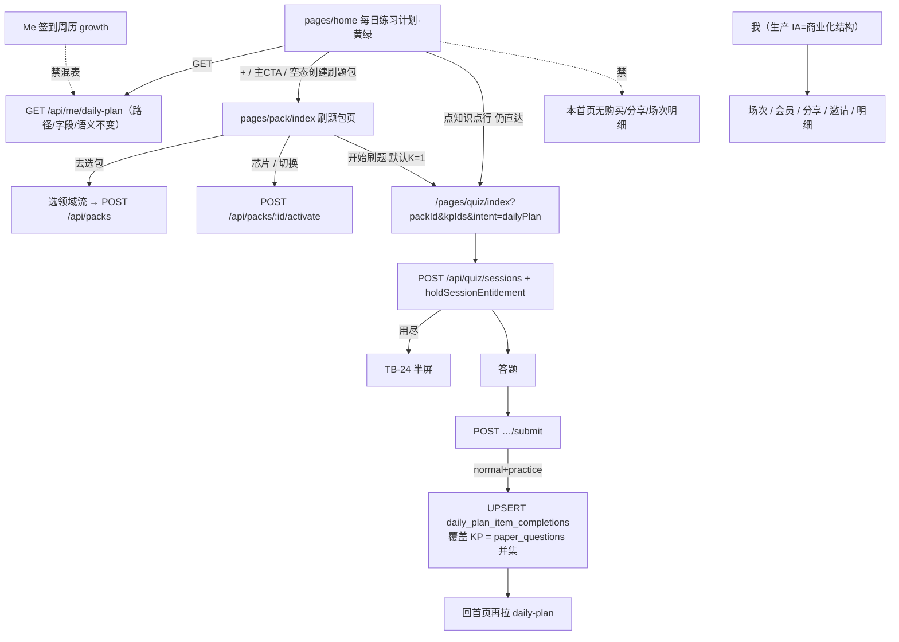

# 题刷刷 · TB-36～45 小程序黄绿视觉改版 · C 切片契约（v0.1.0-C）

| 项 | 值 |
| --- | --- |
| 性质 | **C 契约已放行**（辉亲口确认进完整交付 + Owner 点名写 C；切片号已官定 TB-36～45） |
| 放行 | **2026-11-11**（Asia/Shanghai） |
| 开闸依据 | 辉已在 Arch 本会话亲口确认：「按Arch建议全部采纳，确认进入完整交付」（答复决策卡 **t120s668**，2026-11-11 Asia/Shanghai）。**开闸依据仅此原话**，不以 Owner 转述、正式 PRD 决策卡或其他会话「同义开闸」为准 |
| 角色 | 架构师 Arch |
| 阶段 | **C** |
| 切片 | **TB-36～TB-45**（一份契约覆盖；见 §9。原 TB-35 视觉缺口**并入 TB-37**） |
| 架构版本旁注 | **v0.1.0-C**（相对 B 架构探路短评估 2026-11-11 + 已拍板推荐方案全部采纳） |
| 对照基线 | `origin/main` **`70e85563`**（完整 SHA `70e85563a7405d91d2bacb96aba1074e7a83954a`；GitHub 核验：Merge PR **#66**「修复首页 dailyPlanLayout 不是函数」，2026-11-10T05:25:26Z = Asia/Shanghai **2026-11-10 13:25**）。其中含 PR **#64** merge `f799ba83`（TB-30～34 每日计划读写与旧蓝稿三态）+ PR **#65** merge `02014ec3`（首页 304 一直加载） |
| 仓 | https://github.com/zh7551069/ai-tishuashua |
| 看板 | `/Volumes/My PSSD/notion_files/题刷刷/board/题刷刷 · 切片交付看板__25bfa529.json`。撰写本契约时本地看板 **row_count=35**，TB-30～34 已合码、TB-35 仍排队，**TB-36～45 行尚未建齐**（看板 note：未新建 TB-36）。**不因看板未写完而停笔**；建行与点名下游由 Owner 处理，本文件不改看板 |
| 正式 PRD 落盘状态 | 预定路径 `/Volumes/My PSSD/notion_files/题刷刷/prd/正式 PRD · 小程序黄绿视觉改版（已开C · 2026-11-11）.md` —— **撰写本契约时试读，文件尚不存在**。本稿以已拍板的 **B 评估**、**业务需求**、**官定切片 TB-36～45** 与辉开闸原话为准，**不编造正式 PRD 里没有的条款**。若正式 PRD 随后落盘且与本稿冲突，须 Owner / 辉书面修订本契约后再改实现 |
| 业务需求 | `/Volumes/My PSSD/notion_files/题刷刷/prd/业务需求 · 小程序黄绿视觉改版（2026-11-11）.md`（md5 `e2a0ff3c380470723df71ae5b04a9657`；有疑义以已拍板的 B 评估为准） |
| B 评估（拍板与变更条草案的权威） | 外盘 `/Volumes/My PSSD/notion_files/题刷刷/arch/B 架构探路短评估 · 小程序黄绿视觉改版（2026-11-11）.md` 与 box `/workspace/tishuashua-yellow-green-reskin-B-eval-20261111.md`，md5 均为 **`445423eb896f1df0746e8448a72fa2a1`**。本契约落实 B §6 推荐方案、§7 变更条草案（已全部按推荐拍板）、§8 第 1～6 项、§11 进 C 条件，不另起冲突路径 |
| 已合旧契约（只对照，**不改该文件**） | 外盘 `/Volumes/My PSSD/notion_files/题刷刷/arch/C 契约 · 小程序首页每日练习计划（TB-30～34，2026-11-10）.md` 与 box `/workspace/tishuashua-tb30-home-daily-plan-C-contracts-v0.1.0-C.md`，md5 均为 **`3e0d0c47fc428027fd906137d83d3436`**。本稿是**新切片契约**，内含对旧契约导航 / 样式权威 / 空态 CTA 的**修订补丁**，并明确**不变条款** |
| 样式权威源状态 | **权威目标**为 PSSD `/Volumes/My PSSD/notion_files/题刷刷/design/小程序（黄绿视觉改版v2.0.0）/`。本契约落盘时（2026-11-11 Asia/Shanghai）核验：该目录**已存在**，14 组齐全，与仓内 `/Users/zenghui/Documents/code/ai-tishuashua/design/bridge-export/v2.0.0` **688 个文件 md5 全同**（`hash_diff=0`，仅排除 `._*` / `.DS_Store`）。两组均**无** `FRAMES.md`（帧名与 left 由 HTML 抽出，同 B §3.1）。B 评估撰写时该目录尚缺，之后已拷入且与仓内导出字节一致。对稿与 UI 评审以 **PSSD 该目录**为权威；仓内 v2.0.0 作 Cloud 附件 / 只读对照源。若日后两份出现 diff，以 PSSD 为准并须书面记录 |
| 本稿覆盖范围 | 组件化与 design token 基座；新建刷题包页；修订首页跳转与空态 CTA；首页及全量页面黄绿对稿；性别本地字段；主题四套与旧值回落；「我」生产 IA；对 TB-30～34 已合契约的导航 / 样式权威 / 空态 CTA / 验收 A1·A4 修订补丁。**不**重写 daily-plan 数据章，**不**改已落盘旧契约文件，**不**做 UI 技术评审全套（另刀；前端开工仍须三行通过），**不**拉 Cloud、**不**写业务代码、**不**改仓 / 不合码 |
| 进仓约定 | 合码 PR 应落到 `docs/contracts/tb36-45-yellow-green-reskin-C-contracts-v0.1.0-C.md`；UI 技术评审（另做）落 `docs/delivery/`。本文件**不改 git** |
| 本地 arch 副本 | `/Volumes/My PSSD/notion_files/题刷刷/arch/C 契约 · 小程序黄绿视觉改版（TB-36～45，2026-11-11）.md` |
| 契约归属 | 架构师；**全栈不得私改本刀已钉的导航、默认单 KP 护栏挂点、主题 / 性别键名与回落、生产 IA、「我」只维护一套、样式权威，而不申报** |
| 业务对接 | 题刷刷 · 业务组 |
| 合码 | **仅辉当面「合」授权** |
| 写码 | **等 Owner 点全栈**；本文件不授权开工写码、不点名 Cloud Agent |
| UI 开工 | **须先过「UI 技术评审三行留痕」**；未过审禁前端对稿写码。本契约落盘**不做**该评审 |
| 开工包齐 | **仍否**（本刀只出契约；写码仍等 Owner 点全栈 + UI 三行通过） |

> **放行范围**：本文件为正式 C。落地小程序**全量黄绿换皮 + design token / 组件化基座**，并新建独立刷题包页；首页「+」「开始今日刷题练习」与空态「创建刷题包」均进入该页；默认单 KP 护栏改挂到刷题包页「开始刷题」。**#64 已合的 `GET /api/me/daily-plan` 路径、字段、submit 回写、进度语义与表 `daily_plan_item_completions` 保持不变。** 新业务 endpoint **0**。写码仍等 Owner 点全栈；前端须 UI 技术评审；**不合码直至辉当面「合」**。

---

## 0. 硬拍板（不可改 · 辉「按Arch建议全部采纳」= 对齐 B §6 / §7 / §8 第 1～6 项全部推荐，不是备选）

| # | 拍板 | 备注 |
| --- | --- | --- |
| **H1** | **0 个新业务 endpoint**。不必改 `GET /api/me/daily-plan` 的路径、字段、submit 回写、进度语义，以及表 `daily_plan_item_completions`。刷题包页消费既有 `GET /api/packs` + `POST /api/packs/:id/activate` 及既有重命名 / 删除接口 + 选领域流 `POST /api/packs`。主题与性别均本地，不改用户资料 API | B §6.4；旧契约数据章保持 |
| **H2** | **样式权威**：PSSD `/Volumes/My PSSD/notion_files/题刷刷/design/小程序（黄绿视觉改版v2.0.0）/`（`index.html` + `styles.css` + `svgs/` + `images/`；无 `FRAMES.md` 时按 HTML 屏位）。首页四态 left **0 多包·男** / **470 多包·女** / **940 单包** / **1410 空态**。宽 **390**。主色黄绿（强调约 `rgb(77,124,15)` / `rgb(142,202,58)` / `rgb(192,228,96)`，浅底约 `rgb(244,248,232)`，页面底常见 `rgb(247,248,244)`，正文 `rgb(28,25,23)`，辅文 `rgb(120,113,108)`，以导出实测为准）。本期默认按「多包·女」主图，**不对稿男主图为默认**。不对稿系统状态栏（稿中 9:41）。**禁** `design/dev-cache` / `figma-dev-cache` / `get_design_context`。旧蓝包 `design/小程序（首页每日练习）/` 与主色 `#2563EB` **不再是本改版权威** | 覆盖旧 **H16** |
| **H3** | **首页导航**：右上「+」→ 独立刷题包页 **`/pages/pack/index`**（与现 `pack/domain`、`pack/certificate`、`pack/knowledge` 并列；对照基线 `app.config.ts` **无此路由、无路径冲突**，本文钉死）。主 CTA「开始今日刷题练习」→ **同一**刷题包页（有包展示当前包，无包展示无包空态）。空态「创建刷题包」→ 刷题包无包空态，再由该页「去选包」进入既有选领域流 + `POST /api/packs`。芯片切换仍 `POST /api/packs/:id/activate`。`PackSheet` 管理能力（切换 / 编辑 / 不可用 / 删除确认）**上提到刷题包页**；首页可不再承担主管理面 | 覆盖旧 **H12** / **§5.1** |
| **H4** | 空态主 CTA「开始今日刷题练习」**可点**，进入刷题包无包空态；文案可保持「开始今日刷题练习」。不可用包、无上架知识点等禁用规则改在刷题包页「开始刷题」上执行。今日全 done 时「开始刷题」**仍可点**（再练保持 done；不强制改成购买） | 覆盖旧 **§5.2 / 验收 A1** 的禁用规则 |
| **H5** | **默认单 KP 护栏改挂到刷题包页「开始刷题」**：进入 `/pages/quiz/index?packId&kpIds&intent=dailyPlan` 时默认只带当前包「待练习优先」列表中**第一个待练习 KP**（今日全 done 则可带第一个已完成 KP）。**禁止**空 `kpIds` 走整包。用户仍可在出题设置改多 KP / 整包；覆盖 KP 仍以试卷 `paper_questions` 并集为准（旧 **H4** 不变）。扣场仍发生在 `POST /api/quiz/sessions`；回写仍在 submit | 覆盖旧 **H6** 挂点与验收 **A4**；护栏不得丢失 |
| **H6** | **知识点行维持直达**：点行进入该 KP 的出题设置，路径 `/pages/quiz/index?packId&kpIds=<该行KP>&intent=dailyPlan`（默认 K=1）。已完成行可再练，再练保持 done。不改为先入刷题包页 | 维持旧 **H11**；B §8.4 已拍板 |
| **H7** | **「我」生产 IA**：以商业化导出中的「我」（含今日剩余场次 / 开通会员 / 每日分享 / 邀请有礼 / 场次明细入口）为生产结构；独立「我（新）」作非商业化区块与设置 / 主题色的对稿源与元件源；**只维护一套「我」**。商业化导出顶部 960 图为「气氛稿（氛围参考，非开发依据）」，**不对稿、不作为开发依据** | B §8.1 推荐，已拍板；禁止两套「我」并行 |
| **H8** | **主题**：默认 **黄绿**；四套为 **黄绿 / 森绿 / 茶绿 / 暖芽**。实现 id 钉死为 `yellow-green` / `forest` / `tea` / `warm-sprout`（存储键仍 `tishuashua.theme`，与现 `local-prefs.ts` 风格一致）。插画**固定黄绿**，仅按钮、选中态、强调色随主题更新。现网旧五套 `blue` / `teal` / `violet` / `orange` / `rose` 以及未知 / 非法 id **一律回落黄绿**（`yellow-green`）。森绿 / 茶绿 / 暖芽的完整 token **须从「我（新）」主题色帧抽出**，本稿不臆造色值对照表。`apply-theme` 打到页面根节点 | B §8.5 |
| **H9** | **性别**：本期只落本地。键名钉死 **`tishuashua.heroGender`**，值 `'female' \| 'male'`，**默认 `female`**（缺省 / 未知 / 非法一律 `female`）。首页主图按该字段选择女 / 男资源；男性资源进仓但不当默认。本期**不做设置入口**、**不做后管**、**不改用户资料 API**、不改 `users` 表、不扩 `UserSummary`。`clearDisposableCache`（或等价清缓存）须**保留**该键，与 theme / 登录态同等 | B §8.6；性别不是 daily-plan 字段 |
| **H10** | **组件化与 token**：按 §7 目录落地（`apps/mini/src/theme/` + 公共元件，先基座再全页）。禁止新写 `#2563EB` 作为主色 / 强调色。与现有 `Screen` 等合并收敛，不另造平行组件树 | B §6.1 |
| **H11** | 本首页仍**不挂**购买 / 分享 / 场次明细（这些在「我」与商业化页，按 H7）。**不改** entitlement 四桶语义与扣场顺序；用尽仍走 TB-24 半屏。不新开短信登录 / RAG / 计费·SKU·会员规则；**不把后管纳入本改版** | 旧 H15 在首页侧继续有效 |
| **H12** | 旧契约读写与进度语义**不变**（见 §2.2）：旧 **H1**（路径 A 表 + 读聚合 + submit UPSERT）、**H3**（完成判定）、**H4**（覆盖 KP=试卷并集）、**H5**（`businessDate` Asia/Shanghai）、**H7**（仅 normal+practice 计入）、**H8**（packs 不脸胀；禁成绩列表充当进度）、**H9**（回写失败不阻断交卷但必须可观测）、**H13**（不可用包不进汇总分母）以及旧 **H2**（项=KP）、**H10**（周条只展示、不混签到、v1 不可点历史日）、**H14**（「我」与首页同一 packs 实体）。本稿**不重写**这些数据章，实现以已合旧契约正文为准 | B §7 不变条款 |
| **H13** | 前端对稿写码仍须 **UI 技术评审三行留痕**通过；禁 Dev Mode 读稿。本契约落盘**不做**该评审。写码等 Owner 点全栈；合码仅辉当面「合」 | B §11.4～5 |
| **H14** | 官定切片为 **TB-36～45**（§9），一份契约覆盖。原 TB-35 视觉缺口（不可用 / 混有不可用 / 删除确认 / 无包空态等管理面）**并入 TB-37** 刷题包页对稿，不再以「无帧」堵住管理面。旧看板 TB-35 行如何关闭或改挂由 Owner 处理，本文件不改看板 | Owner 官定 |



---

## 1. 范围与硬约束

### 1.1 做（TB-36～45）

1. **Token + 公共元件基座**（TB-36）：CSS 变量与四套 palettes、`apply-theme` 打到根节点；按钮 / 顶栏 / 空态 / 弹层 / 列表行 / 芯片 / 进度环 / 周条 / 答题选项 / 性别主图。
2. **新建刷题包页 + 首页跳转修订 + 首页黄绿四态对稿**（TB-37，默认女主图）；原 TB-35 管理面缺口并入本刀。
3. **其余已有页面换皮**（TB-38～45）：选领域 / 证书 / 知识点 + 上传教材；出题设置 + 过程态；答题；结果 + 错题回顾；错题本 + 错题详情；练习记录；「我」+ 设置 / 主题色（按 H7 生产 IA）；商业化页只换皮（气氛稿不对稿）。
4. **修订补丁**：覆盖已合 TB-30～34 契约的旧 H12 / H16 / §5.1 / 空态 CTA / 验收 A1 与 A4；默认单 KP 护栏改挂「开始刷题」。
5. **本地偏好**：主题四套 + 旧值回落；`tishuashua.heroGender` 默认 `female`。
6. **复用**：daily-plan 读写、packs CRUD / activate、选领域流、出题编排、`holdSessionEntitlement`、TB-24 用尽半屏、商业化既有入口与规则。

### 1.2 不做（严禁）

| 禁项 | 归属 / 说明 |
| --- | --- |
| 改 `GET /api/me/daily-plan` 路径 / 字段 / submit 回写 / 进度语义 / 表结构 | **总禁**（H1 / H12） |
| 为换皮新开业务 endpoint | **总禁**（默认 0；若必须新开须有依据并书面修订本契约） |
| 修改已落盘的 TB-30～34 C 契约文件 | **总禁**（只在本文件写修订 / 不变项） |
| 丢掉默认单 KP 护栏，或空 `kpIds` 走整包 | **总禁**（H5） |
| 空态主 CTA 再改回禁用（旧规则回潮） | **总禁**（H4） |
| 未经新拍板把知识点行改为先入刷题包页 | **总禁**（H6） |
| 两套「我」并行，或只用独立「我（新）」拿掉已上线商业化入口 | **总禁**（H7） |
| 对稿商业化顶部 960 气氛稿；对稿系统状态栏 9:41；默认对稿男主图 | **总禁** |
| 本期做「设置性别」入口 / 后管性别 / 改用户资料 API | **总禁**（H9） |
| 插画随主题改色；新写 `#2563EB` 作主色 | **总禁**（H8 / H10） |
| 用成绩列表或本地假进度充当今日项；混用 Me 签到周历表 / API | **旧契约继续禁** |
| 改 entitlement 四桶 / 扣场序 / `businessDate` 时区 | **TB-20** |
| 本首页挂购买 / 分享邀请 / 场次明细 | **继续禁**（入口在「我」与商业化页） |
| 新开短信登录 / RAG / 计费·SKU·会员套餐规则 | **总禁** |
| 后管改版纳入本改版 | **总禁** |
| `design/dev-cache` / `figma-dev-cache` / `get_design_context` | **总禁** |
| 把 2026-11-10 首页每日计划的开闸自动视为本次视觉改版已进 C（本刀开闸仅 t120s668 原话） | **总禁** |

### 1.3 边界钉死（既有切片）

| 切片 | 本刀关系 |
| --- | --- |
| **TB-16** | 选领域 / 证书 / 知识点本刀只换黄绿皮并复用既有流；不改搜索 / 进度条契约与选点业务规则 |
| **TB-17～19** | 只消费既有出题 / `paper_questions` / 后管题库；不改编排与后管 |
| **TB-20** | 创建会话仍 `holdSessionEntitlement`；进度层零扣场；共用 `businessDate` |
| **TB-23～26** | 不改支付 / SKU / 会员规则；商业化页只换皮；用尽半屏购买仍归既有页 |
| **TB-24** | 用尽回归半屏；本刀不改半屏禁支付 |
| **TB-27～29** | 「我」保留场次 / 会员 / 分享 / 邀请 / 明细入口；签到周历与首页练习周历分离 |
| **TB-30～34** | 读写与进度语义保持；本刀修订导航、样式权威、空态 CTA、K=1 挂点 |
| **TB-35** | 视觉缺口并入 **TB-37**；旧看板行如何收口由 Owner 处理 |

---

## 2. 对 TB-30～34 已合契约的修订补丁

> 不修改已落盘旧契约文件。实现与验收以**本文件覆盖条款为准**；未覆盖条款仍以旧契约 md5 `3e0d0c47fc428027fd906137d83d3436` 正文为准。

### 2.1 覆盖条款（新规则生效）

| # | 已合条款（摘要） | 本契约覆盖为 |
| --- | --- | --- |
| 1 | 旧 **H12**：创建 /「+」完全复用选领域流 + `POST /api/packs`；首页保留 PackSheet 主管理 | 「+」→ `/pages/pack/index`。无包展示无包空态；有包展示当前包。新建仍由刷题包页「去选包 / 新建刷题包」进入既有选领域流 + `POST /api/packs`。芯片切换仍 `POST /api/packs/:id/activate`。PackSheet 管理能力上提到刷题包页 |
| 2 | 旧 **§5.1 / H6 / TB-34**：主 CTA「开始今日刷题练习」→ `/pages/quiz/index?packId&kpIds&intent=dailyPlan`，默认 K=1 | 首页主 CTA → 刷题包页（有包 / 无包规则同第 1 条）。刷题包页「开始刷题」再进入该出题路径。**默认 K=1 护栏改挂在「开始刷题」**，禁止空 `kpIds` 走整包。用户仍可在出题设置改多 KP / 整包，覆盖 KP 仍以试卷并集为准 |
| 3 | 旧 **§5.2 / 验收 A1**：`empty===true` 时主 CTA **禁用**，文案「创建刷题包后，即可开始今日练习」 | 空态主 CTA **可点**，进入刷题包无包空态；文案可保持「开始今日刷题练习」。不可用包、无上架知识点等禁用规则在刷题包页「开始刷题」上执行 |
| 4 | 旧 **H16 / 对稿坐标**：权威包为 PSSD `design/小程序（首页每日练习）/`；left **0 单包 / 470 空态 / 940 多包**；主色 `#2563EB` | 权威改为 PSSD `design/小程序（黄绿视觉改版v2.0.0）/`（状态见文首）。首页四态 left **0 多包·男 / 470 多包·女 / 940 单包 / 1410 空态**；本期默认按「多包·女」主图。主色黄绿（色值见 H2）。仍禁 dev-cache / `get_design_context`。不对稿状态栏 |
| 5 | 旧 **H11** 知识点行可点进出题 | **维持**（本契约 H6） |
| 6 | 旧验收 **A4**「主 CTA 创建会话 K=1」 | 改为：从刷题包页「开始刷题」（以及首页点行，因仍直达）进入设置并创建会话时，默认 `knowledgePointIds` 长度为 1 |
| 7 | 旧 TB-35 可选：旧异常态补帧、Sheet 入口 | 并入 **TB-37** 刷题包页对稿（导出已含不可用 / 混有不可用 / 删除确认 / 无包空态等） |

空态「创建刷题包」：旧路径直达选领域；本契约改为**先入刷题包无包空态**，与「+」、主 CTA 同一目的地（B §8.2 推荐，已拍板）。

### 2.2 不变条款（避免误伤；不在本稿重写数据章）

旧契约下列条款继续有效，实现对照旧契约正文，不因换皮重开数据层：

- **H1** 路径 A：表 `daily_plan_item_completions` + `GET /api/me/daily-plan` + `QuizService.submit` 成功侧幂等 UPSERT；禁止本地假进度当权威
- **H2** 项定义：1 个知识点在「今日」被标记完成 = 1 项
- **H3** 完成判定：业务日内该包该 KP 至少成功交卷 1 场且本场覆盖该 KP
- **H4** 覆盖 KP = `paper_questions` 并集，不是只看创建请求里的 `knowledgePointIds`
- **H5** 「今日」= entitlement 同一套 `businessDate`（Asia/Shanghai）
- **H7** 计入范围仅 `source=normal` 且 `mode=practice`
- **H8** `GET /api/packs` 不脸胀今日进度；禁止扩展成绩列表充当首页进度
- **H9** 回写失败不阻断交卷成功响应，但必须有日志 / 指标
- **H10** 周条只展示、不与「我」签到混表，v1 不可点历史日
- **H13** 不可用包不进汇总分母；芯片仍可见并标不可用
- **H14** 「我」页刷题包与首页同一 `packs` 实体
- 扣场与 TB-24 用尽半屏仍成立；本首页仍不挂购买 / 分享 / 场次明细

旧 **H6** 仅「挂点」从首页主 CTA 改为刷题包页「开始刷题」，护栏语义本身不变。

---

## 3. 数据 / 接口（0 个新业务 endpoint）

### 3.1 论证

| 能力 | 本刀是否足够 | 结论 |
| --- | --- | --- |
| `GET /api/me/daily-plan` | 首页四态仪表盘仍用同一进度模型 | **不改**路径 / 字段 / 语义 |
| submit 回写 + 表 `daily_plan_item_completions` | 覆盖 KP 与计入范围不变 | **不改** |
| `GET /api/packs` + activate / 重命名 / 删除 + `POST /api/packs` | 足够驱动新建刷题包页八态与去选包 | **复用，不脸胀今日进度** |
| `POST /api/quiz/sessions` + submit | 「开始刷题」与点行仍走既有出题 / 扣场 / 回写 | **复用**；默认 K=1 改挂「开始刷题」 |
| 主题 / 性别 | 本地键即可，无跨设备写入入口 | **不改用户 API，不新开 endpoint** |

→ **新业务 endpoint：0。** 若实现中发现必须新增，须有书面依据并修订本契约后才能开；不得 silently 加。

### 3.2 复用清单（不新开）

| Method | Path | 本刀职责 |
| --- | --- | --- |
| `GET` | `/api/me/daily-plan` | 首页进度权威；字段与空态 / 单包 / 多包语义同旧契约 §3 |
| （内部） | `QuizService.submit` 成功钩子 | 条件满足 → UPSERT；不改 |
| `GET` / `POST` / 既有更新删除 | `/api/packs`、`POST /api/packs/:id/activate` 及既有重命名 / 删除 | 刷题包页消费；禁止 `?view=home` 脸胀 |
| `POST` | `/api/quiz/sessions`、`…/submit` | 「开始刷题」与点行创建会话；submit 回写不变 |
| （本地） | `tishuashua.theme` / `tishuashua.heroGender` | 主题与性别；无 HTTP |

### 3.3 性别与主题键（钉死）

与现 `apps/mini/src/services/local-prefs.ts` 风格对齐（已有 `tishuashua.theme` / `tishuashua.checkin` / `tishuashua.notify`）：

| 键 | 类型 / 取值 | 默认 | 规则 |
| --- | --- | --- | --- |
| `tishuashua.heroGender` | `'female'` \| `'male'` | **`female`** | 缺省、空、未知、非法 → `female`。不是 daily-plan 字段。不进 `UserSummary`。本期无写入 UI（预留读取函数即可：先本地，日后若接口有值再用接口，否则 `female`——接口本身本期不做） |
| `tishuashua.theme` | `'yellow-green'` \| `'forest'` \| `'tea'` \| `'warm-sprout'` | **`yellow-green`**（黄绿） | 读到 `blue` / `teal` / `violet` / `orange` / `rose` 或未知 / 非法 id → 视为 `yellow-green`。展示名：黄绿 / 森绿 / 茶绿 / 暖芽。清缓存须保留 theme 与 heroGender |

---

## 4. 导航（覆盖旧 H12 / §5.1 / 空态 CTA）

| 入口 | 目标 | 规则 |
| --- | --- | --- |
| 首页右上「+」 | `/pages/pack/index` | 有包展示当前包；无包展示无包空态 |
| 首页主 CTA「开始今日刷题练习」 | `/pages/pack/index` | 同上；**不再**直接进入出题设置 |
| 空态「创建刷题包」 | `/pages/pack/index`（无包空态） | 再由「去选包」进入 `/pages/pack/domain/index` 既有选领域流 |
| 空态主 CTA | `/pages/pack/index`（无包空态） | **可点**；不再禁用 |
| 知识点行 | `/pages/quiz/index?packId&kpIds=<该行KP>&intent=dailyPlan` | 维持直达；默认 K=1 |
| 刷题包页「开始刷题」 | `/pages/quiz/index?packId&kpIds=<第一待练KP>&intent=dailyPlan` | **默认 K=1 护栏在此执行**；禁止空 `kpIds` 走整包 |
| 刷题包页「去选包 / 新建」 | 既有选领域流 + `POST /api/packs` | 不新开创建包 API |
| 刷题包页芯片 / 切换 | `POST /api/packs/:id/activate` | 与旧芯片语义相同 |
| 刷题包页编辑 / 删除 | 既有重命名 / 删除接口 | 删除确认对稿并入 TB-37 |

出题设置页：识别 `intent=dailyPlan` / `kpIds` 时预填会话级 `knowledgePointIds`；**仍允许**用户在页内改题量 / 模式 / KP。提交创建仍 `POST /api/quiz/sessions` + `holdSessionEntitlement`。用尽 → TB-24。交卷后回首页再拉 `GET /api/me/daily-plan`。

### 4.1 「开始刷题」禁用规则（从首页主 CTA 迁来）

| 条件 | 「开始刷题」 |
| --- | --- |
| 无包（无包空态） | **不展示为可创建会话的主按钮**；展示「去选包」等空态主操作（以刷题包空态稿为准） |
| 当前包 `unavailable===true` | **禁用**（可 Toast「刷题包不可用」） |
| 无上架知识点 | **禁用** |
| 可用包且今日全 done（`remainingCount===0`） | **仍可点**；再练保持 done；文案保持「开始刷题」或 UI 评审微调，**不**强制改成购买 |

首页空态主 CTA 不再使用上表的「无包禁用」。

---

## 5. 「我」生产 IA 与商业化换皮

- 生产壳以商业化黄绿导出中 390 宽的「我」各态为准（未签到 / 已签到 / 会员中等，含场次、开通会员、每日分享、邀请有礼、场次明细入口），视觉换黄绿，**不另开规则**。
- 独立「我（新）」提供：未签到 / 已签到 / 空态、设置、四套主题色（含森绿变体）、用户协议、隐私政策、设置加载失败等对稿与元件；这些在商业化导出里不完整时，以「我（新）」为源补齐非商业化区块。
- 组件一套复用；商业化块按 entitlement 显隐（与现 `commerce-blocks.tsx` 同构，只换皮）。
- 商业化 TB-45 覆盖：用尽半屏、加油包、开通会员、场次明细、每日分享、邀请有礼——**只换皮**。顶部 960「气氛稿」不对稿。
- **禁止**路由分叉或按开关呈现两套「我」结构。

---

## 6. UI 约束（对稿 · 前端须另做 UI 技术评审）

### 6.1 首页四态（黄绿稿；旧蓝三态坐标作废）

| 态 | left | 要点 |
| --- | --- | --- |
| 多包·男 | **0** | 男主图资源保留；**本期不对稿为默认** |
| 多包·女 | **470** | **本期默认主图对稿源**（女：`images/44cac9e1d94bf340973772136de0b46c2014f520.png`；男：`images/87ad184d1d47140ad2ff33ab81541b711ae95e1e.png`，进仓非默认） |
| 单包 | **940** | 进度环 + 今日知识点列表 + 主 CTA；数据仍以 daily-plan 为准 |
| 空态 | **1410** | 仍有文案「创建刷题包」「或点击右上方 +」「开始今日刷题练习」；主 CTA **可点** |

稿面日期与 2/5、9/15 等示意数字**不要照抄**，一律跟接口。头像首字跟用户昵称。不对稿系统状态栏 9:41。进度环与 `completed/total/remaining` 同源（daily-plan）。周条只展示练习完成日，不混签到。

### 6.2 刷题包页八态（TB-37，含原 TB-35 缺口）

导出 viewport 3688×892，left 步进 470：

| left | 态 |
| --- | --- |
| 0 | 默认·当前刷题包 |
| 470 | 切换 |
| 940 | 编辑 |
| 1410 | 当前包不可用 |
| 1880 | 混有不可用 |
| 2350 | 切换弹层·置灰 |
| 2820 | 删除确认 |
| 3290 | 无包空态（文案含「暂无刷题包」「去选包」） |

### 6.3 其余组（对稿范围，帧位以 HTML 为准；无 FRAMES.md）

| 分组 | 本刀切片 | 备注 |
| --- | --- | --- |
| 选知识点（新）·黄绿 | TB-38 | 含选领域 / 证书 / 知识点多态 |
| 上传教材（新）·黄绿 | TB-38 | HTML 无独立标题条；对稿按屏位与业务需求文案对齐，不在本稿编造第五帧坐标 |
| 出题设置（新）·黄绿 / 过程态（新）·黄绿 | TB-39 | |
| 答题（新）·黄绿 | TB-40 | |
| 结果（新）·黄绿 / 错题回顾（新）·黄绿 | TB-41 | |
| 错题本（新）·黄绿 / 错题详情（新）·黄绿 | TB-42 | |
| 练习记录（新）·黄绿 | TB-43 | |
| 我（新）·黄绿 | TB-44 | 设置 / 主题色 / 非商业化区块源 |
| 商业化 v2.0.0（新）·黄绿 | TB-44 生产「我」结构 + TB-45 只换皮 | 顶区 960 气氛稿不对稿 |

### 6.4 视觉禁令

- 只读 Bridge / PSSD 导出的 HTML / CSS / svg / png；**禁** Dev Mode / `get_design_context` / `design/dev-cache` / `figma-dev-cache`。
- 禁止新写 `#2563EB` 作为主色或强调色。
- 权威源到位情况见文首；开对稿前以 PSSD 权威目录为准（本契约落盘时已与仓内 v2.0.0 字节一致）。

---

## 7. 组件化与 token（到模块 / 目录级，不写业务代码）

落地建议（开码时可微调文件名，但目录职责不得拆成第二套平行树）：

```text
apps/mini/src/theme/
  tokens.css          # 颜色 / 间距 / 圆角 / 字号 CSS 变量（默认黄绿）
  palettes.ts         # 黄绿 / 森绿 / 茶绿 / 暖芽 的 token 映射
  apply-theme.ts      # 启动与切换时把变量打到页面根（替换/收敛 local-prefs.THEMES）

apps/mini/src/assets/hero/
  female.png          # 44cac9e1…（默认）
  male.png            # 87ad184d…（保留，非默认）

apps/mini/src/components/   # 或与现有 Screen 等合并，不另造平行树
  AppButton.tsx             # 主/次/禁用
  AppNav.tsx                # 收敛 Screen / PackTopBar
  EmptyState.tsx            # 收敛 StateBlock 空态
  AppSheet.tsx / AppConfirm.tsx / CelebrateOverlay.tsx
  ListRow.tsx
  FilterChip.tsx
  ProgressRing.tsx          # 从首页抽出
  WeekStrip.tsx             # 只统一外观；首页数据=练习完成日，我页=签到，禁止混源
  QuizOption.tsx
  HeroIllustration.tsx      # 仅首页主图，读 tishuashua.heroGender

apps/mini/src/pages/pack/index   # 新建：刷题包管理页（对稿八态）
apps/mini/src/pages/home         # 换黄绿皮 + 改跳转；继续读 daily-plan
# 其余已有页面：去掉硬编码蓝，改吃 token / 公共元件；不重做业务规则
```

顺序：**先 TB-36 基座，再按页换皮**。`apply-theme` 必须打到根节点，避免只作用于「我 / 设置」。插画不随主题改色。

---

## 8. 门禁

| 项 | 状态 |
| --- | --- |
| 辉确认进 C | **YES**（Arch 会话答复决策卡 **t120s668**：「按Arch建议全部采纳，确认进入完整交付」） |
| §8 第 1～6 项 | **全部按 B 评估推荐采纳**（不是备选） |
| 切片号 | **已官定 TB-36～45**（Owner 书面；看板行撰写时尚未建齐，不阻塞本契约） |
| 正式 PRD | **尚未落盘**（试读不存在）；不以编造条款补上 |
| 本契约 v0.1.0-C | **已放行写契约** |
| 开工包齐 | **仍否** |
| 写码 / Cloud | **未开**；等 Owner 点全栈。本执行助手不拉 Cloud、不写业务代码、不改仓 |
| UI 技术评审三行 | **本刀不做**；前端对稿写码前必过（另刀；落 `docs/delivery/`） |
| 合码 | **未合**；仅辉当面「合」 |
| 已落盘旧契约文件 | **未改** |
| 广播 / SendToAgent / 发用户 | **本执行助手不做** |

---

## 9. 切片拆法（官定 TB-36～45，一份契约覆盖）

| 切片 | 内容 | 依赖 | 默认 |
| --- | --- | --- | --- |
| **TB-36** | 公共 token + 元件基座（`theme/`、四套 palettes、`apply-theme`、§7 公共元件；旧主题回落；禁止新写 `#2563EB`） | `origin/main@70e85563` | **必做**；先于各页对稿 |
| **TB-37** | 刷题包页新建 + 首页跳转修订 + 首页黄绿四态对稿（默认女主图，预留 `heroGender`）；**原 TB-35 缺口并入本刀** | TB-36 | **必做** |
| **TB-38** | 选领域 / 证书 / 知识点 + 上传教材换皮 | TB-36 | **必做** |
| **TB-39** | 出题设置 + 过程态换皮 | TB-36 | **必做** |
| **TB-40** | 答题换皮 | TB-36 | **必做** |
| **TB-41** | 结果 + 错题回顾换皮 | TB-36 | **必做** |
| **TB-42** | 错题本 + 错题详情换皮 | TB-36 | **必做** |
| **TB-43** | 练习记录换皮 | TB-36 | **必做** |
| **TB-44** | 「我」+ 设置 / 主题色（生产 IA=商业化「我」结构；「我（新）」为非商业化区块与主题色对稿源） | TB-36 | **必做** |
| **TB-45** | 商业化页只换皮（用尽半屏、加油包、会员、明细、分享、邀请）；气氛稿不对稿 | TB-36 | **必做** |

裁剪：人力紧时可先合 TB-36+37 再铺其余页，但不得把「全量改版」默认为只做首页；裁剪须辉 / Owner 书面同意。不得跳过 TB-36 基座直接在各页新写硬编码色。不得跳过 TB-37 的 K=1 护栏改挂。

---

## 10. 可测验收

### 10.1 硬拍板复核（H · 14）

§0 **H1～H14** 均为可测禁令 / 规则；实现与 PR 不得违反。抽测优先级 **P0**：H1、H3、H4、H5、H6、H7、H8、H9、H11、H12。

### 10.2 验收场景（A · 12）

1. **A1 空态导航（修订旧 A1）**：0 包 → daily-plan `empty=true`；首页对稿 left **1410**；主 CTA **可点**并进入 `/pages/pack/index` 无包空态；「创建刷题包」同样进入该空态；「+」同样进入该空态；空态页「去选包」进入既有选领域流；保存首包后首页非空态。
2. **A2 有包首页跳转**：有包时首页「+」与主 CTA 均进入 `/pages/pack/index` 展示当前包，**不**直接进入出题设置或选领域。
3. **A3 开始刷题 K=1（修订旧 A4）**：从刷题包页「开始刷题」进入设置并创建会话时，默认 `knowledgePointIds` 长度为 1，且为当前包第一待练 KP（全 done 时可为第一已完成 KP）；**禁止**空 `knowledgePointIds` 走整包。用户在设置页改回整包并交卷 → 按 `paper_questions` 并集标 done（旧护栏后半不变）。
4. **A4 知识点行**：点行仍直达 `/pages/quiz/index?packId&kpIds=<该行KP>&intent=dailyPlan`；再练保持 done。
5. **A5 daily-plan 读写不变**：路径、字段、submit 回写、进度语义、表结构相对已合 #64 / 旧契约无变更；本改版 PR **0** 个新业务 endpoint。
6. **A6 主题**：默认黄绿；四套（黄绿 / 森绿 / 茶绿 / 暖芽）可切换，按钮与强调色随主题、插画仍黄绿；本地旧五套 id 及未知 id 回落黄绿；`apply-theme` 作用于根节点（首页 / 答题等均吃变量，不只「我 / 设置」）。
7. **A7 性别**：本地键 `tishuashua.heroGender`，缺省为 `female`；本期无设置入口、无用户 API / 后管改动；默认对稿女主图；男资源存在但非默认。
8. **A8 「我」IA**：生产结构含场次 / 会员 / 分享 / 邀请 / 明细入口；只一套「我」；商业化顶部 960 气氛稿不对稿、不进开发依据。
9. **A9 刷题包页八态**：默认 / 切换 / 编辑 / 不可用 / 混有不可用 / 切换置灰 / 删除确认 / 无包空态可对稿；activate / 重命名 / 删除 / 去选包走既有 API。
10. **A10 范围锁 + 用尽**：不改四桶 / 扣场序；创建用尽 → TB-24；本首页无支付 / 分享 / 明细入口；无短信登录 / RAG / 新 SKU·会员规则；无后管改版。
11. **A11 token 基座**：`apps/mini/src/theme/` 落地；公共元件按 §7；禁止新写 `#2563EB` 作主色 / 强调色。
12. **A12 首页四态与黄绿主色**：left 0/470/940/1410 与 H2 色值对稿（须 UI 三行通过后实施）；进度数字跟接口不跟稿面示意。

### 10.3 禁项（F · 12）

| # | 禁 | 验法 |
| --- | --- | --- |
| **F1** | 改 daily-plan 路径 / 字段 / 回写 / 进度语义或表结构 | diff 无数据层回退；对照旧契约 §3～4 |
| **F2** | 新业务 endpoint（主题 / 性别走本地） | API 清单为 0 新增 |
| **F3** | 空态主 CTA 再禁用（旧规则回潮） | 无包时首页主按钮可点并进刷题包空态 |
| **F4** | 丢掉 K=1 护栏 / 空 `kpIds` 走整包 | 「开始刷题」默认 `knowledgePointIds.length===1` |
| **F5** | 点行改为先去刷题包页（未经新拍板） | 点行仍直达出题设置 |
| **F6** | 两套「我」并行，或用独立「我（新）」去掉商业化入口 | 生产「我」含场次 / 会员 / 分享 / 邀请 / 明细 |
| **F7** | 对稿气氛稿 960 / 对稿状态栏 9:41 / 默认对稿男主图 | 评审与实现说明 |
| **F8** | Dev Mode / `get_design_context` / `design/dev-cache` / `figma-dev-cache` | 评审与 PR 说明只用 PSSD / Bridge 导出 |
| **F9** | 新写 `#2563EB` 作主色 / 强调色 | grep 新增主色不得为旧蓝 |
| **F10** | 性别进用户 API / 后管 / 本期做设置入口 | 无 users.gender、无设置项、无后管字段 |
| **F11** | 插画随主题改色 | 主题切换后插画仍黄绿 |
| **F12** | 修改已落盘 TB-30～34 契约文件；未过 UI 三行或未点全栈即对稿写码；未辉「合」即合码 | 过程门禁 |

---

## 11. shared / 文档同步清单（合码 PR 用）

1. 本契约进仓：`docs/contracts/tb36-45-yellow-green-reskin-C-contracts-v0.1.0-C.md`。
2. （可选）`docs/packs.md` 旁注：首页「+」/ 主 CTA 改入刷题包页；不再直达选领域 / 出题设置。
3. UI 技术评审（另做）：`docs/delivery/tb36-45-yellow-green-reskin-ui-tech-review-….md`（或按仓内命名）。
4. **不**因本刀重写 daily-plan 数据章进仓副本，除非 Owner 要求把修订补丁摘要附到旧契约进仓文件之后——即便如此也**不得改**已落盘外盘旧契约原文。

---

## 12. 开放问题（非阻塞；不编造未出现的业务约束）

| # | 题 | 状态 |
| --- | --- | --- |
| **E1** | 正式 PRD 落盘后若与本稿字面不一致 | **未落盘**；冲突须书面修订，不在实现中私改 |
| **E2** | 看板 TB-36～45 行尚未建齐 | 不阻塞本契约；由 Owner 建行与点名 |
| **E3** | 四套主题中森绿 / 茶绿 / 暖芽的完整 token | 进 UI 评审 / TB-36 时从「我（新）」主题色帧抽出，本稿不臆造色值 |
| **E4** | 「上传教材」HTML 屏位与业务需求五态文案是否一一对应 | 对稿时核实，不在本稿编造缺帧坐标 |
| **E5** | 导出无 `FRAMES.md` | 按 HTML 屏位对稿；请设计补 FRAMES 更稳，不堵契约 |
| **E6** | 今日全 done 时「开始刷题」文案微调 | 推荐仍可点；UI 评审可改文案，不堵 |
| **E7** | `percent` 四舍五入 vs floor | 仍默认 floor（旧契约）；UI 评审可对齐视觉 1% 差 |
| **E8** | 旧看板 TB-35 行如何关闭或改挂 | 交 Owner；本文件不改看板 |

---

## 13. 阻塞项

| # | 项 | 状态 |
| --- | --- | --- |
| 1 | 辉开闸 | **已确认**（t120s668 原话） |
| 2 | B 评估拍板项 §8 第 1～6 | **已按推荐全部采纳** |
| 3 | 对照基线 | **已核验** GitHub `origin/main@70e85563`（含 #64 / #65 / #66） |
| 4 | PSSD 权威包 | **落盘时已核验到位**：14 组、688 文件，与仓内 `design/bridge-export/v2.0.0` md5 全同；无 `FRAMES.md`（按 HTML 屏位）。B 评估时该目录尚缺，之后已拷入。**不阻塞本契约落盘**。若日后 PSSD 与仓内出现 diff，以 PSSD 为准 |
| 5 | UI 技术评审三行 | **未做**（本刀故意不做）。**阻塞前端对稿写码**，不阻塞本契约落盘 |
| 6 | 正式 PRD 文件 | **尚未落盘**。不阻塞本契约（以已拍板 B 评估 + 业务需求 + 官定切片为准）；若后续 PRD 冲突须书面修订 |
| 7 | 看板 TB-36～45 行 | **尚未建齐**。不阻塞本契约 |
| 8 | 写码授权 | **未授权**（等 Owner 点全栈 + UI 三行）——**不**算本契约技术阻塞 |

**本契约自身的技术阻塞项：0**（权威包已到位且与仓内导出一致）。**前端对稿写码的过程阻塞**：UI 技术评审尚未通过。写码仍等 Owner 点全栈；合码仍仅辉当面「合」。

---

## 三行留痕

| 项 | 内容 |
| --- | --- |
| **结论** | **C 契约 v0.1.0-C 已放行文档**（官定 **TB-36～45**）：0 新业务 endpoint；daily-plan 读写与进度语义保持；「+」/ 主 CTA / 空态「创建刷题包」均进 `/pages/pack/index`；空态主 CTA 可点；K=1 护栏改挂「开始刷题」；点行仍直达出题；「我」以商业化结构为生产 IA；主题默认黄绿、旧五套回落；性别仅本地 `tishuashua.heroGender` 默认 `female`。对照 `origin/main@70e85563`。开闸依据仅辉原话（t120s668）。 |
| **必改** | ① 不得改 daily-plan 数据层或新开业务 endpoint。② 不得丢掉 K=1 护栏或让空 `kpIds` 走整包。③ 空态主 CTA 不得再禁用。④ 不得两套「我」或拿掉商业化入口。⑤ 禁止新写 `#2563EB` 作主色；禁 dev-cache / `get_design_context`。⑥ 前端须先过 UI 三行；写码等 Owner 点全栈；合码仅辉当面「合」。 |
| **建议** | 先 TB-36 基座再铺页；森绿 / 茶绿 / 暖芽 token 从主题色帧抽出，勿臆造；上传教材帧位对稿时核实；请设计补 `FRAMES.md` 更稳。正式 PRD 与看板行由 Owner 补齐，冲突则书面修订。 |

---

*完 · TB-36～45 小程序黄绿视觉改版 C 契约 v0.1.0-C · 2026-11-11（Asia/Shanghai）· 写码未开 · 未合码 · 未拉 Cloud · 未做 UI 评审 · 未改已落盘旧契约文件 · 未广播*
