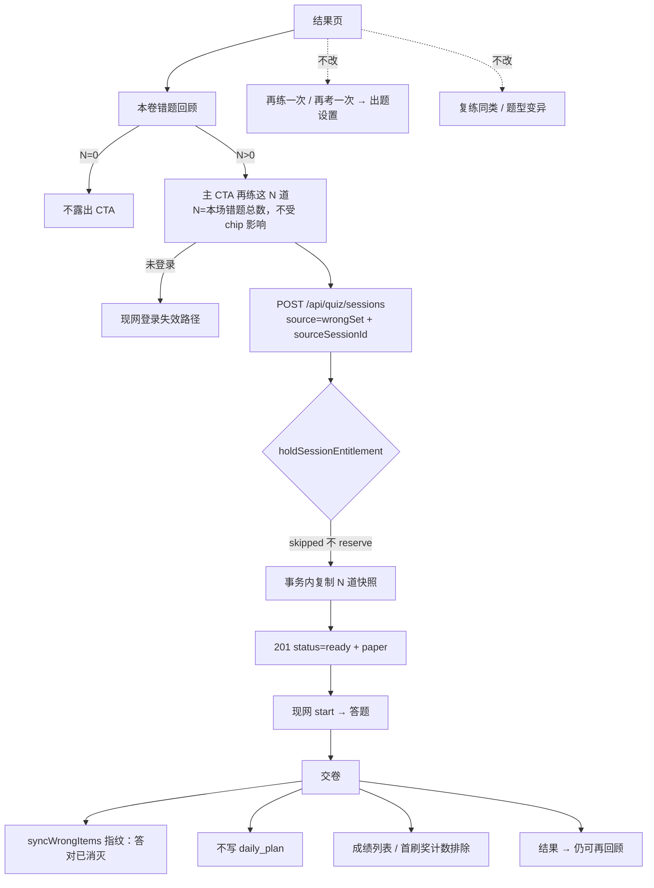

# 题刷刷 · TB-6 本卷 wrongSet 再练 · C 切片契约（v0.1.0-C）

| 项 | 值 |
| --- | --- |
| 性质 | **C 契约已放行**（辉在 Arch 会话亲口确认进入完整交付 + Owner 点名写 C） |
| 放行 | **2026-11-11**（Asia/Shanghai） |
| 开闸依据 | 辉在 **Arch 会话**亲口：「按Arch建议全部采纳，确认进入完整交付」（答复决策卡 **t124s694**，2026-11-11 Asia/Shanghai）。**只写这一条**。禁止把 2026-11-05 Owner 会话「现在已经没有探路的任务，都是可以实施交付的任务了」写成开闸依据或「同义开闸」。 |
| 角色 | 架构师 Arch |
| 阶段 | **C** |
| 切片 | **TB-6** 本卷 wrongSet 再练 |
| 架构版本旁注 | **v0.1.0-C**（本刀在 Arch 侧未另出 B 探路短评估；按正式 PRD + 现网接口 / 既有契约落地） |
| 依据 | 正式 PRD · 本卷 wrongSet 再练（已开C · 2026-11-11）（PSSD md5 `ac0a46a9602e1d8043d0a70223840fbe`，已自校）+ 业务需求 2026-11-05（md5 `0d89bb5ce80f9573be07ce2cf5decdbc`）+ 父 PRD（md5 `e20dd488ab661bf08d3a3e43e5708834`）§6.7 / §10 错题验收 / 决策 7、8 + TB-20 H4 / TB-24 H7 / TB-30 H7 / 复练契约 `docs/contracts/retrain-C-contracts-v0.1.0-C.md` §5.6 |
| 仓 | https://github.com/zh7551069/ai-tishuashua |
| 对照基线 | `origin/main` **`020c5c74405ffa0dd6a6f5401705778ee3d802cd`**（2026-11-11 07:29:32 +08:00 Asia/Shanghai；commit 说明为落地黄绿改版 TB-36～45 / PR **#67 已合**。任务下达时曾提示「#67 仍开放未合」，落笔时以现尖为准，不回退到 `70e85563`。黄绿合入不改变本刀业务接口。） |
| 看板 | `/Volumes/My PSSD/notion_files/题刷刷/board/题刷刷 · 切片交付看板__25bfa529.json`（只读；json md5 落笔时 `ec897fcbb2f092beb89aaa4aed363025`，`local_updated_at=2026-11-11T08:23:14+08:00`；TB-6 状态=架构/设计中，辉确认进C=`__YES__`，开工包齐=`__NO__`） |
| 进仓约定 | 合码 PR 应落到 `docs/contracts/tb6-wrongset-retrain-C-contracts-v0.1.0-C.md`；旁注修订 `docs/quiz.md`（创建会话 / 成绩列表 / 门禁段）与 shared 注释；UI 技术评审（尚未点名）日后落 `docs/delivery/` |
| 本地 arch 副本 | `/Volumes/My PSSD/notion_files/题刷刷/arch/C 契约 · 本卷 wrongSet 再练（TB-6，2026-11-11）.md` |
| 盒子副本 | `/workspace/tishuashua-tb6-wrongset-retrain-C-contracts-v0.1.0-C.md` |
| 契约归属 | 架构师；**全栈不得私改路径 / 字段 / 错误码 / 出卷集合算法 / 不扣场 / 不计入过滤 / 消灭规则 而不申报** |
| 业务对接 | 题刷刷 · 业务组 |
| 合码 | **仅辉当面「合」授权** |
| 写码 | **等 Owner 点全栈**；本文件不授权开工写码、不点名 Cloud Agent |
| UI 开工 | **须先过「UI 技术评审三行留痕」**；未过审禁前端对稿开工 |
| 开工包齐 | **仍否**（本刀只出契约；UI 三行未做） |
| 材料已读 | 正式 PRD（PSSD 权威，md5 已核）+ 业务需求 + 父 PRD 指定章节 + 黄绿「错题回顾（新）」包（`FRAMES.md` §10，md5 `226b07de64b980f1f2f7583d92992d2b`；该组 `index.html` sha256 `7531144e86a6f180e985954e18c6f899869603af47bd782da6ddf5042f1986cc`，正式 PRD 所称「目录哈希」即此值）+ 看板 TB-6 行 + `origin/main` 现网创建/门禁/交卷/成绩列表/错题本代码与既有契约 |

> **放行范围**：本文件为正式 C。在本卷错题回顾露出主 CTA「再练这 N 道」，点击后复用现网 `POST /api/quiz/sessions`、`source=wrongSet`，废除现网 400「错题再练暂未开放」/「暂未开放」，按来源场次快照直接出卷。沿用 TB-20 H4 不扣场、不弹用尽半屏；不计入练习记录与每日计划；消灭规则沿用现网题干指纹「答对即已消灭」。**0 个新业务 endpoint。** 写码仍等 Owner 点全栈；前端须后续 UI 三行；**不合码直至辉当面「合」**。本执行不写业务代码、不拉 Cloud、不改 git、不改导出、不改官方 PRD。

---

## 0. 硬拍板（不可改）

| # | 拍板 | 备注 |
| --- | --- | --- |
| **H1** | **0 新业务 endpoint**。只放开现网 `POST /api/quiz/sessions` 的 `source=wrongSet` 分支。禁止新增 `/api/quiz/wrong-set` 或等价路径 | 正式 PRD §5.2；现网结构足够 |
| **H2** | 废除现网对该 source 的拒绝：不得再返回 `400 VALIDATION_ERROR` 且 message 含「错题再练暂未开放」或等价「暂未开放」 | 现网钉在 `parseCreateQuizSessionRequest` / `quiz-run.ts` |
| **H3** | 请求必填 **`source=wrongSet`**（或既有 `intent` 映射为 source）+ **`sourceSessionId`**（UUID）。出卷集合 **只由服务端**从来源场次计算，**不**接受客户端题 ID 列表 / 知识点 chip 作为出卷范围 | 防 chip 筛进出卷；见 §3 |
| **H4** | **N = 本场错题总数** = 来源场次已交卷试卷中 `review.outcome !== 'correct'` 的题目数（含答错 / 少选 / 未作答）。与现网回顾列表过滤器一致。N **不随**知识点 FilterChip 变化；出卷也是这 N 道，顺序保持来源场次原 `ordinal` 升序 | 正式 PRD 已拍板；现网 `apps/mini/src/pages/score/model.ts` |
| **H5** | 卷面 **复用本场这 N 道题的快照**（题型 / 题干 / 选项 / 答案 / 解析 / 原分值 / KP）。**不走**模型出题、**不走**题库抽题、**不是**复练同类 / 题型变异新题。题目 `source` 记为现网枚举 **`wrong_carry`**。不投递 `JOB_GENERATE_QUIZ` | 「不是同类/变异新题」 |
| **H6** | **不扣场**（沿用 TB-20 **H4**）：`holdSessionEntitlement` 对 `wrongSet` 继续 `skipped`，不调用 `reserve`，账户余额不变。本路径 **不应出现** `402 ENTITLEMENT_EXHAUSTED`。会员 / 非会员都走且都不扣场 | 现网门禁已跳过；本刀保持 |
| **H7** | **不弹用尽半屏**（沿用 TB-24 **H7**）：客户端对 `source=wrongSet` 不预检拦截、不展示用尽半屏 | 现网 `exhausted-sheet.ts` 已跳过；本刀保持并接到真创建成功 |
| **H8** | **不计入练习记录**：会话行 **要写**（否则无法答题→结果→再回顾），但 `GET /api/quiz/sessions` 成绩列表的 `items` 与 `total` **均排除** `source=wrongSet`。不可从练习记录当作一次正式场次回放。本人仍可 `GET /api/quiz/sessions/:id` 走本场闭环 | 正式 PRD §5.4 交由契约钉死「写行后列表过滤」 |
| **H9** | **不计入每日计划**：遵守 TB-30 **H7**（仅 `source=normal` 且 `mode=practice` 计入）。本刀 **不改**日计划契约 / 表 / `GET /api/me/daily-plan`。`recordAfterSubmit` 现网已跳过非 `normal+practice`，须保持 | |
| **H10** | **消灭**：在 wrongSet 卷中 **完全答对**（`outcome=correct`）即按现网 **题干指纹**将对应 `wrong_items` 标为 `cleared`（产品文案「已消灭」，不用「订正」）。答错 / 少选 / 未作答保持或重新变为未消灭（`pending`），并按现网规则累加 `wrong_count`。复用 `syncWrongItems`，**禁止**按会话 ID 做「同源清除」，也 **禁止**为本路径跳过该钩子 | 父 PRD 决策 8；与现网指纹规则一致 |
| **H11** | CTA 文案 **「再练这 N 道」**（完整语义=父 PRD「再练这 N 道错题」）。N>0 才露出；N=0 不渲染。点击后 **直接出卷**，**不回出题设置**，**不进入出题过程态页** | |
| **H12** | **settings 由服务端派生，不回设置页让用户改**。`mode` **固定 `practice`**（「仅作复习演练」）；`timer.enabled=false`（不继承来源场次考试倒计时，正式 PRD 未要求继承限时）；`count=N`（允许 1–50，**不受** `QUIZ_COUNTS` 10/20/30/50 四档限制）；`types`=这 N 道题型并集；`difficulty` 从来源场次 settings 复制，缺省 `medium`（只作记录，不用于抽题）；`packId` 从来源场次复制，包已删则允许 `null`，context 用来源 `pack_snapshot` | 见 §3.3；不另编「必须继承考试模式/限时」 |
| **H13** | 不改复练同类 / 题型变异已合契约，不改结果页「再练一次 / 再考一次」（仍回出题设置） | 正式 PRD 不做项 |
| **H14** | 场次明细（TB-28）只读 `entitlement_ledger`。本路径不写 reserve / ledger 分录，故 **不得作为一次扣场 / 正式场次出现**。禁止为「看起来像一场」而补写分录 | |
| **H15** | 凡以「已交卷会话」计数的 **练习记录 total / 生涯首刷奖 `countSubmitted` / `maybeFirstSubmit`**，均 **排除** `source=wrongSet`，避免复习演练被当成第一份正式成绩 | 现网 `countSubmitted` 未排除，本刀须改 |
| **H16** | 样式权威=黄绿错题回顾包；稿面无该 CTA，**开发加按钮、不改导出**。禁 `design/dev-cache`、MCP `figma-dev-cache`、`get_design_context`。不对稿系统状态栏 9:41。前端对稿 **须后续 UI 三行**后方可开工 | 本刀不做 UI 技术评审全套 |
| **H17** | 创建在同一请求内复制题目并返回 **`status=ready`**（已带 `paper`，未交卷不含答案/解析，与现网 ready 一致）。**跳过** `LLM_NOT_CONFIGURED` 前置检查（本路径不需要模型）。误入队生成任务视为实现缺陷，不得再以「暂未开放」作为产品成功态 | |
| **H18** | 允许以来源为 **上一场 wrongSet** 再次「再练这 N 道」（仍不扣场、仍不计入记录 / 日计划），只要该场已交卷且仍有错题 | 正式 PRD §5.5 |



---

## 1. 范围与硬约束

### 1.1 做

1. 本卷错题回顾（「本卷列表」态；解析展开态若有稳定底栏位置则同样露出）增加主 CTA「再练这 N 道」。
2. 放开 `POST /api/quiz/sessions` `source=wrongSet`：新字段 `sourceSessionId`、派生 settings、快照复制、同步返回 ready。
3. 放宽 / 分支现网校验：`parseCreateQuizSessionRequest`、`AcceptedQuizSessionRequest`、`insertSession` 的 `Exclude<…, 'wrongSet'>`、`QuizSettings.count` 四档限制、创建入口的 `LLM_NOT_CONFIGURED` 前置。
4. `GET /api/quiz/sessions` 与 `countSubmitted`（及首刷奖）排除 `source=wrongSet`。
5. 交卷继续走现网答题 / 结果 / 回顾 / `syncWrongItems`；日计划钩子保持跳过。
6. 客户端：回顾 CTA 接线、创建成功后直接进入答题（不回设置、不进过程态）；用尽半屏继续跳过；失败提示走现网可测路径。
7. 单测 / http 测锁定：放开拒绝、不扣场、不 402、列表过滤、消灭指纹、N 与 chip 无关、递归再练。
8. 合码 PR 写入本契约进仓约定路径，并旁注 `docs/quiz.md`。

### 1.2 不做（严禁）

| 禁项 | 说明 |
| --- | --- |
| 新业务 endpoint | 默认 0；本契约论证现网结构足够，不得偷偷加 |
| 改复练同类 / 题型变异契约或入口 | 已合 #25/#26；`retrain-C-contracts` 除 §5.6 从「一律拒绝」被本刀废止外，其余不变 |
| 改结果页「再练一次 / 再考一次」 | 仍回出题设置 |
| 改 TB-20 四桶 / 扣场序 / 日切；改 TB-30 日计划数据层 | 只遵守 |
| 为 wrongSet 补写 entitlement_ledger 分录 | 不得装成扣场场次 |
| 短信 / 计费 / 会员变更 / 配额 / 支付 / RAG / 后管 | 正式 PRD 不做项 |
| 重做黄绿换皮、模型 AI 点评、弱项复练（TB-5） | 本刀无关 |
| 改已合黄绿导出文件；拉 Dev Mode；点设计师补帧 | 除非后续辉要求 |
| `design/dev-cache` / `figma-dev-cache` / `get_design_context` | 总禁 |
| 对稿系统状态栏 9:41；对稿旧蓝 `#2563EB` | 旧 Figma 31:2 仅历史交互参考 |
| 未点全栈即写业务代码 / 拉 Cloud；未获辉当面「合」即合 main | 总禁 |
| 改官方正式 PRD / 改看板 | 本刀不改；开闸依据差异见 §9 |

### 1.3 与既有契约的正交

| 契约 | 本刀关系 |
| --- | --- |
| **复练** `retrain-C-contracts` §5.6 | 原「wrongSet 一律 400」由本刀废止并改为真链路；§5.4/§5.5 同类/变异与 U4/U5 **不改**。成绩列表原「含 retrain_similar/variant」保持，**另排除 wrongSet**（产品口径与同类/变异不同，已拍板） |
| **TB-20 H4** | 保持跳过 reserve；删除「创建仍 400」的过时描述须在本刀旁注 `docs/quiz.md` / 测试名，不回改 TB-20 已合正文的历史表述 |
| **TB-24 H7** | 保持不弹半屏，接到创建成功 |
| **TB-30 H7 / submit 钩子** | 遵守不计入；不改日计划 API/表 |
| **TB-28** | 不改明细 UI；因无分录故不出现扣场行 |
| **TB-36～45 黄绿** | 回顾页已换皮（现尖已含 PR #67）。本刀只加 CTA，不对稿缺按钮的导出像素全等 |

---

## 2. 现网基线（对照 `origin/main@020c5c74`）

| 点 | 现网行为 | 本刀 |
| --- | --- | --- |
| `POST /api/quiz/sessions` + `source=wrongSet` | `parseCreateQuizSessionRequest` 返回 `ok:false`，`message='错题再练暂未开放'` → `400 VALIDATION_ERROR`。http 测 / entitlement 测按 `/暂未开放/` 断言。Worker `quiz-run.ts` 若接到该 source 亦失败同一文案 | **放开**；删除这两处拒绝 |
| 请求体 | 必填 `packId, count, difficulty, timer, mode`；可选 `source/intent, types, knowledgePointIds, wrongItemId`。**无**来源场次字段。`count` 只允许 10/20/30/50（变异为 1） | 见 §3：wrongSet 以 `sourceSessionId` 为准，放宽四档 |
| 门禁 | `sessionConsumesEntitlement('wrongSet')===false`；`holdSessionEntitlement` 直接 `skipped` | **保持** |
| 用尽半屏 | 客户端 wrongSet 不预检、不弹；但创建仍 400 | 保持不弹，改为创建可成功 |
| 创建流水 | 先查 `LLM_NOT_CONFIGURED`，再 parse，再 `loadPack`，再 reserve，再 `insertSession`（`source` 类型排除 wrongSet，状态 `pending`），再入队 `JOB_GENERATE_QUIZ` | wrongSet：**不**因缺模型 503；**不**入队；事务内复制题目，返回 `ready` |
| 成绩列表 `GET /api/quiz/sessions` | 全部 `status=submitted`，含同类/变异，**未排除** wrongSet（因尚不可创建） | **排除** wrongSet（含 `total`） |
| `countSubmitted` | 统计全部已交卷，供首刷奖 | **排除** wrongSet |
| 日计划 | source 非 normal 或 mode 非 practice 时不写 | **保持** |
| 消灭 | `syncWrongItems` 按 `questionContentKey`（题型+题干+选项+答案）答对 `cleared`，否则 upsert `pending` | **复用**；复制快照才能对上原题指纹 |
| 本卷回顾 | 列表 = `outcome !== 'correct'`；有知识点 chip，只过滤浏览；**无**「再练这 N 道」CTA（#24 隐藏；黄绿稿面亦无） | 加 CTA；N 用未过滤总数 |
| 结果页「再练一次 / 再考一次」 | 回 `/pages/quiz/index` | **不改** |

---

## 3. 接口契约

Base：现网 `/api`。认证：`Authorization: Bearer <微信用户 token>`。错误外壳：现网 `{ "code", "message" }`。本刀 **不新增** `ApiErrorCode`。

### 3.1 `POST /api/quiz/sessions`（`source=wrongSet` 分支）

**0 新路径。** 其它 source 行为不变。

#### 请求字段

| 字段 | 必填 | 规则 |
| --- | --- | --- |
| `source` | 是（或只传 `intent` 且映射为 `wrongSet`） | `wrongSet`。`source` 与 `intent` 冲突仍按现网 400「会话来源不正确」类文案 |
| `sourceSessionId` | **是** | UUID v4。必须是 **当前用户** 的会话，且 `status=submitted`，且按 H4 算出 **N>0** |
| `packId` | 否 | 若传：必须与来源场次 `pack_id` 一致（两边均为 null 视为一致）；不一致 → 400。不作为抽包出题依据 |
| `count` / `difficulty` / `types` / `timer` / `mode` | 否 | **不作出卷依据**，服务端按 H12 覆盖。实现须在 DTO / `parseCreateQuizSessionRequest` 对 wrongSet **放宽**现网必填与四档题量，避免客户端为凑校验去编造 10/20/30/50 |
| `knowledgePointIds` | 否 | **忽略**（防止 chip 筛选被当成出卷范围） |
| `wrongItemId` | 否 | 若传 → 400，`message` 含「wrongItemId 仅用于 variant」（与现网非 variant 规则一致） |
| 客户端题 ID / 快照数组 | **不接受** | 未在现网 DTO 出现的题单字段应忽略或 400；出卷集合只来自 `sourceSessionId` |

推荐最小成功体：

```json
{
  "source": "wrongSet",
  "sourceSessionId": "aaaaaaaa-bbbb-cccc-dddd-eeeeeeeeeeee"
}
```

#### 服务端创建步骤（同一事务）

1. 鉴权失败 → 现网登录失效（`401 UNAUTHORIZED`），不建会话。
2. 解析 source；若为 `wrongSet`：**不要**先走 `LLM_NOT_CONFIGURED` 拒绝。
3. 校验 `sourceSessionId`（见错误表）。加载来源场次试卷与作答结果，按 H4 得 N 道题。
4. `holdSessionEntitlement(..., 'wrongSet', newId)` → 必须 `skipped`；余额不变。
5. `insertSession`：`source='wrongSet'`，`mode='practice'`，settings 按 H12，`question_count=N`，`generated_count=N`，`status='ready'`（或先插入再同事务更新为 ready，对客户端只暴露 ready）。`pack_id` 从来源场次复制（可为 null）。`pack_snapshot` / `context` 从来源场次复制。**持久化** `sourceSessionId`（建议新列 `quiz_sessions.source_session_id UUID NULL REFERENCES quiz_sessions(id) ON DELETE SET NULL`；若不愿加列，须写入该会话可检索的 JSON 上下文，并在评审中标明。不得只放在客户端内存）。
6. 为 N 道题插入新的 `paper_questions`（**新 question id**，内容按 H5 复制，`source='wrong_carry'`，新 `ordinal` 1…N 但稳定对应来源相对顺序）。不写入题库。
7. **不** `enqueue JOB_GENERATE_QUIZ`。提交事务。
8. 返回 `201` + `QuizSessionView`：`source=wrongSet`，`status=ready`，`progress={generated:N,total:N}`，`paper` 已有题目（无标准答案/解析），`settings.count=N`，`settings.mode='practice'`，`settings.timer.enabled=false`。

客户端：创建成功后按现网 ready 会话进入答题（若现网仍须 `POST …/start` 则保持）；**禁止** `navigateTo` 出题设置页或过程态页。

#### 错误码（本路径）

| 条件 | HTTP | code | message（须可测，含下列关键短语；不另编未证实营销文案） |
| --- | --- | --- | --- |
| 未登录 / token 失效 | 401 | `UNAUTHORIZED` | 现网原文，不另编 |
| `sourceSessionId` 缺 / 非 UUID | 400 | `VALIDATION_ERROR` | 请指定来源场次 |
| 来源场次不存在或不属于当前用户 | 404 | `NOT_FOUND` | 来源场次不存在 |
| 来源场次未交卷（含进行中 / 取消 / 失败 / 生成中） | 400 | `VALIDATION_ERROR` | 来源场次尚未交卷，不能再练 |
| 按 H4 计算 N=0 | 400 | `VALIDATION_ERROR` | 没有可再练的错题 |
| `packId` 与来源场次不一致 | 400 | `VALIDATION_ERROR` | 刷题包与来源场次不一致 |
| `wrongItemId` 传入 | 400 | `VALIDATION_ERROR` | wrongItemId 仅用于 variant |
| `source`/`intent` 冲突或非法 | 400 | `VALIDATION_ERROR` | 现网「会话来源不正确」类文案 |
| 其它字段非法 | 400 | `VALIDATION_ERROR` | 现网校验文案 |
| 本路径成功或校验失败 | — | **禁止** `ENTITLEMENT_EXHAUSTED` | 即使账户余量为 0 |
| 本路径 | — | **禁止** 再返回「错题再练暂未开放」/ 等价「暂未开放」 | |
| 本路径 | — | **禁止**因未配置模型返回 `LLM_NOT_CONFIGURED` | |
| 本路径 | — | **默认禁止** `PACK_UNAVAILABLE`：题目来已交卷快照，不因证书下架或刷题包删除拒创建（`pack_id` 可空，ON DELETE SET NULL） | 与「再抽题」路径不同 |

创建失败（非用尽）时，小程序展示现网可测失败提示（接口 `message` 即可），不弹用尽半屏。

### 3.2 既有会话 API（行为增量）

| 方法 | 路径 | 本刀 |
| --- | --- | --- |
| GET | `/api/quiz/sessions/:id` | 本人可读 wrongSet 会话（闭环：答题 / 结果 / 回顾）。未交卷不泄露答案/解析，与现网一致 |
| POST | `/api/quiz/sessions/:id/start` | 不变：`ready`→`in_progress`。wrongSet 为 practice 且 timer 关闭，无考试截止时间 |
| POST | `/api/quiz/sessions/:id/answers` | 不变；练习可改答的现网规则适用（父 PRD 决策 5） |
| POST | `/api/quiz/sessions/:id/submit` | 见 §4.2 / §6。成功后仍可返回结果并再进回顾 |
| POST | `/api/quiz/sessions/:id/cancel` | 现网仅 pending / generating 可取消。本路径创建即为 `ready`，通常已不能取消；保持现网状态机，不另开「ready 可取消」 |
| GET | `/api/quiz/sessions` | **排除** `source=wrongSet`（`items` 与 `total` 一致排除）。同类 / 变异仍计入（复练契约 U5 不改） |

状态机不新增状态。wrongSet 创建后从 `ready` 起跳过 `pending/generating`。旁路 `failed/cancelled` 仍可用在其它 source。

### 3.3 settings 与题量

- 现网 `normalizeQuizRequest` 对普通卷限制题量为 10/20/30/50。wrongSet **不得**走该四档校验，否则 N=3、7、1 等本场错题数无法创建。
- 上限：N∈[1, 50]（现网单场题量上限为 50，变异为 1；递归再练不会超过来源场次题量）。若出现 N>50，视为数据异常，400「没有可再练的错题」或「题量不正确」——实现选定一种并在测试钉死，不得静默截断出卷集合。
- 卷面分值：原样复制快照分值；本场 `context.totalScore` / 成绩 `totalScore` = **本卷题目分值和**，**不要**把 3 道题重新归一化到证书总分。`mode=practice`，`passed` 保持现网练习语义（一般为 `null`）。

---

## 4. 与扣场 / 每日计划 / 练习记录 / 明细的正交

### 4.1 不扣场

- 调用点仍是创建事务内的 `holdSessionEntitlement`。
- 断言：调用前后四桶余额与 `GET /api/me/entitlement` 一致；无新 `entitlement_ledger` 行；不出现 402。
- 会员与非会员、日免已用尽的非会员，均能成功创建。

### 4.2 交卷钩子（「不计入」的服务端实现）

| 钩子 | wrongSet 行为 |
| --- | --- |
| `syncWrongItems`（写/更新 `wrong_items`） | **要跑**（消灭与再次答错依赖它） |
| `DailyPlanService.recordAfterSubmit` | **不写行**（现网条件已排除；加测锁定 `source=wrongSet` 即使 `mode=practice` 也不写） |
| `GET /api/quiz/sessions` / `listScores` | **写了 `quiz_sessions` 行，列表过滤**（WHERE `source <> 'wrongSet'`；窗口计数同步排除，避免占 50 条额度或把 total 算大） |
| `countSubmitted` / `maybeFirstSubmit` / `growth.onFirstSubmit` | **排除** wrongSet，避免首场就是再练时误发首刷奖 |
| entitlement commit/release | 无 reserve 则无对应分录；不得补写 |
| 题库入库 | 复制快照 **不**作为 `BANK_INGEST` 事件 |

「不可当作一次正式场次回放」= 练习记录列表不出现、不能从该列表点进结果。本场刚交卷后的结果页 / 回顾 / 本人按 id 读取 **允许**（闭环需要）。

### 4.3 场次明细

TB-28 只读 ledger。无分录即无扣场行。后管会话查询本刀不做；若后管仍能看到 `source=wrongSet`（现网文案「错题再练」），不得把它统计为扣场次数。

---

## 5. 关键流

```text
结果页
  └─ 进入「错题回顾」（本场有错题）
        ├─ N=0 或无错进入：不露出「再练这 N 道」
        └─ N>0：本卷列表（及有稳定底栏的解析展开态）露出「再练这 N 道」
              │    chip 只过滤列表；CTA 上的 N 与将出的卷始终=未过滤总数
              ├─ 未登录 / token 失效 → 现网登录失效处理；不创建会话
              ├─ 创建失败（非用尽）→ 可测失败提示；不弹用尽半屏；不应出现 402
              └─ 创建成功（source=wrongSet, status=ready）
                    → 直接进入答题（不回出题设置，不进过程态）
                    → 卷面 = 本场全部 N 道错题快照
                    → 交卷 → 结果（不进练习记录、不进日计划、不扣场）
                    → 可再进本卷回顾
                    → 仍有错题则可再次「再练这 N 道」

分流（本刀不改）：
  结果页「再练一次 / 再考一次」→ 仍回出题设置
  复练同类 / 题型变异 → 仍走已合契约
```

客户端计算 CTA 的 N 必须用来源场次回顾列表的 **未过滤** 长度（与 H4 同一集合）。服务端以自己的计算结果为准；若客户端在 N=0 时误击，服务端 400「没有可再练的错题」。

---

## 6. 数据 / 快照 / 消灭

### 6.1 本场错题集合（钉死）

来源场次须已交卷。题目集合 = 其 `paper_questions` 按 `ordinal` 升序，过滤 `outcome ∈ {wrong, partial, unanswered}`（实现上即 `outcome !== 'correct'`，与现网回顾一致）。

不含：本场已完全答对的题；跨卷错题本里其它场次的题；chip 过滤后的子集。

### 6.2 快照字段

每道复制：`type` / `stem` / `options`（含选项 id 与文本）/ `answer` / `analysis` / `score` / `kp_ids`（及展示所需 KP 名称来源，按现网交卷后回填方式，不得丢 KP 导致回顾 chip 空白）。新行新 UUID，不复用 `paper_questions.id`。

消灭指纹 = 现网 `questionContentKey`（题型+题干+选项+答案）。只要快照完整，wrongSet 上答对即可打到原 `wrong_items`。

### 6.3 消灭语义（与父 PRD / 错题本对齐）

- 产品文案统一「已消灭」/「未消灭」（库内状态仍为 `cleared` / `pending`）。不用「订正」。
- **答对即已消灭**（父 PRD 决策 8）：不要求答对 ≥2 次，不以同类复练达标为条件。
- 答错保持未消灭；若此前已消灭又在本卷答错，按现网 `syncWrongItems` 会回到 `pending` 并 `wrong_count+1`（本刀不改这条既有规则）。
- 与变异路径的差异（复练 U4）保持：变异答对 **不会** 按 `wrong_item_id` 同源清除；wrongSet 因为复用原题快照，指纹一致，答对应清除原错题。这是预期，不是冲突。
- 练习/考试原错题已在来源场次交卷时落库；本刀不改变「错题落库存档」规则。

### 6.4 来源场次合法性

- 来源可以是 `normal` / `retrain_similar` / `variant` / `wrongSet` 的已交卷场次（只要 N>0）。
- 来源不得是他人会话。
- 不要求来源场次仍能在练习记录里找到（它可能是上一场已被过滤的 wrongSet）。

---

## 7. UI 约束（本刀不加 UI 评审全套；前端对稿须后续三行）

| 项 | 约束 |
| --- | --- |
| 权威包 | `/Volumes/My PSSD/notion_files/题刷刷/design/小程序（黄绿视觉改版v2.0.0）/错题回顾（新）·黄绿/`（`index.html` + `styles.css` + `svgs/` / `images/`） |
| 帧 | `FRAMES.md` §10：画布 **1808×852**；left **0 本卷列表** / **470 单选解析展开** / **940 多选解析展开** / **1410 判断解析展开** |
| 哈希 | 该组 `index.html` sha256 = `7531144e86a6f180e985954e18c6f899869603af47bd782da6ddf5042f1986cc`（已核；正式 PRD 写作「目录哈希」）。`FRAMES.md` md5 = `226b07de64b980f1f2f7583d92992d2b` |
| 副源 | 仓内 `design/bridge-export/TB-36-45/` 或本机 Bridge；只读 |
| CTA | 稿面 **无**「再练这 N 道」。开发在「本卷列表」增加主 CTA；解析展开态若有稳定底栏位置则同样露出，避免被展开区挤掉 |
| 样式 | 跟黄绿主按钮 / 结果页主按钮 token。加 CTA 除外，不要求与缺按钮的导出像素全等 |
| 导出 | **先不改**已合导出文件，不拉 Dev Mode 定稿，不点设计师补帧（除非后续辉要求） |
| 禁 | `design/dev-cache`、MCP `figma-dev-cache`、`get_design_context`。旧蓝 Figma 31:2 只作历史交互参考，不对稿 `#2563EB`。不对稿系统状态栏 9:41 |
| 文案 | 「再练这 N 道」；N 为阿拉伯数字且等于本场错题总数；不用「订正」 |
| N=0 | 不渲染该 CTA |
| 门禁 | **须 UI 技术评审三行留痕通过后**，前端才可对稿开工。评审日后进 `docs/delivery/`。本契约不代替 UI 三行 |

---

## 8. 门禁

| 项 | 状态 |
| --- | --- |
| 辉确认进 C | **YES**（Arch 会话决策卡 **t124s694**：「按Arch建议全部采纳，确认进入完整交付」） |
| 本契约 v0.1.0-C | **已放行写契约** |
| 开工包齐 | **仍否** |
| 写码 / Cloud | **未开**；等 Owner 点全栈 |
| UI 技术评审三行 | **未做**；前端对稿开工前必过 |
| 合码 | **未合**；仅辉当面「合」 |
| 官方 PRD 开闸句 | 正式 PRD 仍写 2026-11-05 Owner 会话原话，**不是** t124s694。本契约不以该句为开闸依据；**不改 PRD**，请产品经理按本会话收口回写 |
| 广播 / SendToAgent / 发用户 | **本执行助手不做** |

---

## 9. 可测验收

对齐正式 PRD §9；下列为契约可测细化。

### 9.1 硬拍板复核（H · 18）

§0 **H1～H18** 均为可测禁令/规则；实现与 PR 不得违反。抽测优先级 **P0**：H1、H2、H3、H4、H5、H6、H8、H9、H10、H11、H12、H15、H17。

### 9.2 验收场景（A · 12）

1. **A1 CTA 与 N**：本场有 N>0 错题时，回顾可见「再练这 N 道」；切换知识点 FilterChip 后 N 不变，出卷题目集合也不变；列表浏览随 chip 变。
2. **A2 直接出卷**：点击后创建 `source=wrongSet` 会话并进入答题（不回出题设置、不进过程态）；卷面题目=这 N 道快照，题干与来源错题一致，不是同类/变异新题。
3. **A3 放开拒绝**：创建不再返回 400「错题再练暂未开放」或等价「暂未开放」；缺模型环境亦不得 503 `LLM_NOT_CONFIGURED`。
4. **A4 不扣场**：会员与非会员、余量为 0 的非会员，余额不变；无 reserve / ledger 分录；不出现 402；不出现用尽半屏。
5. **A5 不计入记录**：该场不出现在 `GET /api/quiz/sessions` / 练习记录列表；`total` 不含它；不可从练习记录点进该场。交卷后当场结果页可读。
6. **A6 不计入日计划**：交卷后 `GET /api/me/daily-plan` 完成项不因本场增加；`daily_plan_item_completions` 无本场写入。
7. **A7 消灭规则**：wrongSet 卷中答对的原错题变为「已消灭」（`wrong_items.status=cleared`，文案「已消灭」）；答错仍未消灭。不用「订正」。
8. **A8 可再次再练**：仍可从该场结果进本卷回顾；若仍有错题可再次「再练这 N 道」，仍不扣场、仍不计入练习记录/日计划。
9. **A9 分流不被改掉**：结果页「再练一次 / 再考一次」仍回出题设置；复练同类/变异请求体与导航不被本刀改掉。
10. **A10 请求体与错误码**：最小体仅 `source`+`sourceSessionId` 可成功；缺来源场次 / 非本人 / 未交卷 / N=0 分别命中 §3.1 错误表。
11. **A11 对稿**：对稿黄绿回顾页（加 CTA 除外，不要求与缺按钮的导出像素全等）；不对稿 9:41。导出文件 hash 与开工前一致。
12. **A12 范围锁**：0 新业务 endpoint；0 支付/配额/会员变更；无短信/RAG；不重做黄绿换皮或日计划数据层；不做后管；本刀不做模型 AI 点评或弱项复练；PR 不合 main 直至辉当面「合」。

### 9.3 禁项（F · 10）

| # | 禁 | 验法 |
| --- | --- | --- |
| **F1** | 新业务 URL | 路由 diff 无新 `/api/quiz/*` 业务路径 |
| **F2** | 客户端题单决定出卷集合 | 即使误传题 ID/KP，卷面仍是服务端按 H4 的全集 |
| **F3** | 走 LLM / 题库抽题 / 入队生成 | 创建路径无 `JOB_GENERATE_QUIZ`；无新 bank ingest |
| **F4** | 扣场或 402 / 用尽半屏 | 余额与 ledger、客户端半屏 |
| **F5** | 成绩列表或首刷奖计入 wrongSet | `listScores`/`countSubmitted` 断言 |
| **F6** | 改日计划契约或用本场刷完成项 | daily-plan 测 |
| **F7** | 改同类/变异/「再练一次」 | 导航与请求体回归 |
| **F8** | 跳过 `syncWrongItems` 或按会话 ID 同源清除 | 交卷后指纹测 |
| **F9** | 改导出 / Dev Mode / `get_design_context` | 包 hash + PR 说明 |
| **F10** | 把 2026-11-05 Owner 会话句写成开闸依据 | 本文件开闸段只有 t124s694 |

---

## 10. shared / 文档同步清单（合码 PR 用）

1. `packages/shared`：放开 `parseCreateQuizSessionRequest` 对 wrongSet 的拒绝；扩展 `AcceptedQuizSessionRequest` / `CreateQuizSessionRequest`（`sourceSessionId`；wrongSet 不再 Exclude）；`QuizSettings.count` 允许 1–50；注释不再写「wrongSet 创建必须拒绝」。
2. `apps/api`：DTO `ValidateIf`、`QuizService.create` 分支、`insertSession`、成绩列表与 `countSubmitted` 过滤、可选 migration `source_session_id`。
3. `apps/mini`：回顾 CTA、创建接线、跳过设置/过程态与用尽半屏（已跳过则接到成功路径）。
4. 测试：替换「创建仍 400 暂未开放」的旧断言；新增 H/A 锁定。
5. `docs/contracts/tb6-wrongset-retrain-C-contracts-v0.1.0-C.md`；旁注 `docs/quiz.md` 创建/列表/门禁段。
6. UI 三行（后续）：`docs/delivery/tb6-wrongset-retrain-ui-tech-review-….md`。

---

## 11. 开放问题（非阻塞实现选择；下列产品口径已锁，不再重开）

| # | 题 | 状态 |
| --- | --- | --- |
| **E1** | `sourceSessionId` 落列还是 JSON 上下文 | **须可检索持久化**；推荐新列；不堵契约 |
| **E2** | 官方正式 PRD 开闸依据仍写 2026-11-05 Owner 会话原话，未写 t124s694 | **不改 PRD**。请产品经理回写。本契约只认 t124s694 |
| **E3** | 解析展开态底栏是否「稳定」从而三态都露出 CTA | 正式 PRD 已给原则；像素落点交 **UI 三行**，不堵后端 |
| **E4** | 后管会话列表是否过滤 wrongSet | 本刀不做后管；不得计为扣场即可 |
| **E5** | 用户「我」页统计数字若另有聚合源 | 若源是成绩列表，过滤后自然排除；若另有 SQL 须同样排除。发现即对齐，不另开产品口径 |

> 下列产品点 **已于正式 PRD 由 Owner 裁定，本契约不再重开**：N=本场错题总数且不受 chip 影响；直接出卷、`source=wrongSet`、放开现网 400；不占场/不弹用尽半屏；不计入练习记录与日计划；消灭规则与文案「已消灭」；先不加导出、不点设计师补帧；不对稿 9:41；与「再练一次」及复练同类/变异分流。

---

## 12. 阻塞项

| # | 项 | 状态 |
| --- | --- | --- |
| — | 正式 PRD | **已读**，md5 `ac0a46a9602e1d8043d0a70223840fbe` 与 PSSD 权威一致 |
| — | 辉开闸 | **已确认** Arch 会话 **t124s694** |
| — | 现网结构是否必须新 endpoint | **否**（论证见 H1 / §3） |
| — | 写码授权 | **未授权**（等 Owner 点全栈）——**不**算本契约技术阻塞 |
| — | UI 三行 | **未做**；只挡前端对稿，不挡本契约放行 |

**技术阻塞项：0。**

---

## 三行留痕

| 项 | 内容 |
| --- | --- |
| **结论** | **C 契约 v0.1.0-C 已放行文档**：0 新 endpoint；放开 `POST /api/quiz/sessions` `source=wrongSet`；请求体以 `sourceSessionId` 为准、服务端按本场 `outcome !== 'correct'` 复制快照并同步返回 ready；不扣场、列表过滤不计入、日计划不写、答对指纹即已消灭。对照 `origin/main@020c5c74405ffa0dd6a6f5401705778ee3d802cd`。开闸仅 t124s694。 |
| **必改** | ① 废除「错题再练暂未开放」。② 出卷集合禁止由 chip / 客户端题单决定。③ 成绩列表与首刷奖计数必须排除 wrongSet。④ 本路径禁止 402 / reserve / 用尽半屏。⑤ 不入队生成、不因缺模型 503。⑥ 前端须 UI 三行后方可对稿；不改导出。 |
| **建议** | 写码等 Owner 点全栈；先做 UI 三行再对稿 CTA 落点；请产品经理把正式 PRD 开闸依据回写为 t124s694（本刀不改 PRD）；合码仅辉当面「合」。 |

---

*完 · TB-6 本卷 wrongSet 再练 C 契约 v0.1.0-C · 2026-11-11（Asia/Shanghai）· 写码未开 · 未合码 · 未拉 Cloud · 未广播*
