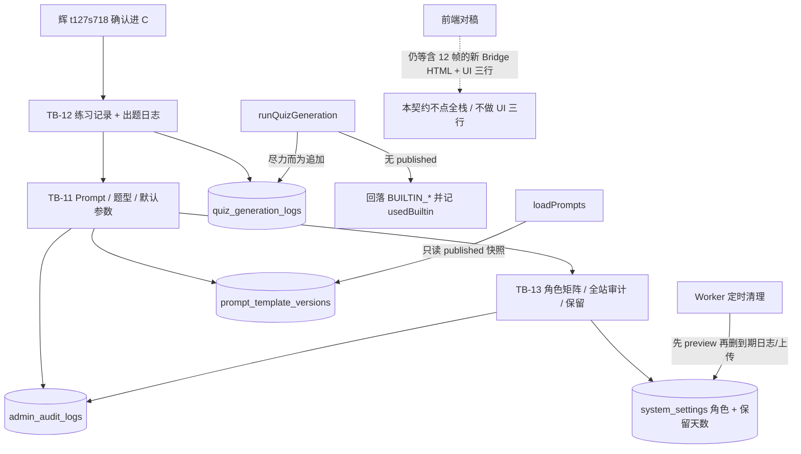

# 题刷刷 · 后管后续页（TB-11 / TB-12 / TB-13）· C 切片契约（v0.1.0-C）

| 项 | 值 |
| --- | --- |
| 性质 | **C 契约已放行**（辉在 Arch 会话亲口确认进入完整交付 + 全采 B 评估 §8） |
| 放行 | **2026-11-11**（Asia/Shanghai） |
| 开闸依据 | 辉在 **Arch 会话**决策卡 **t127s718**（2026-11-11 Asia/Shanghai）亲口原话：「按Arch建议全部采纳，无模板仍回落内置，确认进入完整交付」。**只写这一条**。禁止写成与 2026-11-05 Owner 会话句、业务组「继续后续任务」、看板「辉确认进C」栏或其他会话「同义开闸」。 |
| 角色 | 架构师 Arch |
| 阶段 | **C** |
| 切片 | **TB-11** 出题配置 / **TB-12** 数据查询对稿 / **TB-13** 后管系统 |
| 实施顺序 | **锁定 TB-12 → TB-11 → TB-13**。不另拆切片编号；同号内可分 PR。 |
| 架构版本旁注 | **v0.1.0-C**（相对 B 架构探路短评估 2026-11-11 + 业务需求 2026-11-11 + 后管系统 PRD） |
| 依据 | **尚无单独正式切片 PRD**（2026-11-11 已搜 PSSD `prd/`，无「正式 PRD · 后管后续页 / TB-11 / TB-12 / TB-13」）。本契约以业务需求 · 后管后续页对稿（2026-11-11，md5 `5acd47427c11eb4e6afce04afb295f72`）+ 后管系统 PRD（md5 `e1f7b1359648674f649a14419cbe03f7`，§3、§4.5–4.9、§5、§7.3–7.6、§8、§11、§12）+ B 评估（md5 `cf8dfe6281469ff0c246aaa3cfd5b179`）+ 辉对 B 评估 §8 的全采拍板为准。不编造额外产品约束。上游差异清单（md5 `b4121f99d8c6ba19525110f03f383425`）仅作帧号索引。 |
| 仓 | https://github.com/zh7551069/ai-tishuashua |
| 对照基线 | `origin/main` **`fbb4437463ffe6c848eddab28d2d89ea0c999200`**（Merge PR #68「TB-6 本卷 wrongSet 再练」，commit `2026-11-11T02:01:22Z` = Asia/Shanghai **2026-11-11 10:01**）。与 B 评估对照时的尖相同，**尖未前进**，不改变本契约路径 / 字段 / 错误码。 |
| 看板 | `/Volumes/My PSSD/notion_files/题刷刷/board/题刷刷 · 切片交付看板__25bfa529.json` |
| 进仓约定 | 合码 PR 应落到 `docs/contracts/tishuashua-tb11-13-admin-followup-C-contracts-v0.1.0-C.md`；旁注修订 `docs/quiz.md`（出题消费 published / 内置回落）与 `docs/admin-system-settings.md`（或新建 `docs/admin-prompt-config.md` / `docs/admin-practice-logs.md`）。UI 技术评审（本文件不点名、未做）日后落 `docs/delivery/`。 |
| 本地 arch 副本 | `/Volumes/My PSSD/notion_files/题刷刷/arch/C 契约 · 后管后续页（TB-11、TB-12、TB-13，2026-11-11）.md` |
| 盒子副本 | `/workspace/tishuashua-tb11-13-admin-followup-C-contracts-v0.1.0-C.md` |
| 契约归属 | 架构师；**全栈不得私改路径 / 字段 / 错误码 / 回落内置 / 出题日志表 / 练习记录默认排除 wrongSet / 保留默认天数 / 本期不按角色拒写 而不申报** |
| 业务对接 | 题刷刷 · 业务组 |
| 合码 | **仅辉当面「合」授权** |
| 写码 | **等 Owner 点全栈**；本文件不授权开工写码、不点名 Cloud Agent |
| 前端对稿 / UI 开工 | **须先过「UI 技术评审三行留痕」**，且权威样式源须是**含指定 12 帧**的新后管 Bridge HTML。本任务不做 UI 三行，不拉全栈。现有商业化包不能单独当这三刀样式源（见 §9）。 |
| 开工包齐 | **仍否**（本刀只出契约；指定 12 帧仍缺席；UI 三行未做） |
| 材料已读 | 业务需求（PSSD 与盒上副本 md5 一致）+ 后管系统 PRD（PSSD md5 已核；盒上 `/workspace/admin-c-brief/admin-prd.md` md5 不一致，未采）+ B 评估 + 差异清单 + 设计包 `FRAMES.md`（md5 `b94145d94ae78d11b20bdfad9b362a85`，指定 12 帧 **0/12 缺席**；B 评估「设计包无 FRAMES.md」已过时，本契约以现状为准）+ `origin/main@fbb44374` 现网表结构 / 后管 API / `loadPrompts` / `runQuizGeneration` / 审计与分页惯例 |

> **放行范围**：本文件为正式 C。后管可按本契约在 Owner 点名全栈后，按 TB-12 → TB-11 → TB-13 补练习记录与出题日志只读、出题配置写接口、系统角色矩阵 / 全站审计 / 保留周期。**无 published Prompt 时维持现网回落内置模板，不改成后管 PRD §9「出题失败」。** 不改小程序页面与出题 API 路径。不合码直至辉当面「合」。本执行不写业务代码、不拉 Cloud、不改 git、不做 UI 评审。

---

## 0. 硬拍板（不可改）

辉已全采 B 评估 §8；下列全部写入本契约，不再作为开放问题。

| # | 拍板 | 备注 |
| --- | --- | --- |
| **H1** | **无 published Prompt 时维持现网**：`pickPublishedPrompt` / `pickPublishedVariantPrompt` 选不到时继续回落 `BUILTIN_QUIZ_PROMPT` / `BUILTIN_QUIZ_VARIANT_PROMPT` 出题，**不**改成后管 PRD §9「出题失败、工作台告警」。出题日志必须记录是否回落内置（`usedBuiltin=true`，`templateId` / `templateVersion` 为空或记 `builtin`）。回落内置**不算失败**，不得计入近 7 日出题失败率分子。 | 辉原话含「无模板仍回落内置」 |
| **H2** | **角色方案 A**：登录不改，仍是配置文件一份帐密，该操作者固定为超管。`/system/roles` 展示并可编辑教研 / 运营 / 超管权限矩阵（落 `system_settings`），**本期不按角色拒写**。不做 SSO、不做多帐号。 | 与业务需求「仍用一份独立帐密」一致 |
| **H3** | **出题日志新建追加表** `quiz_generation_logs`。在 `runQuizGeneration` 成功 / 失败各追加一行。**不以**先查 `quiz_sessions` 当验收口径。不回填历史场次的模板版本与耗时。不要把 `/quiz` 改名当出题日志。热路径写入失败**不得阻断出题**（尽力而为）。 | |
| **H4** | **练习记录默认排除** `source=wrongSet`（与 TB-6 / 小程序成绩列表一致）。排障可另加可选筛 `includeWrongSet=true`。`/certificates` 仍可见 wrongSet。不在练习记录页改分。 | |
| **H5** | **保留周期默认 90 天**（出题日志 + 用户上传 / 提炼任务）。后管系统 PRD 只写「可配置」、**未写默认天数**；本值是辉全采下的 **Arch 默认**，不再开放。练习记录与错题**暂不自动删**。Worker 定时清理必须可空跑、可预览范围，禁止误删未到期数据。 | |
| **H6** | `/users` `/wrong-book` `/courseware` **仍只对稿**。不做封禁，不在这三页补导出 / 关键字检索。导出先做在新建的练习记录与出题日志上。 | |
| **H7** | 发布不得原地覆盖唯一已发布行。选定方案见 **§3.2：显式版本历史表** `prompt_template_versions`。回滚语义见该节，写死。 | B 推荐显式历史表 |
| **H8** | 证书题型默认参数落**独立表** `cert_question_type_configs`，禁止塞进证书行 jsonb。启用子集仍由内容配置证书抽屉维护 `certificates.enabled_question_type_codes`（现网已有，本刀不改该写路径，只对稿不重做 TB-10）。默认参数必须独立资源 / 独立页 `/config/cert-types`。 | |
| **H9** | 出题消费路径继续**只读 published**（改 `loadPrompts` 改为读版本历史表中的已发布快照，优先级仍是证书 > 领域 > 全局、同级更高 `version`）。不做「试出题」。不改小程序页面与 `POST/GET /api/quiz/*` 路径。 | |
| **H10** | 发布 / 回滚 / 题型 `enabled`（以及本刀其它关键写，见 §7）必须立刻写入已有 `admin_audit_logs`，不等 TB-13 页面。只读查询不必记。 | |
| **H11** | 题型 `code` 创建后不可改。`enabled=true` 须 `appRendererKey` 已在服务端登记的已支持集合内，与现网 `QUIZ_TYPES` 三套（`single` / `multi` / `judge`）对齐；未发版（未把新 key 写入该集合）不得放开。 | |
| **H12** | 新只读列表分页沿现网多数后管列表：**默认 20、上限 100**、页码默认 1、上限 10_000。禁止把 `GET /api/admin/certificates` 改挂到 `/practice`，禁止放宽 `GET /api/admin/quiz-sessions` 到已交卷。四者不混用。商业化审计 `GET /api/admin/commerce/audit` 的 pageSize 上限 50 **保持不动**。 | |
| **H13** | 导出必须带时间窗（`from`/`to` 必填，跨度 ≤ 31 个自然日，时区 Asia/Shanghai），禁止一次性拉全表；命中行数 > 10_000 时 `400 VALIDATION_ERROR`，要求缩小窗口。用户手机 / openId 按现网后管习惯掩码（见 §5.4）。列表不回传完整 Prompt。 | |
| **H14** | 不把后管帐密放进 `apps/admin` 环境（现网 `.env.example` 已写明，本刀保持）。 | |
| **H15** | 样式权威 = 后管蓝稿，不套小程序黄绿。权威包 `/Volumes/My PSSD/notion_files/题刷刷/design/后管（商业化v2.0.0）/`。指定 12 帧仍缺席，**现有商业化包不能单独当这三刀样式源**。禁 `design/dev-cache`、MCP `figma-dev-cache`、`get_design_context`。探路截图不是开发依据。前端对稿仍等含这 12 帧的新后管 Bridge HTML + UI 三行通过。 | 见 §9 |
| **H16** | 工作台「待发布草稿」「近 7 日出题失败率」随 TB-11 / TB-12 接口给出口径，不单开范围。见 §6。 | |



---

## 1. 范围与硬约束

### 1.1 做

**TB-12（先做）**

1. 新增练习记录只读列表 / 详情 / 导出；数据源 `quiz_sessions WHERE status='submitted'`，默认排除 `source=wrongSet`。
2. 新建 `quiz_generation_logs`；在 `runQuizGeneration` 成功与失败路径尽力追加一行；再提供只读列表 / 详情 / 导出 / 近 7 日失败率统计。
3. `/users` `/wrong-book` `/courseware` 按稿对视觉（只读，不改 API 能力）。
4. 保留现网 `/quiz`、`/certificates` 及对应 API，语义与路径均不改。

**TB-11**

5. Prompt 模板：列表 / 详情 / 草稿保存 / 发布 / 回滚 / 版本列表 / 锁定与解锁。
6. 补 `prompt_templates` 展示名 / code / 锁定；新建 `prompt_template_versions`；迁移回填现网两条已发布种子。
7. 调整 `loadPrompts` / 选取函数：只读已发布快照；返回模板 id+version 供日志使用；选不到仍回落内置。
8. 题型列表 / 创建 / 改 name、enabled、排序、`gradingRuleBrief`（code 不可改；enabled 受 renderer 集合约束）。
9. 证书题型默认参数独立读写页与独立表。
10. 关键写立刻记 `admin_audit_logs`。提供待发布草稿统计给工作台。

**TB-13**

11. 角色矩阵读写（可编辑，本期不按角色拒写）；登录不改。
12. 全站只读审计页 `/system/audit`（复用 `admin_audit_logs`，默认不限 `commerce.` 前缀）。不撤商业化审计页。
13. 盘点并补齐内容配置等关键写的审计（§7）。
14. 保留周期可配（按类）+ 预览 + Worker 清理（默认 90 天，覆盖出题日志与用户上传 / 提炼任务）。
15. `/settings` 题库优先不重做。不做脱敏策略页。

### 1.2 不做（严禁）

| 禁项 | 说明 |
| --- | --- |
| 短信登录、计费、会员配额、RAG、企微/飞书 SSO、多帐号 | 业务需求 / 后管 PRD 不做项 |
| 「试出题」、知识点 weight、日志脱敏策略 | 已拍板不做 / 下版 |
| 改练习分、后管直接改消灭状态、把人工题库当主出题源 | |
| 重做已合的 TB-7 / TB-10 / 商业化后管 / 题库只读 / `/settings` 题库优先 | 除非后续 Arch 书面小修 |
| 用户封禁、在 `/users` `/wrong-book` `/courseware` 补导出或关键字检索 | H6 |
| 把 `/quiz` 改名或把 `GET /api/admin/quiz-sessions` 放宽到已交卷 | |
| 复用或改挂 `GET /api/admin/certificates` 为练习记录 | |
| 以先查 `quiz_sessions` 当出题日志验收口径；回填历史模板版本 / 耗时 | |
| 无 published 时改成出题失败 | 与 PRD §9 冲突处以本契约 H1 为准 |
| 本期按角色矩阵拒写、做 SSO | H2 |
| 自动删除练习记录 / 错题 / 证书成绩 / 题库 | H5 |
| 改小程序页面或出题 API 路径；未发版放开 `QUIZ_TYPES` | |
| 一键复制证书（后管 PRD §7.1，属内容配置，非本三刀默认） | B 评估 §6 |
| `design/dev-cache` / `figma-dev-cache` / `get_design_context`；用现有商业化包假充 12 帧样式源 | |
| 未点全栈即写业务代码 / 拉 Cloud；未获辉当面「合」即合 main | |
| 把帐密写入 `apps/admin` 环境 | |

### 1.3 与既有契约 / 现网的正交

| 对象 | 本刀关系 |
| --- | --- |
| TB-6 | 练习记录默认排除 `wrongSet`；`/certificates` 仍可见。不改再练出卷契约 |
| TB-10 内容配置 | 不重做。启用子集继续走现网 `PUT /api/admin/catalog/certificates/:id` 的 `enabledQuestionTypeCodes`。本刀只补默认参数独立资源，并补目录关键写审计 |
| TB-17 / `/settings` | `freeUserBankFirst` 不重做；本刀补其审计写入 |
| TB-21 / TB-22 商业化审计 | `GET /api/admin/commerce/audit` 保留，默认前缀 `commerce.`、pageSize 上限 50 不改。全站页是另一条路径 |
| 出题运行时 | 继续 `normalizeQuestionScores`、错题入卷 50%、证书下架拒绝出题。本刀不改这些规则，只改 Prompt 选取的数据源与日志埋点 |

---

## 2. 现网基线（对照 `origin/main@fbb44374`）

### 2.1 鉴权、错误外壳、分页

- Base：现网 `/api`。后管写 / 读均需 **Bearer 后管会话**（`AdminSessionGuard`）。微信用户 token → `401 UNAUTHORIZED`。
- 错误体：`{ "code": ApiErrorCode, "message": string }`（现网 `packages/shared/src/errors.ts`）。本刀**不**新造错误码；业务校验统一 `400 VALIDATION_ERROR`，缺资源 `404 NOT_FOUND`，库不可用 `503 DATABASE_UNAVAILABLE`，Redis 缓存失效沿用 `503 REDIS_UNAVAILABLE`（仅已有设置写路径若触及）。
- 列表分页（users / quiz-sessions / certificates / wrong-book / courseware）：`page` 默认 1，`pageSize` 默认 **20**，上限 **100**，页码上限 10_000；响应 `{ items, total, page, pageSize }`。本刀新列表沿此，不沿商业化审计的上限 50。
- 后管登录：`ADMIN_USERNAME` / `ADMIN_PASSWORD` 仅在 API 环境；未配置 → `ADMIN_NOT_CONFIGURED`；代码无默认口令。会话主体只有 `username`，无角色字段。`apps/admin/.env.example` 明确禁止放帐密，本刀保持。

### 2.2 表与消费路径（本刀将扩展，不得破坏现语义）

| 对象 | 现网 |
| --- | --- |
| `prompt_templates` | 字段：`id, scope, scope_ref_id, templates jsonb, variables jsonb, version, status(draft\|published), created_at, updated_at`。**无** name / code / 锁定，**无**历史表，**无**唯一「同一 scope 仅一行 published」约束。种子两条已发布（全局 `44444444-4444-4444-8444-444444444401`、证书级 `…402`）。`templates` 形如 `{ system, user, variant? }`。 |
| `loadPrompts` | `SELECT scope, scope_ref_id, templates, version, status FROM prompt_templates WHERE status='published'` 且 scope 匹配证书 / 领域 / 全局。`pickPublishedPrompt` 按证书 > 领域 > 全局、同级更高 version；选不到由调用方回落 `BUILTIN_*`。当前返回体**不含**模板 id/version，本刀须补（供日志）。 |
| 可注入变量（现网 `buildPromptVariables`） | `domainName, certificateName, totalScore, difficulty, types, count, knowledgePoints, extraConstraint`；变异另有 `originalType, originalStem, originalOptions`。后管 PRD 示例里的 `textbookName` / `mode` / `wrongQuestionSnippets` 等**现网尚未注入**，本期不承诺填充，不得写成已实现。 |
| `question_types` | `code` PK，已种子 `single` / `multi` / `judge`（`app_renderer_key` 同名，`enabled=true`）。无后管 API。App/API 白名单仍是代码常量 `QUIZ_TYPES`。无 `grading_rule_brief` 列。 |
| 证书启用子集 | `certificates.enabled_question_type_codes`，内容配置抽屉已可写。 |
| `quiz_sessions` | 含 `mode, settings, score, pass_snapshot, status, source, pack_id, pack_snapshot, started_at, submitted_at, submit_reason, error_code, error_message, generation_stats, question_count, …`。`generation_stats` 仅 `wrongCarried` / `bankDrawn` / `aiGenerated`。成功出题会清空 `error_*`；重试覆盖同一行；**不落**模板 id/version、**不落**耗时。 |
| `GET /api/admin/quiz-sessions` | **只含未交卷**；`status=submitted` 直接 `400`，文案「已交卷不在出题会话里，请查看证书与成绩」。 |
| `GET /api/admin/certificates` | **只含已交卷**，按交卷时间分页，详情含题目快照，带 `source`（含 wrongSet）。 |
| `admin_audit_logs` | `id bigserial, actor, action, target, before, after, created_at`。商业化配额 / SKU / 增长 / 补发 / 作废已写。`GET /api/admin/commerce/audit` 默认 `actionPrefix=commerce.`。 |
| 内容配置写、`PUT …/freeUserBankFirst` | **现网未写入** `admin_audit_logs`（已核 `admin-catalog.service.ts` 无 audit；`writeFreeUserBankFirst` 只改 `system_settings`）。须在本契约补齐。 |
| `system_settings` | 已有 `freeUserBankFirst` / `dailyFreeSessions` / `refineLifetimeLimitFree` / `growthConfig`。无角色矩阵、无保留天数。 |
| 掩码 | 用户列表：昵称走 `maskAdminNick`，手机只回已脱敏值（`138****8000` 或更短号头两位+末两位），**不返回 openId**。商业化 lookup 的 openId 走 `maskOpenId`（长于 8：头 4 + `…` + 尾 4）。本刀导出与列表沿用这套，不回传全文 openId / 未脱敏手机。 |

### 2.3 现网后管路由（保留 / 只对稿 / 本刀补齐）

占位待补：`/config/prompts` `4:2`+`4:134`、`/config/question-types` `4:243`、`/config/cert-types` `4:390`、`/practice` `4:667`、`/quiz-logs` `9:404`、`/system/roles` `9:998`、`/system/retention` `4:800`、`/system/audit` `4:890`。

已有只读、本期只对稿：`/users` `9:2`、`/wrong-book` `9:197`、`/courseware` `4:542`。

保留：`/quiz`、`/certificates`、`/settings`、登录、内容配置、商业化、题库只读。

---

## 3. 数据模型

下一可用 migration 号（现网最后一号为 `015_quiz_wrongset_source_session.sql`）由实施时顺延，建议 `016_admin_followup_tb12_logs.sql`（TB-12）、`017_admin_followup_tb11_prompts.sql`（TB-11）、`018_admin_followup_tb13_system.sql`（TB-13，可与审计补齐同 PR 或随后）。允许同号内再拆，但表与字段不得偏离本节。

### 3.1 `quiz_generation_logs`（TB-12 新建，追加写入）

| 列 | 类型（概念） | 说明 |
| --- | --- | --- |
| `id` | uuid PK | |
| `session_id` | uuid，可空（FK `quiz_sessions` ON DELETE SET NULL） | 会话已删仍保留日志 |
| `user_id` | uuid 可空 | 用户摘要用 |
| `cert_id` | uuid 可空 | |
| `cert_name` | text 可空 | 写入时快照，避免证书更名丢排障信息 |
| `template_id` | uuid 可空 | 回落内置时为空 |
| `template_version` | int 可空 | 回落内置时为空 |
| `template_code` | text 可空 | 回落内置时记 `builtin` |
| `used_builtin` | boolean NOT NULL | **必填**。回落内置为 true |
| `success` | boolean NOT NULL | |
| `error_code` | text 可空 | 失败时用现网 `ApiErrorCode` 或会话已有 `error_code` |
| `error_message` | text 可空 | 截断至 500 字；不得写 Prompt 全文或密钥 |
| `duration_ms` | int 可空 | `runQuizGeneration` 从 claim 成功到返回的耗时 |
| `request_summary` | jsonb NOT NULL | `{ "count", "types", "difficulty", "mode", "source", "generationStats" }`；不得放完整 Prompt |
| `created_at` | timestamptz NOT NULL DEFAULT now() | |

索引：`(created_at DESC, id DESC)`；`(session_id)`；`(success, created_at DESC)`；`(user_id, created_at DESC)`。

写入规则：

1. 挂在 `runQuizGeneration` 的成功返回（`status='ready'`）与失败返回（`failSession` / 映射异常 / wrongSet 误入队等失败出口）之后，**另开 try/catch**（或同连接但吞掉写失败）。写失败只打服务端日志，**不影响**原 `GenerationOutcome`。
2. 一次尝试一行。会话重试会再追加，不覆盖旧行。
3. `used_builtin` 在选取模板时就算好：走 `BUILTIN_*` 则为 true，即使之后模型失败。
4. 不回填本表上线前的历史场次。
5. wrongSet 真链路不走 `runQuizGeneration`（现网会 fail 若误入队）。正常再练不写本表；若误入队失败，允许写一行失败日志。

### 3.2 Prompt 版本方案（TB-11，选定并写死）

**选定：显式版本历史表 `prompt_template_versions`，禁止原地覆盖已发布快照。**

不采用「只靠多行递增 version、不建历史表」。工作行与已发布快照分离。

#### `prompt_templates` 增列（工作行，身份稳定）

| 列 | 说明 |
| --- | --- |
| `name` | text NOT NULL，展示名。种子回填见下 |
| `code` | text NOT NULL，稳定标识，创建后**不可改**。UNIQUE |
| `locked` | boolean NOT NULL DEFAULT false。锁定后禁止草稿保存 / 发布 / 回滚，须先解锁 |
| `current_published_version` | int 可空。从未发布为空 |
| `updated_by` | text 可空 |

原有 `templates` / `variables` / `version` / `status` 含义收口：

- `templates` / `variables`：**工作草稿**（教研正在改的内容），不是出题消费源。
- `status`：`draft` = 从未成功发布；`published` = 至少有一版已发布快照（即使工作草稿已改脏，只要 `current_published_version` 非空，出题仍读该已发布快照，status 保持 `published`）。
- `version`：与 `current_published_version` 保持一致；从未发布为 `1` 且 status=`draft`（表示「下一版将从 1 起」，或实施时用 0 亦可，但须在 PR 说明并保持种子一致）。**推荐从未发布时 `version=0`、`current_published_version=NULL`，首次发布写入 version=1。** 种子已是 published version=1，回填后保持 1。

`templates` jsonb 继续现网形状，不另拆列：

```json
{ "system": "…", "user": "…", "variant": { "system": "…", "user": "…" } }
```

API 层可同时接受 / 返回 `systemPrompt` / `userPromptTemplate` / `variantPrompt`，映射到上述键。不得丢掉现网可选的 `templates.variant`（变异选取仍认它）。

`variables` 继续为 **text[]**（声明的占位名，不含 `{{ }}`）。

#### `prompt_template_versions`（不可变已发布快照）

| 列 | 说明 |
| --- | --- |
| `id` | uuid PK |
| `template_id` | uuid NOT NULL → `prompt_templates.id` ON DELETE RESTRICT |
| `version` | int NOT NULL，从 1 递增 |
| `templates` | jsonb NOT NULL，发布当时快照 |
| `variables` | jsonb/text[] 发布当时声明 |
| `published_by` | text NOT NULL |
| `published_at` | timestamptz NOT NULL DEFAULT now() |
| UNIQUE (`template_id`, `version`) | |

**禁止 UPDATE / DELETE 已有版本行**（回滚不是改旧行）。

#### 发布语义

1. 校验：`system`/`user` 非空；占位符 `{{name}}` 的 name 必须属于**现网可注入集合**（§2.2 标准 8 个；若该模板声明或正文含 `templates.variant`，另允许变异 3 个）。未知占位 → `400 VALIDATION_ERROR`。声明了但正文未使用的变量：告警可返回，不阻断发布。
2. 若 `locked=true` → `400 VALIDATION_ERROR`（「模板已锁定」）。
3. `newVersion = max(已有版本, 0) + 1`。**INSERT** 新快照，不改旧快照。
4. 更新工作行：`status='published'`，`current_published_version=newVersion`，`version=newVersion`，`updated_by=actor`。工作草稿可保持为刚发布的内容。
5. 同事务写 `admin_audit_logs`，action=`prompt.publish`。

#### 回滚语义（写死）

1. Body：`{ "version": N }`，N 必须是该模板已存在的历史版本。
2. 若锁定 → `400 VALIDATION_ERROR`。若 N 不存在 → `404 NOT_FOUND`。
3. 把版本 N 的 `templates`/`variables` **复制**为新版本 `max+1`（再 INSERT 一行），`published_by=actor`。不删除、不修改版本 N，也不把 `current_published_version` 直接倒回 N（避免「当前指针回跳」造成审计难读）。工作草稿同步覆盖为该快照，status 保持 `published`。
4. 出题下一次 `loadPrompts` 读到的即新的最高 published 快照（内容等于 N）。
5. 同事务写 audit，action=`prompt.rollback`，`before.version` / `after.version` / `rolledBackFrom` 写清。

#### `loadPrompts` 必改（消费仍只读 published）

改为 JOIN `prompt_template_versions`（或等价：只读 `current_published_version` 对应快照），过滤条件与现网相同（scope 匹配 + 该模板确有已发布版本）。选取优先级不变。返回值须带 `id`（工作行 id）、`version`、`code`，供日志使用。选不到仍返回空，由调用方回落内置——**禁止**在此改成抛失败。

#### 种子回填（不得编造业务新约束，只补现网已有两行）

| 现网 id | 回填 code | 回填 name | locked | versions |
| --- | --- | --- | --- | --- |
| `44444444-4444-4444-8444-444444444401` | `gen_global_v1` | 全局出题模板 | false | 将当前 `templates/variables/version=1` 插入 versions |
| `44444444-4444-4444-8444-444444444402` | `gen_cert_teacher_secondary` | 中学教师资格出题模板 | false | 同上 |

code 仅用于后管识别与日志，出题选取仍按 scope 优先级，不按 code 点名。

### 3.3 题型与证书默认参数（TB-11）

`question_types` 增列：

| 列 | 说明 |
| --- | --- |
| `grading_rule_brief` | text NOT NULL。后管展示用说明，算法仍在服务端。种子回填：`single`「全对得分」；`multi`「全对得分，少选得部分分」；`judge`「全对得分」（对应当前判分行为，不新造规则） |
| `updated_at` | timestamptz |
| `updated_by` | text 可空 |

`app_renderer_key` 已支持集合 **本期 = `QUIZ_TYPES`** = `single` / `multi` / `judge`。新增题型可先以 `enabled=false` 登记；`enabled=true` 时若 key 不在该集合 → `400 VALIDATION_ERROR`。把新 key 加入集合属于**后续 App/API 发版**，不在本契约放开。

新建 `cert_question_type_configs`：

| 列 | 说明 |
| --- | --- |
| `certificate_id` | uuid NOT NULL → certificates(id) ON DELETE CASCADE |
| `question_type_code` | text NOT NULL → question_types(code) |
| `default_selected` | boolean NOT NULL DEFAULT false |
| `min_count` / `max_count` | int 可空，≥0；若都有则 min≤max |
| `default_count_share` | numeric 可空，0–1 或百分数——**钉死 0–100 的整数占比**，可空 |
| `score_per_question` | numeric 可空，>0 |
| UNIQUE (`certificate_id`, `question_type_code`) | |

不与 `enabled_question_type_codes` 强行同步删除（证书子集由内容配置维护）。本页写入时：`question_type_code` 必须是全局已存在的题型；**不要求**当时一定已在启用子集内（可先配默认，再由运营在证书抽屉勾选）。出题运行时若未接这些配比字段，本刀**不强制**改组卷算法（后管 PRD 写「选配；无则均分或由模型自定」；现网已有分值归一化）。本刀把字段存下来并提供读写验收即可；若实施时顺手只读这些字段做配比，不得违背「不阻断上架 / 出题后归一化」。

### 3.4 `system_settings` 新键（TB-13）

| key | value 形（钉死） | 默认 |
| --- | --- | --- |
| `adminRoleMatrix` | 见下 | 按后管 PRD §8 的教研 / 运营 / 超管矩阵 |
| `dataRetention` | `{ "quizGenerationLogsDays": 90, "userUploadAndExtractDays": 90 }` | **90 / 90**（辉全采下的 Arch 默认） |

`adminRoleMatrix` 建议形（字段名可在实现时用 camelCase，语义不得少）：

```json
{
  "roles": ["research", "ops", "superadmin"],
  "capabilities": {
    "catalog.domain.write": { "research": "read", "ops": "write", "superadmin": "write" },
    "catalog.certificate.scoring": { "research": "read", "ops": "write", "superadmin": "write" },
    "catalog.knowledge.write": { "research": "write", "ops": "read", "superadmin": "write" },
    "prompt.write": { "research": "write", "ops": "read", "superadmin": "write" },
    "prompt.lock": { "research": "none", "ops": "none", "superadmin": "write" },
    "questionType.write": { "research": "read", "ops": "read", "superadmin": "write" },
    "user.ban": { "research": "none", "ops": "none", "superadmin": "write" },
    "learning.read": { "research": "read", "ops": "read", "superadmin": "read" },
    "roles.write": { "research": "none", "ops": "none", "superadmin": "write" }
  }
}
```

本期验收只要求：GET 能读、PUT 能存、页面能展示并可编辑；**运行时不按该矩阵拒绝任何后管写接口**（唯一操作者视为超管）。`user.ban` 能力仅展示，本刀仍不提供封禁 API。

`dataRetention` 校验：每个天数整数 **1…3650**（禁止 0，避免「立即清空」）。PUT 不得带自动清理练习记录 / 错题的键；出现未知键 → `400 VALIDATION_ERROR`。

---

## 4. 后管 API

共性：均走 `AdminSessionGuard`；微信 token → 401。时间参数为 ISO-8601，服务端按 UTC 存储、列表原样返回 ISO。筛选 UUID 须为合法 UUID，否则 `400 VALIDATION_ERROR`。

### 4.1 TB-12 练习记录

#### `GET /api/admin/practice-records`

Query：

| 参数 | 规则 |
| --- | --- |
| `userId` | 可选 UUID |
| `mode` | 可选 `practice` \| `exam` \| `all`（默认 `all`） |
| `from` / `to` | 可选，按 `submitted_at` 窗（两者只给一个亦可；给了须合法） |
| `includeWrongSet` | 可选 `true` / `false`，默认 **false**（排除 `source=wrongSet`） |
| `page` / `pageSize` | 默认 20，上限 100 |

数据源：`quiz_sessions WHERE status='submitted'`，再加上述筛选。排序：`submitted_at DESC, id DESC`。

列表项（投影，**不含题目快照、不含完整 pack_snapshot / settings 大对象**）：

```json
{
  "id": "…",
  "userId": "…",
  "userNick": "张*三",
  "mode": "exam",
  "source": "normal",
  "score": 86,
  "totalScore": 100,
  "passed": true,
  "durationSeconds": 1234,
  "packId": "…",
  "packName": "…",
  "certId": "…",
  "certName": "…",
  "domainName": "…",
  "startedAt": "…",
  "submittedAt": "…"
}
```

`durationSeconds`：`submitted_at - started_at` 的整秒；任一为空则为 `null`。昵称掩码同 `maskAdminNick`。不改分。分数读 `pass_snapshot` / `score`，对不上则 `score` 可空（与证书页 `scoreReadable` 同思路，可带该布尔）。

响应：`{ items, total, page, pageSize }`。

#### `GET /api/admin/practice-records/:id`

id = 已交卷 `quiz_sessions.id`。未交卷或不存在（或默认规则下的 wrongSet 且未显式请求）→ `404 NOT_FOUND`。详情 = 列表投影 + 结果摘要（correct/wrong/partial/unanswered、accuracy、scoreRate、submitReason）。**不返回题目快照**（题目快照仍只在 `GET /api/admin/certificates/:id`）。wrongSet 仅当 `?includeWrongSet=true` 或详情实现选择：若默认 404，须在文档与列表一致；**钉死：详情默认也对 wrongSet 返回 404，带 `includeWrongSet=true` 才可见**，避免和证书页混用。

#### `GET /api/admin/practice-records/export`

Query：`from`/`to` **必填**，跨度 ≤ 31 个自然日（Asia/Shanghai 日历日）；其它筛选项与列表相同（含默认排除 wrongSet）。命中 > 10_000 行 → `400 VALIDATION_ERROR`（「导出超过 10000 行，请缩小时间窗」）。成功 `200`，`Content-Type: text/csv; charset=utf-8`。列至少含：会话 id、用户 id、脱敏昵称、模式、来源、得分、总分、是否通过、用时秒、包名、证书名、交卷时间。手机 / openId 若导出则必须掩码；默认可不含 openId。

注意：路由须注册在 `/:id` 之前。

### 4.2 TB-12 出题日志

#### `GET /api/admin/quiz-generation-logs`

Query：`userId`、`success`（`true`/`false`/`all`，默认 `all`）、`usedBuiltin`（可选）、`from`/`to`（按 `created_at`）、`errorCode`（可选精确匹配）、`page`/`pageSize`（20/100）。

列表项：§3.1 除大段 message 外的摘要；`errorMessage` 列表可再截到 120 字。**不回传 Prompt 正文**。排序 `created_at DESC, id DESC`。

#### `GET /api/admin/quiz-generation-logs/:id`

详情 = 全行摘要 + `requestSummary` + 完整（已截 500 字）`errorMessage`。若实现想附模板片段：只允许 `promptExcerpt`，最大 **2000** 字，并设 `promptTruncated: boolean`。默认**可以不附**；列表禁止附。不得返回 LLM Key 或系统环境。

#### `GET /api/admin/quiz-generation-logs/export`

与练习记录相同的时间窗 / 1 万行上限规则。CSV 含会话 id、用户 id、脱敏昵称、证书名、templateCode、templateVersion、usedBuiltin、success、errorCode、durationMs、createdAt。不含 Prompt 正文。

#### `GET /api/admin/quiz-generation-logs/stats`

Query：`days` 默认 7，只允许 1–31。

```json
{
  "days": 7,
  "since": "2026-11-04T16:00:00.000Z",
  "attemptCount": 40,
  "failureCount": 4,
  "failureRate": 0.1,
  "builtinFallbackCount": 6
}
```

口径见 §6。无数据时 `attemptCount=0`，`failureRate=null`（工作台可显示「—」）。

### 4.3 TB-11 Prompt

前缀 `/api/admin/prompt-templates`。

| 方法 | 路径 | 说明 |
| --- | --- | --- |
| GET | `/` | 列表。筛 `scope`、`status`（`draft`/`published`/`all`）、`q`（name/code 包含，可选）。分页 20/100。列表**不回传** `templates` 正文，只回 id/code/name/scope/scopeRefId/status/version/locked/updatedAt/hasDirtyDraft |
| GET | `/:id` | 详情，含工作草稿 `templates`/`variables`、当前已发布版本号、`hasDirtyDraft` |
| GET | `/:id/versions` | 历史版本列表（version、publishedAt、publishedBy），**默认不回**全文；`?includeBody=true` 才返回该版 templates（仍走后管鉴权） |
| GET | `/stats` | `{ neverPublishedCount, dirtyDraftCount, publishedCount, pendingDraftCount }`。`pendingDraftCount` = 从未发布 + 已发布但工作草稿与当前快照不同，供工作台「待发布草稿」 |
| POST | `/` | 创建草稿。必填 name、code、scope；certificate/domain 须 `scopeRefId`；global 的 scopeRefId 必须空。初始 status=`draft`，version=0 |
| PUT | `/:id` | 保存草稿（name、templates、variables、scopeRefId 在仍为 draft 且从未发布时可改 scope 绑定；**code 不可改**；已发布后 scope / scopeRefId 也不可改）。锁定中拒绝。不改变已发布快照 |
| POST | `/:id/publish` | 见 §3.2。201 或 200 + 新 version |
| POST | `/:id/rollback` | Body `{ "version": N }`。见 §3.2 |
| POST | `/:id/lock` | `locked=true`，audit `prompt.lock` |
| POST | `/:id/unlock` | `locked=false`，audit `prompt.unlock` |

`hasDirtyDraft`：工作行 `templates`/`variables` 与 `current_published_version` 快照不完全相同；从未发布则为 true。

路由注意：`/stats` 须在 `/:id` 前注册。

### 4.4 TB-11 题型

| 方法 | 路径 | 说明 |
| --- | --- | --- |
| GET | `/api/admin/question-types` | 全部题型（含未启用），按 `sortOrder`、code。附 `appRendererKey`、是否在已支持集合内 `rendererSupported` |
| POST | `/api/admin/question-types` | 创建。必填 code、name、optionStructure、appRendererKey、gradingRuleBrief；`enabled` 默认 false。code 一经写入不可改。若创建时 `enabled=true` 且 renderer 不在集合内 → 400 |
| PUT | `/api/admin/question-types/:code` | 可改 name、enabled、sortOrder、gradingRuleBrief、optionStructure。Body 出现 `code` 且与路径不一致 → 400。将 enabled 从 false→true 必须 renderer 已支持，并立刻写 audit `questionType.enable`（true→false 写 `questionType.disable`） |

### 4.5 TB-11 证书题型默认参数

| 方法 | 路径 | 说明 |
| --- | --- | --- |
| GET | `/api/admin/certificates/:certificateId/question-type-configs` | 该证书已配置的默认参数列表；可同时只读带回证书 `enabledQuestionTypeCodes`（便于对照，但不在本接口改子集） |
| PUT | `/api/admin/certificates/:certificateId/question-type-configs` | **全量替换**该证书的配置数组。校验见 §3.3。audit `certTypeConfig.update`。证书不存在 → 404 |

不提供在本路径改 `enabledQuestionTypeCodes` 的写接口。

### 4.6 TB-13 角色 / 审计 / 保留

| 方法 | 路径 | 说明 |
| --- | --- | --- |
| GET | `/api/admin/system/roles` | 返回矩阵 + `updatedAt` / `updatedBy`。无行则 200 返回默认矩阵（可不先 INSERT） |
| PUT | `/api/admin/system/roles` | 全量替换矩阵；未知能力键或非法枚举（须是 `read`/`write`/`none`）→ 400。写 audit `system.roles.update`。**不改变登录，不按矩阵拒写** |
| GET | `/api/admin/system/audit` | 只读 `admin_audit_logs`。Query：`page`/`pageSize`（默认 20、上限 **100**）、`actor`、`actionPrefix`（**默认空=全部**，可传 `commerce.` / `catalog.` / `prompt.` / `questionType.` / `system.` 等）、`from`/`to`。不提供删除 / 改写。不撤 `GET /api/admin/commerce/audit` |
| GET | `/api/admin/system/retention` | 返回两类天数 + 更新信息 + 文案说明「练习记录与错题暂不自动删除」 |
| PUT | `/api/admin/system/retention` | 只接受两类天数。audit `system.retention.update` |
| POST | `/api/admin/system/retention/preview` | 按当前（或请求里临时给出的）天数预览将删范围：**只计不删**。返回 `{ quizGenerationLogs: { count, oldestAt, newestAt }, userUploads: { count, oldestAt, newestAt }, extractJobs: { count } }`。到期定义：`created_at < now() - days`（不含等于截止瞬时的行，避免边界误删；实施须单测锁住） |

Worker：定时任务（建议每日 Asia/Shanghai 03:00，具体钟点可在实现说明）调用与 preview **同一选择器**。支持空跑（count=0 仍成功）。先写一条服务端预览日志（或 audit actor=`worker`，action=`system.retention.purge`，after 含 counts），再删除。删除范围仅：

- `quiz_generation_logs` 到期行；
- 到期的 `user_uploads`（及其级联 `extract_jobs`，因现网 `extract_jobs.upload_id` 外键 ON DELETE CASCADE）。

**禁止**删除 `quiz_sessions` / `paper_questions` / `wrong_items` / `question_bank` / 证书成绩 / 官方教材知识点（即使用户上传曾提炼出带 `owner_user_id` 的教材 / KP，本刀也不自动删这些行）。禁止在 preview 之外「偷偷全表 delete」。

不提供把练习记录纳入自动删除的开关。

### 4.7 新 endpoint 清单（方法 + 路径）

实施顺序仍是 TB-12 → TB-11 → TB-13。下列均为**本刀新增**（相对 `fbb44374`）。

**TB-12**

- `GET /api/admin/practice-records`
- `GET /api/admin/practice-records/export`
- `GET /api/admin/practice-records/:id`
- `GET /api/admin/quiz-generation-logs`
- `GET /api/admin/quiz-generation-logs/export`
- `GET /api/admin/quiz-generation-logs/stats`
- `GET /api/admin/quiz-generation-logs/:id`

**TB-11**

- `GET /api/admin/prompt-templates`
- `GET /api/admin/prompt-templates/stats`
- `POST /api/admin/prompt-templates`
- `GET /api/admin/prompt-templates/:id`
- `PUT /api/admin/prompt-templates/:id`
- `GET /api/admin/prompt-templates/:id/versions`
- `POST /api/admin/prompt-templates/:id/publish`
- `POST /api/admin/prompt-templates/:id/rollback`
- `POST /api/admin/prompt-templates/:id/lock`
- `POST /api/admin/prompt-templates/:id/unlock`
- `GET /api/admin/question-types`
- `POST /api/admin/question-types`
- `PUT /api/admin/question-types/:code`
- `GET /api/admin/certificates/:certificateId/question-type-configs`
- `PUT /api/admin/certificates/:certificateId/question-type-configs`

**TB-13**

- `GET /api/admin/system/roles`
- `PUT /api/admin/system/roles`
- `GET /api/admin/system/audit`
- `GET /api/admin/system/retention`
- `PUT /api/admin/system/retention`
- `POST /api/admin/system/retention/preview`

不改登录接口。不改 `GET/PUT /api/admin/system-settings/freeUserBankFirst` 的路径与语义，只补审计。

---

## 5. 非功能

### 5.1 权限

现网后管 token = 全权限。TB-13 落地矩阵后仍是一份帐密，**不要假装已按教研 / 运营分流**。验收须写明：即使把矩阵改成「运营不可改 Prompt」，当前登录者仍可发布（直至将来允许多帐号并经辉改口）。

### 5.2 审计

关键写必须落 `admin_audit_logs`（actor=后管 username 或 worker）。只读不必记。action 前缀约定见 §7。发布 / 回滚 / 题型 enabled 在 TB-11 即开始写，不等系统页。

### 5.3 保留与导出

清理必须可预览、可空跑，禁止误删未到期与未纳入范围的数据。导出必须限窗，禁止全表一次性拉取。

### 5.4 安全与掩码

- 帐密不上 `apps/admin`。
- 手机：现网 `138****8000`（11 位）或头 2 + `****` + 尾 2。
- openId：现网 `maskOpenId`；列表默认不返回；若详情 / 导出需要，必须掩码。
- 列表不回传完整 Prompt；详情 excerpt 上限见 §4.2。
- 出题日志写入失败不得让出题失败。

### 5.5 兼容

不改小程序接口；不把 `QUIZ_TYPES` 在未发版时放开。`loadPrompts` 的优先级与内置回落必须保持。

---

## 6. 工作台口径（不单开范围）

随已有工作台 `/` 接入即可，不另开切片。

| 指标 | 口径 |
| --- | --- |
| 待发布草稿 | `GET /api/admin/prompt-templates/stats` 的 `pendingDraftCount` = 从未发布的工作行 + 已发布但工作草稿与当前已发布快照不同的模板。不是「证书未发布项」。无数据可以是 0，不再显示「—」（接口上线后）。 |
| 近 7 日出题失败率 | `GET /api/admin/quiz-generation-logs/stats?days=7`。分母 = 新日志表在接上之日起、统计窗内的出题**尝试**行（`attemptCount`）。分子 = `success=false`。**回落内置不算失败**（这些行 `success` 仍按真正出题结果计；只要模型/组卷成功，`usedBuiltin=true` 仍是成功）。窗口从日志表有数据起才有意义；无尝试时失败率为空，工作台可继续显示「—」。 |

---

## 7. 审计补齐清单

表仍是 `admin_audit_logs`，不另起表。可随各切片 PR 挂钩。

### 7.1 现网已落（保持）

| action 前缀 / 例 | 来源 |
| --- | --- |
| `commerce.quota.update` / `commerce.growth.update` / `commerce.sku.*` | TB-21 |
| `commerce.entitlement.grant` / `commerce.entitlement.revoke*` | TB-22 |

### 7.2 现网缺、必须补（建议挂 TB-13，也可提前随触及该写路径的 PR）

内容配置（`AdminCatalogController` 全部写，现网服务层无 audit）：

| action | 触发 |
| --- | --- |
| `catalog.domain.create` / `.update` / `.delete` | 领域新建 / 改（含上下架） / 删 |
| `catalog.certificate.create` / `.update` / `.delete` | 证书；`update` 须能看出上下架与 `enabledQuestionTypeCodes` 前后摘要 |
| `catalog.textbook.create` / `.update` / `.delete` / `.link` / `.unlink` | 教材 |
| `catalog.knowledge.create` / `.update` / `.delete` | 知识点 / 分组 |

系统设置（已有写路径，无 audit）：

| action | 触发 |
| --- | --- |
| `system.freeUserBankFirst.update` | 现网 `PUT /api/admin/system-settings/freeUserBankFirst` |

只读的题库 / 用户 / 错题 / 课件 / 出题会话 / 证书成绩 / 订单列表不必补。

### 7.3 本刀新写（随 TB-11 / TB-13 当时落地）

| action | 触发 |
| --- | --- |
| `prompt.create` / `prompt.update` / `prompt.publish` / `prompt.rollback` / `prompt.lock` / `prompt.unlock` | TB-11 |
| `questionType.create` / `questionType.update` / `questionType.enable` / `questionType.disable` | TB-11；enabled 变化必须用 enable/disable（可同时写 update） |
| `certTypeConfig.update` | TB-11 |
| `system.roles.update` / `system.retention.update` / `system.retention.purge` | TB-13；purge 可为 worker |

`target` 建议：`prompt:<code-or-id>`、`questionType:<code>`、`certificate:<id>`、`setting:dataRetention` 等。`before`/`after` 为 jsonb 摘要，Prompt 审计**不要把完整长模板各写一份超大正文**；可存 name/code/version 与正文哈希或前 200 字摘要。

---

## 8. 可测验收

### 8.1 TB-12

1. `GET /api/admin/practice-records` 只出现 `status='submitted'` 且默认无 `source=wrongSet` 的行；`includeWrongSet=true` 可见 wrongSet；用时 = started_at 到 submitted_at。
2. 该列表改不了分（无写接口）。不得通过改挂 certificates 或放宽 quiz-sessions 实现。
3. `GET /api/admin/quiz-sessions?status=submitted` 仍 400，文案仍指向证书与成绩。
4. 出题成功 / 失败（含 LLM 失败、无 KP 等现网失败出口）各在 `quiz_generation_logs` 追加一行，含模板 id+version 或 `usedBuiltin=true`、耗时、失败码、requestSummary。
5. 人为让日志 INSERT 失败（测中 mock），出题结果仍成功或仍按原失败码失败，**不**被日志错误改写。
6. 上线前的历史场次没有「补出来的」模板版本 / 耗时行。
7. 导出无 `from`/`to` → 400；跨度 32 日 → 400；窗口内 >10000 行 → 400。CSV 手机 / openId 若出现则已掩码，且无 Prompt 全文。
8. 分页默认 20、pageSize=101 → 400，pageSize=100 可通过。
9. `/users` `/wrong-book` `/courseware` 仍无封禁 / 无新导出接口；视觉对稿不作为本契约后端验收（前端等 UI 三行）。
10. stats：分母为尝试次数；纯回落内置且出题成功的行不计入失败分子。

### 8.2 TB-11

1. 可创建草稿、校验未知 `{{foo}}` 时发布 400、发布后 `loadPrompts` 读到新快照；再保存草稿不改变出题所用版本，直到再次发布。
2. 发布写入 `prompt_template_versions` 新行，旧 version 行内容不变；工作表不是「唯一已发布行被原地改掉且无快照」。
3. 回滚到 version N：新增 N' = max+1，内容等于 N；出题读到 N 的内容；audit 有 rollback。
4. 无 published（该证书 / 领域 / 全局都没有已发布快照，或测中清空可选范围）时出题仍成功走内置，日志 `usedBuiltin=true`，不是 PRD §9 的失败。
5. 锁定后保存 / 发布 / 回滚 400；解锁后可写；lock/unlock 有 audit。
6. 题型 code 创建后 PUT 改 code 400；`enabled=true` 且 `appRendererKey='fill'`（或其他未登记 key）400；三套已支持 key 可启用，audit 有 enable。
7. 默认参数 PUT 进独立表，证书行 jsonb 不因此出现这些字段；内容配置仍只维护启用子集。
8. 发布 / 回滚 / enabled 当时即可在 `admin_audit_logs` 查到，不必等系统页。
9. 不提供试出题接口。小程序出题路径不变。

### 8.3 TB-13

1. 登录流程、环境变量帐密、会话字段与现网一致；无 SSO、无第二帐号。
2. GET/PUT `/api/admin/system/roles` 可读写矩阵；把运营改成不可写 Prompt 后，同一登录者仍能发布模板（本期不按角色拒写）。
3. `GET /api/admin/system/audit` 无前缀时能看到 `commerce.*` 与本刀 / 目录补齐后的非商业化记录；`actionPrefix=commerce.` 可筛回商业化子集。`GET /api/admin/commerce/audit` 仍在且默认仍是 `commerce.`。
4. 内容配置一次上下架或改及格线后，全站审计页能查到对应 `catalog.*`（补齐清单落地后验收）。
5. 保留默认 90/90；preview 只计不删；把天数改为 3650 后，未到期日志仍在；空库 preview count=0 成功。Worker 跑一次不删未到期行，到期日志与上传被删，练习记录 / 错题仍在。
6. `/settings` 题库优先仍可用，本刀无脱敏策略页。

### 8.4 前端（须 UI 三行之后，本文件不点名开工）

指定 12 帧的页面不再是「还没有接口」的占位：出题配置三页可配，练习记录 / 出题日志可筛可导出，系统三页可用。视觉对齐后管蓝稿，不对稿系统状态栏 9:41。在新 Bridge HTML 未交付前，不得以现有 8 个商业化桌面稿冒充这 12 帧验收像素。

---

## 9. UI / 样式源（本任务不做评审）

- 权威包：`/Volumes/My PSSD/notion_files/题刷刷/design/后管（商业化v2.0.0）/`（`index.html` + `styles.css` + `svgs/` / `images/`）。
- `FRAMES.md` **已经在包内**（写入时间 2026-11-11 10:20:21 CST Asia/Shanghai，md5 `b94145d94ae78d11b20bdfad9b362a85`）。B 评估「设计包无 FRAMES.md」过时，不得照抄。
- 指定 12 帧在该包 HTML 中 **0/12 缺席**（仅侧栏导航文案，侧栏文案不算覆盖）。这 12 帧是：TB-11 `4:2` / `4:134` / `4:243` / `4:390`；TB-12 `9:2` / `9:197` / `4:542` / `4:667` / `9:404`；TB-13 `4:800` / `4:890` / `9:998`。
- **现有商业化包不能单独当这三刀样式源。** UI 三行 / 对稿 / 前端开工仍等含上述 12 帧顶层稿的**新后管 Bridge HTML**（新目录，不要改现有商业化包）。探路截图不是开发依据。
- 禁 `design/dev-cache`、MCP `figma-dev-cache`、`get_design_context`。fileKey `6WcuXxnHh0Es0jUMsu7q4b` 仅索引。
- 后管蓝稿主色 `#2563EB`，不套小程序黄绿。
- 本契约不代替 UI 技术评审三行留痕。

---

## 10. 开放问题（均不阻塞本契约）

| # | 项 | 说明 |
| --- | --- | --- |
| O1 | 正式切片 PRD | 尚未找到。本契约已声明以业务需求 + 后管系统 PRD + B 评估 + 辉拍板为准。若 Owner 后补正式 PRD，冲突处须变更条，不得默默改本硬拍板。 |
| O2 | 出题运行时是否读取 `cert_question_type_configs` 做配比 | 本刀以存清 / 可读写为验收；不强制改组卷。若要改组卷须另申报，且遵守「出题后归一化、不阻断上架」。 |
| O3 | 商业化审计 pageSize 上限 50 vs 新列表 100 | 不改商业化页。全站审计用 20/100。非冲突。 |
| O4 | 12 帧 Bridge HTML | **阻塞前端对稿与 UI 三行，不阻塞本后端契约。** |
| O5 | 后管 PRD §9「无 published 则出题失败」 | 已被辉全采的 H1 覆盖，不是开放问题。 |
| O6 | CSV 列的精确中文表头 | 工程细化，只要必含字段与掩码满足 §4 即可。 |

与现网的必要改动（`loadPrompts` 改读历史表并返回 id/version、出题热路径尽力写日志、目录写补审计）是本契约范围内的对齐，不是未决冲突。

---

## 11. shared / 文档同步清单（合码 PR）

1. shared：`loadPrompts` / `pickPublishedPrompt` 返回 id+version+code；日志写入 helper；保留天数选择器与 preview 纯函数。**勿**把 Node SQL 经 browser barrel 导出。
2. 旁注 `docs/quiz.md`：published 快照 + 内置回落仍生效，并增加日志尽力而为。
3. 进仓路径见文首。本文件先落本地 arch / 盒子，不在本任务写入 git。

---

## 12. 落盘

| 副本 | 路径 |
| --- | --- |
| 盒子 | `/workspace/tishuashua-tb11-13-admin-followup-C-contracts-v0.1.0-C.md` |
| PSSD 权威 | `/Volumes/My PSSD/notion_files/题刷刷/arch/C 契约 · 后管后续页（TB-11、TB-12、TB-13，2026-11-11）.md` |

两份字节级一致；全文 md5 以落盘后两份 `md5sum` 实测为准，必须完全相同。版本 **v0.1.0-C**。对照基线 `fbb4437463ffe6c848eddab28d2d89ea0c999200`。进仓约定路径：`docs/contracts/tishuashua-tb11-13-admin-followup-C-contracts-v0.1.0-C.md`（待合码 PR，本任务不改仓）。

---

*完 · 题刷刷 · 后管后续页 TB-11 / TB-12 / TB-13 · C 契约 v0.1.0-C · 2026-11-11（Asia/Shanghai）· 开闸仅 t127s718 辉原话 · 尚无单独正式切片 PRD · 写码等 Owner 点全栈 · 合码仅辉当面「合」 · UI 三行仍等含指定 12 帧的新后管 Bridge HTML*
